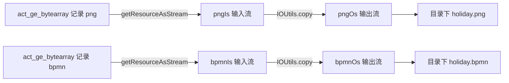

# QueryBpmnFile 逐段精读：两个输入流、两个输出流与一次 copy

十步拆解在纸上走通了，落到代码里是一个百行不到的 main 方法。行数不多，坑却集中在两处：两个取资源名的方法长得几乎一样，`getResourceAsStream` 的两个参数顺序容易倒。把课程工程里的真实实现逐段过一遍，这两处自然就记牢了。

## 先给结论

- 前六步铺垫只产出三个值：部署 ID、png 资源名、bpmn 资源名。
- 输入流由 `getResourceAsStream(deploymentId, resourceName)` 产生，png 与 bpmn 各取一次。
- 输出流用 `new FileOutputStream(目录 + 资源名)` 构建，文件名沿用库里的名字，原来叫什么落盘就叫什么。
- 输入流转输出流交给 `commons-io` 的 `IOUtils.copy`，工程依赖版本 2.0，导入路径 `org.apache.commons.io.IOUtils`。
- 四个流都要关，方法签名声明 `throws IOException`。

## 一、前置六步：只为拿到三个值

```java
//1.得到ProcessEngine对象
ProcessEngine processEngine = ProcessEngines.getDefaultProcessEngine();

//2.得到RepositoryService对象
RepositoryService repositoryService = processEngine.getRepositoryService();

//3.得到查询器:ProcessDefinitionQuery对象
ProcessDefinitionQuery processDefinitionQuery = repositoryService.createProcessDefinitionQuery();

//4.设置查询条件，参数是流程定义的key
processDefinitionQuery.processDefinitionKey("holiday");

//5.执行查询操作，查询出想要的流程定义
ProcessDefinition processDefinition = processDefinitionQuery.singleResult();

//6.通过流程定义信息，得到部署ID
String deploymentId = processDefinition.getDeploymentId();
```

**第一，`singleResult()` 成立有前提。** 课程库里当时只部署了一套请假流程，按 key 查出的流程定义唯一，所以敢用 `singleResult()` 一次拿到对象。一旦同一个 key 部署过多个版本，这个查询会返回多条，查询器直接抛异常而不是挑一条给你，那时要改成按版本号降序再取最新一条。

**第二，变量名就是后续步骤的参数清单。** 走完这六行，手里有 `deploymentId` 加流程定义对象，png 与 bpmn 的资源名都挂在对象上，随用随取。这背后有个便利点：流程定义对象是查询的产物，拿到它就等于拿到了部署阶段写入的全部元信息，不需要再回头查部署表。工程里常见的稳妥写法是把这几个值先打到控制台核对一遍，确认部署 ID 与资源名和库里一致，后面的流操作才有把握。

## 二、getResourceAsStream：两个输入流

```java
//7.通过repositoryService的方法，实现读取图片信息及bpmn文件信息(输入流)
//getResourceAsStream()方法的参数说明：第一个参数部署id,第二个参数代表资源名称
//processDefinition.getDiagramResourceName() 代表获取png图片资源的名称
//processDefinition.getResourceName() 代表获取bpmn文件的名称
InputStream pngIs = repositoryService
        .getResourceAsStream(deploymentId, processDefinition.getDiagramResourceName());
InputStream bpmnIs = repositoryService
        .getResourceAsStream(deploymentId, processDefinition.getResourceName());
```

**第一，两个参数各管一层定位。** 部署 ID 锁定是哪一次部署，资源名在该部署的多条资源记录里精确到具体文件。png 的资源名取自 `getDiagramResourceName()`，bpmn 的资源名取自 `getResourceName()`，名字本身存在 `act_ge_bytearray` 的 `NAME_` 字段里。

**第二，两个 getter 的分工要死记下来。** Diagram 指流程图，对应 png；不带 Diagram 的指流程文件本体，对应 bpmn。用反了代码不报错，流照常返回，只是拿错了文件，这个错误要到打开文件时才暴露。从表的角度再看这两行代码：getResourceAsStream 的底层就是把 act_ge_bytearray 里对应记录的字节字段读出来包成流，流里装的是部署当时的原始字节，与上传的文件逐位一致，引擎不做任何格式转换，png 进去什么样，读出来还是什么样。

## 三、输出流：名字沿用库里的

```java
//8.构建出OutputStream流
OutputStream pngOs =
        new FileOutputStream("G:\\Activiti7开发计划\\Activiti7-day03\\资料\\"
                + processDefinition.getDiagramResourceName());
OutputStream bpmnOs =
        new FileOutputStream("G:\\Activiti7开发计划\\Activiti7-day03\\资料\\"
                + processDefinition.getResourceName());
```

目标目录是课程指定的资料目录，拼接的文件名直接用资源名方法的返回值：库里原来叫什么，落盘就叫什么，不做任何改写。这样文件与表记录一一对应，排查问题时名字即线索。目录本身必须已经存在，否则构造输出流这一行就抛 `FileNotFoundException`。目录路径两种写法都能跑：Windows 风格的双反斜杠或正斜杠，Java 在 Windows 上两者都认。真实项目里更推荐从配置文件读导出目录，别把盘符写死在代码里，示例里写死只是为了演示直观。

## 四、copy 与关流：commons-io 收尾

```java
//9.输入流，输出流的转换  commons-io-xx.jar中的方法
IOUtils.copy(pngIs, pngOs);
IOUtils.copy(bpmnIs, bpmnOs);
//10.关闭流
pngOs.close();
bpmnOs.close();
pngIs.close();
bpmnIs.close();
```

**第一，依赖与导入要成套。** `pom.xml` 里引入 `commons-io`：

```xml
<!--文件读写操作-->
<dependency>
    <groupId>commons-io</groupId>
    <artifactId>commons-io</artifactId>
    <version>2.0</version>
</dependency>
```

代码里导入的必须是 `org.apache.commons.io.IOUtils`，先加依赖再导包，加完最好刷新一次 Maven，让 jar 真正进 classpath。

**第二，两个 copy 就是一次部署的两次落盘。** `copy(InputStream, OutputStream)` 边读边写，内部带缓冲，调用方不用碰字节数组。整个数据通路如下：



**第三，四个流成对关闭。** 先关两个输出流再关两个输入流，保证缓冲区里的数据先刷进文件。更稳的写法是 try-with-resources，让流自动释放。

把整段拼起来，完整实现如下（包名改为 `com.example`，输出目录换成中性示例路径）：

```java
package com.example.day03.activiti;

import org.activiti.engine.ProcessEngine;
import org.activiti.engine.ProcessEngines;
import org.activiti.engine.RepositoryService;
import org.activiti.engine.repository.ProcessDefinition;
import org.activiti.engine.repository.ProcessDefinitionQuery;
import org.apache.commons.io.IOUtils;

import java.io.FileOutputStream;
import java.io.IOException;
import java.io.InputStream;
import java.io.OutputStream;

public class QueryBpmnFile {

    public static void main(String[] args) throws IOException {
        ProcessEngine processEngine = ProcessEngines.getDefaultProcessEngine();
        RepositoryService repositoryService = processEngine.getRepositoryService();
        ProcessDefinitionQuery processDefinitionQuery = repositoryService.createProcessDefinitionQuery();
        processDefinitionQuery.processDefinitionKey("holiday");
        ProcessDefinition processDefinition = processDefinitionQuery.singleResult();
        String deploymentId = processDefinition.getDeploymentId();

        InputStream pngIs = repositoryService
                .getResourceAsStream(deploymentId, processDefinition.getDiagramResourceName());
        InputStream bpmnIs = repositoryService
                .getResourceAsStream(deploymentId, processDefinition.getResourceName());

        OutputStream pngOs = new FileOutputStream("d:/export/" + processDefinition.getDiagramResourceName());
        OutputStream bpmnOs = new FileOutputStream("d:/export/" + processDefinition.getResourceName());

        IOUtils.copy(pngIs, pngOs);
        IOUtils.copy(bpmnIs, bpmnOs);

        pngOs.close();
        bpmnOs.close();
        pngIs.close();
        bpmnIs.close();
    }
}
```

## 常见误区

- **`getResourceName` 与 `getDiagramResourceName` 用反**：png 流里装的是 bpmn 内容，落盘的「图片」其实是 XML。记住 Diagram 修饰的是流程图 png。
- **参数顺序倒置**：把资源名放第一个参数、部署 ID 放第二个，编译不报错，引擎按部署 ID 定位失败，流为空或直接异常。
- **多版本部署后仍用 `singleResult()`**：同一 key 部署多个版本时查询返回多条，查询器抛异常。先 `orderByProcessDefinitionVersion().desc()` 排序，再取列表首条。
- **加了依赖没刷新就导包**：classpath 里没有 commons-io 的 jar，`IOUtils` 始终飘红。pom 加完坐标刷新 Maven，确认依赖树里有它再写代码。

## 面试可能被问到的问题

1. 面试官追问：「`getResourceAsStream` 为什么要传两个参数？」
   答：act_ge_bytearray 里一个部署可能有多条资源记录，部署 ID 缩小到某次部署，资源名精确到具体文件，两个参数合起来才是唯一主键式的定位。

2. 面试官追问：「png 和 bpmn 的资源名分别用什么方法取？」
   答：png 用流程定义的 getDiagramResourceName，bpmn 用 getResourceName。资源名与部署时引擎存储的名字一致，不需要手工拼接。

3. 面试官追问：「为什么用 IOUtils.copy 而不是自己写 while 循环？」
   答：IOUtils.copy 内部处理了缓冲区、读写边界与流的基本异常路径，一行顶一段样板代码，减少出错面。自己写循环是理解原理用的，工程里用工具类。

4. 面试官追问：「输出文件名为什么直接用库里的资源名？」
   答：部署时引擎按原始文件名写入 NAME_ 字段，落盘沿用这个名字能保证文件与表记录一一对应，zip 部署带目录前缀时也不会拼错。

5. 面试官追问：「流不关会有什么后果？」
   答：文件句柄长期占用，Windows 下表现为文件删不掉、目录删不掉，进程退出前句柄一直被持有。输出流不关还可能丢尾部数据，缓冲区没刷进磁盘。

## 配套资料

- 完整实现类：`materials/code/02/Activiti7-day03-进阶1/Activiti7-day03-进阶1/代码/更新到第三天/代码/src/main/java/` 下的 `QueryBpmnFile.java`（包名已改为 `com.example`，输出目录在文中改为中性示例路径）
- 依赖坐标：同目录 `pom.xml`（`commons-io:2.0`，注释「文件读写操作」）
- 引擎与数据源配置：同目录 `src/main/resources/activiti.cfg.xml`
