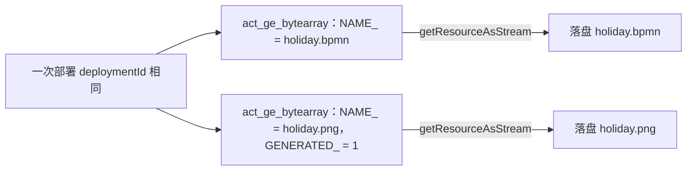

# 落盘效果验证：holiday.bpmn 与 holiday.png 背后的表记录与低级错误

代码写完按下运行键，第一次往往不是一路绿灯。这一节先排掉两个手误级的编译错误，再看一次成功运行的完整验证过程：目录从空到两个文件，文件内容与 `act_ge_bytearray` 里的两条记录一一对应。验证做扎实了，这个功能才算真的交付。

## 先给结论

- 运行前最常挡路的是两类低级错误：变量名手误（`pngIs` 敲成 `pngls`），以及 `IOUtils` 导错了包，正确来源是 `org.apache.commons.io`。
- pom 里加完 `commons-io` 坐标要刷新 Maven，依赖列表里出现 `commons-io-2.0.jar` 再继续编码。
- 运行成功后目标目录出现 `holiday.bpmn` 与 `holiday.png`：bpmn 打开是流程节点 XML，png 是按节点布局画出的流程图。
- 库里 `act_ge_bytearray` 恰好两条记录与两个文件对应，`NAME_` 即文件名，`DEPLOYMENT_ID_` 相同，png 那条 `GENERATED_` 为 1，表示引擎部署时自动生成。

## 一、运行之前：挡掉两个低级错误

**第一，变量名手误。** `pngIs` 这个名字里的 I 是大写字母 i，敲成了小写 L 就成了 `pngls`，编辑器立刻报「找不到符号」。这类错误一眼可辨，但足以让整段红成一片，顺手把 `bpmnIs` 也核对一遍。

**第二，IOUtils 导错包。** 编辑器的导包候选列表里，同名类不止一个，选错了来源，`copy` 方法的签名就对不上。正确的导入只有这一个：

```java
import org.apache.commons.io.IOUtils;   //commons-io 包中的工具类
```

**第三，加完依赖要刷新。** pom 里补上坐标后，Maven 工程不刷新，jar 不会进 classpath，import 依旧飘红：

```xml
<!--文件读写操作-->
<dependency>
    <groupId>commons-io</groupId>
    <artifactId>commons-io</artifactId>
    <version>2.0</version>
</dependency>
```

刷新后在外部依赖库列表里能看到 `commons-io-2.0.jar`，红线随之消失，这才具备运行条件。

## 二、运行验证：目录从空到两个文件

验证讲究对照，先看运行前，再看运行后。

```bash
# 运行前：目标资料目录为空
# 运行 main 方法，控制台滚动引擎的 SQL 日志，进程退出码 0
# 运行后：目录里出现两个文件
holiday.bpmn
holiday.png
```

控制台日志里那些 SELECT 语句，正是引擎按部署 ID 与资源名查 `act_ge_bytearray` 的动作回显；退出码 0 说明十步全部走完没有抛异常。目录里两个文件的出现顺序不重要，文件齐了才算落盘成功。文件本身的健全性也要过一眼：bpmn 用文本编辑器打开，结尾应该是 process 与 definitions 标签完整闭合，没有半截截断；png 双击能看完整流程图，没有下半截空白；文件大小与库里记录的长度一致，说明 copy 全程没有丢字节。

重复运行第二次也值得做一遍：目录里的同名文件会被输出流直接覆盖，程序不报错。覆盖行为意味着这段代码可以反复执行，每次都产出当前部署对应的最新文件，这也是把落盘动作写成独立 main 方法的好处，随时可复现、可核对。

## 三、文件内容与表记录对得上

**第一，bpmn 打开是节点清单。** 文件是标准的 BPMN XML，能看到这套请假流程的节点序列：启动事件、userTask 填写请假单、userTask 部门经理审核、userTask 总经理审核、结束事件。png 则是把这套节点按坐标画成的一张流程图，两者内容同源，一个给人读、一个给页面展示。

**第二，库里恰好两条记录。** 一条部署对应两个资源文件，查表看得清清楚楚：

```sql
SELECT ID_, NAME_, DEPLOYMENT_ID_, GENERATED_
FROM act_ge_bytearray;
-- 两条记录：NAME_ 分别为 holiday.bpmn 与 holiday.png
-- DEPLOYMENT_ID_ 相同，属于同一次部署
-- GENERATED_ 为 1 的是 png 那条，表示由引擎自动生成
```

落盘文件名取自 `NAME_` 字段，表记录与磁盘文件因此能一一指认：



**第三，png 不是你上传的。** 部署时只提交了 bpmn 文件，png 是引擎按流程定义自动生成后连同 bpmn 一起写进 bytearray 表的，`GENERATED_` 字段标记的就是这件事。导出的图是引擎画的，不是原始素材。这条字段差异在实际项目里有后果：设计器里精调过布局的 png 随 bpmn 一起上传，落库后 GENERATED_ 为 0，导出的就是设计稿原样；依赖引擎自动生成时，图的样子由引擎按坐标现画，节点位置可能与设计器里看到的略有出入。审批页面要展示与设计稿一致的图，就得把 png 一起部署进去。

## 常见误区

- **目标目录不存在就运行**：`new FileOutputStream` 直接抛 `FileNotFoundException`，十步在第八步折戟。落盘前确认目录存在。
- **用目录里的旧文件冒充成功**：目录里本来就有同名文件，程序失败也看不出来。运行前先清空目标目录，空目录到两个文件才是干净对照。
- **以为 png 是自己部署时上传的**：自动生成图由引擎完成，若引擎配置关掉了自动生成图，流程定义上取不到图资源名，导出 png 的那一路要单独处理。
- **多版本部署后直接验证**：同一 key 部署多次后按 key 的单条查询会抛异常，先锁版本或按版本号取最新，再做落盘验证。

## 面试可能被问到的问题

1. 面试官追问：「怎么证明导出的文件和库里存的一致？」
   答：两边本就同源，文件由库中记录经输入流原样写出，字节级一致。严格验证可比对文件大小与库中记录长度，或直接打开内容比对节点。

2. 面试官追问：「act_ge_bytearray 的 GENERATED_ 字段是什么含义？」
   答：标记该资源是否由引擎自动生成。手工提交的 bpmn 文件为 0，部署时引擎按流程定义画出的 png 流程图为 1。

3. 面试官追问：「部署时只给了 bpmn，png 是哪来的？」
   答：引擎在部署阶段按流程定义自动生成流程图，连同 bpmn 一起作为资源写入 act_ge_bytearray，两条记录挂在同一个部署 ID 下。

4. 面试官追问：「导出时报 FileNotFoundException，一般查什么？」
   答：先查输出目录是否存在、路径拼接是否正确，再查是否有同名只读文件或句柄占用。目录不存在是最常见的诱因。

5. 面试官追问：「同一套流程部署了多个版本，怎么导出指定版本的两个文件？」
   答：查询流程定义时按版本号排序取目标版本的 ProcessDefinition，部署 ID 与资源名都从该对象取，后续取流落盘的代码不变。

## 配套资料

- 运行类与依赖：`materials/code/02/Activiti7-day03-进阶1/Activiti7-day03-进阶1/代码/更新到第三天/代码/` 下的 `QueryBpmnFile.java` 与 `pom.xml`（包名已改为 `com.example`，pom 内含 `commons-io:2.0` 坐标）
- 引擎与数据源配置：同目录 `src/main/resources/activiti.cfg.xml`
- 查询流程定义对照：同目录下的 `QueryProcessDefinition.java`（验证部署 ID 与资源名的来源）
