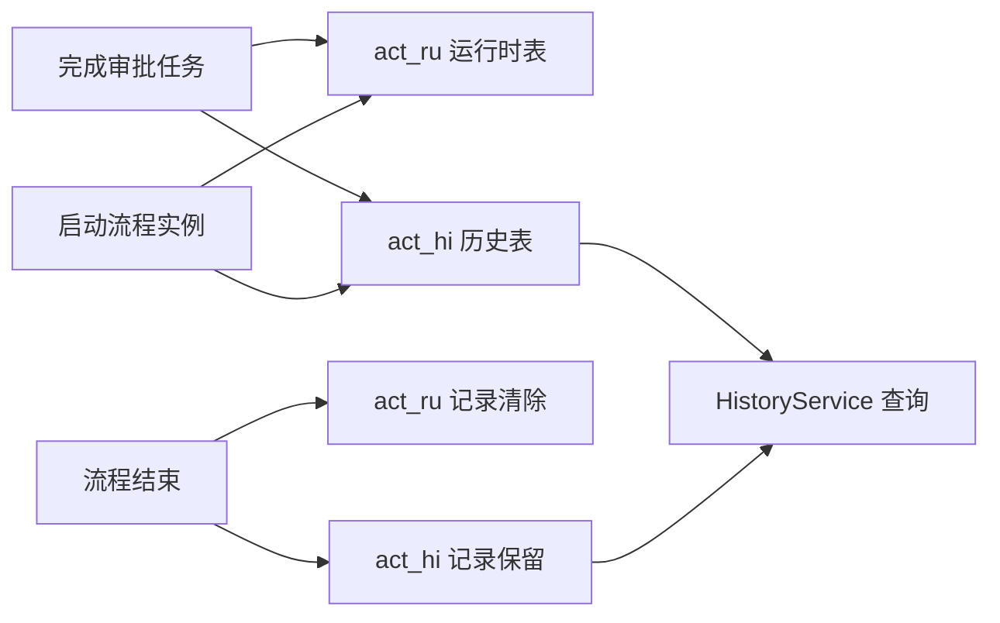

# 流程结束之后去哪查：HistoryService 读 act_hi 历史表

部署、流程定义、任务处理的 Service 都围着「正在跑」的流程转，可流程一走完，运行时表里的记录就被清掉，业务上要看的恰恰是「曾经跑过什么」：这套请假单走过哪些节点、谁审过、花了多久。这类审计与统计需求，落 Activiti 里就是 hi 开头的那一族历史表，入口是 HistoryService。

## 先给结论

- 历史数据查询入口是 HistoryService，从 `processEngine.getHistoryService()` 拿到，对应库里 `act_hi_*` 一族表。
- 查一次流程执行的节点轨迹用 `createHistoricActivityInstanceQuery()`，按流程实例 ID 过滤，能精确到某一次启动的全过程。
- 不加排序时结果顺序与执行顺序可能不一致，用 `orderByHistoricActivityInstanceStartTime().asc()` 还原真实时序。
- 同族还有 `createHistoricProcessInstanceQuery()` 与 `createHistoricTaskInstanceQuery()`，分别面向流程实例与任务两个维度。
- 流程结束后运行时表清空、历史表保留，查已结束的东西必须走历史查询。

## 一、act_hi 一族表：引擎顺手写的流水账

**第一，历史表与运行时表是并存的两套。** `act_ru_*` 是现场，记录正在运行的实例、任务、变量；`act_hi_*` 是档案，流程走的每一步引擎都会同步写一份。常见四张：`act_hi_procinst` 存流程实例，`act_hi_actinst` 存节点级活动轨迹，`act_hi_taskinst` 存任务，`act_hi_varinst` 存变量。

**第二，生命周期不同是两套表的根本区别。** 实例结束、任务办结后，对应的运行时记录会被清理，历史记录原样保留，这正是历史表能服务审计的原因：



图里的关键分叉在「流程结束」这一步：同一个实例，运行时一側消失，历史一側留下。查询代码选哪个 Service，取决于你要的是现场还是档案。

## 二、五步查询：HistoryQuery 的真实代码

课程实现类 `HistoryQuery` 的完整流程是五步：拿引擎、拿 HistoryService、建查询器、设条件、执行并遍历。以下为真实代码（包名改为 `com.example`）：

```java
package com.example.day03.activiti;

import org.activiti.engine.HistoryService;
import org.activiti.engine.ProcessEngine;
import org.activiti.engine.ProcessEngines;
import org.activiti.engine.history.HistoricActivityInstance;
import org.activiti.engine.history.HistoricActivityInstanceQuery;

import java.io.IOException;
import java.util.List;

public class HistoryQuery {

    public static void main(String[] args) throws IOException {
        //1.得到ProcessEngine对象
        ProcessEngine processEngine = ProcessEngines.getDefaultProcessEngine();

        //2.得到HistoryService
        HistoryService historyService = processEngine.getHistoryService();

        //3.得到HistoricActivityInstanceQuery查询器
        HistoricActivityInstanceQuery historicActivityInstanceQuery =
                historyService.createHistoricActivityInstanceQuery();

        //设置查询条件：流程实例的id
        historicActivityInstanceQuery.processInstanceId("2501");

        //4.执行查询，按开始时间升序
        List<HistoricActivityInstance> list = historicActivityInstanceQuery
                .orderByHistoricActivityInstanceStartTime().asc().list();

        //5.遍历查询结果
        for (HistoricActivityInstance instance : list) {
            System.out.println(instance.getActivityId());
            System.out.println(instance.getActivityName());
            System.out.println(instance.getProcessDefinitionId());
            System.out.println(instance.getProcessInstanceId());
            System.out.println("=============================");
        }
    }
}
```

**第一，查询器的用法与前面的查询一脉相承。** create 拿查询器、链式设条件、list 出结果，唯一区别是对象换成了历史族：返回的每条 `HistoricActivityInstance` 对应一个节点的一次执行。

**第二，过滤维度按需选择。** 历史表里将来会有请假、调岗、薪资调整等很多套流程的记录，`processInstanceId("2501")` 把范围收到一次具体启动上，这一个实例从启动到结束经过的每个节点各占一条记录。想看整套流程的所有历史，换 `processDefinitionKey` 之类的条件即可。

**第三，输出字段对应 bpmn 与库表。** `getActivityId()` 是 bpmn 里的节点 id，`getActivityName()` 是节点名，`getProcessDefinitionId()` 形如 `holiday:1:4`（key、版本、部署相关编号的组合），`getProcessInstanceId()` 就是过滤用的实例 ID 2501。

## 三、顺序问题：endEvent 为什么跑到第一行

不加排序直接 `list()` 时，结果里第一行可能是 endEvent，startEvent 反而靠后，输出顺序与直觉相悖。原因在数据侧：`act_hi_actinst` 里记录的插入顺序由引擎事务写入决定，并不承诺与节点执行时序一致，直接按物理顺序输出自然可能乱。

好在每条历史记录都带着时间。`act_hi_actinst` 有 `START_TIME_` 列，节点开始执行的时刻，startEvent 最早、endEvent 最晚，查询器提供了按它排序的链式方法：

```java
//按历史活动的开始时间升序，还原流程执行顺序
List<HistoricActivityInstance> list = historicActivityInstanceQuery
        .orderByHistoricActivityInstanceStartTime()
        .asc()
        .list();
```

加上这一段后重新运行，输出变成 startEvent、填写请假单、部门经理审核、总经理审核、endEvent，与 bpmn 图的节点顺序完全一致。升序的含义也直观：时间从起点走向终点，终点即 `END_TIME_`。

## 四、同一族的另外两个查询器

活动轨迹之外，历史查询还有两个常用入口，写法与活动查询完全同构（示例为按本课写法补全）：

```java
//查已结束的流程实例，做量级统计
List<HistoricProcessInstance> procList = historyService
        .createHistoricProcessInstanceQuery()
        .processDefinitionKey("holiday")
        .finished()
        .orderByHistoricProcessInstanceStartTime().desc()
        .list();

//查某人经手过的历史任务，做人员审计
List<HistoricTaskInstance> taskList = historyService
        .createHistoricTaskInstanceQuery()
        .taskAssignee("zhangsan")
        .finished()
        .list();
```

实例维度回答「这套流程历史上跑过多少次、各花了多久」，任务维度回答「某个人历史上处理过哪些单子」。三个查询器共享同一套链式风格，条件方法按表字段命名，认准一个其余通用。

## 常见误区

- **对已结束的流程去 TaskService 里查任务**：运行时记录已被清理，查出来是空。办结的流程一律走 HistoryService 的历史查询。
- **历史查询不加排序**：结果顺序是表的物理顺序，可能出现 endEvent 在前的怪象，按开始时间升序排列才符合执行轨迹。
- **`processInstanceId` 传错对象**：传成流程定义 ID 或部署 ID 都会查空，这个条件的值是启动实例时拿到的流程实例 ID。
- **以为历史数据永远全量**：引擎的历史记录级别配置过低时，部分表不会写入数据，查不到先确认历史级别，而不是怀疑查询代码。

## 面试可能被问到的问题

1. 面试官追问：「act_ru 和 act_hi 两族表的区别是什么？」
   答：act_ru 是运行时现场，存正在执行的实例、任务、变量，流程结束即清理；act_hi 是历史档案，引擎同步写入并长期保留。前者服务运行中的查询，后者服务审计与统计。

2. 面试官追问：「怎么查某一次流程实例走过的所有节点？」
   答：用 HistoryService 的 createHistoricActivityInstanceQuery，设 processInstanceId 过滤到那次启动，再按活动开始时间升序排列，遍历即得完整轨迹。

3. 面试官追问：「为什么历史记录不加排序顺序是乱的？」
   答：act_hi_actinst 的记录写入顺序由引擎事务决定，与节点执行时序不一致。表里有 START_TIME_ 列，查询器按 orderByHistoricActivityInstanceStartTime 升序即可还原顺序。

4. 面试官追问：「HistoricTaskInstanceQuery 和 TaskQuery 的差别？」
   答：TaskQuery 只覆盖运行中的任务；HistoricTaskInstanceQuery 覆盖历史任务，包括已办结的，可按办理人、完成状态过滤，适合做已办列表与人员审计。

5. 面试官追问：「流程实例 ID 从哪里来？」
   答：启动流程时返回的 ProcessInstance 对象的 getId，实际工程里通常把它或 businessKey 存进业务单据，查历史时凭业务数据反查到实例 ID。

6. 面试官追问：「历史数据可以关掉吗？」
   答：可以，引擎有历史记录级别配置，从 none 到 full 控制写入粒度。级别越低性能开销越小，审计需求也越难满足，按业务在两者之间取舍。

## 配套资料

- 历史查询实现类：`materials/code/02/Activiti7-day03-进阶1/Activiti7-day03-进阶1/代码/更新到第三天/代码/src/main/java/` 下的 `HistoryQuery.java`（包名已改为 `com.example`，代码含条件设置与按开始时间排序）
- 引擎与数据源配置：同目录 `src/main/resources/activiti.cfg.xml`
- 第四小节两个查询器示例为按本课写法补全，课程源码包内无对应文件
