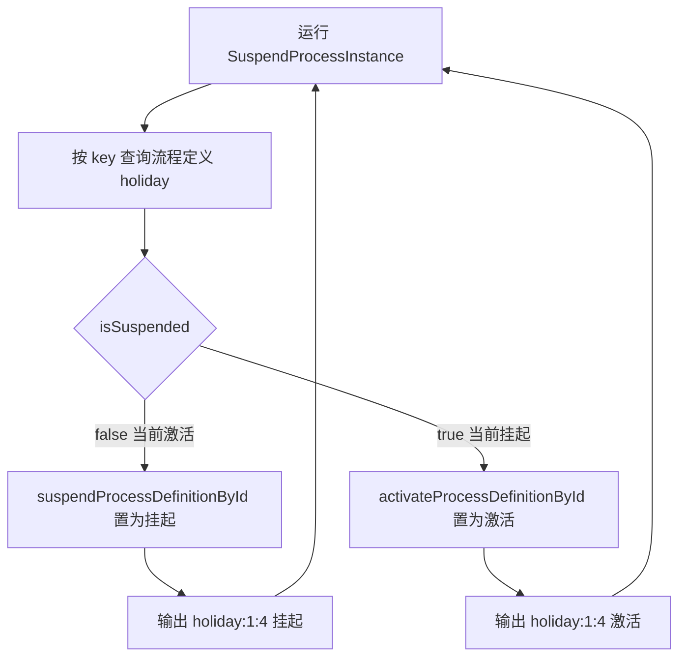

# 一条命令冻结整套请假流程：流程定义级挂起与激活实操

制度调整的当天，`holiday` 这套请假流程里还有一批单子卡在部门经理和总经理环节。原理层面处理办法只有一句话：翻转流程定义的挂起状态，引擎就会拦住新实例和在途实例。真正落到代码上，问题变成四个：用哪个 Service、按什么条件查定义、两个布尔与日期参数怎么传、改完之后到哪张表验证。

课程工程里的 `SuspendProcessInstance` 类正好把这四步走完整，逐段拆开，跑两遍，看控制台输出与数据库里 `SUSPENSION_STATE_` 字段的前后变化。

## 先给结论

- 挂起与激活的操作对象是流程定义，入口在 RepositoryService：`suspendProcessDefinitionById` 挂起，`activateProcessDefinitionById` 激活。
- 标准套路五步：取引擎、取 RepositoryService、按 key 查出 ProcessDefinition、`isSuspended()` 读状态、按状态反向操作。
- 第二个参数传 true 会级联处理该定义下全部存量实例；第三个参数是生效日期，传 null 立即生效。
- 状态变化落在 `act_re_procdef` 的 `SUSPENSION_STATE_` 列，1 是激活、2 是挂起；级联时 `act_ru_execution` 与 `act_ru_task` 的同名列一并翻转。
- 代码不改重复运行，效果就在挂起与激活之间来回切换，这是验证挂起生效最直观的方式。

## 一、动手前的三个选择

**第一，选服务：为什么是 RepositoryService。** 挂起改变的是流程定义的状态，定义属于静态资源，归 RepositoryService 管。写代码前看一眼它的方法列表，能直接找到两个签名：`activateProcessDefinitionById(String, boolean, Date)` 与对应的 `suspendProcessDefinitionById`，参数结构完全一致，一个负责激活、一个负责挂起。

**第二，选查询条件：key 比 id 顺手。** 流程定义表主键是 `holiday:1:4` 这种由「key : 版本号 : 部署序号」拼出来的值，不查库根本不知道。所以查询条件用 `processDefinitionKey("holiday")`，先拿到 ProcessDefinition 对象。之前提过查询尽量不要依赖 id，原因是必须看表才知道 id 的值；而这里先按 key 查出定义对象，再调 `getId()`，id 是从对象上读出来的，不是硬编码，因此后续走 ById 的操作没有任何问题。

**第三，选方法：ById 与 ByKey 两组等价可选。** 引擎同时提供 `activateProcessDefinitionByKey` 与 `activateProcessDefinitionById` 两组方法，suspend 同理。课程实现走的是先查对象再 ById，好处是一次查询同时拿到 `isSuspended()` 状态与 id，两处复用。

## 二、完整实现与参数语义

```java
package com.example.day03.activiti;

import org.activiti.engine.ProcessEngine;
import org.activiti.engine.ProcessEngines;
import org.activiti.engine.RepositoryService;
import org.activiti.engine.repository.ProcessDefinition;

/**
 * 全部流程实例挂起与激活
 */
public class SuspendProcessInstance {

    public static void main(String[] args) {
        //1.得到ProcessEngine对象
        ProcessEngine processEngine = ProcessEngines.getDefaultProcessEngine();

        //2.得到RepositoryService
        RepositoryService repositoryService = processEngine.getRepositoryService();

        //3.查询流程定义的对象
        ProcessDefinition processDefinition = repositoryService.createProcessDefinitionQuery()
                .processDefinitionKey("holiday").singleResult();

        //4.得到当前流程定义的实例是否都为暂停状态
        boolean suspended = processDefinition.isSuspended();

        String processDefinitionId = processDefinition.getId();
        //5.判断
        if (suspended) {
            //说明是暂停，就可以激活操作
            repositoryService.activateProcessDefinitionById(processDefinitionId, true, null);
            System.out.println("流程定义：" + processDefinitionId + "激活");
        } else {
            repositoryService.suspendProcessDefinitionById(processDefinitionId, true, null);
            System.out.println("流程定义：" + processDefinitionId + "挂起");
        }
    }
}
```

骨架是「查询、判断、执行」。三个参数里后两个是重点：

- 第二个参数 `suspendProcessInstances` 控制级联范围。传 true，该流程定义下所有运行中的流程实例连同在途任务一起翻转状态；传 false，只拦新实例的启动，存量实例照常运转。想冻结全局必须传 true。
- 第三个参数是生效日期 `suspensionDate`，传 null 表示立即生效；给一个未来时间点，则到点才执行。

执行逻辑用一张图看，就是一个来回切换的开关：



图里的闭环解释了为什么这个类可以当验证工具用：状态判断取反执行，每运行一次状态就翻一面，连续运行两次等于什么都没改。

## 三、跑两遍，到表里看状态

首次运行，控制台输出 `流程定义：holiday:1:4 挂起`。此刻到 MySQL 里验证定义表：

```sql
SELECT ID_, KEY_, VERSION_, SUSPENSION_STATE_
FROM act_re_procdef
WHERE KEY_ = 'holiday';
```

`SUSPENSION_STATE_` 从 1 翻到 2。级联参数为 true 时，运行时两张表同步变化：

```sql
SELECT ID_, PROC_INST_ID_, SUSPENSION_STATE_ FROM act_ru_execution;
SELECT ID_, NAME_, ASSIGNEE_, SUSPENSION_STATE_ FROM act_ru_task;
```

在途实例与待办任务的挂起状态同样变为 2。从这一刻起，引擎行为出现两处硬性变化：对该定义执行 `startProcessInstanceByKey` 会被直接拒绝，新流程发不起来；被级联挂起的存量实例无法继续办理任务，流程推进被冻结。所有数据原样保留，`BUSINESS_KEY_` 与流程变量都在，随时可以激活恢复。

不改一行代码再运行一遍：`isSuspended()` 这次返回 true，走激活分支，输出 `流程定义：holiday:1:4 激活`，三张表的状态列同步翻回 1，流程恢复推进能力。

## 常见误区

- **硬编码定义 id 去调 ById 方法**：`holiday:1:4` 里的版本号会随重新部署变化，写死必然失效。按 key 查询拿到对象再取 id，才是稳定写法。
- **以为挂起定义就自动停了存量实例**：级联参数不传或传 false 时，只有新实例启动被拦，在途实例照常往下走。要全局冻结必须显式传 true。
- **同一个 key 部署过多个版本还用 `singleResult()`**：按 key 查询会把所有版本都查出来，`singleResult()` 遇到多条结果直接抛异常。多版本场景要追加版本条件或改用 `list()`。
- **挂起与激活的级联参数不对称**：挂起传 true、激活却传 false，结果是一部分实例停在挂起态出不来，恢复时要保证两边级联设置一致。

## 面试可能被问到的问题

1. 面试官追问：「为什么不在业务代码里直接 update 流程定义表的 SUSPENSION_STATE_ 字段？」
   答：挂起不只是改一个字段，级联时引擎要同步维护定义表、执行表、任务表三处状态，并保证缓存一致性。走 RepositoryService 的 API 才能保证这组改动在同一事务里完成，手写 SQL 极易漏表造成状态不一致。

2. 面试官追问：「suspendProcessDefinitionById 的三个参数分别是什么含义？」
   答：第一个是流程定义 id；第二个 suspendProcessInstances 控制是否级联挂起该定义下所有运行中的流程实例；第三个是生效日期，传 null 立即生效，给未来时间则到点执行。

3. 面试官追问：「流程定义挂起后，新实例和存量实例分别受什么影响？」
   答：新实例启动被引擎直接拒绝；存量实例取决于第二个参数，级联为 true 时在途实例与待办任务一起挂起、无法办理，激活后全部恢复。

4. 面试官追问：「怎么判断某个流程定义当前是否处于挂起状态？」
   答：通过 RepositoryService 查出 ProcessDefinition 对象，调用它的 isSuspended 方法。该方法读的就是 `act_re_procdef` 表的 `SUSPENSION_STATE_` 字段，1 为激活，2 为挂起。

5. 面试官追问：「同一个 key 部署了多个版本，按 key 查询会查出几条，挂起的是哪一个？」
   答：会查出所有版本。挂起操作针对单个定义 id，通常先加 `latestVersionOnly` 或版本号条件锁定目标再操作，否则 `singleResult()` 会因多条结果抛异常。

## 配套资料

- 全部挂起与激活实现类：`materials/code/02/Activiti7-day03-进阶1/Activiti7-day03-进阶1/代码/更新到第三天/代码/src/main/java/` 下 day03 流程包中的 `SuspendProcessInstance.java`（文中包名已改为 `com.example`）
- 引擎与数据源配置：同工程 `src/main/resources/activiti.cfg.xml`
