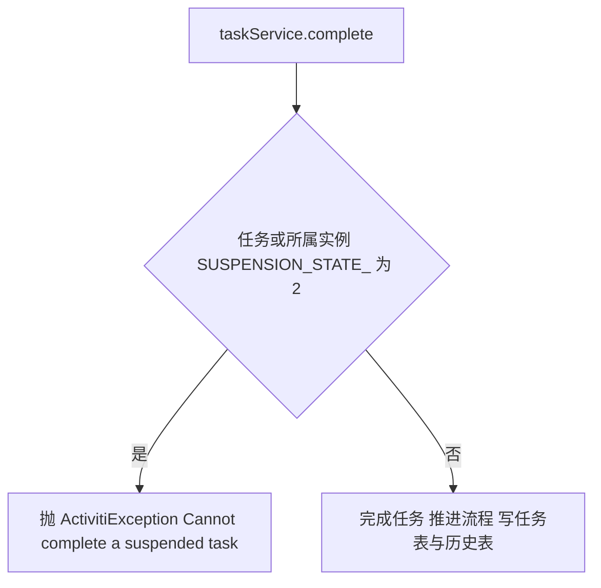

# 挂起的流程还能办任务吗：一次报错实测

前两篇把实例 2501 在挂起与激活之间来回切换，改动说到底只是 `act_ru_execution` 里的一个 `SUSPENSION_STATE_` 字段。字段从 1 变成 2，业务上真的拦得住吗？如果审批人照样能办任务，挂起就成了摆设。最直接的验证办法是：保持 2501 处于挂起状态，让名下待办任务的负责人去 `complete`，看引擎作何反应。

结果只有三种可能：静默成功、什么都不做、抛异常。静默成功意味着挂起形同虚设，讲义就写错了；什么都不做则容易让调用方误以为办完了。课堂实测给出的答案是第三种，并且异常信息把原因写得明明白白。

## 先给结论

- 实例挂起后，待办任务仍能查询到，但 `taskService.complete(taskId)` 会直接抛 `org.activiti.engine.ActivitiException: Cannot complete a suspended task`。
- 拦截是引擎内置的前置校验，发生在办理动作入口，业务代码不需要写任何判断。
- 激活之后，同一行代码立即可用，任务推进恢复正常，两个状态类交替运行就能复现完整闭环。
- 挂起期间 `complete` 不会写入任何表，任务表与历史表保持挂起时刻的原样。

## 一、测试设计：给挂起的实例安排一次办理

前置状态有三条：2501 实例已通过上一节的 `SuspendProcessInstance2` 挂起；`act_ru_task` 里张三名下还挂着这张请假单的「部门经理审批」任务；该任务行与实例行的 `SUSPENSION_STATE_` 都是 2。

测试要回答的问题是：流程实例已处于挂起状态时，让任务继续往后执行是否可以成功。预判是必然失败且抛异常，异常应当说明这条实例已挂起、不能办理。带着这个预判直接写办理代码。

## 二、测试代码

复用任务办理的标准模板（包名已改为 `com.example`，任务负责人按课堂实测使用张三）：

```java
package com.example.activiti;

import org.activiti.engine.ProcessEngine;
import org.activiti.engine.ProcessEngines;
import org.activiti.engine.TaskService;
import org.activiti.engine.task.Task;

/**
 * 处理当前用户的任务
 * 背后操作的表：
 *   act_hi_actinst、act_hi_identitylink、act_hi_taskinst
 *   act_ru_identitylink、act_ru_task
 */
public class ActivitiCompleteTask {

    public static void main(String[] args) {
        //1.得到ProcessEngine对象
        ProcessEngine processEngine = ProcessEngines.getDefaultProcessEngine();

        //2.得到TaskService对象
        TaskService taskService = processEngine.getTaskService();

        //3.查询当前用户的任务
        Task task = taskService.createTaskQuery()
                .processDefinitionKey("holiday")
                .taskAssignee("zhangsan")
                .singleResult();

        //4.处理任务,结合当前用户任务列表的查询操作的话,任务ID:task.getId()
        taskService.complete(task.getId());

        //5.输出任务的id
        System.out.println("任务ID：" + task.getId());
    }
}
```

这份代码在实例激活状态下跑过很多次，是任务办理的常规写法：按流程定义 key 加负责人查待办，拿到任务 id 后 `complete`。这次唯一的变化是实例状态，其余一字未动，保证对照实验的变量只有一个。

## 三、运行结果：Cannot complete a suspended task

实例保持挂起状态运行，控制台抛出：

```text
org.activiti.engine.ActivitiException: Cannot complete a suspended task
```

异常类型是 Activiti 引擎统一的 `ActivitiException`，消息直译过来就是「不能办理一条已挂起的任务」。这说明 `complete` 的执行链路里有一道前置校验：办理之前先读任务及其所属实例的挂起状态，发现是 2 就直接拒绝，后续的推进与写表全部不会发生。



这张图里藏着两个值得记住的细节。**第一，查询与办理是两道不同的门。** 挂起实例的待办任务仍然能被 `createTaskQuery` 查出来，审批人的任务列表不会因此少一条；真正被拦的只有 `complete` 这一步。**第二，异常发生在办理入口，状态校验前置。** 不会出现「办了一半被冻结」的中间态，要么整个动作被拒，要么整个动作完成。

## 四、反向验证：激活后同一行代码成功

把报错原因的另一半也验证掉。先运行上一节的 `SuspendProcessInstance2`，把 2501 激活，再运行本类：任务顺利办结，控制台输出任务 id，`act_ru_task` 里这条任务消失，历史活动与历史任务表新增对应记录，流程推进到下一个审批节点。

两个类交替运行，就能完整复现「挂起即冻结、激活即放行」的闭环。这也回答了挂起机制的价值所在：拦截发生在引擎内部，任何业务入口只要走 `complete` 就绕不过去，不需要每个审批接口自己判断状态。

## 常见误区

- **以为挂起会把待办藏起来**：挂起不改任务表的存在性，只锁办理动作。审批人列表照常显示，点击办理时才报错，前端要为此准备好异常提示。
- **在业务代码里重复判断挂起状态**：引擎已经兜底，业务侧再查一次状态属于重复校验；真正要做的是捕获 `ActivitiException`，把「流程已挂起」转成用户能理解的提示。
- **`complete` 之前不判空**：待办不存在时 `singleResult()` 返回 null，NPE 会先于引擎的挂起校验出现，报错原因与挂起无关，排查时先分清这两层。
- **把报错当成环境问题**：`Cannot complete a suspended task` 是明确的业务状态错误，先查实例的 `SUSPENSION_STATE_`，不要急着重启引擎或重建库。

## 面试可能被问到的问题

1. 面试官追问：「挂起的流程实例，它的待办任务还能查询吗？还能办理吗？」
   答：查询不受影响，`act_ru_task` 记录还在，任务列表照常返回；办理被拒绝，`complete` 会抛 `ActivitiException: Cannot complete a suspended task`。查询与办理在引擎里是两道不同的校验。

2. 面试官追问：「Cannot complete a suspended task 是在什么时机抛出的？」
   答：在办理动作的入口。引擎执行 `complete` 前先校验任务与所属实例的挂起状态，发现挂起直接拒绝，流程推进与历史表写入都不会发生，不存在部分成功的中间态。

3. 面试官追问：「前端要给用户友好提示，后端怎么处理这个异常？」
   答：捕获 ActivitiException，按消息内容区分原因，把「流程已挂起」这类状态错误转成业务提示返回。这是引擎级兜底，业务代码不需要提前查询挂起状态做防御。

4. 面试官追问：「实例挂起期间，引擎还会拦截哪些动作？」
   答：至少两类：对已挂起的实例办理任务会被拒绝；若是定义级挂起，该定义的新实例启动也会被拒绝。挂起是状态锁，所有推进类动作都要过这道校验。

5. 面试官追问：「怎么验证一条实例当前是挂起还是激活？」
   答：运行时层面查 `act_ru_execution` 的 `SUSPENSION_STATE_` 字段，1 为激活 2 为挂起；代码层面查出 ProcessInstance 调 `isSuspended()`。挂起状态下 `complete` 抛出的异常本身就是最直接的行为验证。

## 配套资料

- 任务办理实现类：`materials/code/02/Activiti7-day03-进阶1/Activiti7-day03-进阶1/代码/更新到第三天/代码/src/main/java/` 下 activiti 包中的 `ActivitiCompleteTask.java`（文中包名已改为 `com.example`，任务负责人随课堂实测取张三的待办）
- 实例挂起与激活实现类：同工程 day03 流程包中的 `SuspendProcessInstance2.java`
- 引擎与数据源配置：同工程 `src/main/resources/activiti.cfg.xml`
