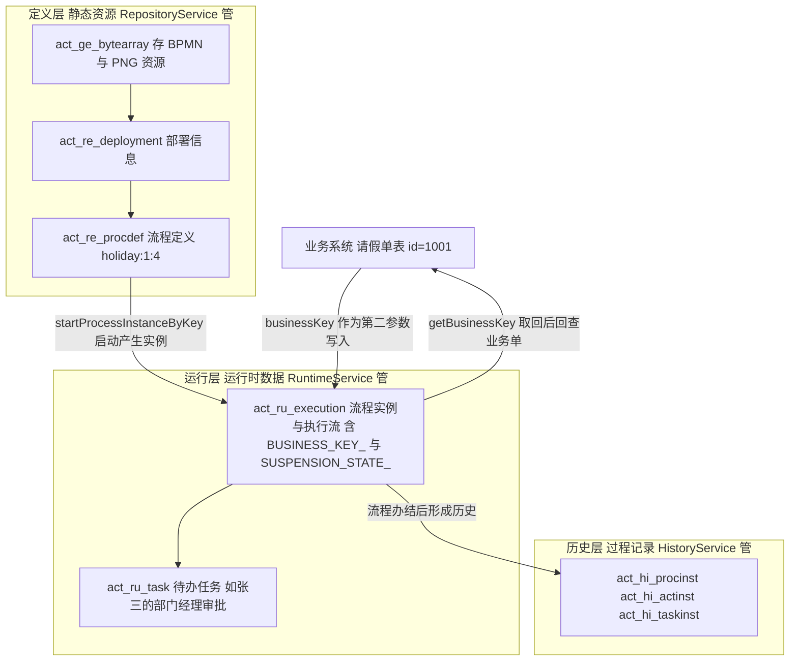

# 类与对象、业务桥、状态锁：流程定义与流程实例知识收网

学到这里，流程定义怎么部署、怎么查资源、怎么删除，流程实例怎么启动、怎么关联业务单、怎么挂起激活，单个知识点都已经过了一遍。散点不难，难的是收网：这些概念之间的层级关系是什么？每个操作背后动的是哪张表？业务系统与引擎的边界在哪里？这一篇用一张概念关系图把定义、实例、执行流、任务、businessKey、挂起状态全部串起来，再把 API 与表对号入座，作为这个模块的收口。

## 先给结论

- 流程定义与流程实例是类与对象的关系：定义是模板，实例是每次启动产生的运行对象，实例之间互不干扰，一百个员工同时请假互不影响。
- 业务系统与引擎的桥是 businessKey：启动实例时作为第二参数传入，落在 `act_ru_execution` 的 `BUSINESS_KEY_` 字段，用 `getBusinessKey()` 取回后回查业务单。
- 定义侧的维护走 RepositoryService：资源查看与下载（BPMN 与 PNG）、删除部署（注意级联）、定义级挂起激活。
- 运行侧的查询与实例级挂起走 RuntimeService，历史数据走 HistoryService，三个服务各管一段生命周期。
- 挂起激活分两级：定义级影响全局可级联，实例级只影响一单，套路都是先 `isSuspended()` 再反向操作。

## 一、一张图串起全部概念

这张图把整个模块分成三层：定义层是静态资源，运行层是活着的流程，历史层是走过的痕迹，businessKey 是业务系统伸进运行层的一根钩子。



顺着图读关键路径：部署动作把 BPMN 与 PNG 写进字节数组表，形成部署记录与流程定义；启动实例时引擎从定义复制出运行时执行流，业务单 id 以 businessKey 的身份同时写进执行表；实例每推进一步，任务表与历史表同步留下痕迹；办结后运行层数据清空，只剩历史层可查。挂起与激活则在定义层与运行层各有一条状态锁，后面单独说。

## 二、定义侧：资源、删除与历史

**第一，资源查看要把 BPMN 和 PNG 都拿到。** 流程图在 IDE 里能显示成图形，靠的是装的流程设计器插件；脱离这个环境，BPMN 文件只是一段 XML，图是出不来的。所以部署时生成的 PNG 图片必须可以单独下载，两者配套才能在任何环境下回看「请假到底每一步怎么走」。资源都存在 `act_ge_bytearray` 表里，通过 RepositoryService 的资源查询方法按部署 id 与资源名取出。

**第二，删除部署有级联问题。** `deleteDeployment(部署id)` 删除时会把 BPMN 与 PNG 一并清掉，涉及 `act_ge_bytearray`、`act_re_deployment`、`act_re_procdef` 三张表。但流程没走完时普通删除会失败，引擎不允许带着在途实例删模板；公司层面确实要强删时，用 `deleteDeployment(部署id, true)` 级联删除，先删未完成的流程节点再删定义，这个动作不可逆。

**第三，历史数据用 HistoryService 查。** 每一步走到哪、谁办的、什么时候开始结束，历史活动实例查询一次给全：

```java
//2.得到HistoryService
HistoryService historyService = processEngine.getHistoryService();

//3.得到HistoricActivitiInstanceQuery对象
HistoricActivityInstanceQuery query = historyService.createHistoricActivityInstanceQuery();
query.processInstanceId("2501");//设置流程实例的id

//4.执行查询，按开始时间排序
List<HistoricActivityInstance> list = query
        .orderByHistoricActivityInstanceStartTime().asc().list();
```

历史查询按流程实例 id 过滤即可，遍历结果能拿到每个活动的 id、名称、所属定义与实例，复盘一次审批的全过程靠它。

## 三、实例侧：businessKey 把流程挂到业务单上

定义是类，实例是对象，这个类比解释了两件事：一百个员工同时请假，各自拿到独立实例，互不干扰；同一套定义可以反复启动，每个实例记住自己从哪个定义复制而来。

实例与业务的关联靠 businessKey。启动实例时多传一个参数：

```java
//3.启动流程实例,同时指定业务标识businessKey  它本身就是请假单的id
//第一个参数：流程定义key
//第二个参数：业务标识businessKey
ProcessInstance processInstance = runtimeService.startProcessInstanceByKey("holiday", "1001");

//4.取出businessKey使用
System.out.println(processInstance.getBusinessKey());
```

不传时 `BUSINESS_KEY_` 字段没有值，这条业务关联通道等于没接。存进去之后，从引擎侧取回业务数据分两步：先按条件查出流程实例，调 `getBusinessKey()` 拿到请假单 id，再拿这个 id 回业务系统查请假单详情。查询实例列表本身用 RuntimeService：

```java
//按流程定义key查询该流程的所有运行中实例
List<ProcessInstance> list = runtimeService
        .createProcessInstanceQuery()
        .processDefinitionKey("holiday")
        .list();
```

有了这条链路，审批列表页展示「哪张请假单、推进到哪一步」就不需要给业务表加状态字段轮询，流程状态以引擎为准，业务明细以业务表为准，两边靠 businessKey 对上号。

## 四、挂起与激活：两级粒度对照

整个挂起激活体系可以压缩成一张对照表：

| 层级 | 服务 | 挂起方法 | 激活方法 | 参数 | 作用范围 |
|---|---|---|---|---|---|
| 定义级 | RepositoryService | `suspendProcessDefinitionById` / `ByKey` | `activateProcessDefinitionById` / `ByKey` | id 或 key、级联布尔、生效日期 | 该定义全部实例，拦新实例启动 |
| 实例级 | RuntimeService | `suspendProcessInstanceById` | `activateProcessInstanceById` | 只有实例 id | 单条实例及其在途任务 |

两条固定的使用套路：操作前先查对象调 `isSuspended()`，处于什么状态就做相反的操作；定义级记得级联参数传 true 才会连存量实例一起冻结，实例级没有级联概念，只有 ById 一种定位方式。状态全部落在 `SUSPENSION_STATE_` 列，1 是激活、2 是挂起；挂起生效后新实例启动与任务办理都会被引擎拒绝，异常实测是 `Cannot complete a suspended task` 这一类。

## 常见误区

- **把 PNG 当成引擎的必需品**：引擎执行读的是 BPMN，PNG 是给人看的图。但部署时建议两者都带上，脱离 IDE 插件环境后 PNG 是唯一能直接看图的方式。
- **删除部署不区分场景**：在途实例存在时普通删除直接失败；`deleteDeployment(id, true)` 是级联强删，会连带删掉未走完的流程节点，执行前必须确认业务允许。
- **启动实例时不传 businessKey**：字段留空，之后既不能用 `processInstanceBusinessKey` 查实例，也无法从实例回查业务单。实例与业务单的对应关系必须在启动那一刻定好。
- **混用两级挂起想当然**：定义级有 ById 与 ByKey 两种定位、带级联与日期参数；实例级只有 ById、没有级联。照搬定义级的参数列表到实例级，编译期就会报错。

## 面试可能被问到的问题

1. 面试官追问：「流程定义和流程实例是什么关系？」
   答：类与对象的关系。定义是 BPMN 描述的模板，实例是按定义启动出来的运行对象；同一套定义可并发跑任意多个实例，实例之间数据隔离、互不干扰，例如一百个员工同时请假各自走各自的流程。

2. 面试官追问：「businessKey 存在哪张表？怎么写入与读出？」
   答：存在运行时执行表 `act_ru_execution` 的 `BUSINESS_KEY_` 字段。写入靠 `startProcessInstanceByKey(key, businessKey)` 的第二参数，读出先查流程实例再调 `getBusinessKey()`，拿业务单 id 回业务系统查明细。

3. 面试官追问：「审批列表要同时显示请假单信息和流程进度，怎么实现？」
   答：按流程定义 key 查运行中实例列表，每个实例通过 `getBusinessKey()` 关联到业务表的请假单 id，业务明细从业务表查，流程进度看实例的当前活动，两边以 businessKey 对齐，不需要业务表冗余流程状态。

4. 面试官追问：「流程定义的删除为什么会失败？」
   答：该部署下还有未走完的流程实例时，引擎拒绝删除以保护在途数据。确需强制删除可用 `deleteDeployment(部署id, true)` 级联删除，先清未完成的流程节点再删定义与资源，操作不可逆，执行前要做业务确认。

5. 面试官追问：「定义级挂起和实例级挂起分别用什么服务和方法？」
   答：定义级在 RepositoryService 上调 `suspend/activateProcessDefinitionById` 或 ByKey 版本，参数含级联布尔与生效日期，影响该定义全部实例；实例级在 RuntimeService 上调 `suspend/activateProcessInstanceById`，只接收实例 id，只影响单条实例。

6. 面试官追问：「历史数据用什么服务查？」
   答：HistoryService。典型用法是 `createHistoricActivityInstanceQuery` 按流程实例 id 过滤、按开始时间排序，遍历结果即可还原每次审批的活动轨迹，数据来自 `act_hi_` 开头的历史表。

## 配套资料

- businessKey 关联实现类：`materials/code/02/Activiti7-day03-进阶1/Activiti7-day03-进阶1/代码/更新到第三天/代码/src/main/java/` 下 day03 流程包中的 `BusinessKeyAdd.java`（文中包名已改为 `com.example`）
- 定义维护与历史查询实现类：同目录的 `QueryProcessDefinition.java`、`QueryBpmnFile.java`、`DeleteProcessDefinition.java`、`HistoryQuery.java`
- 两级挂起激活实现类：同目录的 `SuspendProcessInstance.java`（定义级）与 `SuspendProcessInstance2.java`（实例级）
- 引擎与数据源配置：同工程 `src/main/resources/activiti.cfg.xml`
