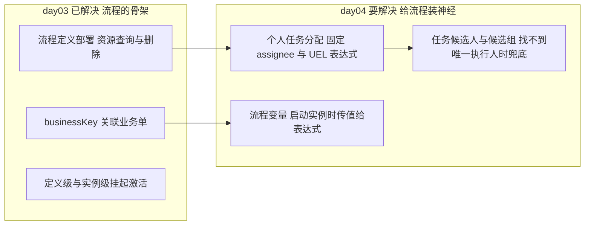

# Activiti7 进阶篇开篇：流程能跑通之后，任务要分对人

跑通第一个请假流程之后，回头看代码会冒出一个之前没深究的问题：查询任务时写的 `taskAssignee("zhangsan")` 里，这个 zhangsan 是从哪来的？答案不难猜，因为前几天的例子里，每个流程节点的负责人都是建模时手工写死的。真实业务里，请假的可能是公司上千名员工中的任何一个，审批的经理也可能随部门变动，写死的流程撑不了几天。

进阶篇就从这个问题开始。研究的角度从「流程能不能在引擎里跑起来」转向「流程怎么贴合真实组织的分工」，问题切得更细，难度也相应上了一个台阶。

## 先给结论

- 个人任务的负责人配置在 UserTask 的 Assignee 属性上，运行期落到 `act_ru_task` 表的 `ASSIGNEE_` 字段，任务与人的绑定关系由引擎统一管理。
- 固定分配是建模时写死具体人名，只适合负责人天然固定的节点；执行人随业务变化的节点必须走表达式分配。
- UEL 表达式在 bpmn 里只是占位的 key，比如变量 `assignee1` 写成 `${assignee1}`，真正的值在启动流程实例时通过 Map 参数传入。
- day04 的主线是个人任务：先对比固定分配与 UEL 表达式两种方式，再用完整代码实测动态分配；候选人、候选组任务在此基础上展开。

## 一、进阶篇与基础篇的分界线

**基础篇解决的是「流程在引擎里转起来」。** 部署 bpmn 与 PNG、启动流程实例、查询并办理任务、businessKey 关联业务单、定义级与实例级的挂起激活，这套动作练完，一条请假流程已经能在引擎里完整走完，每一步动哪张表也都能说清楚。

**进阶篇解决的是「流程嵌进真实组织」。** 引擎里的流程本身没有立场，它不知道这单该给哪个经理批。课程开场对进阶篇有个定调：研究的问题更细致，难度比基础篇略增。这个判断的依据很实在，Activiti 作为工作流引擎，学习成本比一般开源框架高，会引入它的公司往往规模和组织结构都复杂，多部门、多角色、审批人随业务变化，任务怎么分到正确的人就成了绕不开的问题。业务流程建模这套图形符号体系在研究生课程里才会专门展开，而这里的进阶篇不止于建模，还要用代码把流程管理的全过程实现出来，颗粒度自然更细。

## 二、day03 收了什么口，day04 接什么活

day03 结束时，定义侧与运行侧的主干能力已经齐了：流程定义的部署、资源查询与下载、删除部署、businessKey 整合业务单、流程定义与流程实例两级粒度的挂起激活。这些能力让流程「能跑、能管、能连业务」，但整条链路里每个任务节点上的人仍是建模时写死的，这是最后一块没动的硬骨头。day04 要补的就是这块，外加与之配套的流程变量机制：



顺着图读关键路径：部署与 businessKey 是 day03 的存量能力，它们分别支撑「流程定义从哪来」与「实例对应哪张单」；day04 新增的三件事都围绕「人」展开，任务是引擎与真实用户之间唯一的交接点，交接点上的人定不准，前面跑得再顺也只是空转。

## 三、任务分给人：进阶的第一个硬问题

课程演示的请假流程有四个关键节点：开始事件、填写请假申请单、部门经理审批、总经理审批、结束事件。把三个任务节点逐一审视会发现，它们的「人」性质完全不同：

**第一，发起节点的执行人必然不固定。** 填写请假申请单这一步，公司上千名员工任何一个都可能操作，把 Assignee 写成某个具体人，等于宣布只有他能请假，业务直接跑不通。

**第二，审批节点要看组织现状。** 公司有五个部门时，部门经理审批的人随发起人所在部门变化，写死任何一个都不对；而总经理如果确实始终是同一个人，这一步写死反而最直接。

**第三，取舍标准只有一条。** 这个节点的执行人在业务里是否唯一确定，是就固定分配，不是就用表达式留出变化的空间。

课程里改动发生在流程设计器的属性面板：选中部门经理审批节点，Assignee 一栏从 `lisi` 换成变量名，对应到 bpmn 文件里就是 `activiti:assignee` 属性的变化，两种写法放在一起看差别一目了然：

```xml
<!-- 固定分配：负责人写死，所有流程实例都一样（示例，holiday2.bpmn 未随资料包提供，按课程操作写法补全） -->
<userTask id="usertask2" name="部门经理审批" activiti:assignee="lisi"/>
```

```xml
<!-- 表达式分配：负责人是变量，每个流程实例启动时各自解析（示例，同上按课程操作写法补全） -->
<userTask id="usertask2" name="部门经理审批" activiti:assignee="${assignee1}"/>
```

两行代码的差别，就是 day04 第一站要讲透的内容：表达式里的 `assignee1` 是个占位的 key，值在启动流程实例的那一刻由程序传入，同一个流程定义因此可以服务全公司所有人。固定方式与 UEL 表达式的完整对比、UEL 两种形态的写法、动态分配从传值到落表的实测验证，构成个人任务这条主线；候选人与候选组（一个任务一组人可见、可认领）排在个人任务之后展开，解决「找不到唯一执行人」的场景。

## 常见误区

- **把进阶篇当成任务的重复讲解**：基础篇讲任务查询与办理，关注「任务怎么操作」；进阶篇讲任务分配，关注「任务怎么到人」。同一个 UserTask 节点，两边问的问题完全不同。
- **把固定分配当成要被淘汰的写法**：负责人天然固定的节点写死反而可靠，还省去每次启动传值的成本。它的边界仅在于不适合执行人随业务变化的节点，而不是「都不该用」。
- **以为表达式写进 bpmn 就万事大吉**：`${assignee1}` 只是 key，启动实例时不传对应变量，引擎解析不到值会抛 `Unknown property used in expression` 一类异常，流程推进直接中断。表达式与传值是一对，缺一不可。

## 面试可能被问到的问题

1. 面试官追问：「工作流引擎里个人任务和候选人任务的区别是什么？」
   答：个人任务的 assignee 在任务产生时就确定为某一个人，直接出现在这个人的待办列表里；候选人任务先绑定一组用户或组，落入 `act_ru_identitylink`，需要其中一人认领（claim）后才转成个人任务。个人任务解决「分给谁」，候选机制解决「一群人里谁有空谁接」。

2. 面试官追问：「为什么任务分配要支持表达式，而不是在 bpmn 里直接写人名？」
   答：写死人名把流程定义与组织结构焊死了，人员变动、多部门、多候选场景都要改图重新部署。表达式把「人」抽象成流程变量，值在启动时按实例传入，一套流程定义可以服务所有用户，变更只改数据不改模型。

3. 面试官追问：「UEL 是什么？和 JSP 里的 EL 表达式是什么关系？」
   答：UEL 即 Unified Expression Language，统一表达式语言，是 Java EE 6 规范的一部分，JSP 的 EL 表达式与之同源，`${}` 的写法一致。Activiti 原生支持 UEL，分为取值的 UEL-value 和调方法的 UEL-method 两类。

4. 面试官追问：「bpmn 里写了 `${assignee1}`，启动实例时没传这个变量，会发生什么？」
   答：流程推进到该任务节点时表达式解析失败，引擎抛出 Unknown property used in expression 一类的异常，任务创建不了，流程中断。所以变量赋值与表达式必须配套，测试环境也要保证 Map 里的 key 与图中表达式一一对应。

5. 面试官追问：「任务负责人的信息最终存在哪张表？」
   答：运行期存在 `act_ru_task` 的 `ASSIGNEE_` 字段，任务办结后随历史数据进入 `act_hi_taskinst`。查询某人的待办就是按这个字段加流程定义 key 过滤。

## 配套资料

- day04 源码工程：`materials/code/02/Activiti7-day04-进阶2/Activiti7-day04-进阶2/源码/更新后的代码/代码/src/main/java/` 下 day04 流程包中的 `AssigneeUEL.java`（本单元主线代码，文中包名已改为 `com.example`）
- 引擎与数据源配置：同工程 `src/main/resources/activiti.cfg.xml`
- holiday2 流程的 bpmn 文件未随资料包提供，文中 XML 片段为按课程操作写法补全的示例
