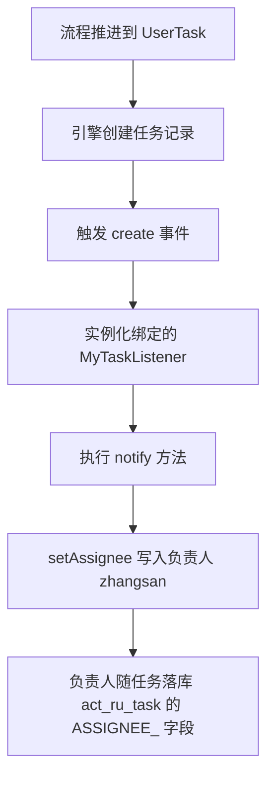

# 用 TaskListener 在任务创建时自动分配负责人

给 UserTask 指定负责人，已经写过两种：一是在 bpmn 节点属性里写死 `activiti:assignee="zhangsan"`，二是写 `${assignee0}` 这样的 UEL 表达式，启动实例时从 Map 取值。这两种的共同点是「分给谁」在任务产生之前就已经确定。要是分配规则本身需要执行一段 Java 逻辑，比如查组织架构、按业务数据计算，前面两种就不合适了，监听器方式补的正是这个位置。

## 先给结论

- 监听器方式的做法：在 UserTask 上挂一个 `taskListener`，监听 `create` 事件，任务一创建就执行监听类的 `notify` 方法，在方法里调 `setAssignee` 完成分配。
- 监听类必须实现 `org.activiti.engine.delegate.TaskListener` 接口，并重写 `notify(DelegateTask)` 方法，这是硬性要求。
- 事件有四种可选：create（任务创建后触发）、assignment（任务分配后触发）、delete（任务完成后触发）、all（以上事件都触发），分配场景一般选 create。
- 课件明确提醒：使用监听器分配方式，按照监听事件去执行监听类的 notify 方法，方法如果不能正常执行也会影响任务的执行。
- 实际开发里监听器方式的使用频率不如 UEL 方式，UEL 是分配个人任务的主力手段。

## 一、第三种方式站在什么位置

三种分配方式可以按「分配逻辑写在哪」来区分：

| 方式 | 分配逻辑写在哪 | 生效时机 |
|---|---|---|
| 固定方式 | bpmn 节点属性里写死一个字符串 | 流程定义时 |
| UEL 表达式 | 节点里写表达式，值由启动参数提供 | 启动流程实例时 |
| 监听器 | 一个可执行的 Java 类 | 任务创建等事件发生时 |

固定方式和 UEL 方式解决的都是「值从哪来」，监听器解决的是「分配动作谁来执行」。把分配从一行配置升级成一段代码，能做的就不只是填一个常量，完全可以先查数据库、再决定负责人。

## 二、在设计器里把监听器挂上去

课程用的测试流程是最简单的三件套：StartEvent → User Task → EndEvent。挂监听器在设计器里完成，操作分三步：

**第一，选中 UserTask 节点，在属性面板的监听器区域点加号。** 面板底部会多出一条 listener 记录。

**第二，选 event 事件类型。** 下拉默认就是 create，绝大多数分配场景用它即可，需要其他时机再换 assignment、delete 或 all。

**第三，type 选 class，并指定监听类的全类名。** 通过类选择对话框（Choose Class to Bind）搜索项目里写好的监听类，确认后属性面板会回填完整的包名点类名，绑定即完成。

设计器做的事，落到 bpmn 文件里就是给 UserTask 补一段 `extensionElements`（示例，按本课设计器生成的格式补全）：

```xml
<userTask id="usertask1" name="User Task">
  <extensionElements>
    <!-- event 为 create：任务创建时触发；class 必须是监听实现类的全类名 -->
    <activiti:taskListener event="create"
        class="com.example.day04.MyTaskListener"/>
  </extensionElements>
</userTask>
```

## 三、监听类：实现 TaskListener 接口

绑定指向的类有明确的写法要求，课程源码里的实现如下（包名已改为 `com.example`）：

```java
package com.example.day04;

import org.activiti.engine.delegate.DelegateTask;
import org.activiti.engine.delegate.TaskListener;

/**
 * 任务监听器：在监听事件发生时为任务分配负责人
 */
public class MyTaskListener implements TaskListener {
    @Override
    public void notify(DelegateTask delegateTask) {
        //这里指定任务负责人
        delegateTask.setAssignee("zhangsan");
    }
}
```

两个关键点：

**第一，必须实现 `TaskListener` 接口。** 没有实现这个接口的普通类，绑定不上，引擎也不会认识它。

**第二，分配动作写在 `notify` 方法里。** `DelegateTask` 是任务此刻的运行时代表，调它的 `setAssignee` 就是在给这个任务落负责人。方法里写常量 zhangsan 只是为了演示，换成数据库查询结果、规则计算结果，写法不变。

## 四、执行时机：create 事件什么时候开火

监听器不是流程图上多出来的节点，而是挂在任务生命周期上的钩子。以 create 事件为例，一次分配的完整链路是这样：



顺着图读：流程推进不受监听器影响，只是任务被创建的那一瞬间多了一次回调。回调返回后，任务带着负责人进入运行时表，后续的查询、办理与固定方式分配的任务没有任何差别。对使用者来说，工作就两件事：把监听类编好，再把它绑定到节点上。

## 常见误区

- **只写了监听类，忘了在设计器里绑定**：类写得再标准，没有挂到 UserTask 的 listener 列表上就永远不会被调用，任务创建后负责人为空。
- **类没有实现 `TaskListener` 接口**：绑定时选择类没问题，运行到节点却拿不到监听器实例，分配直接失效。接口是引擎识别监听器的依据。
- **在 `notify` 里写不可靠的逻辑**：课件注意事项写得很清楚，notify 方法不能正常执行会影响任务的执行，最直接的后果就是流程走到这个节点时卡住或报错。
- **以为监听器是流程级的**：`taskListener` 挂在单个 UserTask 上，只对这个节点生效，流程里每个需要动态分配的节点都要各自绑定。

## 面试可能被问到的问题

1. 面试官追问：「TaskListener 的事件类型有哪些，分配任务一般用哪个？」
   答：有 create、assignment、delete、all 四种。create 在任务创建后触发，assignment 在任务分配后触发，delete 在任务完成后触发，all 表示这些事件都触发。分配负责人一般监听 create，任务一创建就落 assignee，时序最靠前。

2. 面试官追问：「监听类为什么要实现 TaskListener 接口？」
   答：引擎通过接口类型识别监听器并回调 `notify(DelegateTask)` 方法，这是约定好的扩展点。不实现接口的类无法完成绑定与回调，分配逻辑也就没有执行的机会。

3. 面试官追问：「notify 方法里执行失败会怎样？」
   答：课件明确说 notify 方法如果不能正常执行也会影响任务的执行。监听发生在任务创建的关键路径上，抛异常会导致该节点无法正常完成分配，所以监听类里不能放不可靠的代码。

4. 面试官追问：「监听器方式和 UEL 方式怎么选？」
   答：负责人在启动时就能确定的用 UEL，一个表达式加启动 Map 就够了；分配规则需要执行查询或计算逻辑的用监听器。实际项目里 UEL 用得更多，监听器作为补充手段。

5. 面试官追问：「setAssignee 设置的值最终存在哪？」
   答：存在运行时任务表 `act_ru_task` 的 `ASSIGNEE_` 字段里，后续按负责人查询个人任务就是对这个字段过滤，与固定方式分配落的结果没有区别。

## 配套资料

- 监听类源码：`materials/code/02/Activiti7-day04-进阶2/Activiti7-day04-进阶2/源码/更新后的代码/代码/src/main/java/` 下 day04 流程包中的 `MyTaskListener.java`（文中包名已改为 `com.example`）
- 对照的 UEL 分配实现：同 day04 流程包中的 `AssigneeUEL.java`
- 挂载监听器的 bpmn 文件未随资料包提供，第二节 xml 片段为按本课设计器生成格式补全的示例
