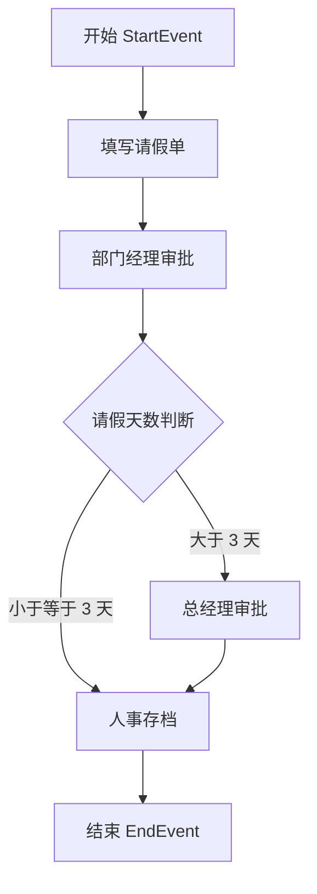

# 流程变量：请假天数怎么决定流程走向

之前画的请假流程始终是一根直线：开始 → 填写请假单 → 部门经理审批 → 总经理审批 → 结束。直线流程在真实业务里站不住：请一天假和请十天假如果都要过总经理那道关，请一天假的员工就得白白多等一层审批。流程要在运行中「看情况办事」，看情况的依据，就是流程变量。

## 先给结论

- 流程变量是随流程实例一起保存的键值数据，为流程执行的需要而创建，典型用途是给分支（网关）提供判断依据。
- 请假场景的标准分支：天数小于等于 3 天，部门经理审完直接人事存档；大于 3 天，加一道总经理审批再人事存档。
- 设置变量有三个时机：启动实例时传 Map、办结任务时传 Map、按流程实例 id 调 `runtimeService.setVariable`。
- 业务系统的数据不要放进流程变量，请假单详情、购物车这类数据存业务系统，变量里只放流程决策需要的值。
- 分支一旦出现，流程变量就是必需品，没有它引擎不知道该走哪条线。

## 一、直线流程为什么要改成分支

原来的流程是一根线冲到底，改造后的流程在部门经理审批之后多了一个判断：



课程在画布上演示的正是这个变化：原流程 StartEvent → 请假申请审批 → 处理请假 → EndEvent 一根直线，改造后从处理请假节点引出一条分支连到人事审批，旁边标注「流程运行过程中，加入流程变量 holidayNum 5」。

引擎怎么知道天数？填写请假单这个任务办理时，把请假天数写进流程变量 holidayNum。流程推进到分支节点时，引擎取变量的当前值参与条件判断：值是 1，走人事存档那条线；值是 5，大于 3，走总经理审批，批完再回到人事存档，流程结束。流程的走向由变量的取值决定，这就是流程变量在流程运行中扮演的角色。

## 二、三个设置变量的时机

课程源码把三种设置方式都写成了可运行的测试（包名已改为 `com.example`）。

**启动流程实例时设置**，变量随实例一起创建：

```java
//1.得到ProcessEngine
ProcessEngine processEngine = ProcessEngines.getDefaultProcessEngine();
//2.得到RuntimeService
RuntimeService runtimeService = processEngine.getRuntimeService();
//3.流程定义的key
String key = "myProcess_1";
Map<String, Object> map = new HashMap<>();

Holiday holiday = new Holiday();
holiday.setNum(5F);
map.put("holiday", holiday);

//4.启动流程实例，并且设置流程变量的值
ProcessInstance processInstance = runtimeService.startProcessInstanceByKey(key, map);
```

**办结任务时设置**，值在任务完成的那一刻进入流程：

```java
Task task = taskService.createTaskQuery().processDefinitionKey(key)
        .taskAssignee("zhangsan").singleResult();

//初始化一些参数
Map<String, Object> map = new HashMap<>();
Holiday holiday = new Holiday();
holiday.setNum(5F);
map.put("holiday", holiday);

if (task != null) {
    taskService.complete(task.getId(), map); //完成任务时，设置流程变量的值
    System.out.println("任务执行完毕");
}
```

**按流程实例 id 单独设置**，实例走到一半也可以补：

```java
Holiday holiday = new Holiday();
holiday.setNum(5F);
//4.通过实例id，来设置流程变量
//第一个参数：流程实例的id
//第二个参数：流程变量名
//第三个参数：流程变量名，所对应的值
runtimeService.setVariable("2501", "holiday", holiday);
```

三种方式设置的变量对流程来说是同一份，区别只在注入时机。变量的值既可以是散装的数字字符串，也可以是像 Holiday 这样的对象，对象怎么存得进去，下一篇专门讲。

## 三、变量为流程而生，不为业务存档

课件里有一句话值得单独拿出来：设置流程变量是为了流程执行的需要而创建。这句话划出了变量和业务数据的边界，具体来说是两类数据明确不往变量里放：

**第一，业务单据的详细信息。** 请假单的请假人、起止日期、请假类型、事由这些过程数据属于业务系统，存业务库，流程里只放决策需要的那一个值。上一节讲过的 businessKey 关联就是干这个的，详情按业务主键回业务库查，不用变量搬运。

**第二，业务运行产生的中间数据。** 典型如购物车，这类数据在业务系统里有自己的生命周期，塞进流程变量既浪费运行时表空间，实例结束后还拿不到。

运行期变量存放在 `act_ru_variable` 表，较大的对象数据以字节形式进 `act_ge_bytearray` 表。把握一个原则就能判断该不该用变量：流程里出现分支的地方，变量必然需要，因为没有它引擎判断不了大于 3 还是小于等于 3；没有分支的直线流程，一个变量都不设也照样跑。

## 常见误区

- **把流程变量当业务数据库用**：整个请假单、整张购物车都往变量里塞，之后查详情也去变量里翻。运行时变量随实例结束而清理，业务数据请回业务库。
- **变量名与表达式对不上**：分支条件里写的是 `${holidayNum}`，代码里却把值放在别的名字下，引擎取不到值，分支判定直接出错。变量名从设置到消费要保持同一个。
- **设值时机晚于分支**：分支在流程推进到它的那一刻就完成判断，值必须在判定之前就位。典型做法是在填写请假单任务办结时连同 Map 一起提交，而不是等流程已经走到分支再补。
- **以为设一次变量全流程共享就万事无忧**：变量覆盖旧值后，后面再有分支会用新值判断。同名变量在多个分支间复用时，要想清楚每个节点读到的应是哪一版值。

## 面试可能被问到的问题

1. 面试官追问：「什么是流程变量，它和业务数据什么关系？」
   答：流程变量是引擎随流程实例保存的键值数据，为流程执行的需要而创建，典型用途是给分支提供判断依据。业务数据留在业务系统里，通过 businessKey 关联，变量里只放流程决策需要的值。

2. 面试官追问：「流程变量有哪些设置时机？」
   答：三种。启动实例时通过 `startProcessInstanceByKey(key, map)` 传入；办结任务时通过 `complete(taskId, map)` 传入；实例运行中按实例 id 调 `runtimeService.setVariable` 单独设置。三者写入的是同一份运行时变量。

3. 面试官追问：「请假流程里请假天数改变流程走向，引擎是怎么知道的？」
   答：填写请假单任务办理时把天数写入流程变量，流程推进到分支节点时，引擎读取变量当前值与条件表达式比较，值落在哪一侧就走哪条分支，总经理审批那条线只在天数大于 3 时经过。

4. 面试官追问：「为什么业务系统数据不建议存进流程变量？」
   答：变量为流程决策而生，存 `act_ru_variable` 与 `act_ge_bytearray`，随实例结束清理；业务数据有自己的持久化需求，放变量里既增大引擎表压力，实例结束后还查不到，正确做法是存业务库并用 businessKey 关联。

5. 面试官追问：「什么情况下流程变量是必需的？」
   答：流程出现分支时。没有变量，网关条件没有取值来源，引擎无法决定走哪条线。直线流程不涉及运行期判断，可以完全不使用流程变量。

## 配套资料

- 启动时设置变量：`materials/code/02/Activiti7-day04-进阶2/Activiti7-day04-进阶2/源码/更新后的代码/代码/src/main/java/` 下 day04 流程包中的 `VariableTest.java`
- 办结任务时设置变量：同 day04 流程包中的 `VariableTest2.java`，按实例 id 设置见 `VariableTest3.java`
- 变量用的请假实体类：同 day04 流程包中的 `Holiday.java`
- 分支流程的 bpmn 文件未随资料包提供，第一节流程图按课程画布演示内容还原
