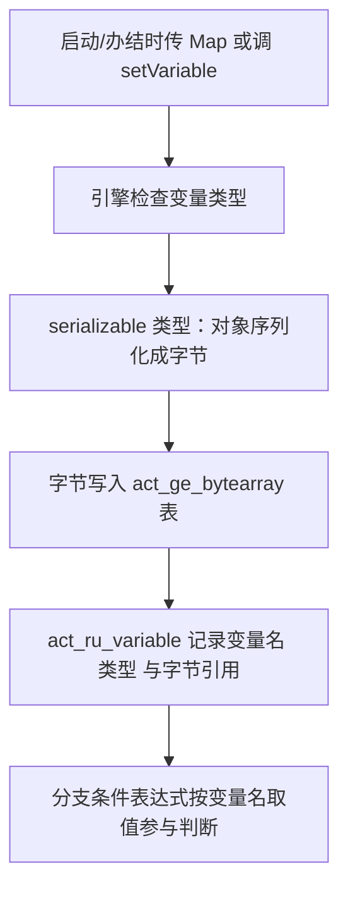
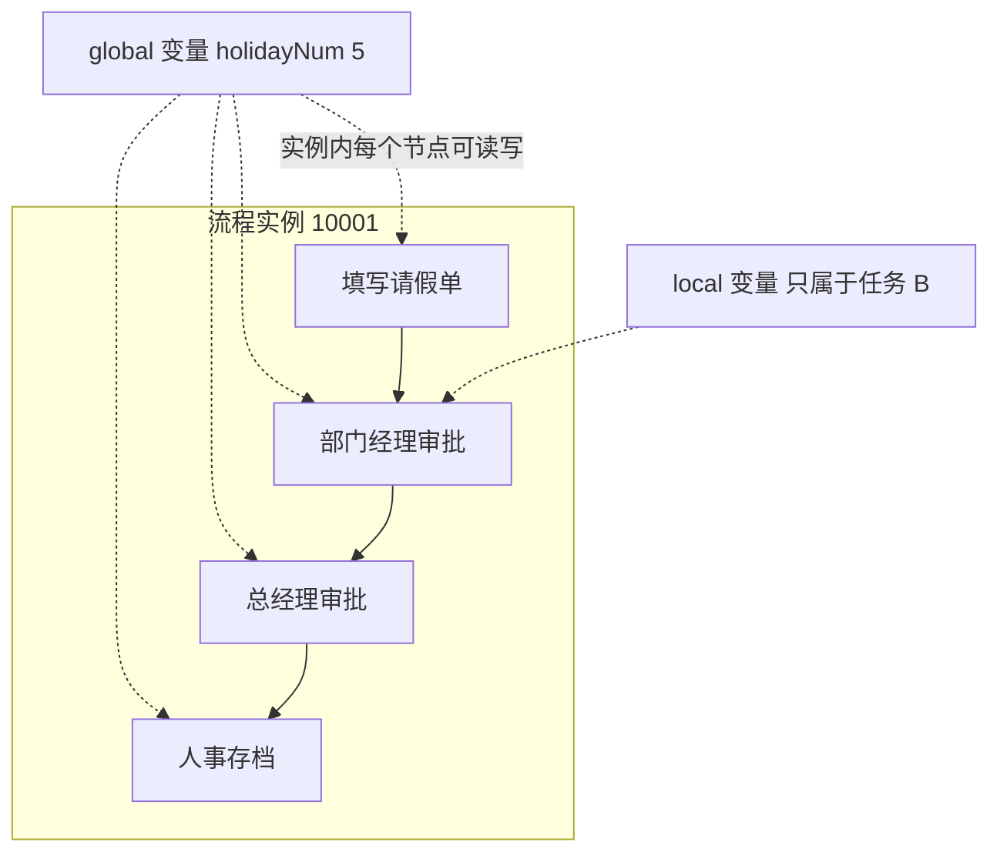
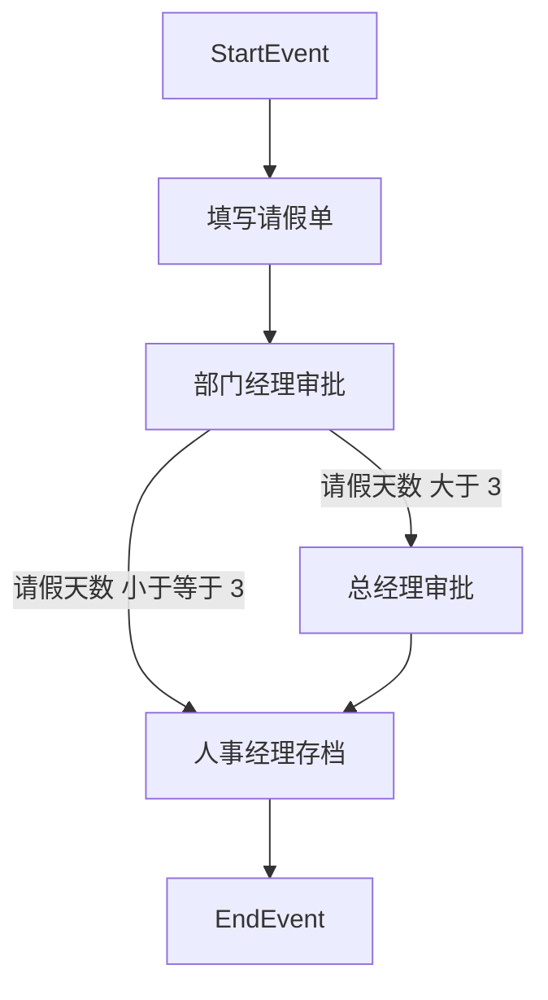
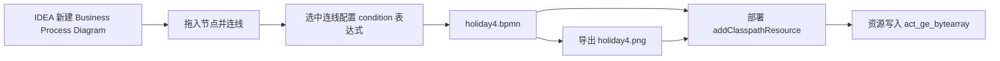
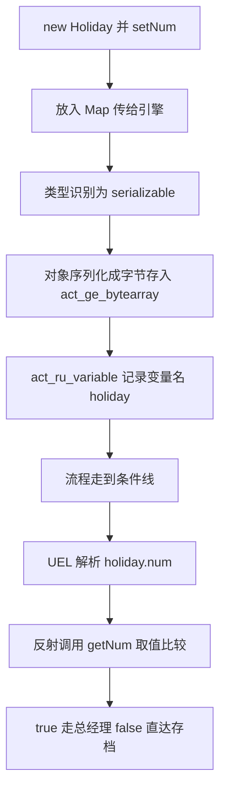

# Activiti中流程变量五讲：类型与作用域、请假分支案例的需求拆解、BPMN 定义与实体准备

## 先给结论

流程变量是把业务数据带进流程引擎的载体：请假天数放在变量里，连线的条件表达式才有值可比，同一张流程图才能长出不同的路。全系列五讲先讲清变量本身的规则，再以请假审批分支为案例把需求、流程图、实体类三件事备齐，构成变量实战的前半程。
规则层两讲：九种支持类型一张表，POJO 存入必须实现 Serializable 并显式生成 serialVersionUID，对象实际以序列化字节落进 act_ge_bytearray；作用域默认是整个流程实例的 global 变量，可收窄到单个任务的 local 变量，消费位置只有 assignee 与 condition 两处 UEL 表达式。
案例层三讲：需求拆解把「3 天及以下人事经理直接审、3 天以上先过总经理」翻译成分流点与两条条件连线；BPMN 定义落成 holiday4 流程图，条件写在连线 condition 属性上，`${holiday.num>3}` 这样的表达式要求变量先有值；Holiday 实体类七个字段，num 用 Float 承接半天假，getter 一个不落，否则表达式取不到属性。
五讲依次是：
- 数据类型及注意事项：九种类型、Serializable 硬门槛与落库链路。
- 作用域介绍：global 与 local 两种用法、变量在哪里被消费。
- 案例需求分析：分流点、判断依据与条件写在连线上的理由。
- 案例的 BPMN 定义：holiday4 流程图绘制与条件表达式写法。
- 案例的 POJO 类准备：Holiday 字段设计、序列化与 getter 职责。

## 第1部分：流程变量能存什么：类型表、序列化硬门槛与作用域

流程变量既然是变量，就有数据类型的问题。散装的数字、字符串、日期直接放进去没有悬念，想把 Holiday 这样的请假单对象整个放进变量，就会撞上序列化这道门槛。这一篇把支持的类型列全，把存对象的要求写清，顺带把变量的作用域说透。

### 一、九种类型一张表

课件引用的是引擎官方文档的变量类型表（Table 15.9 Variable Types），整理如下：

| Type name | 对应 Java 类型 | 说明 |
|---|---|---|
| string | java.lang.String | 字符串值 |
| integer | java.lang.Integer | 整型 |
| short | java.lang.Short | 短整型 |
| long | java.lang.Long | 长整型 |
| double | java.lang.Double | 双精度浮点 |
| boolean | java.lang.Boolean | 布尔值 |
| date | java.util.Date | 日期时间 |
| binary | 字节数组 | 二进制字节流 |
| serializable | 可序列化对象 | 实现了 Serializable 的 Java 对象 |

前七种覆盖了日常的标量场景，请假天数放 double、请假类型放 string、开始结束日期放 date，都不需要额外处理。binary 与 serializable 是给「大块数据」准备的：字节数组原样存，对象则要先过序列化这一关。

### 二、存对象：Serializable 是硬门槛

课程源码里的请假实体类，类声明上就带着这个要求（包名已改为 `com.example`）：

```java
package com.example.day04;

import java.io.Serializable;
import java.util.Date;

/**
 * 请假实体类:
 *    注意POJO类型，一定要实现Serializable接口，否则在存储这个pojo时就会报异常
 */
public class Holiday implements Serializable {
    private static final long serialVersionUID = 1L;

    private Integer id;
    private String holidayName; //申请人的名字
    private Date beginDate;     //开始时间
    private Date endDate;       //结束日期
    private Float num;          //请假天数
    private String reason;      //事由
    private String type;        //请假类型

    // getter/setter 省略
}
```

课程原本的类没有显式写 `serialVersionUID`，上面这一行是按课件注意事项补上的规范写法。课件对此的原文是：如果将 pojo 存储到流程变量中，必须实现序列化接口 serializable，为了防止由于新增字段无法反序列化，需要生成 serialVersionUID。

这两句话背后是同一个机制：变量里的对象不是按字段拆开存的，而是整体序列化成字节。序列化会连同类的版本指纹一起写入；不显式指定 `serialVersionUID` 时，JVM 按类结构自动算一个，将来实体类新增字段，算出的版本号就变了，库里留存的旧字节流反序列化时对不上版本，直接失败。显式固定一个值之后，类演进也保持版本兼容，新增字段按默认值处理。

### 三、对象落库的链路与变量的作用域

把一个对象塞进流程变量后，引擎内部发生的事可以串成一条线：



课程测试代码的注释里专门标注了这两张表：`act_ge_bytearray` 与 `act_ru_variable`。前者是通用字节表，流程定义的 bpmn、png 资源也存在这里；后者是运行时变量表，记录每个实例名下有哪些变量。对象本体在字节表里，变量表存的是名字和指向。

作用域方面，课件的表述是：流程变量的作用域默认是一个流程实例 processInstance，也可以是一个任务 task 或一个执行实例 execution。三个范围里流程实例最大，称为 global 变量；任务和执行实例只针对各自范围，称为 local 变量。日常开发绝大多数用默认的 global：变量在实例的所有节点都可读写，分支判断、任务表达式取的都是同一份。local 只在某个任务需要一份互不干扰的临时数据时才派上用场。

## 第2部分：同一个变量，张三和李四各有一份：流程变量的作用域与两种用法

流程定义只有一张，流程实例却在同时跑着无数个。张三提交的请假单里天数是 5，李四提交的是 1，这两个值各自放在哪、会不会互相污染、流程里哪些节点能读到、哪个节点读不到，是把流程变量用对之前必须想清楚的问题。作用域定了，变量才不会串。

### 一、默认作用域：整个流程实例

**第一，隔离边界是流程实例。** 变量跟着实例走：张三的请假流程启动时放入请假天数，这个值从开始节点到结束节点都归张三这个实例所有；李四再启动一个实例，拿到的是李四自己的那份，张三的变量对它完全不可见。实例跑完，变量随之清理，下次新起的实例又是从零开始。

**第二，实例级意味着全程可用。** 在「填写请假单」节点放进去的变量，到了部门经理审批、总经理审批、人事存档每个节点都能取。这一点是分支判断的地基：变量往往在流程靠前的节点写入，在靠后的连线 condition 上才被消费，中间隔了好几个节点，靠的正是实例级作用域。

课件把作用域列成三档：流程实例最大，任务 task 和执行实例 execution 较小。前者的变量称为 global 变量，后两者称为 local 变量。

| 维度 | global 变量 | local 变量 |
|---|---|---|
| 覆盖范围 | 整个流程实例 | 单个任务或执行实例 |
| 常用设置入口 | 启动、办结时传 Map，或 `setVariable` | `setVariableLocal` 系列 API |
| 变量名约束 | 实例内唯一，重复即覆盖 | 可与 global 或其他 local 同名 |
| 存储表现 | `act_ru_variable` 中只挂实例 | 该行还会记录所属任务 |
| 典型用途 | 请假天数等全局审批依据 | 某个任务节点内部的临时数据 |

### 二、local 变量：只归一个任务所有

设置变量的入口不止一个，先看课程源码里按实例 id 设置的方式（`2501` 是流程实例 id，第二个参数是变量名，第三个参数是变量名对应的值）：

```java
// 通过流程实例 id 设置变量，作用域为整个实例
runtimeService.setVariable("2501", "holiday", holiday);
```

这样设置的变量是 global 的，全实例可见。要把它收窄到某个任务上，换用任务服务对应的 local 方法（课程讲解了 local 语义，源码包里没有对应片段，下面是按该语义补全的可运行示例）：

```java
// 通过任务 id 设置 local 变量，只属于这一个任务
taskService.setVariableLocal("5002", "approveIdea", "部门经理同意");
// 读取时也必须带同一个任务 id
Object idea = taskService.getVariableLocal("5002", "approveIdea");
```

**global 的覆盖规则是后者优先。** 同一个实例里先设 holidayNum 等于 5，之后又设 holidayNum 等于 10，那么 10 生效，5 被覆盖。实例内变量名唯一，引擎按名字定位到变量行再改值，同名即覆写。

**local 的同名规则是各用各的。** 任务 A 上设 holidayNum 等于 5，任务 B 上设 holidayNum 等于 7，两个值互不干扰：A 读到 5，B 读到 7。local 与 global 同名也一样，在任务里读到的优先是 local 那份，出了这个任务，能读到的只剩 global。

下面这张图把两种作用域的覆盖面画在一起：



实线是流程走向，虚线是变量可见范围：global 一条线穿起四个节点，local 的虚线只连到部门经理审批这一个任务，到总经理节点就读不到了，想用就得自己再设一份。

### 三、变量在哪里被消费：assignee 与 condition

**第一处是任务负责人的分配。** assignee 属性里可以直接写 UEL 表达式，引擎在流转时求值，把结果当作任务负责人。课程源码在启动实例时一次性填好三个变量：

```java
// 启动流程实例，动态设置 assignee
Map<String, Object> map = new HashMap<>();
map.put("assignee0", "zhangsan");
map.put("assignee1", "lishi");
map.put("assignee2", "wangwu");
ProcessInstance processInstance =
        runtimeService.startProcessInstanceByKey("holiday2", map);
```

BPMN 里对应的写法是 `activiti:assignee="${assignee0}"`，变量名可以自取，`${}` 里也可以写对象点属性。

**第二处是连线的条件。** 选中一条连线，在 condition 里写 UEL 布尔表达式，例如 `${holidayNum>3}`：变量值大于 3 时表达式为 true，流程走这条线；变量取 1 时条件不成立，这条线被跳过。课件里的另一组例子是价格审批：涨价幅度满足 `${price>=10000}` 就要走总经理审批，`${price<10000}` 则直接进下一环；调薪场景同理，涨幅特别大的要加一道总裁审批。分流依据是什么，就把什么放进变量，再在连线上写判断。

两处位置的分工可以记成一句话：assignee 决定「这件事谁做」，condition 决定「流程往哪走」。

## 第3部分：3 天以内和 3 天以上走不同的路：请假审批分支的需求拆解

之前画的请假流程是一根线从开始捅到结束，所有节点人人有份。现实审批不是这样：请 1 天假还让总经理过目是浪费，请半个月只让部门经理点头是失守。要让同一张流程图长出两条路，得先把需求掰开揉碎，弄清楚在哪分、凭什么分、分完怎么汇合。

### 一、把需求句翻译成流程结构

课件需求原文：员工创建请假申请单，由部门经理审核，部门经理审核通过后请假 3 天及以下由人事经理直接审核，3 天以上由总经理审核，总经理审核通过再由人事经理存档。

逐句对应到流程元素：

| 需求原句 | 流程元素 |
|---|---|
| 员工创建请假申请单 | 第一个用户任务：填写请假单 |
| 由部门经理审核 | 第二个用户任务：部门经理审批 |
| 3 天以上由总经理审核 | 条件连线指向的用户任务：总经理审批 |
| 3 天及以下由人事经理直接审核 | 条件连线直达：人事经理存档 |
| 总经理审核通过再由人事经理存档 | 总经理审批汇入人事经理存档 |
| 存档之后结束 | EndEvent |

**「及以下」三个字是边界的归属。** 3 天整走的是人事经理直审那条线，条件要写成天数小于等于 3 才涵盖它；写成小于 3，请 3 天整的单子就会被推去总经理。需求分析阶段就要把边界钉死，后面表达式怎么写都不会含糊。

### 二、两条路径走读

部门经理审批完成后，流程遇到第一个岔路口，岔路口只有一个裁判：流程变量里的请假天数。天数大于 3，流程走上面的线，总经理审批生成任务，审完再进人事存档；天数小于等于 3，流程直接落进人事经理存档，总经理节点从头到尾没有存在过任务记录。



两种典型取值下各节点的行为对比：

| 场景 | 部门经理审批 | 总经理审批 | 人事经理存档 |
|---|---|---|---|
| 请 5 天 | 生成任务 | 生成任务 | 生成任务 |
| 请 1 天 | 生成任务 | 不生成 | 生成任务 |

关键路径在图中一目了然：两条支路只有一个分岔点，也只有一个汇合点，汇合之后的尾段完全一致，存档与结束事件全流程各只有一个。

### 三、为什么把条件写在连线上

连线的 condition 是一个 UEL 布尔表达式，流程流转到这条线时引擎求值：true 走，false 跳。落到 BPMN 里，两条出口线各带一个条件表达式（细节在流程定义一篇展开）：

```xml
<!-- 部门经理审批之后两条互斥的条件线 -->
<conditionExpression xsi:type="tFormalExpression">${holiday.num &gt; 3}</conditionExpression>
<conditionExpression xsi:type="tFormalExpression">${holiday.num &lt;= 3}</conditionExpression>
```

条件里引用的变量得先有人放进去，通常是在启动实例时随 Map 传入：

```java
// 启动实例时把请假单对象放进变量，岔路口才有值可比
map.put("holiday", holiday);
ProcessInstance processInstance =
        runtimeService.startProcessInstanceByKey(key, map);
```

也可以由部门经理办理任务时通过 `taskService.complete(任务id, map)` 传入。无论哪种时机，只要在流程走到岔路口之前放进去即可。

除了直接在连线上写 condition，BPMN 规范还提供了排他网关：分岔处放一个网关节点，出口线上各自写条件，行为等价。这个案例采用的是连线条件的方式，图面更简洁。

### 四、这个案例练的是什么

它是 global 变量控制流程走向的最小完整闭环：一个变量、一处判断、两条路。把它的四件事想通，商品涨价超过一万块加审一道、调薪幅度过大找总裁复核这类需求都是同一个模型的换皮：

- 变量装的是审批依据（请假天数、涨价幅度、调薪幅度）；
- 判断写在分岔处的出口线上；
- 每条路都有明确的条件且条件互补；
- 各条路最后汇到同一个收尾节点。

## 第4部分：把分流画进流程定义：holiday4 流程图的绘制与条件连线

需求定了，接下来把分流落成 BPMN。在 IDEA 的资源目录下右键新建一个 Business Process Diagram，起名 holiday4，画布就打开了。画节点连线本身不难，难的是那两条分叉线怎么让引擎看懂：条件写在哪儿、表达式怎么写、部署时带哪些文件，这一步都有讲究。

### 一、画图：五个节点加一个岔路

节点的摆放照着审批链路来：StartEvent 拖进来打头，EndEvent 收尾，中间按顺序放四个用户任务，填写请假申请单、部门经理审批、总经理审批、人事经理存档。连线时把岔路画出来：部门经理审批引出两条线，一条到总经理审批，一条直达人事经理存档，总经理审批完成后再连回人事经理存档。

整条生产链路是这样的：



图中关键的一步是 C 到 D：条件表达式是写在 bpmn 文件里的，编辑器只是替你把属性面板上的输入落成 XML。画完的图同时承担两个身份，一个是给引擎执行的流程定义，一个是给流程图预览用的 png 图片。

### 二、条件表达式：写在连线 condition 上

选中部门经理审批出来的连线，属性面板里找到 condition，填 UEL 表达式。到总经理审批那条线写 `${holiday.num>3}`，到人事存档那条线写 `${holiday.num<=3}`。注意这里用的不是裸变量，而是 `holiday.num`：holiday 是变量名，num 是 Holiday 对象身上的属性，引擎取出对象、拿到 num 属性的值再和 3 比较。

落到 XML 里，条件线就是带 conditionExpression 的 sequenceFlow（资料包未附该 bpmn 文件，以下片段按课件画面与课程操作补全）：

```xml
<!-- 部门经理审批之后的两条互斥条件线 -->
<sequenceFlow id="flow_toGM" name="3天以上" sourceRef="usertask_manager" targetRef="usertask_gm">
    <conditionExpression xsi:type="tFormalExpression">${holiday.num &gt; 3}</conditionExpression>
</sequenceFlow>
<sequenceFlow id="flow_toArchive" name="3天及以下" sourceRef="usertask_manager" targetRef="usertask_archive">
    <conditionExpression xsi:type="tFormalExpression">${holiday.num &lt;= 3}</conditionExpression>
</sequenceFlow>
```

**XML 里的比较号要转义。** `>` 在 XML 文本里能直接写，`<` 不行，会被当成标签的开始，必须写成 `&lt;`。所以 `${holiday.num <= 3}` 进了 bpmn 文件就是 `${holiday.num &lt;= 3}`。编辑器生成时通常会自动处理，手工改 XML 时最容易在这里翻车。

**等价的排他网关写法。** 在部门经理审批后面放一个 `exclusiveGateway`，两条出口线照样写条件：

```xml
<!-- 显式排他网关，行为与直接在连线上写条件等价 -->
<exclusiveGateway id="gw_days" name="请假天数判断"/>
<sequenceFlow id="flow_manager_gw" sourceRef="usertask_manager" targetRef="gw_days"/>
<sequenceFlow id="flow_toGM" sourceRef="gw_days" targetRef="usertask_gm">
    <conditionExpression xsi:type="tFormalExpression">${holiday.num &gt; 3}</conditionExpression>
</sequenceFlow>
```

网关方式在图上有一个显式的菱形决策点，语义更清楚；直接在连线上写条件图面更简洁。引擎执行时都按「条件为真的那条线」走，两种写法选哪种看团队习惯。

### 三、部署：bpmn 与 png 一起进库

课程源码的部署方法，资源路径就是画好的这两个文件：

```java
// 新的请假流程定义的部署
ProcessEngine processEngine = ProcessEngines.getDefaultProcessEngine();
RepositoryService repositoryService = processEngine.getRepositoryService();
Deployment deploy = repositoryService.createDeployment()
        .addClasspathResource("diagram/holiday4.bpmn")
        .addClasspathResource("diagram/holiday4.png")
        .name("请假流程-流程变量")
        .deploy();
System.out.println(deploy.getId());
System.out.println(deploy.getName());
```

png 是流程图的图片版。设计器里的小技巧：把 bpmn 文件复制一份，扩展名改成 xml，用设计器打开后另存为图片导出 png，再把副本改回 bpmn 后缀，原图不受影响。部署之后 bpmn 与 png 都落在 `act_ge_bytearray` 表，流程实例运行中的流程图预览用的就是这张图。

### 四、变量名必须与表达式对得上

分支线上的表达式写了 `holiday.num`，就意味着流程走到岔路口之前，实例的变量表里必须已经有一个叫 holiday 的变量，它是 Holiday 类型、带 num 属性的 getter。缺了任何一环，条件线求值就失败。表达式里能写什么，决定了下一步准备什么样的变量：接下来要写的 POJO 类，就是为 `${holiday.num>3}` 这个表达式服务的。

## 第5部分：请假实体类 Holiday：字段设计、序列化与 getter 的隐藏职责

流程定义里那两条条件线写的是 `${holiday.num>3}`，取的是一个叫 holiday 的变量身上的 num 属性。变量表里得真有这么一个对象，条件才有值可比。这一步的活儿看起来朴素：写一个请假实体类。但类怎么设计，直接决定表达式能不能取到值、对象能不能存进表，是整个案例能跑通的前提。

### 一、七个字段与一个接口

课程源码里的请假实体类，类声明上就带着那条硬性要求（包名已改为 `com.example`）：

```java
package com.example.day04;

import java.io.Serializable;
import java.util.Date;

/**
 * 请假实体类:
 *    注意POJO类型，一定要实现Serializable接口，否则在存储这个pojo时就会报异常
 */
public class Holiday implements Serializable {
    private Integer id;
    private String holidayName;//申请人的名字
    private Date beginDate;//开始时间
    private Date endDate;//结束日期
    private Float num;//请假天数
    private String reason;//事由
    private String type;//请假类型

    public Integer getId() {
        return id;
    }

    public void setId(Integer id) {
        this.id = id;
    }

    public String getHolidayName() {
        return holidayName;
    }

    public void setHolidayName(String holidayName) {
        this.holidayName = holidayName;
    }

    public Date getBeginDate() {
        return beginDate;
    }

    public void setBeginDate(Date beginDate) {
        this.beginDate = beginDate;
    }

    public Date getEndDate() {
        return endDate;
    }

    public void setEndDate(Date endDate) {
        this.endDate = endDate;
    }

    public Float getNum() {
        return num;
    }

    public void setNum(Float num) {
        this.num = num;
    }

    public String getReason() {
        return reason;
    }

    public void setReason(String reason) {
        this.reason = reason;
    }

    public String getType() {
        return type;
    }

    public void setType(String type) {
        this.type = type;
    }
}
```

字段与含义一一对应：

| 字段 | 类型 | 含义 |
|---|---|---|
| id | Integer | 请假单主键 |
| holidayName | String | 请假申请人名字 |
| beginDate | Date | 开始日期 |
| endDate | Date | 结束日期 |
| num | Float | 请假天数 |
| reason | String | 请假事由 |
| type | String | 请假类型，如病假、婚假 |

**num 选 Float 是业务倒逼的。** 请半天假、请一天半都是真实场景，整型装不下 0.5，Float 天然支持。条件表达式 `${holiday.num>3}` 拿到的值也就可能是 1.5 这类小数，比较逻辑同样成立。

**getter/setter 是全选一次性生成的。** 课件的操作是七个字段全部勾上、一次生成，一个不漏。生产代码还应该补一行显式的 `serialVersionUID`，防止实体类日后新增字段时，历史实例里留存的旧变量无法反序列化。

### 二、变量放进实例的三个时机

课件 3.5.3 节列了两种设置 global 变量的时机，启动流程时和任务办理时，作用域都是整个流程实例。课程源码把三个入口都写了出来。

启动流程实例时设置，变量随 Map 一起传入：

```java
// 启动流程实例，同时设置流程变量的值
Map<String, Object> map = new HashMap<>();
Holiday holiday = new Holiday();
holiday.setNum(5F);
map.put("holiday", holiday);
ProcessInstance processInstance =
        runtimeService.startProcessInstanceByKey(key, map);
```

办理任务时设置，在完成任务的那一刻把变量补进去：

```java
// 完成任务时设置流程变量的值
taskService.complete(task.getId(), map);
```

实例已经启动还可以按实例 id 补设：

```java
// 第一个参数是流程实例 id，第二个是变量名，第三个是值
runtimeService.setVariable("2501", "holiday", holiday);
```

课件代码里还有另一种放法：Map 的 key 用 num，value 用 `holiday.getNum()`，只把天数这一个标量放进变量。两种放法都能驱动分支，区别在表达式：放标量就写 `${num>3}`，放对象就写 `${holiday.num>3}`。流程定义里两条条件线用的是对象属性写法，所以代码里必须把整个对象放进去，两边要对得上。

### 三、getter 为什么要一个不少

从 new 一个对象到条件线完成判断，中间是一条完整的链路：



链路末端揭示了 getter 的隐藏职责：表达式求值时，引擎从变量表拿到对象，按属性名 num 拼出 getNum 方法反射调用。字段是私有的，引擎能用的也只有公开的 getter，少了 getNum，`${holiday.num>3}` 直接抛属性不存在的异常。这一层和序列化是两回事：序列化把对象整体变成字节落库，考验的是类有没有实现 Serializable；表达式取值考验的是 getter 齐不齐。一个管「存得进去」，一个管「取得出来」。

课程还留了一个验证手段：把 Serializable 从类声明上暂时去掉再跑一遍，亲眼看一次存储时的报错，比背结论记得牢。验证完记得加回去。

### 四、准备工作齐了之后会发生什么

流程定义图和实体类都就位，接下来启动实例就能看到分支生效：变量里放 5 天，部门经理审完走总经理审批再进存档；放 1 天，部门经理审完直接落存档。裁决依据就是这个对象身上的 num。POJO 这一步看着不起眼，它同时供着三张嘴：业务代码读写靠 setter 和 getter、存储落库靠 Serializable、UEL 表达式取值靠 getter，三处都通，案例才算真正就绪。

## 常见误区

- **实体类不实现 Serializable 就往变量里塞**：设置变量的瞬间抛序列化异常，启动实例或办结任务的调用直接失败。接口是存对象的前提，不是建议。
- **实现了接口却不写 serialVersionUID**：短期看不出问题，实体类一加字段，库里历史实例的旧变量就反序列化失败，这类故障往往在上线一段时间后才爆发。
- **把大文件当流程变量存**：binary 与 serializable 类型都会把内容写进 `act_ge_bytearray`，附件、图片这类大对象会把表撑大并拖慢序列化，正确做法是文件进文件系统或对象存储，变量里只放引用。
- **把 global 和 local 混为一谈**：默认设置的变量是实例级的，全流程共享；限定在任务或执行实例上的变量只有局部可见性，误用会导致下游节点取不到值。
- **把流程变量当成全局静态缓存**：以为所有实例共享一份数据。实际变量按实例隔离，各自落在 `act_ru_variable` 的不同行上，张三的 5 天污染不了李四的 1 天。
- **用 `setVariableLocal` 设完就盼着下游用**：local 变量出了所属任务就不存在，下游节点取值会取到空或直接抛错。要跨节点共享，就用实例级的 `setVariable` 或启动、办结时传 Map。
- **global 变量重复设置却期待两个值并存**：实例内变量名唯一，后设的覆盖先设的。要同时保留两份数据，得起不同的变量名。
- **连线的 condition 引用了还没赋值的变量**：流程走到分支时引擎对表达式求值，变量不存在会直接求值失败。必须在分支之前（启动时或前序节点办理时）把变量放进去。
- **边界漏掉「等于 3」**：条件写成大于 3 与小于 3 之间留下真空，请 3 天整的单子两条线都不满足，流程卡死。两侧条件必须互补，一侧大于 3，另一侧小于等于 3。
- **以为不满足的分支会「走一遍但不办」**：条件不成立的线不执行，目标节点不生成任务，历史表中也没有该节点的活动记录。
- **把存档拆成两个节点**：两条路应汇到同一个人事经理存档任务，而不是各画一个存档节点、各画一个结束事件，否则结束判定会混乱。
- **分流依据没有先放入变量**：岔路口求值时取不到变量直接失败。启动或前序节点办结时必须完成变量设置。
- **`<` 没转义**：手写 XML 时 `${holiday.num <= 3}` 里的 `<` 会被解析器当成标签起始，部署直接报解析错误，必须写成 `&lt;`。
- **两条出口线只给一条配条件**：另一条不带条件会被引擎当作恒真，分流结果就不再由天数决定。互斥分支的每条出口线都要有自己的条件，或者显式指定一条默认线兜底。
- **表达式里的属性名和实体字段对不上**：写成 `holiday.number` 而实体字段是 num，求值时找不到属性直接报错，两边改名要同步。
- **变量还没设置就到岔路口**：启动时忘传 Map，前序任务办结时也没传，走到条件线时取不到值，实例停在原地。
- **漏生成某个 getter**：表达式引用了没生成 getter 的属性，求值时抛属性不存在的异常。生成时全选，新增字段后重新生成。
- **num 定义成 Integer 或 int**：半天、一天半表达不了，1.5 天的单子在分支判断里行为失真。天数用 Float。
- **改了字段名没同步表达式**：BPMN 里还写着 `holiday.num`，实体里字段已经改名，两边对不上，分支求值失败且报错位置在流程运行期，不好排查。

## 面试可能被问到的问题

1. 面试官追问：「流程变量支持哪些数据类型？」
   答：string、integer、short、long、double、boolean、date、binary、serializable 九种。前七种对应常见标量，binary 存字节数组，serializable 存实现了 Serializable 接口的对象。

2. 面试官追问：「POJO 存进流程变量有什么要求？」
   答：必须实现 `java.io.Serializable`，因为对象是整体序列化后按字节存储的，不实现接口存入时直接抛异常。同时建议显式生成 serialVersionUID，避免类新增字段后旧变量反序列化失败。

3. 面试官追问：「serialVersionUID 不写会怎样？」
   答：JVM 会按类结构自动计算一个版本号，类结构一变（比如新增字段），版本号随之改变，数据库里留存的旧字节流与新类对不上版本，反序列化直接失败。显式固定版本号能让类演进保持兼容。

4. 面试官追问：「流程变量存在哪几张表里？」
   答：运行时变量记录在 `act_ru_variable`，较大的值（字节数组、序列化对象）本体在 `act_ge_bytearray` 里，变量表保存变量名、类型与引用。流程实例结束后运行时变量随之清理。

5. 面试官追问：「流程变量的作用域有哪些，默认是哪个？」
   答：三种作用域，流程实例 processInstance、执行实例 execution、任务 task。默认是流程实例级，即 global 变量，整个实例范围内可读写；后两种范围小，称为 local 变量，只在各自范围内有效。

6. 面试官追问：「流程变量的作用域有哪几种？默认是哪种？」
   答：三种，流程实例、执行实例、任务。默认是流程实例级，即 global 变量，从启动到结束全实例可读写；后两种范围小，称为 local 变量，只在各自范围内有效。

7. 面试官追问：「global 和 local 变量同名会怎样？」
   答：互不影响。local 只在其所属任务内可见，任务里取值优先拿到 local 那份；出了任务，能读到的就是 global 的值。两个 local 同名同理，各自任务读各自的。

8. 面试官追问：「怎么把一个变量限定在单个任务里？」
   答：用 `taskService.setVariableLocal(任务id, 变量名, 值)` 设置，读取用对应的 `getVariableLocal`。变量行上会记录所属任务 id，出了这个任务别的节点便取不到它。

9. 面试官追问：「UEL 表达式可以写在流程定义的哪些位置？」
   答：主要是两处：任务节点的 assignee 属性，用来动态指定负责人；连线或排他网关出口的 condition 条件，用来决定流程走向。`${}` 里既可以放变量名，也可以写对象点属性。

10. 面试官追问：「连线上条件表达式的求值时机和返回值要求是什么？」
   答：流程流转到这条连线时求值，表达式必须是布尔结果。返回 true 流程走这条线；返回 false 这条线被跳过，若所有候选线都为 false 且没有默认线，流程实例会停在原地无法继续。

11. 面试官追问：「这个请假流程的分支判断发生在哪个环节？」
   答：部门经理审批之后。其后的两条连线各自携带 condition 布尔表达式，引擎按流程变量里的请假天数求值，为 true 的线被执行。

12. 面试官追问：「3 天及以下和 3 天以上的条件怎么写才不漏边界？」
   答：一侧写大于 3，另一侧写小于等于 3，两侧互补覆盖全部取值。若写成大于 3 与小于 3，等于 3 的单子两条线都不满足，流程无法流转。

13. 面试官追问：「不满足条件的分支节点会有记录吗？」
   答：不会有。条件不成立的线不执行，目标节点不生成任务，历史表中也没有该节点的活动记录，而不是生成了任务再自动跳过。

14. 面试官追问：「分支判断的变量什么时候设置进去？」
   答：必须在流程走到岔路口之前。常见做法是启动流程实例时随 Map 传入，或者在部门经理办结任务时通过 complete 传入，两种方式设置的默认都是实例级变量。

15. 面试官追问：「条件写在连线上和用排他网关有什么区别？」
   答：运行行为等价，都是按出口线条件的求值结果选一条执行。网关在图上是显式决策节点，语义更清楚；直接在连线上写条件图面更简洁。分支多、易扩展的场景建议用网关。

16. 面试官追问：「conditionExpression 里的表达式是什么语法？」
   答：UEL 表达式。可以引用流程变量名，也可以写对象点属性如 `${holiday.num>3}`，引擎对表达式求布尔值，为 true 的线被执行。

17. 面试官追问：「两条条件线都不满足会怎样？」
   答：排他选择要求至少一条线可走。全部为 false 且没有默认线时，流程实例停在该处无法继续，所以互斥分支要么条件互补，要么给一条默认线兜底。

18. 面试官追问：「bpmn 与 png 部署后存在哪？」
   答：都存在 `act_ge_bytearray` 表，按部署 id 关联；`act_re_procdef` 记录流程定义的 key 与版本信息，流程图预览读取的就是部署进去的 png 资源。

19. 面试官追问：「条件表达式能用对象的属性吗？」
   答：可以。变量里放一个实现了 Serializable 的对象，表达式写对象名点属性名，引擎通过 getter 取值。这也是实体类的 getter 必须齐全的原因。

20. 面试官追问：「为什么流程变量里的 POJO 必须实现 Serializable？」
   答：对象整体序列化成字节后存入 act_ge_bytearray 表，不实现接口序列化直接失败，设置变量的调用当场抛异常。建议同时显式生成 serialVersionUID，保证类演进后旧变量仍可反序列化。

21. 面试官追问：「UEL 表达式 ${holiday.num>3} 是怎么取到值的？」
   答：引擎从变量表取出 holiday 对象，按属性名 num 解析出 getNum 方法，反射调用拿到值再与 3 比较。所以 getter 必须存在，属性名与字段名要一致。

22. 面试官追问：「变量放标量和放整个对象有什么区别？」
   答：放标量时表达式直接写变量名，如 `${num>3}`；放对象时表达式写对象点属性，如 `${holiday.num>3}`。放对象能把整张请假单带给下游节点使用，信息量更大；标量更轻，适合只有一个判断依据的场景。

23. 面试官追问：「请假天数字段为什么用 Float？」
   答：业务上存在半天、一天半，整型无法表示小数天数。Float 支持 0.5 粒度，分支比较同样适用。

24. 面试官追问：「任务办理时设置的变量作用域是什么？」
   答：与启动时设置一样，默认都是整个流程实例的 global 变量，入口是 complete 时传 Map。需要限定在单个任务内时，用 setVariableLocal 收窄成 local 变量。

## 配套资料

- 请假实体类源码：`materials/code/02/Activiti7-day04-进阶2/Activiti7-day04-进阶2/源码/更新后的代码/代码/src/main/java/` 下 day04 流程包中的 `Holiday.java`（serialVersionUID 为按课件注意事项补全的规范写法）
- 存对象的变量测试：同 day04 流程包中的 `VariableTest.java`（类注释标注了 `act_ge_bytearray`、`act_ru_variable` 两张表）
- 变量设置的其他时机：同 day04 流程包中的 `VariableTest2.java`、`VariableTest3.java`
- 按实例 id 设置变量：`materials/code/02/Activiti7-day04-进阶2/Activiti7-day04-进阶2/源码/更新后的代码/代码/src/main/java/` 下 day04 流程包中的 `VariableTest3.java`
- 启动时设置 assignee 变量：同 day04 流程包中的 `AssigneeUEL.java`
- 任务办理时设置变量：同 day04 流程包中的 `VariableTest2.java`（`taskService.complete` 传 Map 的用法）
- local 变量的 `setVariableLocal` 示例为按课程讲解的语义补全，源码包未附对应文件
- 案例流程的部署与变量设置代码：`materials/code/02/Activiti7-day04-进阶2/Activiti7-day04-进阶2/源码/更新后的代码/代码/src/main/java/` 下 day04 流程包中的 `VariableTest.java`（启动实例时传入 Holiday 对象）
- 任务办理时设置变量：同 day04 流程包中的 `VariableTest2.java`
- 按实例 id 补设变量：同 day04 流程包中的 `VariableTest3.java`
- 需求描述出自本课课件 3.5.1 节，资料包未附该节独立源码，文中 XML 片段为按课程写法补全
- 部署代码（`diagram/holiday4.bpmn` 与 png 的加载）：`materials/code/02/Activiti7-day04-进阶2/Activiti7-day04-进阶2/源码/更新后的代码/代码/src/main/java/` 下 day04 流程包中的 `VariableTest.java`（部署方法）
- 变量设置时机对照：同 day04 流程包中的 `VariableTest2.java`、`VariableTest3.java`
- holiday4.bpmn 源文件资料包未附，文中 XML 片段为按课件画面与课程操作补全的可运行写法
- 请假实体类：`materials/code/02/Activiti7-day04-进阶2/Activiti7-day04-进阶2/源码/更新后的代码/代码/src/main/java/` 下 day04 流程包中的 `Holiday.java`（文中包名已改为 `com.example`）
- 启动时设置变量：同 day04 流程包中的 `VariableTest.java`
- 任务办理时设置变量：同 day04 流程包中的 `VariableTest2.java`，按实例 id 补设见 `VariableTest3.java`
