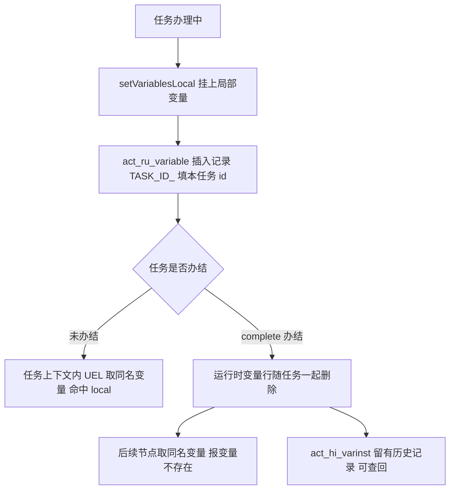

# Local 局部变量：把流程变量的作用域缩到一个任务

Global 变量是整个流程实例共享的：同一个名字在整个实例里只有一个值，不管哪个节点设的、何时设的，其他节点都读得到。可有些数据天生只属于某一个节点，部门经理审批时记录的信息只对这一站有意义，总经理审批不该再看到它。Local 局部变量就是把流程变量的作用域从实例级缩到任务级的那个开关。

## 先给结论

- 设置 API 与 global 一一对应，只是多一个 Local 后缀：`taskService.setVariablesLocal(taskId, map)` 与 `taskService.setVariableLocal(taskId, name, value)`。
- 作用域只覆盖当前任务：任务办结，变量随任务从运行时消失，后续节点再取同名变量会报变量不存在。
- 每个任务都可以设同名的 local 变量，互不影响。
- 值并没有丢，`act_hi_varinst` 里留有记录，用 `historyService` 的历史任务查询配合 `includeTaskLocalVariables()` 可以查回来。
- 流程图零改动：UEL 表达式照旧写，local 改变的是取值的作用域，不是建模方式。

## 一、global 与 local 的分工

打个比方：global 是贴在流程实例上的公共白板，实例里所有节点都能读能写；local 是任务自己的便签，任务一结束便签就撕掉。落到表上，两者同住 `act_ru_variable`，靠 `TASK_ID_` 列分家：global 变量该列为空，local 变量填着所属任务的 id。global 的「办理任务时设置」与「按任务 ID 设置」两种写法，在 local 这里都有对应版本，方法名换后缀，参数顺序不变。TaskService 之外，RuntimeService 上也有一组按执行流 ID 设置的 Local 方法，把局部变量挂到执行流上，作用域随执行流结束而失效，思路与任务级一致。本课聚焦任务级：审批场景里局部数据几乎总是跟着任务走，任务级 API 覆盖了绝大多数用法。

## 二、两种设置方式

**办理任务时设置**，在 `complete` 之前把变量挂到当前任务上（day05 源码包中没有对应的独立测试类，示例按本课 PPT 的写法补全）：

```java
@Test
public void completeTask() {
    // 任务 id
    String taskId = "2504";
    ProcessEngine processEngine = ProcessEngines.getDefaultProcessEngine();
    TaskService taskService = processEngine.getTaskService();
    // 定义流程变量
    Map<String, Object> variables = new HashMap<String, Object>();
    Holiday holiday = new Holiday();
    holiday.setNum(3);
    // 变量名是 holiday，变量值是 holiday 对象
    variables.put("holiday", holiday);
    // 设置 local 变量，作用域为该任务
    taskService.setVariablesLocal(taskId, variables);
    taskService.complete(taskId);
}
```

**按任务 ID 设置**，不办结、只挂变量：

```java
@Test
public void setLocalVariableByTaskId() {
    // 当前待办任务 id，必须是 act_ru_task 中还存在的那条记录
    String taskId = "1404";
    TaskService taskService = ProcessEngines.getDefaultProcessEngine().getTaskService();
    Holiday holiday = new Holiday();
    holiday.setNum(3);
    // 通过任务设置 local 流程变量
    taskService.setVariableLocal(taskId, "holiday", holiday);
    // 一次设置多个值用 taskService.setVariablesLocal(taskId, variables)
}
```

与 global 的写法逐字对比，只有方法名里多出的 Local 一个差别，这也意味着手滑漏写后缀不会有任何编译期提示，变量会悄悄设成实例级。

## 三、生命周期：任务结束即失效

local 变量的生死完全绑定任务：



两个推论直接从这个生命周期里长出来。其一，同名互不影响：部门经理审批的任务设 local 变量 `holiday` 值为 3，总经理审批的任务再设同名 local 变量按自己的值算，两张便签互不覆盖，这就是「每个任务可以设置同名的变量，互不影响」的含义。其二，同名遮蔽：同一任务上下文里求 `${holiday.num}` 这类表达式时，引擎沿作用域由近及远找，先命中任务自己的 local，找不到才落到实例级的 global；出了这个任务，local 已删，剩下的只有 global。

反过来的场景要警惕：任务办结后 local 消失，如果后续节点的连线条件或表达式依赖的恰恰是这个 local 变量，流程推进到那里会直接报错，这是测试 local 变量时最常撞见的异常。

## 四、任务结束后怎么找回

值在运行时没了，历史表里还在。查询思路是创建历史任务实例查询对象，声明要把 local 变量一并带出来：

```java
// 创建历史任务查询对象
HistoricTaskInstanceQuery historicTaskInstanceQuery = historyService
        .createHistoricTaskInstanceQuery();
// 查询结果包括 local 变量
historicTaskInstanceQuery.includeTaskLocalVariables();
List<HistoricTaskInstance> list = historicTaskInstanceQuery.list();
for (HistoricTaskInstance h : list) {
    System.out.println("任务 Id: " + h.getId());
    System.out.println("任务名称: " + h.getName());
    System.out.println("任务负责人: " + h.getAssignee());
    System.out.println("任务 local 变量: " + h.getTaskLocalVariables());
}
```

适用场景也明确：部门经理、总经理、人事经理审批时各自设置过 local 变量，事后审计要还原每个节点当时的取值，就靠这个查询逐任务列出来。同一个查询器上还有个孪生方法 includeProcessVariables()，把 global 变量一并带出，两者可以同时调用，结果对象上用 getTaskLocalVariables 与 getProcessVariables 分别取两份值。审计场景通常两个都要：既要还原每个节点写了什么局部便签，也要还原实例级公共数据当时的快照。

## 常见误区

- **以为 local 变量会传给下一节点**：办结即删，后续节点取不到直接报错。需要跨节点传递的数据用 global，local 只服务当前任务。
- **手滑用成 global 的方法**：`setVariables` 与 `setVariablesLocal` 一字之差，落库时 `TASK_ID_` 一个为空一个有值，变量级别就此改变，要回看 `act_ru_variable` 才能发现设错。
- **对已办结任务设置 local 变量**：任务 id 必须是 `act_ru_task` 里还存在的待办任务，拿历史任务 id 去设置会报错。
- **把 local 当持久化存储用**：运行时虽然删了，历史表能查回，但那是为审计准备的；业务上要长期保留的值，应该在办结回调里写进业务表。

## 面试可能被问到的问题

1. 面试官追问：「Global 变量和 Local 变量的区别是什么？」
   答：作用域不同。global 挂在流程实例上，实例存续期内始终可读，同名只有一个值；local 绑定具体任务，只在任务存续期有效，办结即从运行时消失，不同任务可以设同名 local 变量互不影响。

2. 面试官追问：「数据库层面怎么区分两种变量？」
   答：两者都在 `act_ru_variable`，看 `TASK_ID_` 列。global 变量该列为空，只填执行流与实例 id；local 变量填所属任务 id。历史侧 `act_hi_varinst` 同理。

3. 面试官追问：「local 变量任务结束后还能拿到吗？」
   答：运行时拿不到了，但 `act_hi_varinst` 保留了历史记录。用 `historyService.createHistoricTaskInstanceQuery()` 配合 `includeTaskLocalVariables()` 查询历史任务，能取到当时的 local 变量值。

4. 面试官追问：「同一个任务里，同名的 global 和 local 谁生效？」
   答：任务上下文内求值时 local 优先，引擎沿作用域由近及远解析。设置 local 变量不影响 global 那一份的值，出了这个任务，local 失效，global 恢复可见。

5. 面试官追问：「什么业务场景会用到 local 变量？」
   答：典型的是各节点内部数据：审批意见、某个节点的临时核算结果。这类值只对当前任务有意义，既不想污染实例级变量名，也不想被后续节点读到，用 local 最干净。

## 配套资料

- day05 源码工程：`materials/code/02/Activiti7-day05-进阶3/Activiti7-day05-进阶3/源码/activiti01/`（本课无 Local 变量的独立测试类，文中示例按本课 PPT 的写法补全，包名已改 `com.example`）
- global 写法对照：`materials/code/02/Activiti7-day04-进阶2/Activiti7-day04-进阶2/源码/更新后的代码/代码/src/main/java/` 下 day04 包中的 `VariableTest.java`、`VariableTest2.java`、`VariableTest3.java`
