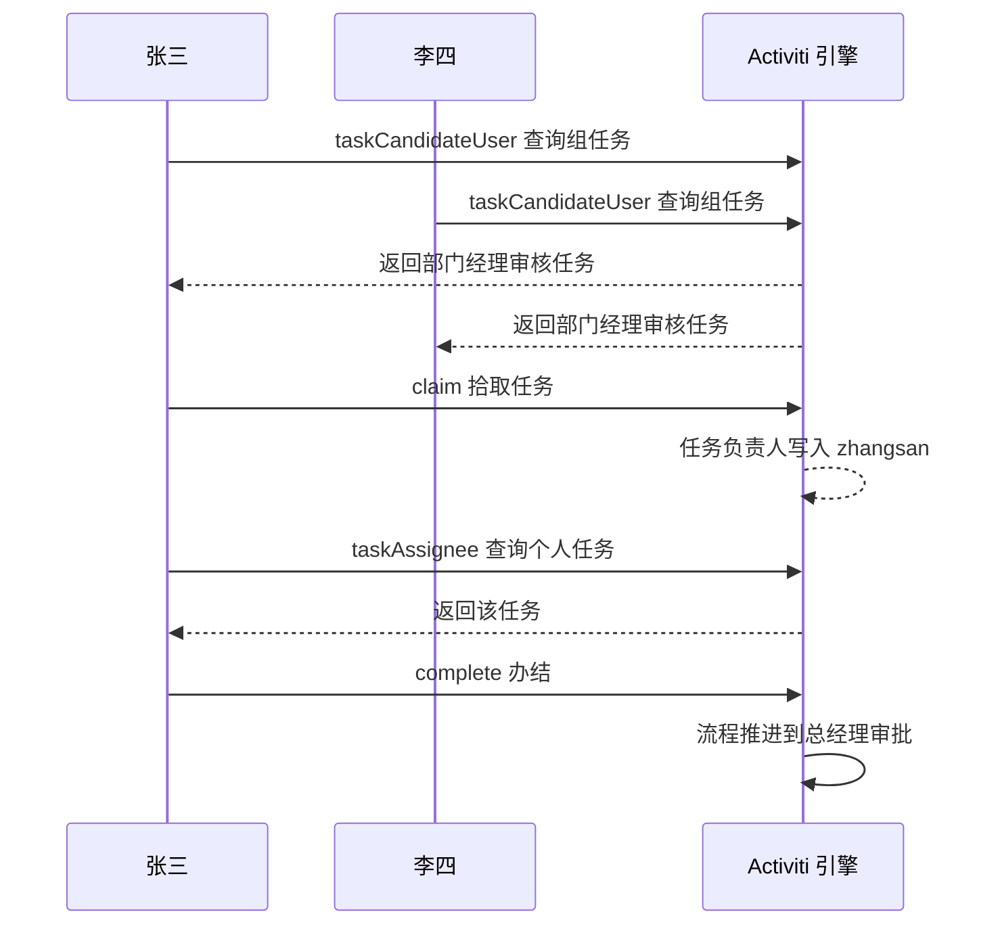
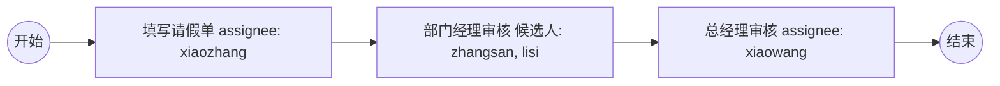
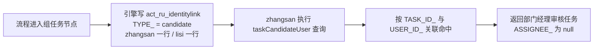
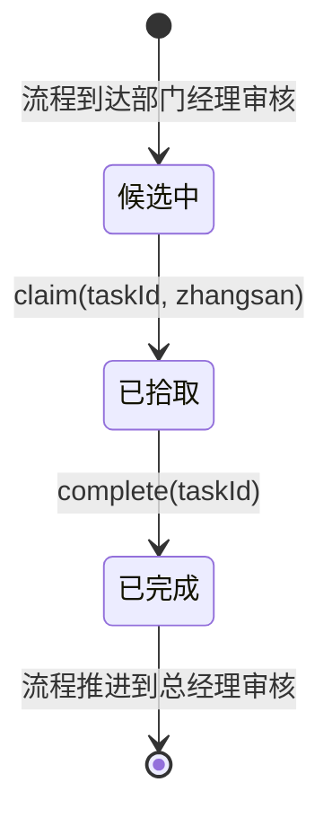
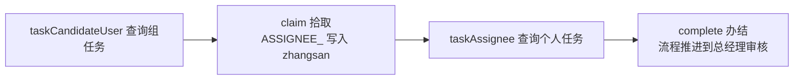
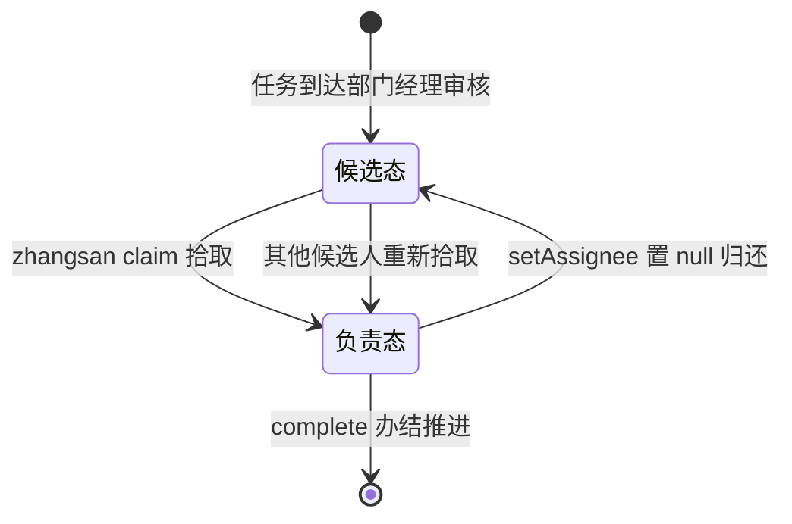
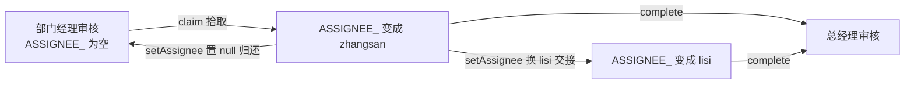
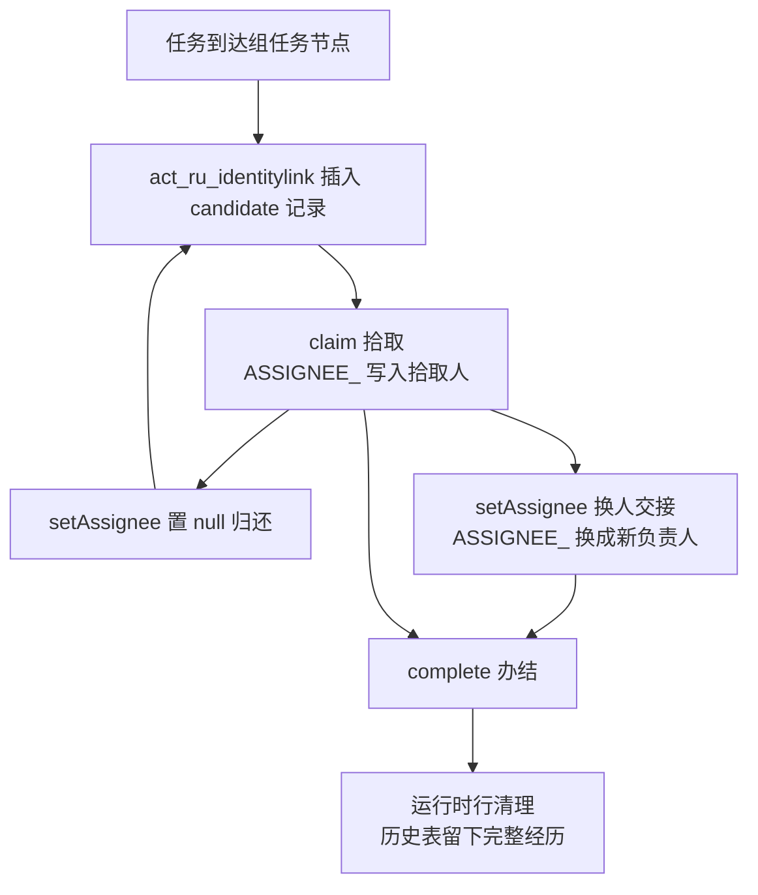

# Activiti 组任务闭环：候选人、拾取、归还与交接全流程实战

## 先给结论

- 组任务与个人任务的分水岭在负责人：个人任务天生有 assignee，组任务只有候选资格，`act_ru_task` 的 `ASSIGNEE_` 为 null。
- BPMN 侧用 `activiti:candidateUsers` 画候选人，流程到达节点时引擎往 `act_ru_identitylink` 为每个候选人写一条 candidate 记录。
- 办理四步走：`taskCandidateUser` 查询 → `claim` 拾取 → `taskAssignee` 查询 → `complete` 办理，新增学习成本集中在拾取一步。
- 拾取的落库动作只有一处：`ASSIGNEE_` 写入拾取人；已有负责人再 claim 抛异常，并发拾取靠乐观锁兜底。
- 拾取反悔两条路：`setAssignee(taskId, null)` 归还回候选池，`setAssignee(taskId, 人名)` 交接给指定人，同一个方法两种语义。
- 归还与交接都建议先校验操作者身份：按任务 id 加 `taskAssignee` 查得到才有资格操作。
- 三个动作动的是同一张运行时表，参与关系与完整经历分别沉淀在 identitylink 与历史表里。
- 实测前的准备也有讲究：候选人画进流程图、启动 key 与 process id 对齐、先办掉前置任务才能推进到组任务节点。
- 全系列按「分析、准备、查询、拾取、办理、归还、交接、落库盘点」八步推进，构成组任务知识的完整闭环。

## 第1部分：组任务办理四步走：查询、拾取、再查询、办理

候选人设好了，zhangsan、lisi 打开系统都能看到部门经理审核这条任务。三个人一起批一张请假单显然不行，引擎对此有明确的规矩：候选人只有知情权，没有办理权，必须有人先站出来把任务认领成自己的。这个认领动作就是拾取 claim，它把组任务的办理切成了与个人任务不同的四步。

### 一、四步全景

以 zhangsan、lisi 两个候选人为例，任务到达部门经理审核这一站后发生的事：



两个候选人都查得到任务，但只有先拾取的人拿到办理权。图中第三步之后，这条任务对 lisi 而言已经从组任务列表里消失。

### 二、第一步：查询组任务

查询条件不再是负责人，而是候选用户：

```java
// 查询 zhangsan 的组任务
List<Task> list = taskService.createTaskQuery()
        .processDefinitionKey(key)
        .taskCandidateUser(candidateUsers)   // 设置候选用户
        .list();
for (Task task : list) {
    System.out.println("任务名称: " + task.getName());
    System.out.println("任务负责人: " + task.getAssignee());  // 为 null，说明只是候选人并非负责人
}
```

`getAssignee()` 打出来是 null，这正是组任务在运行时的形态特征：任务有人可选，无人认领。查询链路里 `processDefinitionKey(key)` 值得多说一句：这个 key 对应 bpmn 文件里 process 标签的 id，同一 key 重复部署后会有多个版本并存，引擎会把所有版本的待办一起查出来，若排查时发现同名任务成对出现，多半是流程定义重新部署过，新旧版本各有一条实例在跑。候选条件与 key 条件是并且的关系，两个条件同时满足才算命中。

### 三、第二步：拾取，组任务变个人任务

```java
// zhangsan 拾取组任务
Task task = taskService.createTaskQuery()
        .processDefinitionKey(key)
        .taskCandidateUser(candidateUsers)
        .singleResult();
if (task != null) {
    // 第一个参数任务 id，第二个参数拾取人
    taskService.claim(task.getId(), candidateUsers);
    System.out.println("任务拾取完毕!");
}
```

`claim` 做的事只有一件：把任务的负责人字段写上拾取人。此后任务对其他候选人不可见，对拾取人而言就是一个普通的个人任务。本课源码在任务交接那段注释里把这件事说得很直白：交接任务就是一个候选人拾取用户的过程，`taskService.setAssignee(taskId, "lisi")` 的实质也是让 assignee 有值。拾取还有两个约束值得记住：任务已有负责人时再 claim 会抛任务已被认领的异常；第二个参数传 null 同样是合法调用，语义是清空负责人，这正是后面归还功能的实现基础。一个方法覆盖了认领与放弃两个动作，接口设计相当克制。

### 四、第三步与第四步：回到熟悉的个人任务

```java
// 拾取后 zhangsan 查询自己的个人任务
Task task = taskService.createTaskQuery()
        .processDefinitionKey(key)
        .taskAssignee("zhangsan")   // 设置任务的负责人
        .singleResult();
// 办理任务
if (task != null) {
    taskService.complete(task.getId());
    System.out.println("任务执行完毕!");
}
```

这两步与个人任务的查询、办理代码一字不差，组任务的学习成本集中在拾取，拾取之后全是旧知识。

### 五、拾取之后反悔了：归还与交接

拾取人把任务看了一眼，发现请假事由不充分，不想批也不想压着，这时任务不能砸在手里。归还的通用做法是把负责人清空：`taskService.claim(taskId, null)`，任务回到候选组，zhangsan、lisi 又都能在组任务里看到它，谁想接谁再拾取。交接则是把任务直接转给指定的人：`taskService.setAssignee(taskId, "lisi")`，前提是当前操作者就是该任务的负责人。一个回组，一个定向转移，对应两种协作场景。

## 第2部分：组任务实测前的准备：把候选人画进流程图、部署、启动并推进到组任务节点

组任务的查询与拾取代码本身不长，真正让实测翻车的往往是前面的准备工作：BPMN 里候选人没配对、启动实例的 key 和流程定义对不上、或者流程还没走到组任务节点就开始查任务，结果查出来永远是空列表。这一课把整条链路的地基打好：画一条带候选用户的流程，部署进引擎，启动流程实例，再把第一个个人任务办理掉，让流程正好停在部门经理审核这个组任务节点上，后面的候选人查询与拾取才有数据可操作。

### 一、把候选人画进流程图

流程还是熟悉的请假场景，一共三个用户任务，分工很清楚：

| 节点 | 任务类型 | 关键配置 |
|---|---|---|
| 填写请假单 | 个人任务 | `activiti:assignee="xiaozhang"` |
| 部门经理审核 | 组任务 | `activiti:candidateUsers="zhangsan,lisi"` |
| 总经理审核 | 个人任务 | `activiti:assignee="xiaowang"` |

画图的关键动作在 Designer 的属性面板：选中部门经理审核节点，把候选人填进候选用户一栏，多个用户用逗号分隔，负责人一栏保持不动。填完生成的节点定义大致如下（资料包里没有这份 bpmn 文件，片段按课程在 Designer 里画的属性补全，节点间的顺序流元素省略）：

```xml
<process id="myProcess_1" name="请假申请单流程">
    <!-- 个人任务：直接指定负责人 -->
    <userTask id="fillLeave" name="填写请假单" activiti:assignee="xiaozhang"/>
    <!-- 组任务节点：只配候选人，不配负责人 -->
    <userTask id="deptLeaderAudit" name="部门经理审核"
              activiti:candidateUsers="zhangsan,lisi"/>
    <userTask id="gmAudit" name="总经理审核" activiti:assignee="xiaowang"/>
</process>
```

这张图在讲整条实测链路的走向：前后两个个人任务负责把流程「送」到中间的组任务节点，组任务才是本课的主角。



图里关键的一站是部门经理审核：它没有负责人，只有两名候选人，任务办不办、谁来办，都要等后面的拾取动作来决定。

### 二、部署流程定义：PNG 可以省

部署代码是老朋友了，唯一的变化是资源文件换成本课画的 holiday5.bpmn，PNG 那一行直接注释掉：

```java
public class GroupTest {
    //1.部署流程定义
    public static void main(String[] args) {
        //1.创建ProcessEngine对象
        ProcessEngine processEngine = ProcessEngines.getDefaultProcessEngine();
        //2.得到RepositoryService实例
        RepositoryService repositoryService = processEngine.getRepositoryService();
        //3.进行部署
        Deployment deployment = repositoryService.createDeployment()
                .addClasspathResource("diagram/holiday5.bpmn")  //添加bpmn资源
                // .addClasspathResource("diagram/holiday5.png")
                .name("请假申请单流程")
                .deploy();
        //4.输出部署的一些信息
        System.out.println(deployment.getName());
        System.out.println(deployment.getId());
    }
}
```

PNG 缺席的后果可以直接在数据库里看到：部署资源以字节流形式存进 `act_ge_bytearray`，平时一次部署写两条记录，BPMN 一条、PNG 一条；这次少了 PNG，表里就少一条记录。仅此而已，流程定义的解析、实例的启动、任务的流转都不依赖这张图片。

**第一，图片是给人看的，流程是给引擎跑的。** 只有系统页面需要展示流程图时 PNG 才有存在感，纯粹跑通链路的测试阶段完全可以省掉，本课注释掉 PNG 部署代码就是在验证这一点。

跑完部署，控制台会打出流程名称和部署 id，`act_re_deployment`、`act_ge_bytearray`、`act_re_procdef` 三张表各就各位。想要观察结果更干净，可以像课程演示那样先删掉 activiti 库再重建，让引擎重新建表，避免上一轮练习的历史数据混进视野。

### 三、启动流程实例：key 与 BPMN 对齐

启动代码不新鲜，坑全在 key 的取值上。`startProcessInstanceByKey` 的参数必须是 BPMN 里 `<process>` 标签的 id，不是 bpmn 文件的文件名：

```java
    //2.启动流程实例
    public static void main(String[] args) {
        //1.得到ProcessEngine对象
        ProcessEngine processEngine = ProcessEngines.getDefaultProcessEngine();
        //2.得到RuntimeService对象
        RuntimeService runtimeService = processEngine.getRuntimeService();
        //3.创建流程实例  流程定义的key需要知道
        ProcessInstance processInstance = runtimeService.startProcessInstanceByKey("myProcess_1");
        //4.输出实例的相关信息
        System.out.println("流程定义ID" + processInstance.getProcessDefinitionId());
        System.out.println("流程实例ID" + processInstance.getId());
    }
```

Designer 默认生成的流程 id 是 `myProcess_1`，本课没有改名，key 就得原样写它；要是顺手写成 `holiday5`，引擎找不到对应流程定义，启动直接报错。输出的流程定义 ID 形如 `myProcess_1:1:4`，由 key、版本号、定义 id 三段拼成；同一个 key 重复部署，版本号会递增为 2、3，按 key 启动时永远取最新版本。

### 四、把流程推进到组任务节点

实例启动后，任务停在「填写请假单」，办理人是 xiaozhang。这是一个普通的个人任务，和组任务无关，用老套路查出来办掉：

```java
    //3.填写请假单的任务要执行完成
    public static void main(String[] args) {
        //1.得到ProcessEngine对象
        ProcessEngine processEngine = ProcessEngines.getDefaultProcessEngine();
        //2.得到TaskService对象
        TaskService taskService = processEngine.getTaskService();
        //3.查询当前用户的任务
        Task task = taskService.createTaskQuery()
                .processDefinitionKey("myProcess_1")
                .taskAssignee("xiaozhang")
                .singleResult();
        //4.处理任务，结合当前用户任务对象的属性操作，任务ID:task.getId()
        if (task != null) {
            taskService.complete(task.getId());
            System.out.println("用户任务执行完毕...");
        }
    }
```

`complete` 一执行，流程推进到部门经理审核。这时去 `act_ru_task` 看这条新任务，`ASSIGNEE_` 是空的；候选资格则写在 `act_ru_identitylink` 里。组任务的舞台搭完了，候选人怎么查到这条任务、怎么把它认领成自己的，是后面两课的内容。

## 第3部分：候选人查询组任务：taskCandidateUser 的用法与 identitylink 表验证

流程停在部门经理审核之后，zhangsan、lisi 两个人都应该能在自己的待办里看到这条任务。查询代码和个人任务几乎一模一样，只把 `taskAssignee` 换成 `taskCandidateUser`；差别虽小，背后查的却是另一张表。把这次查询做扎实，顺手去数据库里验证候选资格的落点，后面拾取环节的变化才看得懂。

### 一、候选人资格存哪：act_ru_identitylink

任务表 `act_ru_task` 只有一个 `ASSIGNEE_` 字段，装不下「一组都可以办的人」。Activiti 把这类人与任务的关系单独放进运行时身份关联表 `act_ru_identitylink`，流程进入部门经理审核节点的瞬间，引擎为每个候选人各写一行：

| 字段 | 本课的值 | 说明 |
|---|---|---|
| `TYPE_` | candidate | 关系类型，候选记录 |
| `USER_ID_` | zhangsan、lisi 各一行 | 具体候选人 |
| `GROUP_ID_` | 空 | 本课没配候选组 |
| `TASK_ID_` | 当前任务 id | 指向部门经理审核任务 |

这张图在讲候选人查询的数据来源：查询条件没有碰任务表的负责人字段，而是拿用户名去身份关联表里对号。



图中最关键的一环是最后的关联命中：候选人能看到任务，靠的是 identitylink 里的候选记录，而不是任务上的负责人字段。表里还有 `PROC_INST_ID_` 一列，标识候选关系挂在哪个流程实例上；同一个流程定义跑多个实例时，每个实例的组任务各自有各自的候选行，互不串扰，实例结束或删除时这些行随运行时数据一并清理。

### 二、taskCandidateUser 查询：只换一个条件

工程里组任务测试类的第 4 段代码就是这次查询：

```java
    //4.查询候选用户的组任务
    public static void main(String[] args) {
        //1.得到ProcessEngine对象
        ProcessEngine processEngine = ProcessEngines.getDefaultProcessEngine();
        //2.得到TaskService对象
        TaskService taskService = processEngine.getTaskService();
        //3.设置一些参数，流程定义的key,候选用户
        String key = "myProcess_1";
        String candidate_users = "zhangsan";
        //4.执行查询
        List<Task> list = taskService.createTaskQuery()
                .processDefinitionKey(key)
                .taskCandidateUser(candidate_users)   //设置候选用户
                .list();
        //5.输出
        for (Task task : list) {
            System.out.println(task.getProcessInstanceId());
            System.out.println(task.getId());
            System.out.println(task.getName());
            System.out.println(task.getAssignee());   //为null，说明当前的zhangsan只是一个候选人，并不是任务的执行人
        }
    }
```

把这段代码和之前查个人任务的代码并排看，除了 `taskCandidateUser` 这一行，其余一模一样。输出四项信息里前三个都有值，唯独 `getAssignee()` 打出 null：当前 zhangsan 只是候选人，不是任务的执行人，任务归谁办还没有定论。这个 null 是组任务最可靠的判断依据，见到 null 就知道该走拾取流程。

实测跑下来，lisi 用同样的代码把自己换成查询参数，也能查到同一条任务：一次部署、一次实例启动，`act_ru_identitylink` 里的两行 candidate 记录支撑了两个人的查询，互不干扰。谁先拾取，这层公共可见性如何被打破，就轮到下一课的 claim 登场。运行时身份关联在历史侧还有对应的 `act_hi_identitylink` 留痕，任务办完之后，候选人是谁、负责人是谁，历史表里仍然可查，这类审计需求正是靠它满足的。

### 三、按候选组查询：同一机制的另一面

候选人可以一个一个写，也可以打包成组。BPMN 里把属性换成 `activiti:candidateGroups`，查询时调用 `taskCandidateGroup`（本课演示用的是候选人方式，下面是候选组的示例写法）：

```java
// 候选组查询示例：前提是节点配了 activiti:candidateGroups="deptLeader"
List<Task> list = taskService.createTaskQuery()
        .processDefinitionKey("myProcess_1")
        .taskCandidateGroup("deptLeader")   //按候选组查询
        .list();
```

数据落点同步变化：`act_ru_identitylink` 里 `USER_ID_` 留空，`GROUP_ID_` 写入 deptLeader。候选人属于哪个组，Activiti 不负责计算，项目自己的用户体系说了算，所以按组查询在真实工程里通常要配合自建的用户角色关系一起用。

### 四、taskAssignee 为什么查不到组任务

两个条件查的根本不是同一列。`taskAssignee` 只看 `act_ru_task` 的 `ASSIGNEE_` 字段，拾取之前它就是 null，按负责人查组任务必然为空；`taskCandidateUser` 则去 `act_ru_identitylink` 里按 candidate 关系对号入座。查询结果不同不是任务丢了，而是查询语义不同：组任务在拾取前只对候选条件可见。面试或排查时把这两句话分开说清楚，比笼统地说「查不到任务」有价值得多。

## 第4部分：拾取组任务：一行 claim 让候选人变成任务负责人

候选人查到了部门经理审核这条任务，但任务还没有主人，组里谁都能看，谁也不能说任务就是自己的。组任务链路里承上启下的一步是拾取 claim：候选人中站出来的那个人，被写进任务的负责人字段，任务从此从公共待办变成个人待办。这一课把 claim 的规范用法、落库变化和已认领任务的规则一次讲透。

### 一、规范姿势：先校验资格，再拾取

课程 PPT 给出的 claimTask 模板，把资格校验写在了拾取前面：

```java
@Test
public void claimTask() {
    TaskService taskService = processEngine.getTaskService();
    //要拾取的任务id
    String taskId = "6302";
    //任务候选人id
    String userId = "lisi";
    //拾取任务
    //即使该用户不是候选人也能拾取(建议拾取时校验是否有资格)
    //校验该用户有没有拾取任务的资格
    Task task = taskService.createTaskQuery()//
            .taskId(taskId)
            .taskCandidateUser(userId)//根据候选人查询
            .singleResult();
    if (task != null) {
        taskService.claim(taskId, userId);
        System.out.println("任务拾取成功");
    }
}
```

代码注释把话说得很直白：即使该用户不是候选人也能拾取，建议拾取时校验是否有资格。claim 方法本身不认人，任何人拿到任务 id 都能把任务据为己有；用 `taskId` 加 `taskCandidateUser` 先查一次，查得到才拾取，就把越权认领挡在了门外。模板里写死的任务 id `6302` 是演示值，真实工程里任务 id 来自待办查询的结果或前端传参，绝不该在业务代码里硬编码；拾取人也不是写死的，而是当前登录用户的身份，从会话或 token 里取。

### 二、本课实测：查到即拾取

工程里组任务测试类的第 5 段代码把查询与拾取连在一起做实测。zhangsan 名下的组任务只有一条，所以查询直接用 `singleResult()`，省掉一次遍历：

```java
    //5.测试zhangsan用户，来拾取组任务
    //拾取任务的过程就是将候选用户转化为真正任务的负责人（让任务的assignee有值）
    public static void main(String[] args) {
        //1.得到ProcessEngine对象
        ProcessEngine processEngine = ProcessEngines.getDefaultProcessEngine();
        //2.得到TaskService对象
        TaskService taskService = processEngine.getTaskService();
        //3.设置一些参数，流程定义的key,候选用户
        String key = "myProcess_1";
        String candidate_users = "zhangsan";
        //4.执行查询
        Task task = taskService.createTaskQuery()
                .processDefinitionKey(key)
                .taskCandidateUser(candidate_users)   //设置候选用户
                .singleResult();
        if (task != null) {
            taskService.claim(task.getId(), candidate_users);   //第一个参数任务ID,第二个参数为具体的候选用户名
            System.out.println("任务拾取完毕!");
        }
    }
```

运行输出「任务拾取完毕」，说明代码走进了 if 分支，zhangsan 名下确实有一条组任务，并且已经被他拾取。

### 三、claim 之后数据库发生了什么

这张图在讲拾取前后的状态迁移，全程只有负责人一个字段发生变化：



状态从「候选中」走到「已拾取」靠的就是 claim 这一条边，拾取人从此独占办理权，其他人不再是这条任务的候选人视角。

**第一，任务表落人。** `act_ru_task` 里部门经理审核这条任务的 `ASSIGNEE_` 由 null 变成 zhangsan，这是 claim 唯一的运行时落点，源码注释「让任务的 assignee 有值」说的就是它。

**第二，历史活动表补上办理人。** 到 `act_hi_actinst` 里看部门经理审核这一行，办理人一栏同步补上 zhangsan，课程演示正是用任务表和历史活动表做的验证。

**第三，候选资格还在。** `act_ru_identitylink` 里 zhangsan、lisi 的 candidate 记录不会因为拾取被删掉，claim 改的是任务的负责人，不是把其他人踢出候选名单；这些运行时记录要等任务办理完成、数据归档时才随之处理。历史侧同步动作：`act_hi_identitylink` 留下关联记录，`act_hi_taskinst` 的负责人字段补上拾取人，任务从候选到有主的转变在历史表同样可查，课程用历史活动表验证办理人用的正是这套留痕。

### 四、已被拾取的任务：再认领与交接

组任务的规则是先到先得。zhangsan 拾取之后，任何人再对同一个任务调用 `claim(taskId, userId)`，引擎都会抛出 `ActivitiTaskAlreadyClaimedException`，明确提示任务已被谁认领。想让别人接着办，走的是交接：负责人调用 `setAssignee` 把任务直接转给指定的人，工程源码里这一段以注释形式保留：

```java
    //8.任务交接，前提要保证当前用户是这个任务的负责人，这时候他才可以有权限去将任务交接给其他候选人
    public static void main(String[] args) {
        //1.得到ProcessEngine对象
        ProcessEngine processEngine = ProcessEngines.getDefaultProcessEngine();
        //2.得到TaskService对象
        TaskService taskService = processEngine.getTaskService();
        //3.设置一些参数，流程定义的key,用户
        String key = "myProcess_1";
        String assignee = "zhangsan";
        //4.执行查询
        Task task = taskService.createTaskQuery()
                .processDefinitionKey(key)
                .taskAssignee(assignee)   //设置任务的负责人
                .singleResult();
        //5.判断是否有这个任务
        if (task != null) {
            taskService.setAssignee(task.getId(), "lisi");   //交接任务为lisi，交接任务就是一个候选人拾取用户的过程
            System.out.println("交接任务完成~!");
        }
    }
```

源码注释把交接的定性写得很准：交接任务就是一个候选人拾取用户的过程，本质同样是让 `ASSIGNEE_` 有值。区别在于 claim 面向候选资格、且目标必须还没负责人，`setAssignee` 则是无条件的负责人改写，可以交接也可以清空归还，权限控制要业务层自己把握。

## 第5部分：拾取之后办任务：按 assignee 查询个人任务并完成部门经理审核

zhangsan 拾取任务之后，身份从候选人升级成了负责人，办理动作也就回到了最熟悉的个人任务模型：把查询条件从候选换成负责人，把任务查出来 `complete` 掉，流程随即推进到总经理审核。这一课代码量最少，但把前面几课的链路完整收了尾。

### 一、负责人视角的查询

工程里组任务测试类的第 6 段代码，把 zhangsan 当成普通任务负责人来查：

```java
    //6.当前的用户查询自己的任务
    public static void main(String[] args) {
        //1.得到ProcessEngine对象
        ProcessEngine processEngine = ProcessEngines.getDefaultProcessEngine();
        //2.得到TaskService对象
        TaskService taskService = processEngine.getTaskService();
        //3.设置一些参数，流程定义的key,用户
        String key = "myProcess_1";
        String assignee = "zhangsan";
        //4.执行查询
        List<Task> list = taskService.createTaskQuery()
                .processDefinitionKey(key)
                .taskAssignee(assignee)   //设置任务的负责人
                .list();
        //5.输出
        for (Task task : list) {
            System.out.println(task.getProcessInstanceId());
            System.out.println(task.getId());
            System.out.println(task.getName());
            System.out.println(task.getAssignee());   //任务的执行人
        }
    }
```

同一个 zhangsan，拾取之前按负责人查询是空的，因为那时他只是候选人；拾取之后查出部门经理审核，第四行输出不再是 null 而是 zhangsan。变量名也从 `candidate_users` 换成了 `assignee`，查询语义跟着换：现在的条件是「这个任务的负责人是我」，底层只看 `act_ru_task` 的 `ASSIGNEE_` 字段，与身份关联表再无关系。查询构造器里条件是叠加过滤，每加一个结果收窄一圈。前端聚合待办时常把候选与负责两种身份一次取回，用的是 `taskCandidateOrAssigned`；列表要按时间倒序就在 `list()` 之前加 `orderByTaskCreateTime().desc()`。这些条件方法都返回查询对象本身，可以一直链下去。

### 二、办理任务，流程推进

查询确认任务在手，接着就是办理，对应测试类的第 7 段代码：

```java
    //7.当前用户完成自己的任务
    public static void main(String[] args) {
        //1.得到ProcessEngine对象
        ProcessEngine processEngine = ProcessEngines.getDefaultProcessEngine();
        //2.得到TaskService对象
        TaskService taskService = processEngine.getTaskService();
        //3.设置一些参数，流程定义的key,用户
        String key = "myProcess_1";
        String assignee = "zhangsan";
        //4.执行查询
        Task task = taskService.createTaskQuery()
                .processDefinitionKey(key)
                .taskAssignee(assignee)   //设置任务的负责人
                .singleResult();
        //5.执行当前的任务
        if (task != null) {
            taskService.complete(task.getId());
            System.out.println("任务执行完毕!");
        }
    }
```

`complete` 一执行，部门经理审核办结，流程推进到总经理审核，负责人是 xiaowang。这一站从 BPMN 配置起就是个人任务，xiaowang 用最普通的 `taskAssignee` 查询就能接手，不需要任何拾取动作。到这里，一条请假流程在组任务这一站的完整经历就演示完了。complete 还有个带参重载 `complete(taskId, variables)`，办结的同时向流程写入一组流程变量，审批意见、复核结论这类数据就在这一刻进入流程，供下一站的条件判断使用。本例没有输出变量所以用的是无参版本，真实审批流里下一站的网关或分支几乎都依赖上一站办结时传入的变量。

`complete` 之后数据库里能看到一组连锁变化：`act_ru_task` 里部门经理审核这条记录消失，运行时身份关联一并清理；历史侧的 `act_hi_taskinst`、`act_hi_actinst` 把这条任务的完整经历（谁候选、谁办理、何时办结）沉淀下来；`act_ru_execution` 推进到总经理审核节点，一张新的个人任务落进 `act_ru_task`，`ASSIGNEE_` 直接就是 xiaowang。运行时表只保存「现在」，历史表保管「曾经」，这是 Activiti 的一贯分工。

### 三、组任务一生的四个阶段

从候选资格出现到任务办结，查询条件的切换就是组任务的完整生命周期：

| 阶段 | 查询与操作 | `ASSIGNEE_` | `act_ru_identitylink` |
|---|---|---|---|
| 到达组任务节点 | `taskCandidateUser` 查询 | null | zhangsan、lisi 各一条 candidate |
| zhangsan 拾取 | 调 `claim` | 写入 zhangsan | candidate 记录保留 |
| 负责人办理前 | `taskAssignee` 查询 | zhangsan | candidate 记录保留 |
| complete 之后 | 任务办结 | 历史表留痕 | 运行时记录随任务归档 |

这张图把四段代码串成一条线，重点看查询条件在哪一步发生切换：



条件切换只发生在 claim 前后：拾取前按候选资格查，拾取后按负责人查，`complete` 之后任务离开运行时表。四段代码共用同一个查询构造器，变的只有条件与后续动作，这就是组任务比个人任务多出来的全部内容。把这条分界线写进接口设计也很自然：拾取接口返回成功后，前端立即把待办列表从「组任务」页签切到「我的任务」页签，用户就不会对着突然消失的任务发懵。

## 第6部分：拾取后悔了怎么办：setAssignee 置空把组任务归还回候选池

zhangsan 把部门经理审核任务拾取到自己名下，任务进了他的个人待办。可打开一看不好办，流程又不能卡在他手里，也不想靠 complete 硬推。这时候需要的动作叫归还：把负责人字段清空，任务放回组里，让其他候选人重新拾取。Activiti 里这一步只有一行代码，但它背后的归属语义值得说透。

### 一、先把现场恢复出来

归还发生在「已被拾取」之后。要是上一轮测试已经把流程跑完，最干净的办法是重建数据库，把场景重演一遍：

```sql
drop database activiti;
create database activiti;
```

空库建好后引擎启动时自动建表，接着按顺序重演 holiday5 流程的前几步：部署流程定义、启动流程实例、xiaozhang 完成填写请假单、zhangsan 用 `claim` 拾取部门经理审核。每一步都是前几课的原代码，拾取完成后数据库的状态是：`act_ru_task` 里部门经理审核这条任务的 `ASSIGNEE_` 是 zhangsan，`act_ru_identitylink` 里 zhangsan 与 lisi 的候选记录都还在。

zhangsan 正是从这个状态反悔的：任务在他名下，但他不打算办了，想把任务还给组。

### 二、归还的代码：先校验，再置空

```java
    //8.归还组任务：前提是当前用户是这个任务的负责人，归还后任务回到候选状态
    public static void main(String[] args) {
        //1.得到ProcessEngine对象
        ProcessEngine processEngine = ProcessEngines.getDefaultProcessEngine();
        //2.得到TaskService对象
        TaskService taskService = processEngine.getTaskService();
        //3.设置一些参数：当前待办任务ID、任务负责人
        String taskId = "6004";
        String userId = "zhangsan";
        //4.校验userId是否是taskId的负责人，是负责人才可以归还任务
        Task task = taskService.createTaskQuery()
                .taskId(taskId)
                .taskAssignee(userId)
                .singleResult();
        if (task != null) {
            //5.执行人设置为null，归还任务，该任务回到没有负责人的候选态
            taskService.setAssignee(taskId, null);
        }
    }
```

这段代码有两层意思值得拆开看。

**第一，查询条件同时用了 taskId 和 taskAssignee。** 单按 taskId 查，任务一定能查到，但查到不代表 zhangsan 有资格归还。把 userId 拼进查询条件，只有当前负责人确实是 zhangsan 时 `singleResult()` 才非空，task 为空就什么都不做。引擎的 `setAssignee` 本身不做任何资格校验，这个判断是业务侧必须自己补的一道闸。

**第二，`setAssignee(taskId, null)` 是归还的全部动作。** 第二个参数传 null，引擎把 `act_ru_task` 的 `ASSIGNEE_` 写成空。回头看拾取那一课的 `claim(taskId, userId)`，做的事情正好相反：把 null 写成人名。归还就是拾取的逆操作，同一个字段，一个方向写进人，一个方向清回空。

### 三、置空之后，任务回到什么状态

归还前后查一次 `act_ru_task`，差异只有 `ASSIGNEE_` 一列：

```sql
SELECT ID_, NAME_, ASSIGNEE_ FROM act_ru_task WHERE ID_ = '6004';
-- 归还前：ASSIGNEE_ = zhangsan
-- 归还后：ASSIGNEE_ = (NULL)
```

`ASSIGNEE_` 为空，意味着引擎回到「还没有任何用户拾取这条任务」的状态，组任务的候选语义整体恢复。谁还能看到它、怎么接手，走一遍状态机最直观：



关键在「候选态」这一个落点：归并没有产生新状态，它只是把拾取那一步抹掉。`act_ru_identitylink` 里 zhangsan、lisi 的候选记录从任务到达起就没动过，归还后 lisi 用 `taskCandidateUser` 查询，这条任务重新出现在他的组任务列表里；如果 lisi 接着 `claim`，负责人就写成了 lisi。对 lisi 来说，zhangsan 这轮拾取与归还等于没有发生过。

### 四、置 null 与置人名只差一个字，语义完全不同

`setAssignee` 的第二个参数理论上可以写任何用户。写成 null 是归还，任务回组；写成另一个人名，负责人从 zhangsan 直接换成那个人，任务根本不回组，这就是任务交接。课程把两者分成两课讲，正是因为业务语义不同：归还解决「我不想办了，退回池子」，交接解决「我不办了，点名让某某接手」。做归还时老老实实传 null，不要借这个方法顺手指派他人，指派的事留给交接那一课。

## 第7部分：不想办的活点名换人：setAssignee 换个参数实现组任务交接

zhangsan 拾取部门经理审核任务之后反悔，归还的解法是把任务退回候选池，谁抢到算谁的。但多数场景不是回池子，而是有明确的接手人：这活自己干不了，可知道谁能干。任务交接就是这个动作，负责人把任务直接交给指定的候选人，流程一天不停。

### 一、交接与归还，差在哪一步

两句话把边界划清。

- 归还：任务退回候选池，`ASSIGNEE_` 清空，接下来谁拾取不确定。
- 交接：任务从 zhangsan 名下直接落到 lisi 名下，`ASSIGNEE_` 换值，中间没有真空期。

交接覆盖的是「我干不了，但我知道谁能干」的情况。负责人不干了，也没打算把选择权还给池子，而是直接指定替补。两个动作共用同一个 API，课程却分成两课讲，说明差异不在代码在语义。举个对比例子帮助建立直觉：审核人临时出差，业务上还没想好交给谁，用归还，谁有空谁接；单据涉及报销口径拿不准，明确该让分管财务的 lisi 复核，用交接。前者把选择权交还给候选池，后者带着答案换人，责任转移的明确程度是两种动作的分水岭。

### 二、交接的代码：校验身份，指定接手人

工程里组任务测试类的第 8 段代码就是交接，注释把这个动作的前提和本质都点明了：

```java
    //8.任务交接，前提要保证当前用户是这个任务的负责人，这时候他才可以有权限去将任务交接给其他候选人
    public static void main(String[] args) {
        //1.得到ProcessEngine对象
        ProcessEngine processEngine = ProcessEngines.getDefaultProcessEngine();
        //2.得到TaskService对象
        TaskService taskService = processEngine.getTaskService();
        //3.设置一些参数，流程定义的key，用户
        String key = "myProcess_1";
        String assignee = "zhangsan";
        //4.执行查询
        Task task = taskService.createTaskQuery()
                .processDefinitionKey(key)
                .taskAssignee(assignee)   //设置任务的负责人
                .singleResult();
        //5.判断是否有这个任务
        if (task != null) {
            taskService.setAssignee(task.getId(), "lisi");   //交接任务为lisi，交接任务就是一个候选人拾取任务的过程
            System.out.println("交接任务完成~!");
        }
    }
```

结构与归还一模一样：先查询校验，再 `setAssignee`，唯一区别是第二个参数从 null 变成了 `"lisi"`。查询条件 `taskAssignee("zhangsan")` 保证只有 zhangsan 本人名下确实有这条任务时才执行交接，与归还前的资格校验是同一个套路。

源码注释里那句「交接任务就是一个候选人拾取任务的过程」值得咀嚼：拾取时 `claim` 把 `ASSIGNEE_` 从 null 写成 zhangsan，交接把 `ASSIGNEE_` 从 zhangsan 改成 lisi，两次落库动的都是同一个字段，只是旧值不同。从这个角度看，交接就是替 lisi 做了一次拾取，只不过跳过了候选池。工程实现上，这段校验在真实项目里通常包进 service 层：先取当前登录用户，查他名下是否有这条任务，有才允许交接，并把「交给谁」做成页面上的选人组件而非手输用户名。`setAssignee` 对不存在的用户也不报错，用户名的合法性完全靠业务侧把关，这是它在资格校验之外又一个要自己兜底的点。

### 三、交接之后，lisi 直接办任务

交接完成，lisi 名下立刻多出这条任务。他按普通个人任务走查询加 complete，测试类第 7 段代码把 assignee 换成 lisi 即可：

```java
    //交接后：lisi 以负责人身份查询并完成任务
    public static void main(String[] args) {
        //1.得到ProcessEngine对象
        ProcessEngine processEngine = ProcessEngines.getDefaultProcessEngine();
        //2.得到TaskService对象
        TaskService taskService = processEngine.getTaskService();
        //3.设置一些参数，流程定义的key，用户
        String key = "myProcess_1";
        String assignee = "lisi";
        //4.执行查询
        Task task = taskService.createTaskQuery()
                .processDefinitionKey(key)
                .taskAssignee(assignee)
                .singleResult();
        //5.执行当前的任务
        if (task != null) {
            taskService.complete(task.getId());
            System.out.println("任务执行完毕!");
        }
    }
```

complete 执行后查历史行为表 `act_hi_actinst`，部门经理审核这一行 lisi 的 `END_TIME_` 有了值，流程推进到总经理审核节点，新任务静静等人办理。从拾取、反悔到换人再办结，流程没有在任何一步停住。交接不改变任务的其他属性，任务 id、创建时间、所属流程实例都不动，变的只有负责人一个字段，所以交接前后流程的推进路径完全一致，这也是图上两条路径殊途同归的原因。

把三个动作放进一张图，路径差异一目了然：



图上能看到，交接比归还走的路更短：不经过候选态，负责人字段直接从一个人名跳到另一个人名。

## 第8部分：一行代码动了几张表：组任务拾取、归还、交接的落库全景

前几课在 `claim` 和 `setAssignee` 之间来回切换，每次代码只有一行。这行代码落到数据库里远不止动一个字段：运行时任务表、运行时身份关联表、几张历史表都在跟着变。把这笔账算清，组任务一节也就真正收束了。

### 一、两张运行时表，各管一件事

**`act_ru_task` 管任务本体。** 一条运行中的任务一行记录，`NAME_` 是任务名，`ASSIGNEE_` 是负责人。组任务与个人任务在这张表上的唯一差别：到达时 `ASSIGNEE_` 为空，靠 `act_ru_identitylink` 的候选关系圈定能拾取的人群。

**`act_ru_identitylink` 管参与关系。** 任务到达时，引擎给每个候选人各插一条 `TYPE_` 为 candidate 的记录：

```sql
SELECT ID_, TYPE_, USER_ID_, TASK_ID_
FROM act_ru_identitylink
WHERE TASK_ID_ = '6004';
-- TYPE_ = candidate  USER_ID_ = zhangsan
-- TYPE_ = candidate  USER_ID_ = lisi
```

zhangsan 拾取之后再看这张表，zhangsan 那行的 `TYPE_` 已经是 participant：他不再是候选人之一，而是这条任务经历的真正参与者；lisi 没拾取，仍是 candidate。等后续交接把任务交给 lisi，lisi 也从候选变成参与者。候选与参与，一个表示「有资格」，一个表示「沾过手」。若节点配置的是候选组，落库变成 `GROUP_ID_` 有值、`USER_ID_` 为空，`TYPE_` 仍是 candidate；查询侧对应 `taskCandidateGroup`，拾取、归还、交接的行为与候选人方式完全一致，差别只在身份关联行里留的是组名还是用户名。

### 二、三个动作的落库对照

把三个 API 摆在一起，代码上的差别只剩参数：

```java
taskService.claim(taskId, "zhangsan");     //拾取：ASSIGNEE_ 从 null 写成 zhangsan
taskService.setAssignee(taskId, null);     //归还：ASSIGNEE_ 从 zhangsan 清回 null
taskService.setAssignee(taskId, "lisi");   //交接：ASSIGNEE_ 从 zhangsan 换成 lisi
```

对应的表变化逐项对照：

| 动作 | `act_ru_task.ASSIGNEE_` | `act_ru_identitylink` | 历史侧 |
|---|---|---|---|
| 任务到达 | null | zhangsan、lisi 各一条 candidate | 尚无记录 |
| claim 拾取 | null 变 zhangsan | zhangsan 转 participant，lisi 仍 candidate | `act_hi_identitylink` 留痕 |
| 置 null 归还 | zhangsan 清回 null | 候选记录原样 | 归属变动留痕 |
| 换 lisi 交接 | zhangsan 换成 lisi | lisi 成为 participant | `act_hi_taskinst` 将记 lisi 办理 |
| complete 办结 | 该行删除 | 随任务清理 | `act_hi_actinst` 补齐起止时间 |

归还一行的「候选记录原样」解释了归还后为什么还能被重新拾取：候选关系从未被删除，负责人字段一清空，组任务查询的判断依据立刻恢复。

### 三、历史表记的才是完整故事

运行时表永远只显示当前快照：任务在谁名下、参与关系是什么。可一旦发生拾取又归还，`act_ru_task` 里 zhangsan 的痕迹就被抹掉了，只剩历史表还记得他来过。`act_hi_identitylink` 里能查到 zhangsan 曾是候选人、lisi 曾是候选人、lisi 后来成为真正参与者的完整经历；`act_hi_actinst` 里每个 userTask 节点的 `ASSIGNEE_`、`START_TIME_`、`END_TIME_` 一应俱全。排查「这任务之前是谁的、为什么轮到我」这类问题，全部依赖历史表。



图上从拾取节点出发的三条去向，归还、交接、办结，就是组任务处理的全部分支，殊途同归的终点都是历史表。

### 四、组任务一节收束

从 BPMN 里给任务节点配置 `candidate users` 开始，到负责人字段的三种变化结束，组任务的完整知识链是：配置候选人、按候选资格查询、`claim` 拾取、`setAssignee` 归还与交接、`complete` 办理。所有动作拆到底，就是两张运行时表上几个字段的增删改，加上历史表的如实记账。从这里开始，视角从「任务给谁」切换到「流程往哪走」，网关登场。这张对照表也是排查索引：组任务查不到，先看任务到达行有没有 candidate 记录；拾取后按候选查不到了，确认条件是否已切到 `taskAssignee`；历史归属对不上，再去 `act_hi_` 两张表里核对。

## 常见误区

- **候选人直接 `complete`**：跳过拾取硬去办结，即使凑巧拿到任务 id 办成了，流程记录里也缺了真实的负责人归属，正确顺序永远是先拾取。
- **以为拾取会通知其他人**：拾取不推送任何消息，lisi 下次查询组任务时任务已经不在列表里，先到先得还是管理指派，协作规则要业务侧自己定。
- **归还与交接混用**：归还是把负责人清空回到候选组，交接是把负责人换成指定的人，语义与结果都不同。
- **并发拾取不做防御**：两个候选人同时 `claim` 同一任务，引擎靠乐观锁保证只有一人成功，另一个收到异常，代码要有对应的提示与重试。
- **把文件名当 key**：`startProcessInstanceByKey("holiday5")` 里的 holiday5 是 bpmn 文件名，key 要用 `<process>` 的 id `myProcess_1`，两者对不上引擎抛出找不到流程定义的异常。
- **以为 PNG 必须有**：不部署 PNG 只是部署资源表少一条字节流记录，流程照跑；只有页面要展示流程图时才需要它。
- **没推进就查组任务**：实例刚启动时任务还在「填写请假单」，不先把 xiaozhang 的任务办完，候选人查组任务必然是空。
- **候选人配到了负责人一栏**：`activiti:assignee` 是唯一负责人，填了值就退化成个人任务；候选人必须配在候选用户属性上。
- **用 taskAssignee 查组任务**：查不到就以为流程没走到组任务节点，实际是条件用错，拾取前要用 `taskCandidateUser`。
- **把查到任务当成有办理权**：`getAssignee` 为 null 只代表候选资格，跳过拾取直接办结会让负责人归属记录失真，规范顺序是先拾取再办理。
- **漏掉 processDefinitionKey 过滤**：多个流程都在跑时，不带 key 会把别家流程的组任务一起查出来，key 条件要始终带上。
- **以为 act_ru_identitylink 只存候选人**：这张表也存参与者等实例级关系，靠 `TYPE_` 字段区分，按 candidate 过滤才是候选记录。
- **跳过资格校验直接 claim**：claim 不认候选人，任何拿到任务 id 的人都能把任务抢走，接口层要按模板先校验再拾取。
- **以为拾取就是办理**：claim 只改负责人归属，`complete` 才推进流程，拾取后部门经理审核依旧待办。
- **重复拾取不做防御**：并发或重复 claim 会抛 `ActivitiTaskAlreadyClaimedException`，提示话术与重查逻辑要提前设计好。
- **交接不看身份**：`setAssignee` 不校验操作者是不是当前负责人，业务侧不拦的话任务可以被任何人转走。
- **拾取后还按组任务查**：拾取把归属落在负责人字段上，办理前应按 `taskAssignee` 查询，条件与阶段不匹配会让排查方向跑偏。
- **complete 传错 id**：`complete` 要的是任务 id，把流程实例 id 传进去会直接抛找不到任务的异常。
- **singleResult 遇上多条任务**：查询命中多条时 `singleResult` 抛异常而不是取第一条，只有确定最多一条时才用它。
- **判空不彻底**：源码里完成首任务那段的 `System.out.println(task.getId())` 写在 if 外面，任务办过一次再跑，task 为 null 直接空指针，输出也要收进 if。
- **归还后还按负责人查任务**：`taskAssignee` 查 zhangsan 已经查不到，任务并没丢，换 `taskCandidateUser` 按候选资格查就能看到。
- **不校验负责人直接还**：`setAssignee` 不做权限校验，任何拿到 taskId 的代码都能把别人名下的任务清空，归还前的负责人查询校验不能省。
- **把置人名当归还**：`setAssignee(taskId, "lisi")` 之后任务仍有负责人，只是换了人，这不是归还而是交接，任务也不会再出现在组任务查询里。
- **complete 之后再想归还**：任务办结就离开运行时表，归还只对还在 `act_ru_task` 里的任务有效，办结的任务只能去历史表查账。
- **交接后接手人再去 claim**：任务已有负责人，不出现在任何人的组任务查询里，`claim` 会直接抛任务已被拾取的异常，接手人按个人任务办理即可。
- **以为交接会新增候选关系**：`setAssignee` 只改负责人字段，不会给 lisi 添加 candidate 记录，也不会删除原有的候选记录。
- **漏掉负责人校验**：`setAssignee` 没有权限控制，谁调都能换人，查询条件里的 `taskAssignee(userId)` 就是资格闸门，不能因为代码短就省。
- **拿归还冒充交接**：置 null 后任务重新进池子，指定不了接手人；要点名换人就必须传人名，两者不可混用。
- **以为拾取会把其他候选人的记录删掉**：candidate 关系保留，被覆盖的只是负责人字段；拾取后该任务的 `ASSIGNEE_` 非空，候选查询不再把它列出来。
- **只盯 `act_ru_task` 排查历史问题**：运行时表只有当前快照，拾取后又被归还的痕迹在运行时表里不存在，要查 `act_hi_identitylink` 与 `act_hi_actinst`。
- **混淆 candidate 与 participant**：candidate 是候选资格，participant 是参与过；`TYPE_` 字段看错，参与者的范围就判错了。
- **以为交接给新负责人加了候选记录**：交接不新增任何 identitylink 行，lisi 的 participant 身份来自他成为负责人这件事，与 candidate 记录是两回事。

## 面试可能被问到的问题

1. 面试官追问：「组任务和个人任务的办理流程差异在哪？」
   答：差异集中在拾取这一步。组任务先按 `taskCandidateUser` 查询候选任务，`claim` 拾取后变成个人任务，之后的查询与办理与个人任务完全一致；个人任务天生有负责人，直接查、直接办。

2. 面试官追问：「claim 的本质做了什么？」
   答：把任务的负责人写为拾取人，`act_ru_task` 的 `ASSIGNEE_` 由 null 变为具体用户。任务从候选组的公共待办变成拾取人的个人待办，其他候选人此后查询不到该任务。

3. 面试官追问：「拾取后不想办理了怎么办？」
   答：归还给组，把负责人清空，任务重新对全体候选人可见；或交接给指定的人。归还适合「我处理不了，让能处理的人来」，交接适合「我明确知道该谁办」。

4. 面试官追问：「两个候选人同时拾取会怎样？」
   答：引擎对任务更新做乐观锁控制，同一时刻只有一个拾取成功，另一个抛乐观锁异常。业务代码要捕获并提示「任务已被他人认领」，必要时重新查询候选列表。

5. 面试官追问：「查询组任务和个人任务的 API 差异？」
   答：查询构造器相同，都是 `taskService.createTaskQuery()`，条件不同：组任务用 `taskCandidateUser`，个人任务用 `taskAssignee`。前者按 `act_ru_identitylink` 的 candidate 关联查，后者按任务的负责人列查。

6. 面试官追问：「部署流程定义时 PNG 必须一起部署吗？」
   答：不是。流程执行只依赖 BPMN 文件，PNG 只用于页面展示流程图。不部署 PNG 只是 `act_ge_bytearray` 少一条记录，不影响流程定义的解析与实例流转。

7. 面试官追问：「`startProcessInstanceByKey` 的 key 从哪里来？」
   答：来自 BPMN 里 `<process>` 标签的 id 属性，与文件名无关。key 对不上会抛出找不到流程定义的异常；相同 key 重复部署会产生新版本，按 key 启动时默认取最新版本。

8. 面试官追问：「多次部署同一个 BPMN 文件会怎样？」
   答：每次 `deploy()` 都生成一条新部署记录和一条新流程定义记录，版本号递增。旧版本定义不会被删除，按 key 启动取最高版本，按流程定义 id 启动则可以指定旧版本。

9. 面试官追问：「组任务和个人任务在 BPMN 配置上的差异？」
   答：个人任务配 `activiti:assignee` 指定唯一负责人；组任务配 `activiti:candidateUsers` 或 `activiti:candidateGroups`，多个候选值逗号分隔，负责人留空，办理前需要有人拾取。

10. 面试官追问：「任务到达组任务节点后引擎做了什么？」
   答：向 `act_ru_task` 插入任务记录但 `ASSIGNEE_` 为空，同时为每个候选人向 `act_ru_identitylink` 写入 `TYPE_=candidate` 的候选资格记录，等待候选人查询并拾取。

11. 面试官追问：「taskCandidateUser 的底层查询逻辑是什么？」
   答：查询条件作用在 `act_ru_identitylink` 上，按 `TYPE_=candidate` 且 `USER_ID_` 为当前用户（或用户所在组）关联 `act_ru_task` 取回任务；`taskAssignee` 则只匹配任务表的 `ASSIGNEE_` 字段，两者数据来源不同。

12. 面试官追问：「组任务在运行时表里是什么形态？」
   答：`act_ru_task` 有一条任务记录但 `ASSIGNEE_` 为空，候选资格在 `act_ru_identitylink` 里，每个候选人一行 `TYPE_=candidate` 记录，`TASK_ID_` 指向该任务。

13. 面试官追问：「候选人和候选组在使用上有什么区别？」
   答：BPMN 属性分别是 `activiti:candidateUsers` 与 `activiti:candidateGroups`，查询方法分别是 `taskCandidateUser` 与 `taskCandidateGroup`，落库分别写 `USER_ID_` 与 `GROUP_ID_`。用户与组的从属关系要项目自己的用户体系维护。

14. 面试官追问：「act_ru_identitylink 里除了 candidate 还有什么类型？」
   答：还有 participant 等类型，比如办理过任务的人会以参与者身份留痕，流程启动人也有实例级的关联记录，全部靠 `TYPE_` 字段区分，查询时按需过滤。

15. 面试官追问：「候选人查到的任务为什么 getAssignee 是 null？」
   答：候选人只拥有候选资格，引擎在有人 claim 拾取之前不会把任何用户写进 `ASSIGNEE_`。null 正是判断「这是条组任务且还没人认领」的依据。

16. 面试官追问：「claim 一定要是候选人才能拾取吗？」
   答：引擎不做校验，任何用户传任务 id 都能拾取成功。规范做法是先用 `taskCandidateUser` 校验资格，查到任务再拾取，防止越权认领。

17. 面试官追问：「已被拾取的任务再次 claim 会怎样？」
   答：抛 `ActivitiTaskAlreadyClaimedException`。任务有了负责人就不再是组任务，规则是先到先得；要换人用 `setAssignee` 交接，要回组就把负责人清空。

18. 面试官追问：「claim 到底改了哪些数据？」
   答：运行时改 `act_ru_task` 的 `ASSIGNEE_`，历史活动表 `act_hi_actinst` 的办理人同步补值；`act_ru_identitylink` 里的候选记录不受影响，任务办理完成后随运行时数据归档。

19. 面试官追问：「claim 和 setAssignee 的区别是什么？」
   答：claim 的语义是候选人认领，目标任务必须还没有负责人，否则抛异常；`setAssignee` 是直接改写负责人，既能交接给指定人也能清空归还，不校验候选人身份，权限由业务层保证。

20. 面试官追问：「拾取之后任务办理完了吗？」
   答：没有。拾取只完成归属转移，部门经理审核仍处于待办状态，拾取人还要按负责人身份查询任务并 complete，流程才会推进到总经理审核。

21. 面试官追问：「拾取后为什么要把查询条件换掉？」
   答：拾取把负责人写进了 `ASSIGNEE_`，任务归属从候选关系变成个人关系，按 `taskAssignee` 查询语义准确，也让组任务此后与个人任务共用同一套办理代码。

22. 面试官追问：「complete 之后引擎做了哪些事？」
   答：当前任务办结并从 `act_ru_task` 删除，相关运行时身份关联归档到历史表，流程沿顺序流推进到下一节点，总经理审核的个人任务随之生成，办理人是 BPMN 里配置的 xiaowang。

23. 面试官追问：「singleResult 和 list 怎么选？」
   答：确定结果最多一条时用 `singleResult`，直接拿到任务对象；结果可能多条必须用 `list` 遍历，`singleResult` 命中多条会抛异常，不会默默取第一条。

24. 面试官追问：「站在办理环节看，组任务和个人任务还剩什么差异？」
   答：只剩拾取一步。个人任务天生有负责人，直接查直接办；组任务要先 claim 把候选人变成负责人，之后的查询与 complete 两条链路完全一致。

25. 面试官追问：「测试代码第二次运行为什么报空指针？」
   答：任务在上一轮已被办理，查询返回 null，写在 if 之外的 `task.getId()` 触发空指针。查询结果的判空要覆盖所有后续访问，这是流程代码重跑时最常见的坑。

26. 面试官追问：「归还组任务底层改了什么？」
   答：`setAssignee(taskId, null)` 把 `act_ru_task` 表的 `ASSIGNEE_` 字段清空，任务回到无负责人的候选态；`act_ru_identitylink` 里的候选记录不动，候选人重新按 `taskCandidateUser` 查询就能拾取。

27. 面试官追问：「claim 和 setAssignee 有什么区别？」
   答：`claim` 是拾取语义，面向候选人把任务据为己有；`setAssignee` 是直接覆盖负责人字段，不校验任务状态与操作者身份，置 null 是归还、换人名是交接，资格校验要业务自己做。

28. 面试官追问：「为什么归还前要按 taskId 加负责人查一遍？」
   答：为了确认操作者确实是当前负责人。引擎不会拦，若不校验，任何知道 taskId 的人都能清空他人任务，这是业务层面的越权风险，查询命中才执行归还。

29. 面试官追问：「归还后候选人的记录有变化吗？」
   答：没有。任务到达时生成的 candidate 参与关系归还前后保持原样，归还只回滚负责人字段，恢复的正是「候选池里等人来抢」的初始状态。

30. 面试官追问：「任务已经办结还能归还吗？」
   答：不能。办结后任务从 `act_ru_task` 删除并归档到历史表，运行时已无此任务可操作，归还只对运行中的任务有意义。

31. 面试官追问：「交接和归还用的是同一个方法吗？」
   答：都是 `setAssignee`，第二个参数决定语义：传 null 是归还，`ASSIGNEE_` 清空回候选态；传人名是交接，`ASSIGNEE_` 直接换成新负责人。

32. 面试官追问：「为什么说交接本质是一次拾取？」
   答：两者落库动作相同，都是给 `ASSIGNEE_` 赋值；拾取是从 null 到人名，交接是旧人名到新人名，对引擎来说都是一次负责人字段的覆盖。

33. 面试官追问：「交接时引擎校验操作者身份吗？」
   答：不校验。`setAssignee` 对调用者没有任何限制，资格判断靠业务代码先按 `taskId` 加 `taskAssignee` 查询，确认操作者是负责人再执行。

34. 面试官追问：「交接完成后原负责人还剩什么权限？」
   答：`ASSIGNEE_` 已换成新负责人，原负责人按负责人查询查不到这条任务，不再拥有办理权；候选关系不受交接影响，变的只有负责人字段。

35. 面试官追问：「接手人办理需要额外动作吗？」
   答：不需要。交接完成时他已是负责人，直接按个人任务流程用 `taskAssignee` 查询后 `complete`，不需要 claim，也查不到这条组任务。

36. 面试官追问：「组任务的拾取、归还、交接分别改哪张表？」
   答：都改 `act_ru_task` 的 `ASSIGNEE_`，拾取写入拾取人、归还清空、交接换人；同时 `act_ru_identitylink` 的 `TYPE_` 反映参与者身份变化，历史表同步留痕。

37. 面试官追问：「act_ru_identitylink 的 TYPE_ 字段有哪些取值？」
   答：候选人阶段是 candidate，用户真正参与任务办理后对应记录表现为 participant；此外还有按组候选的 group 等取值，这张表是任务参与关系的主记录。

38. 面试官追问：「为什么归还后任务能被重新拾取？」
   答：归还只清空 `ASSIGNEE_`，候选关系从未被删除，任务重新满足「无负责人且有候选记录」的组任务查询条件，候选人可以再次 claim。

39. 面试官追问：「运行时表和历史表怎么分工？」
   答：`act_ru_` 系列只保存当前快照，任务办结即清理；`act_hi_` 系列按节点和参与关系完整记账，历史归属、办理时间、参与者演变都要去历史表查。

40. 面试官追问：「怎么查一个任务被谁拾取过又归还？」
   答：`act_ru_task` 只能看到当前为空，拾取痕迹要查 `act_hi_identitylink` 里该任务相关的参与记录，再结合 `act_hi_actinst` 的负责人与起止时间字段还原过程。

## 配套资料

- 组任务全流程测试类：`materials/code/02/Activiti7-day05-进阶3/Activiti7-day05-进阶3/源码/activiti01/src/main/java/` 下 day05 包中的 `GroupTest.java`（部署、启动、查询组任务、拾取、查询个人任务、办理、交接七段按注释轮换启用，包名已改 `com.example`）
- 四步流程、归还与交接的小节划分出自本课 PPT「4.1.1.1 组任务办理流程」
- 组任务测试类：`materials/code/02/Activiti7-day05-进阶3/Activiti7-day05-进阶3/源码/activiti01/` 下 `src/main/java` 的 day05 包 `GroupTest.java`（部署、启动、完成首任务三段代码取自该类，包名已改 `com.example`）
- 工程配置：同工程 `src/main/resources/activiti.cfg.xml`，以 Standalone 方式连接 MySQL 的 activiti 库
- holiday5.bpmn 在资料包中缺席，文中 XML 片段为按课程演示的属性补全的示例
- 组任务测试类：`materials/code/02/Activiti7-day05-进阶3/Activiti7-day05-进阶3/源码/activiti01/` 下 `src/main/java` 的 day05 包 `GroupTest.java`（第 4 段「查询候选用户的组任务」，包名已改 `com.example`）
- 候选组查询在课程演示中未跑通链路，文中代码为按本课写法补全的示例
- 组任务测试类：`materials/code/02/Activiti7-day05-进阶3/Activiti7-day05-进阶3/源码/activiti01/` 下 `src/main/java` 的 day05 包 `GroupTest.java`（第 5 段拾取与第 8 段交接，包名已改 `com.example`）
- 资格校验模板出自本课 PPT「4.1.1.3 用户拾取组任务」的 claimTask 示例
- 组任务测试类：`materials/code/02/Activiti7-day05-进阶3/Activiti7-day05-进阶3/源码/activiti01/` 下 `src/main/java` 的 day05 包 `GroupTest.java`（第 6、7 段查询与办理，包名已改 `com.example`）
- 代码：`materials/code/02/Activiti7-day05-进阶3/Activiti7-day05-进阶3/源码/activiti01/` 下 `src/main/java` 的 day05 包 `GroupTest.java`（含部署、启动、拾取、查询、完成、交接各段；归还段为按本课讲解与写法补全，包名已改 `com.example`）
- 工程配置：同工程 `src/main/resources/activiti.cfg.xml`（数据源指向 `activiti` 库，`databaseSchemaUpdate=true`，空库启动时自动建表）
- 代码：`materials/code/02/Activiti7-day05-进阶3/Activiti7-day05-进阶3/源码/activiti01/` 下 `src/main/java` 的 day05 包 `GroupTest.java`（第 8 段交接与第 7 段办理，包名已改 `com.example`）
- 代码：`materials/code/02/Activiti7-day05-进阶3/Activiti7-day05-进阶3/源码/activiti01/` 下 `src/main/java` 的 day05 包 `GroupTest.java`（拾取、查询、完成、交接各段，包名已改 `com.example`）
- 文中 SQL 为按本课真实表结构写的演示查询，`TASK_ID_ = '6004'` 以库中实际任务 id 为准
