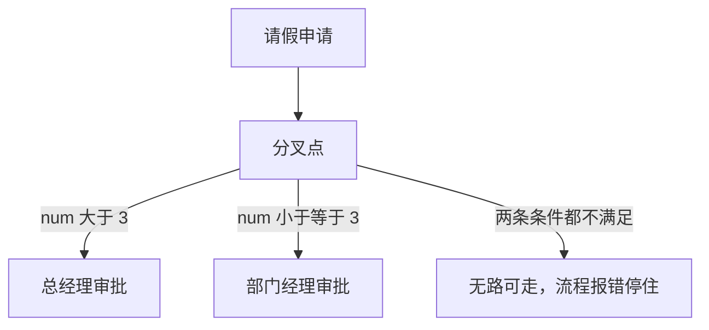

# 条件全不匹配流程就卡死：网关是什么，三种网关各管什么

请假流程里天数决定审批路线：3 天以内部门经理批，超过 3 天总经理批。用带条件的顺序流就能实现，可流程变量一旦给出两条条件都不满足的值，比如 num 忘了赋值传进来一个 null，大于 3 不成立、小于等于 3 也不成立，流程推进到分叉点就报错停住。网关就是给这个分叉点补上的正式决策节点，让分支语义显式化、可控化。

## 先给结论

- 裸连线加条件也能分支，但条件全不满足时引擎找不到可走的顺序流，流程在分叉点报错停摆。
- 网关（gateway）是 BPMN 里专门做分支控制的节点，把所有判断收口到一处。
- 常用的是三种：排他网关只走一条分支，并行网关所有分支同走，包含网关按条件走若干条。
- BPMN 规范还有事件网关（event gateway），由捕获到的事件驱动走向，业务里用得少。
- 图形记号都是菱形，靠内部图案区分：叉号是排他，加号是并行，圆圈是包含。

## 一、不用网关的分支，问题出在兜底

holiday4 流程已经在两条顺序流上挂了 UEL 条件表达式，启动时把流程变量带进来就能选路：

```java
Holiday holiday = new Holiday();
holiday.setNum(5F);                        //请假天数
Map<String, Object> map = new HashMap<>();
map.put("holiday", holiday);               //流程变量赋值
ProcessInstance processInstance = runtimeService.startProcessInstanceByKey("myProcess_1", map);
```

两条顺序流的条件大致长这样（BPMN 片段为按本课写法补全的示例）：

```xml
<sequenceFlow id="flow_manager" sourceRef="gateway1" targetRef="managerTask">
    <conditionExpression xsi:type="tFormalExpression">${holiday.num &lt;= 3}</conditionExpression>
</sequenceFlow>
<sequenceFlow id="flow_boss" sourceRef="gateway1" targetRef="bossTask">
    <conditionExpression xsi:type="tFormalExpression">${holiday.num &gt; 3}</conditionExpression>
</sequenceFlow>
```

变量给 5 走总经理，给 2 走部门经理。可变量忘了赋值，或传进来一个两条都不满足的值，两条顺序流的条件求值全为 false，引擎无路可走，流程实例停在原地抛异常。这张图就是卡住的那一幕：



裸连线的缺陷还有一种相反的形态：条件区间有重叠时（比如 num 大于等于 1 与 num 大于 3 同时为 true），两条分支会被同时激活，流程凭空分叉出两份审批任务。day05 工程里 `ExclusiveGateWayTest01` 的注释写的正是这个对照实验：先测没有网关时的表现，再测加入网关后的表现。可见裸连线的毛病不在「不能分支」，而在决策没有收口：条件散在每条线上，全 true 或全 false 都没有统一的裁决者与出口。

## 二、网关：把决策收口成一个节点

网关是 BPMN 里专门控制流向的一类节点，画出来都是菱形，靠内部图案区分类型。流程到达网关后，引擎按网关的语义对出线做裁决，分支逻辑集中在一个节点上，排查与维护都容易得多。常用的三种网关定位如下：

| 网关 | 记号 | 走几条 | 定位 |
|---|---|---|---|
| 排他网关 | 菱形内叉号 X | 有且仅一条 | 基于条件做多选一决策，也叫异或（XOR）网关、基于数据的排他网关 |
| 并行网关 | 菱形内加号 | 全部出线同时激活 | 不看条件，把流程拆成并行分支，之后需要汇聚 |
| 包含网关 | 菱形内圆圈 | 满足条件的若干条 | 每条出线带条件，为 true 的都走，几条不定 |
| 事件网关 | 菱形内双圈 | 事件触发后定 | 由捕获到的中间事件驱动走向，用得不多 |

排他网关是三个里的「你走我不走」：流程到达后所有出线都判条件，但只允许一条为 true 的分支执行。并行网关压根不看条件，一到网关全部出口同时铺开。包含网关介于两者之间，每条出线带条件，满足几条走几条。事件网关不靠变量靠事件，到达后停下来等事件发生，哪个事件先到就走哪条线。后续几课按排他、并行、包含的顺序逐个上代码。

## 三、为什么建议用网关而不是裸条件线

**第一，语义显式。** 图上一眼能看出「这里是个决策点」，不用逐条点开顺序流去找条件。

**第二，判断集中。** 条件写在同一个节点的出线上，增删分支不用在图上到处找线。

**第三，可留默认出口。** 排他网关支持默认流转（default flow），所有条件都不满足时走兜底分支，而不是让流程卡死，这是裸连线给不出的保障。

对照 day05 的测试类：`ExclusiveGateWayTest01` 用 key 为 `myProcess_1` 的流程验证没有网关时的两个坑，`ExclusiveGateWayTest02` 换用带排他网关的 `holidayExclusive` 流程做对照。同样的请假天数变量，加上网关之后分支行为才真正符合业务预期。

## 常见误区

- **把网关当性能优化**：网关不省性能也不省代码，它改变的是分支语义的可控性；裸条件线全 true 会导致分叉、全 false 会导致停摆，这才是要解决的痛点。
- **认为并行网关也看条件**：并行网关的出线全部同时激活，条件表达式写了也不参与判断，想按条件选路要用排他或包含网关。
- **排他网关出线不配条件**：没有条件的出线恒为可走，多条无条件出线并存时行为难以维护，每条出线都应配条件表达式或明确设置默认流转。
- **把事件网关当排他网关用**：事件网关到达后是等待事件，不是立刻判条件，流程变量式的条件判断对它不适用。

## 面试可能被问到的问题

1. 面试官追问：「裸连线条件与排他网关的区别？」
   答：裸连线把条件散在各条顺序流上，条件全不满足时流程无路可走直接报错，条件重叠时又会多路齐发；排他网关把决策收口到一个节点，出线条件集中管理，还支持默认流转兜底。

2. 面试官追问：「三种常用网关各自的语义？」
   答：排他网关只执行一条为 true 的分支；并行网关不看条件，所有出线同时激活并要求汇聚；包含网关按条件执行，满足几条走几条。

3. 面试官追问：「事件网关什么时候用？」
   答：流程走向要由外部事件驱动时使用，流程到达事件网关后等待捕获事件，哪个事件先发生就走对应分支，业务里用得比三种常用网关少。

4. 面试官追问：「流程变量为 null 时裸条件分支会怎样？」
   答：条件表达式求值得不到 true，所有出线都不满足，引擎抛出无法选择分支的异常，流程实例停在分叉点，这正是引入网关要解决的问题之一。

5. 面试官追问：「排他网关的图形记号是什么？」
   答：菱形内部一个叉号，与并行网关的加号、包含网关的圆圈区分；它是异或网关，决策结果必然且只能是一条出线。

## 配套资料

- 代码：`materials/code/02/Activiti7-day05-进阶3/Activiti7-day05-进阶3/源码/activiti01/` 下 `src/main/java` 的 day05 包 `ExclusiveGateWayTest01.java`（测试无网关时的分支表现）、`ExclusiveGateWayTest02.java`（加入排他网关后的对照测试），day04 包 `Holiday.java`（流程变量 POJO）
- 文中 BPMN 片段与流程图为按本课写法补全的示例，工程部署代码引用的流程图资源为 `diagram/holiday4.bpmn` 等同目录文件
