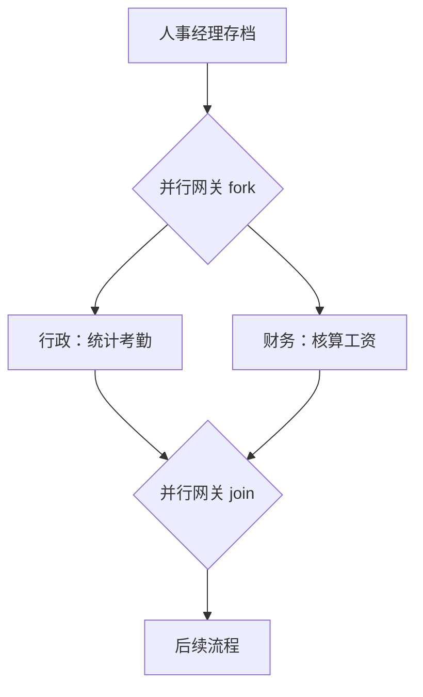
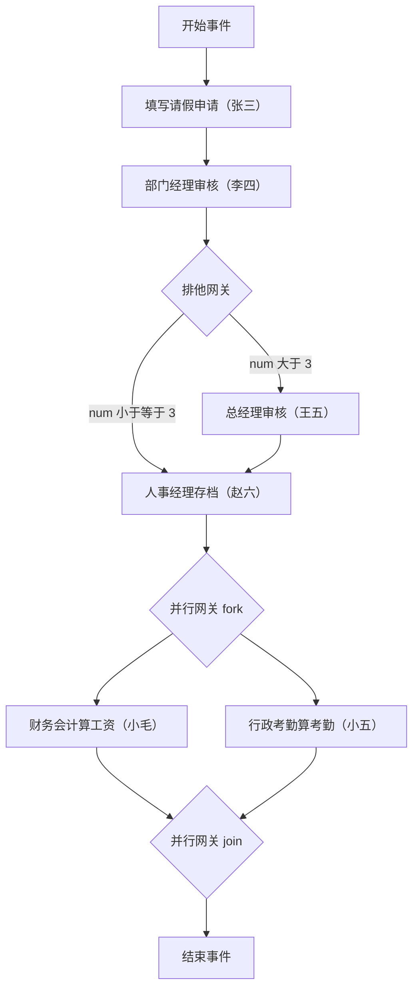
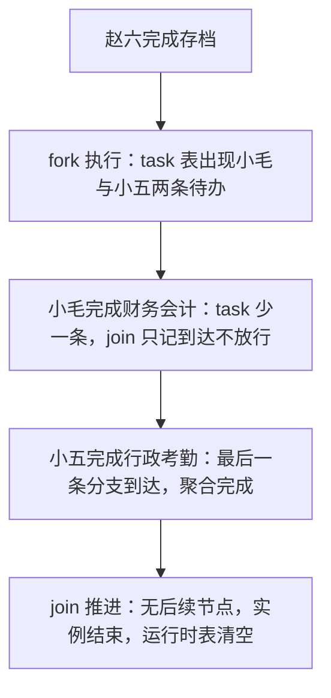

# Activiti 并行网关实战：fork 分支、join 汇聚与请假流程全流程实测

## 先给结论

- 并行网关基于进入和外出顺序流工作：外出多条是 fork 分支，进入多条是 join 汇聚，一个网关两副面孔。
- fork 出的分支并行推进、互不等待；join 必须等所有分支都到达才放行，一条没走完流程就停在汇聚点。
- 与排他、包含网关的本质区别：并行网关不解析条件，出线上写了条件表达式也会被忽略。
- 分支数量不限，fork 与 join 通常成对出现；同一网关节点同时带多条进入流与外出流时，先汇聚再切分。
- 引擎侧每条分支对应一个 execution：`act_ru_execution` 里是一条流程实例记录加每条活动分支各一条记录。
- 实战改图不在旧图上动刀：复制 holiday5 改出 holiday6，流程 id 从 `holidayExclusive` 改成 `holidayParallel`，存档之后 fork 出财务会计算工资与行政考勤两条分支。
- 出线上不写条件，两条分支的办理人先写死成人名，纯粹为了演示时能从表里分辨分支；join 之后暂时直连结束事件。
- 实测三看：存档完成瞬间任务表两条待办同屏；完成其中一条只是记录少一条、流程不走；两条全部完成聚合才发生，运行时记录随之清空；测试前先清库重建，表内变化才看得干净。

## 第1部分：fork 出去几条就得等几条回来：并行网关的分支与汇聚

请假审批走完还有两件事：行政要统计考勤，财务要核算工资。两件事互不依赖，串在一条线上纯属浪费等待时间。并行网关（parallel gateway）把流程拆成多条同时推进的分支，再等所有分支都完成后汇成一股继续走。

### 一、fork 与 join：一个网关的两副面孔

并行网关允许把流程分成多条分支，也可以把多条分支汇聚到一起，行为完全由进入与外出顺序流的数量决定：一个进入流配多个外出流，它在做 fork（分支）；多个进入流配一个外出流，它在做 join（汇聚）。图上记号是菱形里一个加号。

fork 的语义是「你走你的，我走我的」：分出的每条分支独立推进，先后互不影响。join 的语义是「一个都不能少」：所有进入的分支都到达汇聚点，流程才继续往后走；会合之后不一定马上结束，后续还有节点就接着走。

### 二、场景：存档之后的并行处理

人事经理存档完成后，考勤统计与工资核算就该启动了：原来请了两天假要扣两天工资，这次又请了五天，财务核算时得把新天数算进去。两件事谁先谁后无所谓，但都完成之前流程不能往下走：



这张图讲的是 fork 与 join 的配对使用：存档完成瞬间两条分支同时激活，行政与财务各自处理各自的任务。关键路径在 join 节点：财务先核算完工资而考勤还没统计完，汇聚不算完成，流程停在 join；两边都到齐，汇聚才生效，流程继续往后推进。分支不限于两条，三条五条都可以，fork 出几条，join 就等几条。

### 三、引擎里发生了什么

流程经过 fork 后，引擎为每条分支创建独立的执行实例：图上的考勤统计与工资核算就是两个 execution 分支，在 `act_ru_execution` 表里体现为两条分支记录，另外还有一条记录代表流程实例本身。所有分支的任务全部完成，两条 execution 在汇聚点合并，通过 `parallelGateway` 后流程继续。

分支上放的是普通用户任务，查询与完成的方式和单线流程完全一样，只是同一时刻待办里会同时出现多条分支的任务，每条都得推进。

汇聚点的写法在 BPMN 里就是第二个 `parallelGateway` 元素（资料包未附带 bpmn 源文件，片段为按本课写法补全的示例）：

```xml
<sequenceFlow id="flow5" sourceRef="archiveTask" targetRef="forkGateway"/>
<parallelGateway id="forkGateway"/>
<sequenceFlow id="flow6" sourceRef="forkGateway" targetRef="attendanceTask"/>
<sequenceFlow id="flow7" sourceRef="forkGateway" targetRef="salaryTask"/>
<sequenceFlow id="flow8" sourceRef="attendanceTask" targetRef="joinGateway"/>
<sequenceFlow id="flow9" sourceRef="salaryTask" targetRef="joinGateway"/>
<parallelGateway id="joinGateway"/>
```

fork 与 join 在图上通常画成两个网关，BPMN 也允许同一个网关既有多个进入流又有多个外出流：此时它先汇聚所有进入的流，再切分成多条并行分支，两种职责在同一节点上完成。

### 四、与排他网关的本质区别

| 维度 | 排他网关 | 并行网关 |
|---|---|---|
| 出线激活数量 | 有且只有一条 | 全部同时激活 |
| 是否解析条件 | 逐条求值 UEL 表达式 | 完全忽略，写了也不看 |
| 汇聚要求 | 不需要，走完即走 | 必须 join，等全部分支到达 |
| 典型场景 | 按请假天数选审批路线 | 考勤与工资同时处理、会签 |

「不解析条件」最容易被忽略：顺序流上设置了条件，并行网关也不会去统计，最终只看分支是否都执行完。想按条件选路，用的是排他网关或包含网关，不是并行网关。

并行网关在业务里还有一个高频应用：会签任务，即多个参与者共同办理的任务。把任务分给多个办理人并行办理，join 等全部办理完毕再往下走，正好就是会签的语义。

### 五、测试代码长什么样

工程里 day05 包的 `ParallelGateWayTest` 就是这张图的配套测试，流程 holiday6 同时带排他网关与并行网关（包名已改为 `com.example`）：

```java
// 1. 部署流程定义：一张图里同时有排他网关与并行网关
Deployment deployment = repositoryService.createDeployment()
        .addClasspathResource("diagram/day05/holiday6.bpmn")
        .name("请假申请单流程")
        .deploy();

// 2. 启动流程实例，num=5 命中排他网关的总经理分支
Holiday holiday = new Holiday();
holiday.setNum(5F);
Map<String, Object> map = new HashMap<>();
map.put("holiday", holiday);
runtimeService.startProcessInstanceByKey("holidayParallel", map);

// 3. 查询并完成当前分支上的任务
Task task = taskService.createTaskQuery()
        .processDefinitionKey("holidayParallel")
        .taskAssignee("xiaowu")
        .singleResult();
if (task != null) {
    taskService.complete(task.getId());
    System.out.println("用户任务执行完毕...");
}
```

部署、启动、推进的套路与单线流程完全一致，差别都在流程图里：走到并行网关那一刻，`act_ru_task` 会同时多出几条分支的任务，必须把每条分支各自推进完，流程才能通过 join。

## 第2部分：把并行网关画进请假流程：存档之后同时算工资、算考勤

holiday5 的流程在人事经理存档完成时就结束了，可业务上存档往往只是中转点：行政要按这次假单统计考勤，财务要按这次假单核算工资，两件事互不依赖，串在一条线上就得一先一后干等。把并行网关画进流程定义，fork 出两条分支齐头并进，全走完再汇聚，这就是 holiday6 要做的事。

### 一、复制一份新图，而不是改旧图

操作从复制文件开始：在 `src/main/resources/diagram/day05` 下选中已有的流程图，用 Copy File 复制出 `holiday6.bpmn`。课程一路迭代下来 holiday1 到 holiday6 一天一个文件，这个习惯有两个好处：旧流程定义已经部署进数据库，历史实例还在引用它，改旧图会让可回溯的版本变乱；复制出的新图随便怎么画，也不影响之前部署的版本。

复制完有两处要改：

**第一，流程 id 改成 `holidayParallel`。** BPMN 里 process 的 id 就是启动实例用的 key，改名之后部署、启动代码都要跟着用这个新 key，两边对不上会报 `no processes deployed with key`。

**第二，前半段的排他网关原样保留。** 开始事件到人事经理存档这一段，走还是排他网关按请假天数选审批路线的老逻辑，一条线都不用动。改的只是存档之后：删掉「存档直连结束」那条线，换成并行网关。

### 二、fork 与 join 摆在哪

改完之后的完整拓扑如下：



这张图讲的是存档之后的并行改造：赵六完成存档，流程进入 fork 网关，同时激活两条出线，财务与行政各自拿到一份待办；两边都办完，才在 join 网关聚合，流程走完。关键路径在 join：任何一条分支没办完，聚合都不发生，流程就停在汇聚点。

现实里这种齐头并进的场景很多，双 11 下单就是典型：一边仓库开始出库，一边物流环节同时开动，两边都到位订单才算履约完成。这里只是用「一边算工资一边算考勤」把它落进请假流程。

对应的 BPMN 片段长这样（资料包未附带 bpmn 源文件，片段为按本课写法补全的示例）：

```xml
<userTask id="usertask4" name="人事经理存档" activiti:assignee="zhaoliu"/>
<sequenceFlow id="flow8" sourceRef="usertask4" targetRef="parallelFork"/>

<!-- fork：一条进，两条出 -->
<parallelGateway id="parallelFork" name="并行分支"/>
<userTask id="usertask5" name="财务会计" activiti:assignee="xiaomao"/>
<userTask id="usertask6" name="行政考勤" activiti:assignee="xiaowu"/>
<sequenceFlow id="flow9" sourceRef="parallelFork" targetRef="usertask5"/>
<sequenceFlow id="flow10" sourceRef="parallelFork" targetRef="usertask6"/>

<!-- join：两条进，一条出 -->
<sequenceFlow id="flow11" sourceRef="usertask5" targetRef="parallelJoin"/>
<sequenceFlow id="flow12" sourceRef="usertask6" targetRef="parallelJoin"/>
<parallelGateway id="parallelJoin" name="并行汇聚"/>
<sequenceFlow id="flow13" sourceRef="parallelJoin" targetRef="endEvent"/>
```

对照 XML 能看出并行网关的特点：`parallelGateway` 元素上没有任何条件，fork 与 join 靠进 出顺序流的数量区分，一条进多条出就是分支，多条进一条出就是汇聚。

### 三、属性面板上要填的东西

画图时拖两个网关进画布，类型都选 `ParallelGateway`。BPMN 2.0 一共提供四种网关：排他、并行、包含、事件，这一课用到前三种里的并行。网关的 name 属性填「并行分支」「并行汇聚」只为看图友好，不影响执行。

两条分支的任务节点各填一个办理人：财务会计给 xiaomao，行政考勤给 xiaowu。正式项目里办理人通常由流程变量或监听器动态决定，这里写死是为了测试时代码里按人名查任务、逐条推进时看得清楚。fork 与 join 之间的连线上什么都不填，并行网关不看条件。

### 四、部署代码跟着对齐两处

图形画完存盘，部署代码引用的资源与 key 要和图一致，出自 day05 包 `ParallelGateWayTest`（包名已改为 `com.example`）：

```java
// 1. 部署流程定义：一张图同时带排他网关与并行网关
ProcessEngine processEngine = ProcessEngines.getDefaultProcessEngine();
RepositoryService repositoryService = processEngine.getRepositoryService();
Deployment deployment = repositoryService.createDeployment()
        .addClasspathResource("diagram/day05/holiday6.bpmn")  // 新流程的 bpmn 资源
        .name("请假申请单流程")
        .deploy();
System.out.println(deployment.getName());
System.out.println(deployment.getId());
```

**第一处，资源路径写 holiday6。** 指向刚复制出来的新图，路径写错部署进引擎的就是旧流程，后面测半天测的都是排他网关。

**第二处，启动 key 写 holidayParallel。** `startProcessInstanceByKey` 匹配的是流程定义的 id，图上改成什么，这里就得写什么。

画完之后按四条自查：fork 与 join 成对出现，中间几条分支 join 就等几条；分支之间不互相连线，每个分支里的任务只进自己那条线；join 的出线连结束事件或下一个任务；流程 id、部署资源、启动 key 三处一致。

## 第3部分：存档之后两条待办同屏：并行网关全流程实测

holiday6 把 fork 与 join 画进了请假流程，图是对的，效果还得跑出来看。启动实例后一步步推进到人事经理存档，fork 触发的那一刻数据库里该多出什么、完成一条分支流程动不动、聚合到底发生在哪一秒，这些只有对着表逐帧观察才有体感。

### 一、清库、部署、启动

观察并行行为最怕旧数据干扰，先把库整个重建（测试库，别在生产上这么干）：

```sql
drop database activiti;
create database activiti;
```

重启应用让引擎自动建表，然后部署 holiday6 并启动实例，代码出自 day05 包 `ParallelGateWayTest`（包名已改为 `com.example`）：

```java
// 2. 启动流程实例
ProcessEngine processEngine = ProcessEngines.getDefaultProcessEngine();
RuntimeService runtimeService = processEngine.getRuntimeService();

Holiday holiday = new Holiday();
holiday.setNum(5F);
Map<String, Object> map = new HashMap<>();
map.put("holiday", holiday);   // 流程变量赋值

ProcessInstance processInstance = runtimeService.startProcessInstanceByKey("holidayParallel", map);
System.out.println("流程定义ID：" + processInstance.getProcessDefinitionId());
System.out.println("流程实例ID：" + processInstance.getId());
```

num 给 5，前半段的排他网关会命中总经理审批那条线，流程走单线段：填写请假单、部门经理审核、总经理审核、人事经理存档。

### 二、单线段逐人推进

每个环节都是同一套三板斧：按流程 key 加办理人查任务、完成任务、刷表确认，每换一个环节换一个人名：

```java
// 3. 查询并完成当前环节的任务
TaskService taskService = processEngine.getTaskService();
Task task = taskService.createTaskQuery()
        .processDefinitionKey("holidayParallel")
        .taskAssignee("zhangsan")   // 之后依次换 lishi、wangwu、zhaoliu
        .singleResult();
if (task != null) {
    taskService.complete(task.getId());
    System.out.println("用户任务执行完毕...");
}
```

张三填完单子轮到李四，李四审完轮到王五，王五审完轮到赵六存档。这一段每次查 `act_ru_task` 都只有一条任务，和以前的单线流程没有任何区别。变化发生在赵六完成任务之后。

### 三、fork 时刻：一张表两条待办

赵六完成存档，流程进 fork 网关，此时刷新两张表：

```sql
SELECT * FROM act_ru_task        #当前任务表
SELECT * FROM act_ru_execution   #流程实例的执行表
```

`act_ru_task` 里同时出现两条记录：财务会计，办理人小毛；行政考勤，办理人小五。这就是并行网关最直观的表象，一份待办清单里并排躺着两个不同环节的任务，谁也不挡谁。顺带看了 `act_ru_identitylink`，里面看不出办理人取值，因为这两个任务是 assignee 直派，不涉及候选组，观察并行还是以 `act_ru_task` 和 `act_ru_execution` 为主。

`act_ru_execution` 里的记录更能说明引擎在干什么：一条是流程实例本身，一条是 fork 网关 ParallelGateway1（它已经执行完，时间戳停在赵六完成任务那一刻），剩下两条分别对应财务与行政两条活动分支。两条分支各自推进，互不等待。

### 四、一次完成不聚合，两次完成才放行

让小毛先完成财务会计的任务：

```java
Task task = taskService.createTaskQuery()
        .processDefinitionKey("holidayParallel")
        .taskAssignee("xiaomao")
        .singleResult();
if (task != null) {
    taskService.complete(task.getId());
    System.out.println("用户任务执行完毕...");
}
```

刷表验证：`act_ru_task` 少了一条，财务的记录没了，行政考勤还躺着；`act_ru_execution` 里财务分支的 execution 消失，行政分支还在。流程停在汇聚点不动。同时能看到 join 网关的记录已经有时间戳了：每条分支到达汇聚点，引擎都会记一次到达，小毛这条先到，时间就先写上了，但这只是「到达」，不是「放行」。

再让小五完成行政考勤，第二次也是最后一次到达发生：

```java
Task task = taskService.createTaskQuery()
        .processDefinitionKey("holidayParallel")
        .taskAssignee("xiaowu")
        .singleResult();
if (task != null) {
    taskService.complete(task.getId());
    System.out.println("用户任务执行完毕...");
}
```

这一步之后三张表一起变化：`act_ru_task` 清空，`act_ru_execution` 的分支记录全部合并消失，流程实例结束。整条观察路径如下：



这张图讲的是聚合发生的完整时序：fork 一放两份待办同时出现，每完成一条分支就少一条记录，join 的记录从第一条分支到达时就有，但只有最后一条分支完成任务的那一刻，汇聚才算真正完成。汇聚点后面如果是结束事件，实例立即结束；如果还有任务，就把待办推给下一个节点，由下一个执行人接着办。这就是并行网关的核心承诺：所有分支都到达汇聚节点，它才算执行完成，才会把流程推进到下一个节点。

## 常见误区

- **给并行网关的出线写条件指望它选路**：条件被完全忽略，所有出线同时激活；按条件选路要用排他网关或包含网关。

- **漏推进某条分支的任务**：join 等所有分支，差一条流程就停在汇聚点，看起来像流程卡死，实际是还有一份待办没办。

- **把并行网关当成多线程**：分支是引擎里的 execution 与待办任务，不是开发者创建的线程；业务侧的异步、超时策略仍需另行设计。

- **以为 fork 和 join 必须是两个独立网关**：同一网关可以同时承担汇聚与分支，先 join 后 fork；画成一对是习惯画法，不是规范的硬性要求。

- **在旧图上直接改**：旧流程定义已经部署，历史实例还在引用；复制新图改新 key，新旧两版互不干扰，随时可回溯对照。

- **给并行网关的出线写条件**：条件被完全忽略，所有出线同时激活；想按条件选路要用排他网关或包含网关。

- **分支各自直连结束事件**：某条分支走到自己的结束事件，整条流程实例就结束了，join 永远等不齐剩下的分支；所有分支必须汇到同一个 join。

- **改了流程 id 不同步启动代码**：key 对不上，启动时报 `no processes deployed with key`，图没错、代码没错，错在两边不一致。

- **完成一条分支后以为流程卡死**：task 表里还剩另一条待办，去把那个人名的任务办完流程就走；不是引擎出问题，是 join 在等人。

- **以为并行分支等于同时有人在干活**：引擎只是把两份待办同时挂出来，什么时候办、谁先办完它不管，业务侧的催办与超时得自己设计。

- **只盯 `act_ru_task` 不看 `act_ru_execution`**：任务表只能看到待办增减，fork 与 join 的执行状态、分支的存活情况都在执行表里。

- **清库后直接启动实例**：库重建后表是空的，流程定义还没部署进去，启动报找不到 key；清库之后要先重新部署。

## 面试可能被问到的问题

1. 面试官追问：「并行网关的 fork 和 join 分别是什么？」
   答：fork 指一个进入流配多个外出流，流程拆成多条并行分支同时推进；join 指多个进入流配一个外出流，所有分支都到达后流程才继续。两者由进入与外出顺序流的数量决定，通常成对出现。

2. 面试官追问：「并行网关和排他网关的本质区别？」
   答：排他网关解析条件且只放行一条出线；并行网关不解析条件，出线全部同时激活，并且要求所有分支汇聚完成后流程才能继续。

3. 面试官追问：「一条分支的任务一直没完成，流程会怎样？」
   答：流程停在 join 汇聚点，其余分支已完成也不会往下走，这是并行网关「一个都不能少」的语义；未完成分支的 execution 记录会一直留在 `act_ru_execution` 里。

4. 面试官追问：「并行分支在数据库里怎么体现？」
   答：每条活动分支对应一个 execution，`act_ru_execution` 里除了流程实例本身的记录，还有每条分支各一条记录；分支汇聚后对应的分支记录合并消失。

5. 面试官追问：「什么是会签？和并行网关什么关系？」
   答：会签是多个参与者共同办理的任务，全部办理完毕流程才继续；用并行网关把任务分给多个办理人、用 join 等待全部完成，是实现会签的常用手段。

6. 面试官追问：「并行网关出线上设置了条件会怎样？」
   答：条件被忽略，所有出线照样同时激活；并行网关只负责分与合，不负责选。

7. 面试官追问：「为什么复制新文件而不在旧流程图上改？」
   答：旧流程定义已部署进引擎，历史流程实例还引用着它；直接改旧图会让已部署版本与源文件失去对应。复制改名后用新 key 部署，新旧版本互不干扰，也便于回溯对照。

8. 面试官追问：「fork 和 join 是两个不同的网关吗？」
   答：是同一种网关 `parallelGateway` 的两种用法，由进入与外出顺序流的数量决定：一条进多条出是 fork，多条进一条出是 join。画图时习惯摆成一对，BPMN 也允许同一网关先汇聚再切分。

9. 面试官追问：「join 之后一定要连结束事件吗？」
   答：不一定。join 之后有节点就继续走下一个节点，没有就直接连结束事件；把收尾任务插在 join 与结束之间即可，汇聚点本身不是终点。

10. 面试官追问：「并行分支的办理人为什么要写成两个不同的人名？」
   答：为了测试时能按人名分别查询并推进每条分支，从 `act_ru_task` 里清楚看到两条待办并存、各自消失的过程。生产上办理人一般由流程变量或任务监听器动态分配。

11. 面试官追问：「并行网关的出线上可以写条件吗？」
   答：可以写但会被忽略，并行网关不解析条件，所有外出顺序流同时激活；这是它与排他网关、包含网关最根本的行为差异。

12. 面试官追问：「fork 触发的那一刻，数据库里发生了什么？」
   答：`act_ru_task` 同时插入两条分支的任务记录，`act_ru_execution` 里 fork 网关执行完毕，两条分支各生成一个活动 execution；不存在先后，两条待办是并排出现的。

13. 面试官追问：「完成了一条并行分支，流程为什么停在汇聚点？」
   答：并行网关的 join 要求所有分支都到达才放行。完成一条只是该分支的 execution 与任务记录消失，其余分支未完成，聚合不发生，流程就停在汇聚点等人。

14. 面试官追问：「`act_ru_execution` 里为什么会有网关的记录？」
   答：execution 是引擎的执行流载体，网关节点也是流程的一部分。fork 网关执行后时间戳定格，join 网关在第一条分支到达时就产生记录；靠这张表能还原每条分支的推进与汇聚时序。

15. 面试官追问：「怎么判断并行网关的聚合已经完成？」
   答：所有分支的 execution 在汇聚点合并消失、待办全部清空、join 之后节点的记录带上了新时间戳；三件事同时发生，说明最后一条分支刚到达，聚合完成。

16. 面试官追问：「join 后面没有节点，流程什么时候结束？」
   答：最后一条分支完成任务、聚合发生的那一刻，流程推过 join 直达结束事件，实例结束，`act_ru_task` 与 `act_ru_execution` 的运行时记录随之清空。

## 配套资料

- 代码：`materials/code/02/Activiti7-day05-进阶3/Activiti7-day05-进阶3/源码/activiti01/` 下 `src/main/java` 的 day05 包 `ParallelGateWayTest.java`（部署同时含排他与并行网关的 holiday6 流程、启动 key 为 holidayParallel 的实例、推进任务）

- 同包 `InclusiveGateWayTest.java` 可对照阅读（包含网关按条件走若干条，介于排他与并行之间）

- 资料包未附带 bpmn 源文件，文中 `parallelGateway` 的 BPMN 片段为按本课写法补全的示例

- 代码：`materials/code/02/Activiti7-day05-进阶3/Activiti7-day05-进阶3/源码/activiti01/` 下 `src/main/java` 的 day05 包 `ParallelGateWayTest.java`（部署 holiday6.bpmn、以 holidayParallel 为 key 启动实例、按执行人推进任务）

- 工程部署代码引用的流程资源为 `diagram/day05/holiday6.bpmn`；资料包未附带 bpmn 源文件，文中 BPMN 片段与流程图为按本课写法补全的示例

- 代码：`materials/code/02/Activiti7-day05-进阶3/Activiti7-day05-进阶3/源码/activiti01/` 下 `src/main/java` 的 day05 包 `ParallelGateWayTest.java`（以 holidayParallel 为 key 启动实例、按执行人逐条推进任务的真实代码，部署段见文件内注释块）

- 同工程 day04 包 `Holiday.java`（流程变量 POJO，num 字段决定排他网关走向）

- 表观察语句 `act_ru_task`、`act_ru_execution` 来自本课讲义演示；资料包未附带 bpmn 源文件，流程图为按本课写法补全的示例
