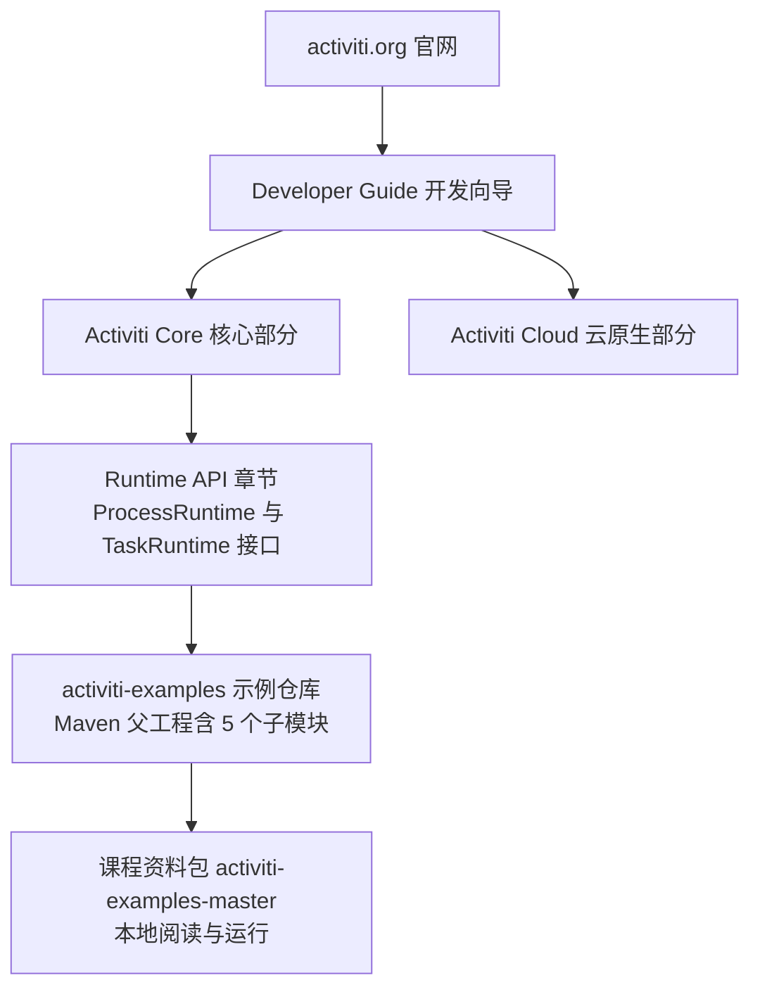

# 7.x 的资料怎么读：官方开发向导与 activiti-examples 示例工程

5.x 和 6.x 时代的中文教程铺天盖地，到了 7.x 情况急转直下：网上能搜到的中文资料绝大多数还在讲老的 Service 全家桶，真正讲 7.x 新 API 的内容极少。这一课不写代码，专门解决资料问题：官方文档该看哪几页，官方示例工程长什么样，以及课程资料包里已经备好了什么。

## 先给结论

- 7.x 的系统学习资料基本只有官方一份：官方文档加官方示例，中文资料目前几乎断档，英文阅读能力就是学习门槛。
- 官网 activiti.org 的开发向导分成 Activiti Core 与 Activiti Cloud 两大部分，课程重点是 Core 里的 Runtime API 章节。
- 每一节文档的配套代码都对应 activiti-examples 仓库里的一个模块：一个 Maven 父工程，内含 5 个子模块。
- 仓库的 master 分支与 develop 分支内容几乎一致，看哪个分支都可以。
- 课程资料包已经收录了 activiti-examples-master，直接在本地读和跑，不需要临时去找下载渠道。

## 一、为什么基本只剩官方文档可看

**第一，资料断档是客观现实。** 5 和 6 流行了近十年，社区沉淀足够厚；7.x 发布后关注度转移了一部分到 Flowable，中文内容始终没跟上来。想系统学 7.x，只能硬着头皮读官方文档。

**第二，官方文档就是围着示例工程写的。** 打开官网进入开发向导，按提示一路走到快速开始页面：先 setup 开发环境，再把 Activiti 的运行时应用部署起来，然后就能进到 Activiti 与 Activiti Cloud 的 Developer Guide。向导里每讲一个 API，比如 ProcessRuntime API、TaskRuntime API，都给出接口定义、依赖坐标，以及「完整代码在 activiti-examples 仓库的某某模块」这样的指引。也就是说，文档负责讲清楚接口，示例工程负责给一份能直接跑的完整实现，两边是一一对应的关系，读文档时把工程开在旁边对照，效率最高。

## 二、开发向导的地图：Core 与 Cloud

官方把 7.x 的内容组织成两大板块，先用一张图看全貌：



这张图讲的是资料的从属关系。关键路径在最左侧一条：官网到开发向导，向导里的 Core 部分到 Runtime API 章节，再到示例仓库，最后落到资料包。Activiti Core 是核心引擎，覆盖企业级工作流管理的常规需求，本课程的全部内容都走这条线；Activiti Cloud 面向云原生，用 Runtime Bundle、Query、Audit、Connectors 等构建块做分布式流程开发，入门阶段知道有这条线、能看懂文档目录即可。

## 三、activiti-examples：一个父工程带五个子模块

示例仓库在资料包里的位置是 `materials/code/02/Activiti7-day06-新特性/Activiti7-day06-新特性/资料/activiti-examples-master/`，解压后的结构如下：

```text
activiti-examples-master
├── pom.xml                                  // Maven 父工程，统一管理子模块
├── README.md                                // 仓库说明
├── activiti-api-basic-process-example       // 只演示 ProcessRuntime
├── activiti-api-basic-task-example          // 只演示 TaskRuntime
├── activiti-api-basic-full-example          // Process 与 Task 合体的完整示例
├── activiti-api-spring-integration-example  // 与 Spring 集成的示例
└── activiti-api-web-example                 // Web 场景示例
```

父工程的 `pom.xml` 只干两件事：引入 Activiti 的依赖清单，声明一个 starter。以功能最全的 `activiti-api-basic-full-example` 为例：

```xml
<properties>
    <activiti-dependencies.version>7.0.65</activiti-dependencies.version>
</properties>
<dependencyManagement>
    <dependencies>
        <!-- 用依赖清单统一仲裁 Activiti 各组件版本 -->
        <dependency>
            <groupId>org.activiti.dependencies</groupId>
            <artifactId>activiti-dependencies</artifactId>
            <version>${activiti-dependencies.version}</version>
            <scope>import</scope>
            <type>pom</type>
        </dependency>
    </dependencies>
</dependencyManagement>
<dependencies>
    <!-- 7.x 新 API 与 Spring Boot 整合的启动器 -->
    <dependency>
        <groupId>org.activiti</groupId>
        <artifactId>activiti-spring-boot-starter</artifactId>
    </dependency>
    <!-- 官方示例配 H2 内存库，不装数据库也能跑 -->
    <dependency>
        <groupId>com.h2database</groupId>
        <artifactId>h2</artifactId>
    </dependency>
</dependencies>
```

**第一，看模块名就知道对应文档哪一节。** 文档里 ProcessRuntime API 一节指向 `activiti-api-basic-process-example`，TaskRuntime API 一节指向 `activiti-api-basic-task-example`，两个都用到的完整业务场景放在 `activiti-api-basic-full-example`。读的顺序建议从 task 到 process 再到 full，由简到繁。

**第二，版本以工程为准。** 文档页面里贴的依赖坐标是历史形成的，出现过 `7.0.0.Beta1`、`7.0.0.Beta2` 这样的版本号；仓库里的示例工程已经升级到 `7.0.65`。学习时以工程 `pom.xml` 的版本为准，别照抄文档里的 Beta 版本。

## 四、示例工程的读法与跑法

每个子模块都是一个标准的 Spring Boot 工程，有引导类 `DemoApplication`，直接启动即可。官方刻意配了 H2 内存库，省掉装数据库这一步：

```bash
cd activiti-api-basic-task-example
mvn spring-boot:run
```

**第一，边跑边读。** 启动后控制台会打出示例的日志：登录了哪个用户、创建了什么任务、流程实例走到哪一步。把日志和文档里的说明对照着看，接口的行为一目了然，比干读英文文档快得多。

**第二，读懂三件套。** 每个模块的代码结构高度一致：一个 `DemoApplication` 引导类负责调用新 API，一个 `DemoApplicationConfiguration` 配置类负责注册带角色的用户，一个 `SecurityUtil` 工具类负责模拟登录。这三件套正是 7.x 新 API 的使用前提，后面两课拆解 ProcessRuntime 与 TaskRuntime 时会逐个登场。

**第三，中文文档的替代方案。** 目前几乎没有可用的 7.x 中文文档，与其等翻译，不如用「文档加示例加运行日志」的组合硬读。官方文档的用词并不生僻，接口定义部分甚至不需要通读，对着示例代码看方法签名就够了。

## 常见误区

- **把 5/6 的教程当成 7 的资料**：判别方法很简单，教你怎么从 `ProcessEngine` 领 `RuntimeService`、`TaskService` 的是老 API 的资料；出现 `@Autowired ProcessRuntime` 写法的才是 7.x 的内容。
- **照抄文档里的 Beta 依赖版本**：文档示例中的 `7.0.0.Beta1`、`7.0.0.Beta2` 是写作时的快照，示例工程实际使用 `7.0.65`；版本混用容易出现类找不到等诡异错误。
- **只看文档不跑工程，或只跑工程不读文档**：文档与示例模块一一对应，单看任何一边都会丢信息，文档里的权限说明尤其容易在只看代码时被漏掉。
- **在注册下载环节耗时间**：示例仓库已在课程资料包中，本地路径即上文所示，不必依赖外部下载渠道。

## 面试可能被问到的问题

1. 面试官追问：「Activiti 7 的官方学习资料有哪些？」
   答：两样：官网 activiti.org 的 Developer Guide 开发向导，以及 activiti-examples 示例仓库。向导按 Core 与 Cloud 两大板块组织，每个 API 章节都指向仓库里对应的示例模块，两者配套阅读。

2. 面试官追问：「activiti-examples 仓库是什么结构？」
   答：一个 Maven 父工程，通过父 `pom.xml` 统一管理版本，内含五个子模块：basic-process-example 演示 ProcessRuntime，basic-task-example 演示 TaskRuntime，basic-full-example 是两者的完整合体，另有 Spring 集成与 Web 两个场景示例。

3. 面试官追问：「Activiti Core 与 Activiti Cloud 怎么选？」
   答：Core 是核心引擎，单体或常规微服务里做工作流管理用它就够了；Cloud 面向云原生与分布式场景，提供 Runtime Bundle、Query、Audit、Connectors 等构建块。企业常规需求优先 Core，课程重点也是 Core。

4. 面试官追问：「官方示例用什么数据库？换成 MySQL 要改什么？」
   答：示例默认配 H2 内存库，开箱即跑；换 MySQL 只需去掉 H2 依赖、加 MySQL 驱动，并在数据源配置里指向 MySQL，Activiti 首次启动会自动建表。

5. 面试官追问：「7.x 中文资料少，你怎么学新技术？」
   答：以官方文档与官方示例为准，先跑通示例看日志建立整体认识，再对照接口定义逐个方法理解；同时参考同源的 Flowable 社区资料辅助理解，两者引擎设计同源，概念可以互相印证。

## 配套资料

- 官方示例仓库：`materials/code/02/Activiti7-day06-新特性/Activiti7-day06-新特性/资料/activiti-examples-master/`（含父 `pom.xml`、`README.md` 及五个子模块）
- 最简示例模块：`materials/code/02/Activiti7-day06-新特性/Activiti7-day06-新特性/资料/activiti-examples-master/activiti-api-basic-task-example/`
- 完整示例模块：`materials/code/02/Activiti7-day06-新特性/Activiti7-day06-新特性/资料/activiti-examples-master/activiti-api-basic-full-example/`
- 本课无讲义源码包，目录结构与依赖坐标均取自资料包内示例工程实际文件
