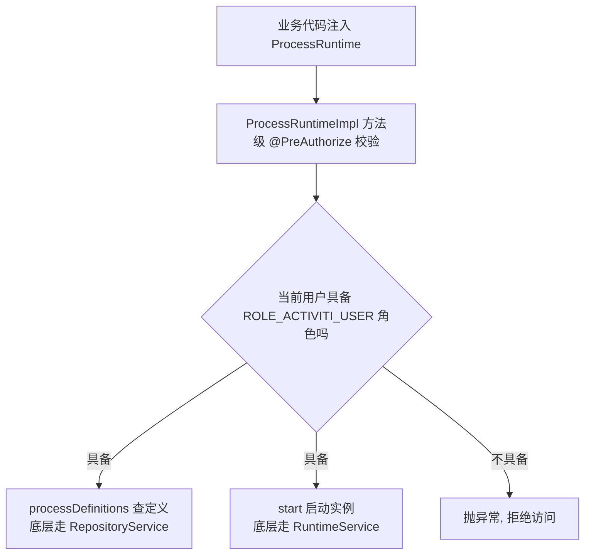

# ProcessRuntime 拆解：7.x 里查流程定义、起流程实例的新入口

把工程从 Activiti 5/6 迁到 7.x，第一段代码通常是这样写的：注入 ProcessRuntime，调 processDefinitions 想列出流程定义，结果一跑就抛异常，提示没有认证用户。代码没错，错在认知：7.x 的每个新 API 都默认站在 Spring Security 后面，不先以合法用户身份登录，一步都走不动。这一课把 ProcessRuntime 从接口、前置条件到底层实现完整拆开。

## 先给结论

- ProcessRuntime 是 7.x 在老 API 之上封装出的流程操作门面，负责查流程定义、启动流程实例等一切流程侧操作，唯一实现类是 ProcessRuntimeImpl。
- 与 Spring Boot 整合后，7.x 默认的权限体系是 Spring Security，实现类的方法上标注了 `@PreAuthorize`，当前用户必须具备 `ROLE_ACTIVITI_USER` 角色才放行。
- 官方示例统一用 `SecurityUtil.logInAs("system")` 这类工具方法模拟登录，把认证信息塞进 Spring Security 上下文。
- 流程定义文件放在 `src/main/resources/processes/` 目录下，应用启动时自动部署，不再手写部署代码。
- 实现类内部干的还是老活：查定义靠 RepositoryService，起实例靠 RuntimeService；老 Service 仍可直接注入，新旧 API 允许混用。

## 一、接口长什么样

7.x 明确说：新 API 只有两个接口，ProcessRuntime 管流程，TaskRuntime 管任务，本课先看前者。接口定义节选如下：

```java
public interface ProcessRuntime {
    ProcessRuntimeConfiguration configuration();
    // 按 id 查单个流程定义
    ProcessDefinition processDefinition(String processDefinitionId);
    // 分页查流程定义列表
    Page<ProcessDefinition> processDefinitions(Pageable pageable);
    // 启动流程实例
    ProcessInstance start(StartProcessPayload payload);
    // 分页查流程实例
    Page<ProcessInstance> processInstances(Pageable pageable);
    ProcessInstance processInstance(String processInstanceId);
    // 实例的挂起、恢复、删除
    ProcessInstance suspend(SuspendProcessPayload payload);
    ProcessInstance resume(ResumeProcessPayload payload);
    ProcessInstance delete(DeleteProcessPayload payload);
    void signal(SignalPayload payload);
}
```

方法名的规律很明显：名词复数配 Pageable 就是分页查询，动词配一个 Payload 对象就是一次操作。所有入参都不再是散装的字符串，而是 `StartProcessPayload` 这类参数对象，配合 Builder 链式构造，这是 7.x 风格上的第一个大变化。

## 二、用之前必须过两道门：依赖与登录

**第一道门，整合依赖。** 教学工程用的坐标是 `activiti-spring-boot-starter`，官方示例工程则通过依赖清单 `activiti-dependencies` 统一管版本：

```xml
<dependency>
    <groupId>org.activiti</groupId>
    <artifactId>activiti-spring-boot-starter</artifactId>
    <version>7.0.0.Beta2</version>
</dependency>
```

starter 引进来，容器启动时自动装配好 ProcessRuntime 的实现 bean，业务代码里 `@Autowired` 就能注入。

**第二道门，登录与角色。** Activiti 不管哪个版本，天然有用户、组、候选人的概念，7.x 干脆把权限这件事交给 Spring Security：实现类 ProcessRuntimeImpl 的方法上标注了 `@PreAuthorize` 注解，要求当前用户具备 ACTIVITI_USER 角色，权限串写作 `ROLE_ACTIVITI_USER`，没有这个角色直接拒绝访问。所以要注册用户：

```java
@Configuration
@EnableWebSecurity
public class DemoApplicationConfiguration extends WebSecurityConfigurerAdapter {

    @Bean
    public UserDetailsService myUserDetailsService() {
        InMemoryUserDetailsManager manager = new InMemoryUserDetailsManager();
        // 用户名、密码、角色与组：ROLE_ACTIVITI_USER 是调用新 API 的通行证
        String[][] usersGroupsAndRoles = {
                {"salaboy", "password", "ROLE_ACTIVITI_USER", "GROUP_activitiTeam"},
                {"ryandawsonuk", "password", "ROLE_ACTIVITI_USER", "GROUP_activitiTeam"},
                {"system", "password", "ROLE_ACTIVITI_USER"},
                {"admin", "password", "ROLE_ACTIVITI_ADMIN"},
        };
        for (String[] user : usersGroupsAndRoles) {
            List<String> authorities = Arrays.asList(Arrays.copyOfRange(user, 2, user.length));
            manager.createUser(new User(user[0], passwordEncoder().encode(user[1]),
                    authorities.stream().map(SimpleGrantedAuthority::new).collect(Collectors.toList())));
        }
        return manager;
    }

    @Bean
    public PasswordEncoder passwordEncoder() {
        return new BCryptPasswordEncoder();
    }
}
```

再配一个模拟登录的工具类，官方所有示例都靠它切换身份：

```java
@Component
public class SecurityUtil {

    @Autowired
    private UserDetailsService userDetailsService;

    public void logInAs(String username) {
        UserDetails user = userDetailsService.loadUserByUsername(username);
        // 把认证信息塞进 Spring Security 上下文，新 API 认的是它
        SecurityContextHolder.setContext(new SecurityContextImpl(new Authentication() {
            // 省略 getAuthorities、getPrincipal 等实现，均委托给 UserDetails user
        }));
        // 同步喂给引擎自己的身份机制，老 API 仍认这个
        org.activiti.engine.impl.identity.Authentication.setAuthenticatedUserId(username);
    }
}
```

注意 SecurityUtil 同时喂了两套身份：`SecurityContextHolder` 给 7.x 新 API 用，`Authentication.setAuthenticatedUserId` 给引擎老机制用。少喂任何一边，都会在某条链路上变成「无主」操作。

## 三、查流程定义与启动流程实例

测试类里的两个典型用法，查定义：

```java
// 查看流程定义
@Test
public void contextLoads() {
    securityUtil.logInAs("salaboy");
    Page<ProcessDefinition> page = processRuntime.processDefinitions(Pageable.of(0, 10));
    System.out.println("可用的流程定义数量：" + page.getTotalItems());
    for (ProcessDefinition pd : page.getContent()) {
        System.out.println("流程定义：" + pd);
    }
}
```

启动流程实例，带流程定义 key 与业务变量：

```java
// 启动流程实例
@Test
public void testStartProcess() {
    securityUtil.logInAs("system");
    ProcessInstance pi = processRuntime.start(
            ProcessPayloadBuilder.start().withProcessDefinitionKey("myProcess").build());
    System.out.println("流程实例ID：" + pi.getId());
}
```

官方示例里启动动作放在定时任务中周期执行，参数给得更全，流程实例名称、业务变量一并带上：

```java
@Scheduled(initialDelay = 1000, fixedDelay = 1000)
public void processText() {
    securityUtil.logInAs("system");
    String content = pickRandomString();
    ProcessInstance processInstance = processRuntime.start(ProcessPayloadBuilder
            .start()
            .withProcessDefinitionKey("categorizeProcess")
            .withProcessInstanceName("Processing Content: " + content)
            .withVariable("content", content)
            .build());
    logger.info(">>> Created Process Instance: " + processInstance);
}
```

还有一个隐性福利藏在约定里：官方文档明确要求流程定义文件放在 `/src/main/resources/processes/` 目录下。放对了位置，应用一启动就自动完成部署，老写法里 `repositoryService.createDeployment()...deploy()` 那一整套代码可以省掉。官方示例的 `activiti-api-basic-full-example` 就是在这个目录里放了 `categorize-human-content.bpmn20.xml`，流程 id 为 `categorizeHumanProcess`，上面的 `start` 方法直接按 key 启动它。

## 四、实现类里看到的老朋友

按住 Ctrl 点进注入的 ProcessRuntime，实现类 ProcessRuntimeImpl 暴露了真相：它是一个普通接口实现，内部持有的字段是两个熟悉的面孔，RepositoryService 与 RuntimeService，也就是 5/6 时代那套 Service。整条调用链可以画成这样：



这张图讲的是新 API 的真实分工。关键结论有两条：新接口没有发明新引擎，部署、查定义还是 RepositoryService 在干，启动实例还是 RuntimeService 在干，7.x 只是在外面套了一层带权限校验的门面；门面之后灵活性反而下降，因为每个方法都被权限规则管着。官方也留了后路：把 `@Autowired` 的类型换成老的 `RuntimeService`，照样能注入、能干活，新的老的可以混着用，熟练哪套用哪套。

## 常见误区

- **忘记模拟登录就调新 API**：抛「没有认证用户」一类的异常。测试与定时任务里，每个业务动作前都要先 `securityUtil.logInAs("xxx")`。
- **角色串少写 ROLE_ 前缀**：配置用户时权限串必须是 `ROLE_ACTIVITI_USER`，写成 `ACTIVITI_USER` 会导致 `@PreAuthorize` 校验永远不通过，现象是明明登录了还是被拒。
- **流程定义放错目录**：不是放在 resources 根下就能自动部署，必须在 `src/main/resources/processes/` 下；查不到流程定义多半是这个原因。
- **以为新 API 是一台新引擎**：ProcessRuntime 只是封装，底层仍是老 Service；同理也不要以为用了新 API 老的就废了，老 Service 照常能注入使用。

## 面试可能被问到的问题

1. 面试官追问：「ProcessRuntime 和老的 RuntimeService 是什么关系？」
   答：封装关系。ProcessRuntime 是 7.x 提供的新门面接口，唯一实现类 ProcessRuntimeImpl 内部持有老的 RepositoryService 与 RuntimeService，查流程定义、启动流程实例最终仍由这两个老 Service 执行，新 API 主要增加了 Payload 参数风格与权限校验。

2. 面试官追问：「为什么 7.x 必须引入 Spring Security？」
   答：7.x 与 Spring Boot 整合后默认用 Spring Security 做用户体系，实现类方法上标注了 `@PreAuthorize`，要求调用者具备 `ROLE_ACTIVITI_USER` 角色。引擎本身有用户、组、候选人的模型，新 API 把「当前操作人是谁」直接绑定到 Spring Security 上下文，所以不集成就调不动。

3. 面试官追问：「流程定义还要写部署代码吗？」
   答：不用。7.x 约定流程定义文件放在 `src/main/resources/processes/` 目录，应用启动时自动扫描并部署；前提是文件位置必须符合约定，否则查定义时列表为空。

4. 面试官追问：「怎么带变量启动一个流程实例？」
   答：用 `ProcessPayloadBuilder.start()` 链式构造：`withProcessDefinitionKey` 指定流程定义 key，`withVariable` 放业务变量，`withProcessInstanceName` 设实例名称，最后 `build()` 生成 `StartProcessPayload` 交给 `processRuntime.start`。

5. 面试官追问：「新的老的 API 能混用吗？」
   答：能。starter 把两套 bean 都装配进了容器，注入 `ProcessRuntime` 用新写法，注入 `RuntimeService`、`TaskService` 用老写法，互不冲突。过渡期项目常按方法粒度混用，注意身份上下文两边都要喂到位。

6. 面试官追问：「SecurityUtil 这个工具类做了什么？」
   答：它按用户名从 UserDetailsService 加载用户，手工构造一个已认证的 Authentication 放进 SecurityContextHolder，让新 API 认到当前用户；同时调用引擎的 `Authentication.setAuthenticatedUserId` 同步老机制的身份。测试和定时任务没有真实登录过程，全靠它模拟。

## 配套资料

- 教学工程：`materials/code/02/Activiti7-day06-新特性/Activiti7-day06-新特性/源码/demo2/activitispringboot06/`（含 `pom.xml`、`Actviti7DemoApplication.java`、`DemoApplicationConfiguration.java`、`SecurityUtil.java` 与测试类，包名已统一改为 `com.example`）
- 官方完整示例：`materials/code/02/Activiti7-day06-新特性/Activiti7-day06-新特性/资料/activiti-examples-master/activiti-api-basic-full-example/`（`DemoApplication.java` 中定时启动流程实例的写法、`src/main/resources/processes/` 下的自动部署文件均出自此处）
- 官方流程示例：`materials/code/02/Activiti7-day06-新特性/Activiti7-day06-新特性/资料/activiti-examples-master/activiti-api-basic-process-example/`
