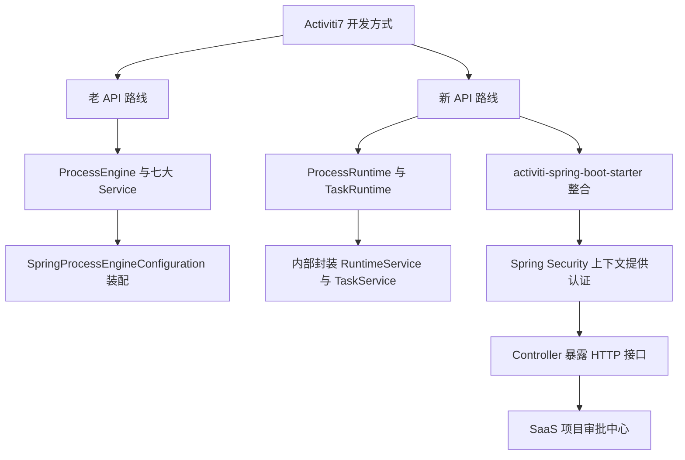
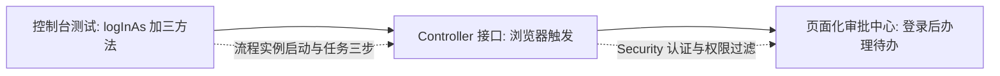

# Activiti7 新特性总结：双轨 API、starter 整合与安全上下文的收束课

Activiti 系列走到收尾。回看这几天的内容，真正需要沉淀下来的其实是三条线：没用 Spring Boot 的团队怎么用 Activiti 与 Spring 整合；Activiti7 的新 API 长什么样、和老 API 是什么关系；整合 Spring Boot 之后如何一路打通到 Controller。把这三条线理清楚，后续在 SaaS 项目里做审批中心时，前面铺的所有路都直接复用。

## 先给结论

- 整合有两条路线：Activiti 与 Spring 整合通过 `SpringProcessEngineConfiguration` 工厂方式创建引擎，服务不用 Spring Boot 的老项目；Spring Boot 整合靠 `activiti-spring-boot-starter` 一个坐标搞定。
- 工作流市场的生产主力仍是 Activiti 5 与 6，7.x 是面向云与容器的新一代引擎，学习它的价值在于新 API 与整合方式。
- 新 API 的两个核心接口 `ProcessRuntime` 与 `TaskRuntime`，内部封装的正是老的 `RuntimeService` 与 `TaskService`，概念没换、入口换了。
- 整合四步：加 starter 坐标、配 Spring Security 用户与组、用新 API 开发流程定义查询与实例启动、任务查询拾取完成，再往上就是 Controller 暴露接口。
- 新 API 的每次调用都依赖 Spring Security 上下文中的认证对象，`logInAs` 是整合开发的固定起手式。

## 一、两条整合路线，各自服务什么场景

**Activiti 与 Spring 整合**针对没有使用 Spring Boot 的公司。引擎通过 Spring 的工厂配置创建，`SpringProcessEngineConfiguration` 接管数据源、事务管理器等核心资源，配置文件 `activiti-spring.xml` 负责把流程引擎装配进 Spring 容器。业务代码里拿到 `ProcessEngine`，再取出七大 Service 使用。这条路写法偏老但依然有效，属于需要掌握的工程能力。

**Activiti7 与 Spring Boot 整合**是 7.x 发布后的正式能力，官方明确支持与 Spring Boot 2.x 整合开发。整合步骤压缩成四步：

1. 添加 Spring Boot 整合 Activiti7 的坐标；
2. 添加 Spring Security 安全框架的整合配置信息；
3. 使用新支持的类开发工作流，核心是 `ProcessRuntime` 与 `TaskRuntime` 两个接口；
4. 用新 API 实现流程定义查询、启动流程实例、任务查询、任务完成。

坐标层面只需要一个依赖：

```xml
<!-- Activiti7 与 Spring Boot 整合的核心坐标 -->
<dependency>
    <groupId>org.activiti</groupId>
    <artifactId>activiti-spring-boot-starter</artifactId>
    <version>7.0.0.Beta2</version>
</dependency>
```

starter 把引擎、Spring 集成、新 API 的 REST 支持一并传递进来，配合 `spring-boot-starter-parent` 统一版本仲裁。对比 Spring 整合时代的一堆坐标加一份 XML 配置，整合成本降了一个量级。

## 二、新 API 与老 API：封装关系而非替代关系

新 API 常被误解成另一套引擎能力，实际上它是对老 Service 的再封装。`ProcessRuntime` 的启动实例、流程定义查询，底层转给 `RuntimeService` 与 `RepositoryService`；`TaskRuntime` 的任务查询、拾取、完成，底层转给 `TaskService`。对应关系如下：

| 业务动作 | 老 API | 新 API |
|---|---|---|
| 查询流程定义 | `repositoryService.createProcessDefinitionQuery()` | `processRuntime.processDefinitions(Pageable)` |
| 启动流程实例 | `runtimeService.startProcessInstanceByKey(key)` | `processRuntime.start(ProcessPayloadBuilder...)` |
| 查询任务 | `taskService.createTaskQuery()` | `taskRuntime.tasks(Pageable)` |
| 拾取任务 | `taskService.claim(taskId, userId)` | `taskRuntime.claim(ClaimTaskPayload)` |
| 完成任务 | `taskService.complete(taskId)` | `taskRuntime.complete(CompleteTaskPayload)` |

新 API 的差异集中在两点：一是所有列表查询强制分页，返回统一的 `Page` 对象；二是用户身份不再手工传参，统一从 Spring Security 上下文获取。启动实例的测试方法能看出这套风格：

```java
@Test
public void testStartProcess() {
    securityUtil.logInAs("system"); // 认证是所有新 API 调用的前置条件
    ProcessInstance pi = processRuntime.start(ProcessPayloadBuilder.start()
            .withProcessDefinitionKey("myProcess")
            .build());
    System.out.println("流程实例ID：" + pi.getId());
}
```

`logInAs` 之后才能调 `start`，因为新 API 内部会校验当前认证人及其权限。查询流程定义同样如此：

```java
@Test
public void contextLoads() {
    securityUtil.logInAs("salaboy");
    Page<ProcessDefinition> page = processRuntime.processDefinitions(Pageable.of(0, 10));
    System.out.println("可用的流程定义数量：" + page.getTotalItems());
    for (ProcessDefinition pd : page.getContent()) {
        System.out.println("流程定义：" + pd);
    }
}
```

两张关系图把整个系列的脉络收在一起：



图里从上往下正是本系列的推进顺序：老 API 打基础，新 API 简化整合，Controller 打通前端，最终落在审批中心这个真实业务场景上。

## 三、市场现状与学习价值：5、6 打天下，7 看方向

工作流部分的生产实践仍以 Activiti 5 和 6 为主，它们是市面上做工作流最主要的引擎版本，API 稳定、资料充足、案例成熟。Activiti7 目前更多代表引擎的演进方向：拥抱 Spring Boot 与云原生，把安全模型内置进 API，把流程操作从 Service 面向过程的调用升级为 Runtime 面向资源的调用。

这个现状决定了学习策略：老 API 的六大核心表、七大 Service、流程定义与实例的完整生命周期是必练的基本功，任何版本都绕不开；新 API 的整合方式与安全模型要理解其设计意图，真正接手 7.x 项目时可以快速上手，面试里能讲清两套 API 的封装关系也足够应对。

## 四、从控制台到审批中心：这一系列铺到了哪里

整个 Activiti 系列的落点不是控制台打印，而是 SaaS 项目中的审批中心。请假要审批、报销要审批，审批流走到部门主管、人事经理、总经理的每一层，都是流程实例在节点间流转。届时操作界面完全页面化：管理员在页面上发布流程，张三登录进来看到自己的待办并完成，李四登录进来办理自己那一层，浏览器发请求、后端 Controller 调 Runtime 接口，链路已经在这几课全部验证过。



控制台阶段的每一次 `logInAs`、每一次 `claim` 加 `complete`，都是页面审批中心背后的同一段逻辑。页面换掉了入口，引擎侧的调用一行不变，这正是前面反复强调「准备工作」的原因。

## 常见误区

- **把新 API 当成全新引擎重学**：`ProcessRuntime` 与 `TaskRuntime` 封装的是老 Service，六大核心表与流程生命周期知识完全复用，理解封装关系后新 API 一天就能上手。
- **只学 7.x 不碰老 API**：生产环境以 5、6 为主，老 Service 的查询与操作写法是主流项目的现实需求，跳过老 API 会在真实项目里寸步难行。
- **忽略安全配置直接调新 API**：新 API 从 Spring Security 上下文取认证人，没有 `logInAs` 或登录态时调用直接失败。安全上下文是 7.x 整合开发的地基，不是可选项。
- **版本混引**：老版本 `activiti-engine` 与 7.x starter 混在同一个工程里，类路径冲突导致难以排查的异常。按整合路线二选一，版本交给 starter 与 parent 管理。

## 面试可能被问到的问题

1. 面试官追问：「Activiti7 相比 5、6 有哪些核心变化？」
   答：一是与 Spring Boot 2.x 官方整合，一个 starter 坐标完成装配；二是引入新 API，`ProcessRuntime` 与 `TaskRuntime` 封装老的 `RuntimeService` 与 `TaskService`，列表查询统一分页；三是安全模型内置，所有操作依赖 Spring Security 上下文中的认证对象。引擎底层的核心表与流转机制保持延续。

2. 面试官追问：「没用 Spring Boot 的项目还能用 Activiti7 吗？」
   答：可以，走 Activiti 与 Spring 整合路线，通过 `SpringProcessEngineConfiguration` 工厂配置创建 `ProcessEngine`，把数据源与事务管理器交给 Spring 管理，业务代码从引擎取出七大 Service 使用。这条路服务的是传统 Spring 项目，属于需要掌握的整合方式。

3. 面试官追问：「新 API 为什么要求先认证再操作？」
   答：新 API 把权限过滤内置在实现层，任务查询会按当前认证人及其所属组过滤数据，启动实例、拾取、完成等写操作也校验认证人的 `ROLE_ACTIVITI_USER` 权限。认证对象缺失时调用直接失败，这把「谁登录谁执行」变成了引擎强制的规则，而不是业务代码的自觉。

4. 面试官追问：「生产选型时 5、6 和 7 怎么权衡？」
   答：看团队技术栈与项目周期。传统 Spring 项目或追求稳定的老项目选 5、6，API 成熟、社区案例多；新项目技术栈是 Spring Boot 且接受 7.x 的安全模型，可以用 7 的 starter 快速整合。核心表结构与流程机制相通，切换的主要成本在 API 风格与安全配置。

5. 面试官追问：「怎么做一套审批中心？」
   答：流程定义由管理端页面部署，发起审批时业务落库并调 `processRuntime.start` 传业务关联信息；待办列表调 `taskRuntime.tasks` 按登录人过滤；认领与办理分别对应 `claim` 与 `complete`，办理时先完成业务表单落库再办结任务。审批人之间的层层流转由引擎沿 BPMN 定义自动推进。

## 配套资料

- Spring Boot 整合工程：`materials/code/02/Activiti7-day06-新特性/Activiti7-day06-新特性/源码/demo2/activitispringboot06/`（`pom.xml` 的 `activiti-spring-boot-starter` 坐标、测试类 `Actviti7DemoApplicationTests.java` 的流程定义查询与实例启动代码，包名已改为 `com.example`）
- Spring 整合素材：`materials/code/02/Activiti7-day06-新特性/Activiti7-day06-新特性/资料/基本素材/01activiti与spring整合素材/`（`activiti-spring.xml` 与 `pom.xml`，老路线的引擎装配配置）
- 审批中心工程：`materials/code/02/Activiti7-day07-审批中心模块开发/Activiti7-day07-审批中心模块开发/代码/activiti07/`（页面化审批中心的真实工程，含 Controller、Service 与 Thymeleaf 页面，可作为系列收束后的进阶参考）
