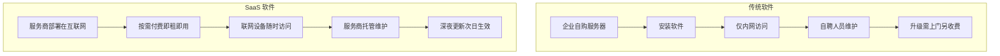

# SaaS 概述：把软件做成「既租即用」的生意

上一节把 IaaS、PaaS、SaaS 三层租法分清了，但一个更实际的问题马上浮出来：同样是云服务，为什么这几年资本和厂商都在追 SaaS？一套软件不卖断、改成按月收租，究竟改变了什么，能让企业觉得「成本越来越低」？

这一节聚焦 SaaS 本身：它的商业模式长什么样、订阅的钱怎么收、和传统买断式软件比省在哪，以及这个市场到底还有多大空间。

## 先给结论

- SaaS 的商业形态：服务商做好一套软件，众多企业付费共用，还可以按需求定制，交一点费用就能用整套系统。
- 既租既用：不用安装、不用部署，浏览器、手机等任何联网设备打开就能用。
- 与传统软件相比，企业省掉了服务器采购、专职维护人员、上门升级费，服务商半夜更新、次日全员见效。
- 应用领域分两类：面向个人（在线文档、记账、日程、相册云管理）与面向企业（CRM、ERP、线上会议、HRM、OA）。
- 中国企业软件盘子最大，SaaS 行业软件规模增长更快，且仍有很大的增长空间。

## 三层租法里，SaaS 是包得最彻底的那层

把三种云模式串起来看：IaaS 提供的是最基础的组件，也就是服务器；PaaS 在服务器之外把数据库等平台件也包了进去；SaaS 不仅包含服务器，还把整个运行平台搞定，连应用本身都是服务商做好的。

所以 SaaS 平台是「既租既用」的模式：缴纳一定费用，你要的功能都已经准备好，直接使用即可。中小型应用如果自己买服务器、自己搭环境、自己写全部代码，成本很高；换成直接用 SaaS 平台上的现成软件，按需付费，用什么功能付什么钱，对企业来说就是一句话：**成本越来越低。**

## 订阅制：SaaS 的钱怎么收

SaaS 的收费逻辑是订阅：企业按版本、按周期付费，而不是一次性买断。这套逻辑落到本项目的数据模型上，就是每一家入驻企业的档案里都记录着订阅状态。课程资料里的企业实体 `Company` 把这件事写得很直白（精简自真实代码，包名已改为 `com.example`）：

```java
package com.example.domain.company;

import javax.persistence.Id;
import java.io.Serializable;
import java.util.Date;

public class Company implements Serializable {
    private static final long serialVersionUID = 594829320797158219L;

    @Id
    private String id;               // 企业唯一标识
    private String name;             // 公司名称
    private String managerId;        // 企业登录账号 ID
    private String version;          // 当前版本：订阅的套餐档位
    private Date renewalDate;        // 续期时间
    private Date expirationDate;     // 到期时间：订阅周期到此为止
    private String auditState;       // 审核状态：入驻资质审核
    private Integer state;           // 状态：启用、停用
    private Double balance;          // 当前余额：支持余额扣费
}
```

`version`、`renewalDate`、`expirationDate` 三个字段合在一起，就是一次订阅的完整描述：订的什么档位、什么时候该续、什么时候到期。`balance` 留出了余额扣费的口子，`auditState` 与 `state` 则控制一家企业能不能正常使用服务。订阅制不是口号，它在数据模型里就是这几个字段。

## 传统软件与 SaaS：一条链条的对比

传统企业软件的形态：软件安装在企业自己的服务器里，公司必须先有服务器才能用；系统出了问题，要额外聘人维护；而且一般只能在内网访问，局限性很强。成本呢？买服务器、买软件授权、雇维护人员，一样都省不掉，后续投入居高不下。

版本升级更麻烦。服务商出了新版本，得派一套人马到企业去更新，更新本身还要再收费。

SaaS 软件把这整条链条换掉了：部署在互联网上，付出一点费用就能用提供的功能；开发维护由服务商负责；更新是服务商半夜统一发布，第二天用户直接看到新功能；只要能联网的设备就支持远程办公。

```bash
# 传统管理软件的一次版本升级（示例，按主流做法还原）
ssh admin@192.168.1.100          # 登录客户企业的内网服务器
./app --stop                     # 停掉正在运行的服务
rpm -Uvh app-2.1.0.rpm           # 逐户安装升级包
./app --start                    # 重新拉起服务
# 服务商要派工程师一家一家做，做完还要单独收一笔服务费
```

两种模式放在同一张图里对照：



两条链条从起点到终点没有一步是重叠的：传统软件的每一步都是企业的负担，SaaS 把每一步都收回到服务商手里。降低企业成本、按需购买、无需关注开发维护、更新迭代快、支持远程办公，这几个好处全都来自同一次模式切换。

## 应用领域与市场前景

SaaS 服务两类对象。

**面向个人的产品**：在线文档、收支记账、日程计划、照片云管理、联系人管理，手机里的相册云同步就是典型的个人 SaaS，每个用户都在使用服务商提供的公共服务。

**面向企业的产品**：因为企业应用五花八门，种类更多，比如 CRM 客户关系管理、ERP、线上会议与群组会议，当然也包括本课程要做的 HRM 人力资源管理和 OA 办公自动化。

前景可以看一组行业数据：把中国企业软件与 SaaS 行业软件的市场规模画成两条增长曲线，传统企业软件的盘子目前仍是最大的，SaaS 的曲线增长很快，而且与传统软件的差距意味着它还有很大的上升空间。增长中的市场，也就是从业者的机会所在。

## 常见误区

- **把 SaaS 等同于「软件装在云服务器上」。** 关键差异在商业模式与维护主体：租还是买断、服务商维护还是企业自维护，部署位置反而是次要的。
- **以为 SaaS 只能做个人小工具。** 企业级 SaaS（CRM、ERP、HRM）才是市场的主力，也最能体现订阅制的价值。
- **以为 SaaS 不能定制。** 服务商可以按企业需求做定制化开发，主流做法是把通用功能做成默认能力、把差异需求做成版本和模块的分层订阅。
- **只比软件授权费。** 传统模式的真实成本还包括服务器采购、电费机房、专职运维人员、每次上门升级的服务费，这些才是大头。

## 面试可能被问到的问题

1. 面试官追问：「SaaS 和传统软件的本质区别是什么？」
   答：传统软件买断后安装在企业自己的服务器上，内网访问、自聘维护、升级另收费；SaaS 部署在服务商的互联网环境里，按需订阅、即租即用，开发维护与版本升级全部由服务商托管，任何联网设备都能访问。

2. 面试官追问：「SaaS 为什么能降低企业成本？」
   答：它把服务器采购、环境搭建、专职运维、上门升级这几项固定投入全部收归服务商，由所有租户分摊；企业只为实际使用的功能按周期付费，边际成本远低于自建，所以总体成本越来越低。

3. 面试官追问：「订阅制在系统里怎么体现？」
   答：一般在租户档案上记录版本、续期时间、到期时间、余额等字段，例如本项目的 `Company` 实体就用 `version`、`renewalDate`、`expirationDate`、`balance` 描述每家企业的订阅状态，配合审核状态控制可用性。

4. 面试官追问：「举几个你身边的 SaaS 产品？」
   答：个人侧有在线文档、云相册、日程与记账应用；企业侧有 CRM、ERP、线上会议、OA，以及人力资源管理系统，它们都符合按需付费、联网即用的特征。

5. 面试官追问：「你怎么看 SaaS 的市场前景？」
   答：中国企业软件市场规模目前最大，SaaS 行业软件规模增速更快、渗透率还低，增长空间大；企业降本诉求叠加远程办公普及，SaaS 仍在快速上升期。

## 配套资料

- 企业实体：`materials/code/02/day01 SAAS-HRM系统概述与搭建环境/SAAS-HRM系统概述与搭建环境/资源/Company.java`（文中代码精简自此文件，包名由原包名改为 `com.example`）。
- 文中 bash 升级脚本为按主流做法补全的示例，仅用于说明传统软件的升级流程。
