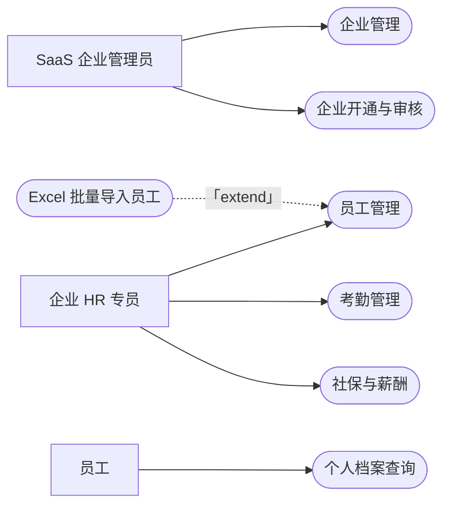

# 原型分析法与用例图：需求从「看得见」到「抽得出」

项目立项之后，需求文档摆在你面前：几十页文字，描述了一个 SaaS 人力资源管理系统的方方面面。领导想知道钱花得值不值，产品想知道功能对不对，你想知道系统到底有哪些模块、都有谁来用。同一份文字需求，四类人能读出四个版本。

需求分析阶段的两个工具就是来解决这件事的：原型分析法让系统先「看得见」，UML 用例图让程序员「抽得出」骨架。这一节把两个工具讲清，并顺手把本项目的用例图画出来。

## 先给结论

- 原型分析法：拿到基本需求后快速构造一个反映用户真实需求的初始模型，让人看到未来系统的概貌，再反复修改直到各方满意。
- 原型面向所有项目参与者，关注界面与细节；程序员还需要一套能抽取参与者、模块、功能的工具。
- UML（统一建模语言）是始于 1997 年的 OMG 标准，包含用例图、类图、状态图等多种图形，其中用例图最能体现系统结构。
- 用例图回答两个问题：谁要用系统（参与者）、系统提供什么功能（用例），以及它们之间的关系。
- 原型确定「页面长什么样」，用例图确定「有什么、谁在用」，接口契约把两者接起来。

## 原型分析法：最短时间拿到最真实的需求

原型分析法（界面原型法）的理念是：在获取一组基本需求之后，快速构造出一个能够反映用户需求的初始系统原型，让用户看到未来系统的概貌，以便判断哪些功能符合要求、哪些方面还需要改进；然后对需求进一步补充、细化和修改，如此反复，直到用户满意，并由此开发出完整的系统。

一句话概括：**在最短的时间内，以最直观的方式获取用户最真实的需求。**

这套方法有两个要点。其一，原型是给所有人看的：开发人员、产品人员、公司领导，都能通过它感知系统未来的样貌，判断功能对错。其二，原型不是一次成型的，它是一个不断往返的过程，不断采集需求、不断修改界面，最终才定稿。

本项目就带着这样一份现成的原型：资料包里附带了在线原型站点，登录后进入系统，左侧是「SaaS 企业」等导航模块，首页上有工作日历、便捷导航；打开企业列表页，能看到企业名称、当前版本、联系人、联系电话、所在地区这些列。虽然数据都是假的，但整个系统有什么模块、每个模块关注什么细节，看一遍就清楚了。

## 原型给所有人看，程序员要抽骨架

原型法的信息密度很高：页面的整体结构、每一处要展示的数据，甚至一个输入框该怎么填都有讲究。这些细节对产品和 UI 很重要，但对程序员来说，价值不在细节本身，而在细节背后可以被抽取出来的三样东西：

**第一，系统有什么参与者。** 谁在操作这套系统，平台运营方还是接入企业的 HR。

**第二，系统有什么模块。** 企业管理、员工管理、考勤、社保、薪酬，边界在哪里。

**第三，每个模块提供什么功能。** 模块里的动作清单，也就是后面接口的来源。

把这三样东西画成图，程序员之间、程序员和产品之间才有共同语言。这门「图形语言」就是 UML。

## UML 与用例图：程序员的图形语言

UML（Unified Modeling Language）又称统一建模语言或标准建模语言，是始于 1997 年的一个 OMG 标准。它是一种支持模型化和软件系统开发的图形化语言，为软件开发的各个阶段提供模型化和可视化支持，覆盖从需求分析、规格说明到构造和配置的全过程。UML 里包含很多种图形：用例图、类图、状态图等，这些图形面向成千上万的开发成员，比文字更直观地展示项目结构。其中用得最多的是用例图，因为它最能体现整个系统的架构。

用例图（use case）主要用于描述用户与用例之间的关联关系。它回答两个问题：

**谁要用系统**，也就是参与者（Actor）：与系统交互的外部角色，比如平台运营人员、企业 HR、普通员工。

**系统提供什么功能**，也就是用例（Use Case）：一个用例大致对应系统里的一个模块或一项完整功能。

两者之间的连线，就是关系。按本项目的范围画一张用例图：



这张图在讲：三类参与者各取所需，管理员负责企业管理与企业开通审核，HR 专员操作员工、考勤、社保薪酬，员工只查自己的档案；虚线那条「extend」表示 Excel 批量导入是对员工管理的一个可选扩展，不做导入，员工管理照样完整。参与者、用例、关系，三个要素齐了，系统骨架就立住了。

用例图之外，每个关键用例通常还要配一页文字规约，评审时直接对着念（示例为按主流用例规约模板补全）：

```yaml
# 用例规约示例：把用例图里的一个椭圆展开成一页可评审的说明
用例名称: 查询企业列表
参与者: SaaS 企业管理员
前置条件: 管理员已登录平台
主流程:
  - 进入「SaaS 企业」菜单
  - 按条件检索入驻企业
  - 系统返回总记录数与当前页数据
后置条件: 列表页展示企业名称、当前版本、联系人、联系电话、所在地区
```

## 从用例到代码：列表页的后端契约

原型里那个企业列表页，落到程序员手里就是一个分页查询用例。它的输出契约，课程资料里已经用同一个通用类定义好了（包名已改为 `com.example`）：

```java
package com.example.common.entity;

import lombok.AllArgsConstructor;
import lombok.Data;
import lombok.NoArgsConstructor;

import java.util.List;

@Data
@AllArgsConstructor
@NoArgsConstructor
public class PageResult<T> {
    private Long total;   // 总记录数：对应列表页上方的总数
    private List<T> rows; // 当前页数据：对应表格里的每一行
}
```

`total` 加 `rows`，就是用例「查询企业列表」返回给前端的一切：总数用来渲染分页条，泛型 `List<T>` 里的每条记录承载企业名称、当前版本、联系人、联系电话、所在地区等字段，正好对应原型页上的那些列。三件东西各司其职：原型定下页面有什么字段，用例定下谁去查、查什么，通用实体把接口的两端接起来。需求分析做到这个份上，写代码已经只是执行了。

## 常见误区

- **把原型当成最终设计稿照抄进代码。** 原型是沟通工具，注定被反复修改；把它当定稿，返工只是时间问题。
- **把 UML 等同于用例图。** UML 是一族图形（用例图、类图、状态图等），用例图只是其中最常用的一种，描述的也只是需求层骨架，不是全部。
- **把用例当成一个个接口。** 用例是参与者的一个完整目标，「员工管理」一个用例背后可能有增删改查多个接口；反过来逐个接口去凑用例，图会碎掉。
- **参与者写成具体的人。** 参与者是「角色」不是「某人」，画「企业 HR 专员」而不是某个姓名工号；同一个人兼两个角色，就是两个参与者。
- **只画参与者连用例。** 用例之间还有包含、扩展等关系，比如批量导入扩展员工管理；漏掉关系，图退化成一堆孤立椭圆。

## 面试可能被问到的问题

1. 面试官追问：「原型分析法是什么，解决什么问题？」
   答：在获取基本需求后快速构造一个能反映用户真实需求的初始系统原型，让用户和项目各方看到未来系统的概貌，判断功能对错，再反复补充细化和修改，直到满意。核心是最短时间、最直观地拿到最真实的需求，减少理解偏差。

2. 面试官追问：「UML 是什么？包含哪些图？」
   答：UML 即统一建模语言，又称标准建模语言，是始于 1997 年的 OMG 标准，用图形化方式支持软件开发各阶段的模型化与可视化。包含用例图、类图、状态图等多种图形，其中用例图最能体现系统结构。

3. 面试官追问：「用例图有哪三个要素？」
   答：参与者、用例、关系。参与者是 与系统交互的外部角色；用例是系统提供的功能或模块；关系既包括参与者与用例之间的关联，也包括用例之间的包含与扩展。

4. 面试官追问：「原型和用例图分别给谁看、看什么？」
   答：原型给开发、产品、领导等所有参与者看，关注界面细节和数据呈现；用例图主要给开发成员看，抽取系统有什么参与者、有什么模块、模块提供什么功能，是更抽象的结构视图。

5. 面试官追问：「用例和接口是什么关系？」
   答：用例是参与者的一个完整业务目标，粒度比接口大；一个用例可能对应多个接口，接口是用例在实现层的落点。先有用例定边界，再拆接口，顺序不能反。

6. 面试官追问：「分页查询的通用返回结构怎么设计？」
   答：用 `PageResult<T>` 这类泛型结果对象，携带 `total` 总记录数与 `rows` 当前页数据两个字段，任何列表查询都能复用；前端拿 `total` 渲染分页条，拿 `rows` 渲染表格。

## 配套资料

- 分页结果实体：`materials/code/02/day01 SAAS-HRM系统概述与搭建环境/SAAS-HRM系统概述与搭建环境/资源/通用代码/common/PageResult.java`（包名已改为 `com.example`）。
- 原型站点与用例图讲解为课程资料包内容；文中 yaml 用例规约为按主流模板补全的示例。
