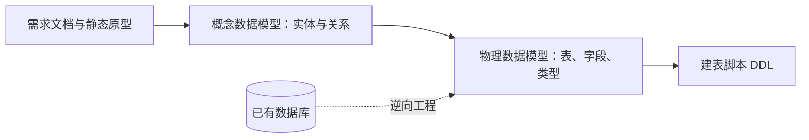
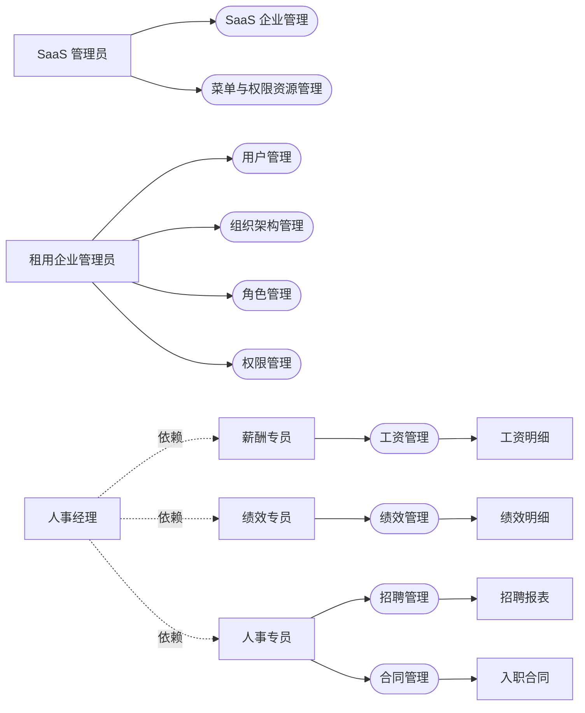

# Power Designer 上手：把 SaaS-HRM 的参与者和功能画成一张用例图

用例图的概念前一节已经讲清：小人代表参与者，椭圆代表功能。真到动手画的时候，新问题马上冒出来：图画在哪？Word 里拖文本框，改一次布局全乱；PPT 里画完导不出任何东西；项目做上两年，图和系统早就是两个东西。需求分析这一环，需要一件趁手的工具。

课程选用 Power Designer：把它装起来，把 SaaS-HRM 的人员和功能模块画成一张完整的用例图。

## 先给结论

- 需求分析软件有很多，Power Designer 是其中流行度极高的一款：Sybase 公司的 CASE 工具集，既能画 UML 的各种图形，又能做数据库建模。
- 数据库建模覆盖数据流图、概念数据模型、物理数据模型，还能为数据库生成结构模型、支持从已有数据库反向生成模型（逆向工程）。
- 画用例图的固定入口：文件 → 建立新模型 → Model types → 面向对象模型（Object Oriented Model）→ Use Case。
- 面板右侧工具栏三件套：小人（Actor，参与者）、椭圆（Use Case，功能模块）、实线（关联，连接参与者与用例）；虚线表示依赖，File 图形表示用例输出的文件。
- SaaS-HRM 的参与者分两层：平台侧的 SaaS 管理员管企业与菜单权限资源，租户侧的企业管理员与各业务专员管自己公司的事。

## 一、这工具解决什么问题

CASE（Computer Aided Software Engineering，计算机辅助软件工程）工具，一句话解释：把分析与设计从纸笔搬到软件里，图可以增删改查、可以校验、可以导出，而不是一张画完就冻结的图片。

**第一，它完整支持 UML 建模。** UML 统一建模语言里的那一族图形，用例图、类图、状态图等都能画，课程重点关注的用例图只是其中一项。

**第二，它覆盖数据库模型设计的全过程。** 数据流图、概念数据模型、物理数据模型都能制作，还能为数据库制作结构模型、对团队设计模型进行控制。概念模型与物理模型的差别，一句话记住：概念模型描述「有哪些实体、实体之间是什么关系」，不绑定任何具体数据库；物理模型落实到「某种数据库里建什么表、什么字段、什么类型」。从概念模型推进到物理模型，再由物理模型正向生成建表脚本；反过来，拿着一个已经跑起来的数据库，也能反向生成物理模型，这就是逆向工程，接手没有文档的老项目时特别有用。

**第三，图是活文档。** 双击图元即可打开属性框改名，模型随需求演进持续维护，而不是一张画完就冻结的图片。

这三件事串成一条线，正好对应「需求 → 设计 → 落库」的全过程：



这条链路里，用例图站在最上游，负责把「谁在用系统、系统有什么功能」固定下来；数据库建模站在下游，后续单独展开。

## 二、画用例图的入口与工具栏

安装没有难度：课程资料里已经准备好了安装包，解压安装即可，唯一要注意的是安装过程中选择语言时选中文。

装好之后打开软件，画用例图走固定路径：

文件 → 建立新模型 → 选择 Model types → 选中面向对象模型（Object Oriented Model）→ 模型类型里选 Use Case → 给模型起个名字（例如 HRM）→ 确认进入绘图面板。

新建模型时能看到模型类型有很多种：物理数据模型（就是数据库模型）、面向对象模型等。选错类型，面板上出现的工具就不对，这是新手遇到的第一个卡点。

进入绘图面板后，右侧是工具栏（Palette），画用例图用到的就几个图元：

| 工具图形 | 名称 | 含义 |
|---|---|---|
| 小人 | Actor | 系统的参与者 |
| 椭圆 | Use Case | 用例，可以理解为系统的功能模块 |
| 实线 | 关联 | 连接参与者与用例，回答「这个功能的参与者是谁」 |
| 虚线 | 依赖 | 一方依赖另一方完成工作 |
| 文件图形 | File | 用例执行后输出的文件，如报表、合同 |

双击图元会弹出属性对话框，里面最常用的是 Name 和 Code 两个属性：Name 是图上显示的名称，给人看；Code 是模型的代码标识，给后续生成产物用。

## 三、把 SaaS-HRM 摆上图

工具认识了，回到系统本身。这是一套基于 SaaS 模式的人力资源管理平台：一个平台，多家公司进来租用。对照静态原型把功能过一遍：雇员管理、工资、社保、考勤、薪酬绩效，都是常规的人力资源功能；但别忘了平台自身也要有人管。于是参与者自然分成两层。

**第一层，平台侧的 SaaS 管理员。** 他管两类东西：一是 SaaS 企业管理，对所有租用这套系统的企业进行管理；二是菜单与权限资源。左侧菜单今天五个、明天随着功能升级变成六个七个，是一个动态变化的过程，菜单、按钮这些统称为权限资源，由平台管理员录入，租户企业没有这个权限。平台提供什么功能，租户才能用什么功能。前端菜单动态加载的设计，源头就在用例图的这一笔。

**第二层，租户侧的角色。** 租用企业的管理员管企业内部：用户管理（企业内部人员要能登录系统）、公司组织架构、角色管理、权限管理。管理员之下是各业务专员：薪酬专员对应工资管理，绩效专员对应绩效管理，人事专员对应招聘管理和合同管理。

还有两个细节值得单独说。

一是输出文件。工资管理要能给某位员工生成当月工资明细，绩效管理要能出绩效明细，招聘要出招聘报表，入职要签合同。企业管理系统跑到最后，很多模块都要输出文件，用例图里用 File 图形接在用例后面表示。

二是人事经理这类「管理者」参与者。他也干活，但干的活是把工作划分给薪酬、绩效、人事这些专员，自己并不直接操作那些模块。这种「我依赖你帮我完成」的关系，用虚线（依赖）连接，而不是实线关联。

完整的用例图示意如下：



读图的关键路径有两条：平台侧一条，SaaS 管理员实线连接企业管理与权限资源；租户侧一条，管理员与各专员各连各的模块。文件挂在用例后面；人事经理到专员的三条虚线是依赖，表达分工调度而非直接操作。后勤人员等参与者可后续补充，模型本来就是逐步细化出来的。

## 四、从模型到表：三层模型的落点

用例图之外，物理模型那一层先看个例子。概念模型里画一个「公司」实体，推进到物理模型就成了一张具体的表，正向生成的建表脚本大致是这个样子（示例为按本项目企业实体的字段结构补全）：

```sql
-- 物理模型正向生成的建表脚本示例，字段取自本项目 Company 实体
CREATE TABLE `co_company` (
  `id`                  VARCHAR(40)  NOT NULL COMMENT 'ID',
  `name`                VARCHAR(255) DEFAULT NULL COMMENT '公司名称',
  `manager_id`          VARCHAR(40)  DEFAULT NULL COMMENT '企业登录账号ID',
  `version`             VARCHAR(20)  DEFAULT NULL COMMENT '当前版本',
  `renewal_date`        DATETIME     DEFAULT NULL COMMENT '续期时间',
  `expiration_date`     DATETIME     DEFAULT NULL COMMENT '到期时间',
  `company_area`        VARCHAR(100) DEFAULT NULL COMMENT '公司地区',
  `company_address`     VARCHAR(200) DEFAULT NULL COMMENT '公司地址',
  `business_license_id` VARCHAR(40)  DEFAULT NULL COMMENT '营业执照图片ID',
  `audit_state`         VARCHAR(10)  DEFAULT NULL COMMENT '审核状态',
  `state`               INT          DEFAULT NULL COMMENT '状态',
  `balance`             DOUBLE       DEFAULT NULL COMMENT '当前余额',
  `create_time`         DATETIME     DEFAULT NULL COMMENT '创建时间',
  PRIMARY KEY (`id`)
) ENGINE=InnoDB DEFAULT CHARSET=utf8;
```

这张表对应的实体类在课程资料里已经有了（包名已改为 `com.example`），字段一一对应：

```java
package com.example.domain.company;

import javax.persistence.Id;
import java.io.Serializable;
import java.util.Date;

public class Company implements Serializable {
    private static final long serialVersionUID = 594829320797158219L;
    @Id
    private String id;             // ID
    private String name;           // 公司名称
    private String managerId;      // 企业登录账号ID
    private String version;        // 当前版本
    private Date renewalDate;      // 续期时间
    private Date expirationDate;   // 到期时间
    private String companyArea;    // 公司地区
    private String companyAddress; // 公司地址
    private String auditState;     // 审核状态
    private Integer state;         // 状态
    private Double balance;        // 当前余额
    private Date createTime;       // 创建时间
    // 字段读写方法省略
}
```

物理模型的每个字段落到实体类的每个属性，这就是「建模先行」的价值：表结构和代码结构在设计阶段就对齐了，后面写代码只是执行。

## 常见误区

- **把用例图画成流程图。** 用例图回答「谁在用系统、系统有什么功能」，不画步骤的先后；有先后顺序的走向交给活动图或时序图。
- **参与者与模块之间一律用实线连。** 实线是关联，表示谁操作这个功能；虚线是依赖，表示谁委托谁完成。让经理直接连一串模块，图传达的信息就是错的。
- **Name 和 Code 随手起名。** Name 给人看，写中文没问题；Code 是后续正向生成代码与脚本的标识，命名混乱会让生成的产物没法用。
- **模型画完就归档。** 需求变了图不跟着改，几个月后图和系统就是两个东西，建模的价值归零。

## 面试可能被问到的问题

1. 面试官追问：「Power Designer 是什么工具，能做什么？」
   答：Sybase 公司的 CASE 工具集，用于管理信息系统的分析与设计。它支持 UML 建模（用例图、类图等），也覆盖数据库模型设计的全过程：制作数据流图、概念数据模型、物理数据模型，还能为数据库制作结构模型、支持逆向工程与团队模型控制。

2. 面试官追问：「概念数据模型和物理数据模型有什么区别？」
   答：概念模型是抽象层，只描述实体和实体之间的关系，不绑定具体数据库产品；物理模型是实现层，落实到某种数据库的具体表、字段、类型与索引。通常先画概念模型评审，再转成物理模型生成建表脚本。

3. 面试官追问：「什么是逆向工程？」
   答：与正向生成相反，指从已有数据库反向生成物理模型甚至概念模型。接手没有文档的老系统时，用它把库表结构还原成图，是摸清数据模型最快的方式。

4. 面试官追问：「用例图里实线和虚线分别表示什么？」
   答：实线是关联，连接参与者与用例，表示这个参与者操作这个功能；虚线是依赖，表示一方依赖另一方完成工作，比如经理依赖下属专员的操作来完成调度。两种线的语义不能混用。

5. 面试官追问：「SaaS 平台的用例图和普通系统相比，参与者上有什么不同？」
   答：多出一层平台侧参与者。普通系统只有业务角色，SaaS 平台要先有平台管理员，负责租户（企业）管理和菜单、按钮等权限资源的维护；租户侧角色只能使用平台开放的功能。画图时这两层参与者必须分开，权限边界才清晰。

## 配套资料

- 企业实体类：`materials/code/02/day01 SAAS-HRM系统概述与搭建环境/SAAS-HRM系统概述与搭建环境/资源/Company.java`（包名已改为 `com.example`）。
- 本课为工具操作课，无配套源码工程；操作路径按课件内容整理，建表 SQL 为按本项目实体结构补全的示例。
