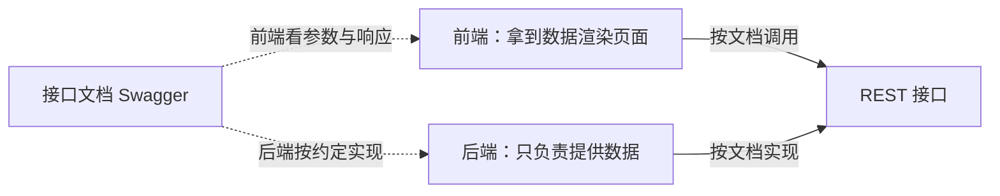
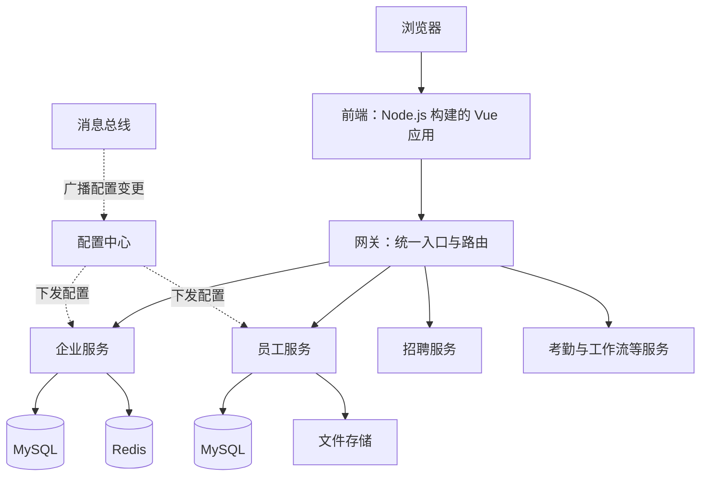

# SaaS-HRM 系统设计：前后端分离怎么协作，微服务怎么拆

需求和用例图都齐了，下一个岔路口是架构：这套多租户的人力资源平台，前端后端怎么分工？一个大工程从头包到尾，还是拆成一组服务？拆的话按什么粒度拆？选错方向，后面每一天都在还债。这一节把课程的设计决策摊开讲：开发方式、技术栈、系统结构，三层各是什么样。

## 先给结论

- 开发方式采用业界流行的前后端分离：前端与后端并行开发，维系两端的纽带是接口文档，课程用 Swagger 来把它规范化。
- 职责边界一句话：后端只负责提供数据，前端拿到数据后负责渲染页面。
- 前端技术栈：以 Node.js 为核心的 Vue 生态，包括 Vue 本体、Vue Router 路由、Vuex 状态管理、axios 请求库等。
- 后端技术栈：Spring 全家桶。Spring Boot 快速构建环境，Spring Cloud 提供网关等微服务能力，Spring MVC 承担 web 层，Spring Data JPA 操作数据库。
- 系统结构：请求经网关分发到一组按业务拆分的微服务（企业、员工、招聘、工作流等），每个服务独立连接自己的 MySQL、Redis 与文件存储。

## 一、开发方式：并行开发的命脉是接口文档

前后端分离不是说前端归一个组、后端归另一个组就完事，核心是两边可以**并行**：左边在开发前端的时候，右边同步开发接口，互不等待。

疑问马上来了：既然互不等待，前端怎么知道自己需要什么数据、要往后端传什么样的参数？答案就是接口文档。文档的形式可以很随意：Word 文档、txt 文本，甚至口头约定都能算；但课程采用更规范的做法，用 Swagger 来编写和维护。



图里那条虚线就是整个协作模式的关键：接口文档不是事后补的记录，而是先于编码存在的契约。前端照着文档发起请求，后端照着文档返回数据，两边各自对齐同一份约定，并行才不翻车。

## 二、技术架构：前端 Vue 生态，后端 Spring 全家桶

技术架构围绕前端、后端两条线展开。

前端不是课程的学习重点，只需要认识它的轮廓：以 Node.js 为核心的 Vue 前端技术生态，里面包含 Vue 本体、负责路由的 Vue Router、负责状态管理的 Vuex，还有发请求的 axios 等。这套生态贯穿课程全程，后端工程师要能看懂它发来的请求长什么样。

后端是重心，Spring 全家桶四个成员各管一段：

| 成员 | 在本项目里的角色 |
|---|---|
| Spring Boot | 快速构建工程环境，起步依赖加自动配置 |
| Spring Cloud | 提供网关等微服务特性，负责服务间的入口与治理 |
| Spring MVC | web 层框架，按三层架构的设计模式组织代码 |
| Spring Data | 持久层解决方案，Spring Data JPA 查询数据库，也能操作 Redis 等 |

**关于持久层要多说一句。** Spring Data JPA 底层是 Hibernate，有的团队不喜欢这层封装，想换 MyBatis，完全可以，只是需要自己动手改造，课程统一用 Spring Data 来做，为的是把系统快速搭起来。持久层选型是工程决策，不是信仰问题。

## 三、系统结构：网关后面是一组微服务

把系统全部做完之后，整体结构长这样：



关键路径从上往下读：前端应用发出请求，先到网关，由网关跳转到具体的模块；企业、员工、招聘、工作流这些模块，每一个就是一个微服务；每个服务内部再去调用自己的 MySQL、Redis 或文件存储。配置中心统一管理各服务的配置，改配置时由消息总线广播刷新，服务不用重启。

**为什么按业务拆而不是按技术拆？** 企业管理、员工管理这类模块的业务节奏不同：菜单和功能是动态变化的（权限资源由平台侧维护），招聘和考勤的变更频率也不一样。按业务边界拆成独立服务，一个模块升级不影响其他模块，这正是上一节用例图里画出的业务边界，在部署结构上的延续。

**多租户的数据放哪，是这套结构绕不开的设计倾向。** SaaS 平台上多家公司共用一套系统，数据隔离有三种主流方案：独立数据库（隔离最彻底，成本最高）、共享数据库独立 Schema、共享数据库共享表并在业务表里带租户字段（成本最低，运维最简单）。本项目的倾向是最后一种：企业本身就是租户实体（`Company`），其余业务数据统一挂在企业维度之下。租户规模不大、需要快速交付时，共享表方案是性价比最高的起点，等隔离要求变高再演进。

落到接口上，前后端交换的数据也长着一个固定的样子（示例，结构来自课程通用代码）：

```json
{
  "success": true,
  "code": 10000,
  "message": "操作成功！",
  "data": {
    "total": 3,
    "rows": [
      { "id": "1", "name": "某某科技有限公司", "version": "V1.0" }
    ]
  }
}
```

外层是统一响应结构 `Result`，分页数据装在 `data` 里的 `PageResult` 中，两者的完整定义在接口文档一节展开。

网关这一环的配置大致如下（示例为按 Spring Cloud 网关的写法补全）：

```yaml
# 网关路由示例：按路径前缀把请求转发到各业务服务
server:
  port: 8080
zuul:
  routes:
    company-service:
      path: /company/**
      serviceId: company-service
    employee-service:
      path: /employees/**
      serviceId: employee-service
```

前端只认网关地址，请求打到 `/company/**` 还是 `/employees/**`，由网关转发给对应的服务，前端不需要知道后面有几个服务、各部署在哪。

## 常见误区

- **把前后端分离理解成「各干各的」。** 分离的是开发过程，不分的是契约。接口文档不同步，前端按旧字段开发，联调当天就是事故现场。
- **把 Spring Boot 当成微服务框架。** Spring Boot 解决的是快速构建单个应用；服务注册发现、网关、配置中心这些微服务治理能力来自 Spring Cloud。两者是配合关系，不是一回事。
- **按技术层拆微服务。** 把所有 Controller 拆一个服务、所有 Service 拆一个服务，改一个需求要跨三个仓库上线。拆分粒度跟着业务边界走，不跟代码分层走。
- **多租户一上来就独立数据库。** 每个租户一套库，资源成本和运维成本随租户数线性上涨。多数业务场景下，共享表加租户字段已经够用，隔离要求升级时再演进不迟。

## 面试可能被问到的问题

1. 面试官追问：「什么是前后端分离？相比不分离有什么优势？」
   答：前后端分离指前端负责页面渲染、后端只提供数据接口，两端通过接口文档约定契约，可以并行开发、独立部署。优势在于分工明确、并行提效、前端后端各自独立演进与扩容，接口还可以同时服务 Web 端和移动端。

2. 面试官追问：「并行开发时，前后端怎么保证接口对得上？」
   答：靠事先约定的接口文档，课程里用 Swagger 编写并集中发布。字段、参数、响应结构都以文档为准，任何一方改动先改文档再改代码，联调成本从「互相等着猜」变成「对着契约写」。

3. 面试官追问：「Spring Boot、Spring Cloud、Spring MVC、Spring Data 各自解决什么问题？」
   答：Spring Boot 快速构建与自动配置单个应用；Spring Cloud 提供网关、注册与配置中心等微服务治理能力；Spring MVC 是 web 层框架，负责请求分发与三层架构中的表现层；Spring Data 是持久层统一方案，Spring Data JPA 操作关系库，也有对 Redis 等的封装。

4. 面试官追问：「系统里为什么要加一层网关？」
   答：网关是所有请求的统一入口，负责路由转发、把 `/company/**` 这类前缀映射到具体服务，前端无需感知服务数量与部署位置；鉴权、限流等横切逻辑也能在网关统一处理，避免每个微服务重复实现。

5. 面试官追问：「SaaS 多租户的数据隔离有哪些方案？你们怎么选的？」
   答：三种主流方案：独立数据库、共享数据库独立 Schema、共享库共享表加租户字段。独立库隔离最彻底但成本最高；共享表成本最低。本项目采用共享表方案，企业本身即租户实体，业务数据挂在企业维度下，适合租户规模适中、要求快速交付的场景。

6. 面试官追问：「为什么微服务按业务拆，而不是按 Controller、Service 这种技术层拆？」
   答：按技术层拆，一个需求要横跨多个服务修改与发布，团队协作和部署都碎；按业务边界拆，模块内高内聚、模块间通过接口协作，单模块升级不影响其他模块，与组织上的分工也更容易对齐。

## 配套资料

- 统一响应实体：`materials/code/02/day01 SAAS-HRM系统概述与搭建环境/SAAS-HRM系统概述与搭建环境/资源/通用代码/common/Result.java` 与同目录 `PageResult.java`（包名已改为 `com.example`）。
- 租户实体：`materials/code/02/day01 SAAS-HRM系统概述与搭建环境/SAAS-HRM系统概述与搭建环境/资源/Company.java`。
- 开发方式与技术架构图为课件内容；响应 JSON 与网关路由 yaml 为按课程通用代码和写法补全的示例。
