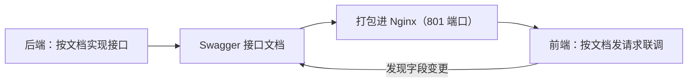

# 接口文档怎么读：Swagger、RESTful 约定与统一响应结构

前后端分离开工在即，前端的第一句话多半是：接口文档给我一份。如果文档东一份 Word、西一份 txt，字段含义全靠猜，并行开发立刻退化成互相等待。契约要统一格式、集中查阅、随取随用。课程的做法是把整套接口文档用 Swagger 编写好，打包进一个改造过的 Nginx 服务器，跑起来逐个接口读一遍，顺带把「请求怎么传、响应怎么收」的结构定死。

## 先给结论

- 文档即服务：Swagger 编写的 API 文档与 Nginx 打包在一起，解压后运行 `nginx.exe`，浏览器访问 `http://localhost:801` 即可查阅。
- 文档按业务模块分组：企业、组织架构、用户、员工、角色、权限、工资等，每个接口标注请求方式与路径。
- 接口按 RESTful 风格约定：POST 增加、GET 查询、PUT 修改、DELETE 删除，资源路径形如 `/company/{companyId}`。
- HTTP 状态码 200 只代表请求成功，业务成功与否要看响应体里的返回码 `code`，连同成功标记与说明文字构成统一响应结构。
- 响应结构在代码里对应通用实体 `Result`（success、code、message、data）与返回码枚举 `ResultCode`，分页查询再套一层 `PageResult`（total、rows）。

## 一、把文档跑起来

资料包里的 API 目录是一个已经打包好的 Nginx 服务器，所有接口文档都放在里面，不需要自己部署 Swagger 环境。操作只有三步：解压，进入解压后的目录，双击 `nginx.exe` 启动。

```bash
# 进入解压后的目录，双击或命令行启动 Nginx
./nginx.exe
# 这套 Nginx 被改造成了 801 端口，浏览器直接访问
curl http://localhost:801
```

页面打开后，文档按服务分组：企业（Company）、组织架构、用户、员工、角色、权限、工资等模块一目了然。每个接口前面带请求方式，POST、GET、PUT、DELETE 排列整齐；页面底部的 Models 区列出各实体的字段清单与含义。这张图说明文档在协作里处于什么位置：



文档从后端流向前端，前端发现字段对不上时再回流修改文档，它是两端共同维护的活契约，而不是一次性的交付物。

## 二、以「增加企业」为例读懂一个接口

点开 `POST /company`（增加 Company）这一条，往下走能看到两层内容。

**第一层是 parameter，前端要往后端传的参数。** 传递的数据要封装成 Company 实体，也就是一个 JSON 对象（文档原样示例，节选）：

```json
{
  "id": "string",
  "name": "string",
  "managerId": "string",
  "version": "string",
  "renewalDate": "string",
  "expirationDate": "string",
  "companyArea": "string",
  "companyAddress": "string",
  "businessLicenseId": "string",
  "mailbox": "string",
  "companySize": "string",
  "industry": "string",
  "auditState": "string",
  "balance": "string",
  "createTime": "string"
}
```

**第二层是 response，后端处理完的响应。** 响应同样是一个 JSON 串。这里有个所有新手都会遇到的分界线：发送请求必然有一个 HTTP 返回状态，200 代表请求成功，但**请求成功不等于后台处理成功**。真正的处理结果以返回值的形式告知，同样是一个 JSON 串（文档原样示例）：

```json
{
  "code": 0,
  "flag": true,
  "message": "string"
}
```

三个字段的分工：`code` 是返回码，具体数值由前后端约定；`flag` 代表操作是否真正成功；`message` 携带说明信息，成功时说成功，失败时告诉用户原因，比如「用户名密码登录错误」。文档底部的 Models 区还给出了字段含义对照：`name` 是公司名称，`version` 是当前使用的系统版本，`mailbox` 是邮箱。

接口路径本身也在传递信息：`POST /company` 增加企业，`DELETE /company/{companyId}` 删除指定企业。路径里只有名词（资源），动作全部交给 HTTP 方法表达，这就是 RESTful 风格的基本约定。

## 三、响应结构落到代码：Result、ResultCode 与 PageResult

文档里的响应示例不是各接口随手写的，背后有一套通用实体支撑。课程通用代码里，`Result` 是所有接口的统一响应外壳（包名已改为 `com.example`）：

```java
package com.example.common.entity;

import lombok.Data;
import lombok.NoArgsConstructor;

@Data
@NoArgsConstructor
public class Result {

    private boolean success; // 是否成功
    private Integer code;    // 返回码
    private String message;  // 返回信息
    private Object data;     // 返回数据

    public Result(ResultCode code) {
        this.success = code.success;
        this.code = code.code;
        this.message = code.message;
    }

    public Result(ResultCode code, Object data) {
        this.success = code.success;
        this.code = code.code;
        this.message = code.message;
        this.data = data;
    }

    public static Result SUCCESS() {
        return new Result(ResultCode.SUCCESS);
    }

    public static Result ERROR() {
        return new Result(ResultCode.SERVER_ERROR);
    }

    public static Result FAIL() {
        return new Result(ResultCode.FAIL);
    }
}
```

文档示例里的 `flag`，落到代码里就是 `success` 字段，命名以代码为准，前后端保持一致即可。返回码也不是随手写的数字，而是由枚举统一约定：

```java
package com.example.common.entity;

public enum ResultCode {

    SUCCESS(true, 10000, "操作成功！"),
    //---系统错误返回码-----
    FAIL(false, 10001, "操作失败"),
    UNAUTHENTICATED(false, 10002, "您还未登录"),
    UNAUTHORISE(false, 10003, "权限不足"),
    SERVER_ERROR(false, 99999, "抱歉，系统繁忙，请稍后重试！");

    boolean success;  // 操作是否成功
    int code;         // 操作代码
    String message;   // 提示信息

    ResultCode(boolean success, int code, String message) {
        this.success = success;
        this.code = code;
        this.message = message;
    }
}
```

约定的思路值得学：10000 段是成功，10001 起是通用失败，再往下为登录、权限等场景预留分段，源码里企业、权限、用户各业务段都留了注释占位，业务扩充时按段追加，不会出现「每个接口自己发明一个返回码」的混乱局面。

列表类接口还有第四个成员 `PageResult`，专门承载分页数据，与 `Result` 嵌套使用：

```java
package com.example.common.entity;

import lombok.AllArgsConstructor;
import lombok.Data;
import lombok.NoArgsConstructor;
import java.util.List;

@Data
@AllArgsConstructor
@NoArgsConstructor
public class PageResult<T> {
    private Long total;   // 总记录数
    private List<T> rows; // 当前页数据
}
```

三者串起来，一次分页查询的响应就是：外层 `Result` 带上 `success`、`code`、`message`，`data` 里装一个 `PageResult`，`rows` 中是企业实体的 JSON 数组。前端只需要写一套解析逻辑，就能通吃全系统所有接口。

## 常见误区

- **拿 HTTP 200 当业务成功。** 200 只说明请求到达并被处理，业务可能失败。前端必须解析响应体里的返回码与成功标记，两层状态分开判断。
- **返回码散落无约定。** 这个接口 0 是成功、那个接口 0 是失败，联调时来回对口径。用枚举集中管理返回码与提示语，一处定义处处引用。
- **URL 里写动词。** `/getCompany?id=1` 这类写法把动作放进路径，违背 RESTful。资源用名词，动作交给 HTTP 方法：`GET /company/{id}`。
- **响应结构不统一。** 有的接口返回裸数组，有的返回对象，前端要写 N 套解析。统一 `Result` 外壳、分页统一 `PageResult`，代价小收益大。
- **文档与代码命名漂移。** 文档写 `flag`、代码写 `success`，不改可以，但必须有一处权威定义并保持同步，否则新人一定踩坑。

## 面试可能被问到的问题

1. 面试官追问：「前后端分离项目里，接口文档起什么作用？」
   答：它是前后端的契约，规定了每个接口的路径、请求方式、参数结构与响应结构，让两端在没有对方代码的情况下并行开发。集中发布、随版本维护的文档能把联调成本从「互相猜」降到「对着查」。

2. 面试官追问：「Swagger 是什么？」
   答：一套规范化的 API 文档工具，按注解或配置自动生成可交互的接口文档，浏览器里能查看每个接口的参数与响应结构。课程把它编写好的文档打包进 Nginx 静态发布，前端访问 801 端口即可查阅。

3. 面试官追问：「HTTP 状态码和业务返回码是什么关系？」
   答：HTTP 状态码是传输层语义，200 表示请求成功送达并被处理；业务返回码在响应体里，表示业务处理结果。请求成功但业务失败是常见情形，比如登录密码错误返回 200 加失败返回码，两层要分开判断。

4. 面试官追问：「RESTful 风格的核心约定是什么？」
   答：URL 定位资源、只用名词，操作语义由 HTTP 方法表达：GET 查询、POST 增加、PUT 修改、DELETE 删除；层级关系放进路径，如 `DELETE /company/{companyId}` 表示删除指定企业。统一约定让接口自解释。

5. 面试官追问：「统一响应结构怎么设计？为什么必须统一？」
   答：固定字段通常包括成功标记、返回码、提示信息和数据载体，课程用 `Result` 承载这四项，分页数据用 `PageResult`（total 加 rows）装进 `data`。统一之后前端一套解析逻辑通吃所有接口，异常处理和提示逻辑也能集中实现。

6. 面试官追问：「业务返回码怎么规划？」
   答：用枚举集中定义，分段预留：10000 段成功，10001 起通用失败，再按登录、权限、各业务域细分段落。每个返回码绑定默认提示语，新增业务在对应段里追加，避免返回码含义漂移。

## 配套资料

- 统一响应实体与返回码枚举：`materials/code/02/day01 SAAS-HRM系统概述与搭建环境/SAAS-HRM系统概述与搭建环境/资源/通用代码/common/Result.java`、`ResultCode.java`、`PageResult.java`（包名已改为 `com.example`）。
- Swagger 接口文档与 Nginx 打包包为课程资料内容，无源码工程；文中请求与响应 JSON 为文档原样示例。
