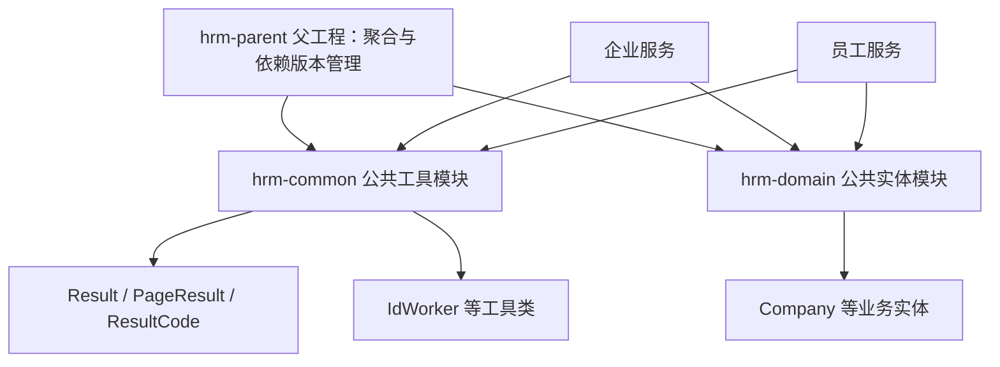

# 动手搭工程之前：前置知识清单、环境版本与父子模块规划

需求和设计都过完了，接下来真的要写代码。很多人到这里就直接新建工程开敲，结果敲到一半发现：Lombok 注解全飘红、Maven 插件对不上版本、公共代码在三个服务里复制了三份。搭架子之前的两件小事，前置知识点和开发环境，决定了后面顺不顺。这一节把这两件事交代清，顺便把工程的骨架规划出来。

## 先给结论

- 前置知识两条线：后端是 Spring 全家桶（Spring Boot、Spring MVC、Spring Data 里的 JPA 与 Redis 方案），前端是 Vue 生态加 Element UI 组件库，前端可以边做边学。
- 开发环境版本定死：JDK 1.8、MySQL 5.7（5.6 与 5.7 差别不大）、IDEA 2017.1.2、Maven 3.3.9。
- 老版本 IDEA 必须先装 Lombok 插件，配合类上的 `@Data` 注解自动生成 getter 与 setter。
- 工程骨架两步走：先建一个父工程统一管理依赖，再建两个子模块，一个放公共工具类，一个放公共实体类。

## 一、前置知识清单：哪些要会，哪些边做边学

后端这条线全部来自 Spring 全家桶。Spring Boot 用来快速搭建环境；Spring MVC 是 web 层的 MVC 框架；Spring Data 是持久层解决方案，里面既包含操作关系库的 Spring Data JPA，也包含操作 Redis 等的方案；Spring Cloud 提供网关等微服务特性。这四样要求「了解」：知道它们各自解决什么问题、注解怎么写，能看懂工程里的代码。

前端这条线以 Node.js 环境上的 Vue 生态为主，钩子函数这类术语要能对上号；Element UI 这套组件库上手不难，可以随着课程深入一边开发一边掌握，不要求提前精通。

| 方向 | 内容 | 要求程度 |
|---|---|---|
| 后端 | Spring Boot：快速构建工程 | 了解 |
| 后端 | Spring MVC：web 层框架 | 了解 |
| 后端 | Spring Data：JPA 与 Redis 持久层方案 | 了解 |
| 后端 | Spring Cloud：网关等微服务特性 | 了解 |
| 前端 | Vue 生态与钩子函数等概念 | 知道，能看懂 |
| 前端 | Element UI 组件库 | 边做边学 |

这份清单的用处不在背诵，而在自检：开工前扫一眼，哪个名字完全陌生，就先花半小时补概念，免得写代码时被它绊住。

## 二、开发环境版本：版本不对，坑在后头

课程给出一套明确的环境要求：JDK 1.8、MySQL 5.7、IDEA 2017.1.2、Maven 3.3.9。数字看着随意，其实是踩过坑之后收敛出来的稳定组合。

**JDK 用 1.8。** 这是国内企业级开发的主流长期支持版本，课程所有依赖坐标都按它验证过。随手换更新的 JDK，Spring 老版本可能在编译期或运行期出各种兼容问题。

**MySQL 用 5.7，5.6 与 5.7 差别不大。** 学习阶段两者都能跑通，按 5.7 装即可。

**Maven 用 3.3.9。** Maven 版本过老或过新，都可能与插件协议不匹配，症状是同样的 pom 在别人机器上能构建、在你机器上报奇怪的插件错误。

**IDEA 用 2017.1.2，并安装 Lombok 插件。** Lombok 这件事值得单独说。

## 三、Lombok：把 getter 与 setter 从代码里赶走

实体类动辄十几个字段，手写 getter、setter、toString，几百行全是模板。Lombok 的做法是在类上加注解，编译期自动生成这些方法，源码里一行都不用写。

课程通用代码里的类全部这样写（这是真实的 `PageResult`，包名已改为 `com.example`）：

```java
package com.example.common.entity;

import lombok.AllArgsConstructor;
import lombok.Data;
import lombok.NoArgsConstructor;

import java.util.List;

@Data
@AllArgsConstructor
@NoArgsConstructor
public class PageResult<T> {
    private Long total;
    private List<T> rows;
}
```

三个注解的分工：`@Data` 生成全部字段的 getter 与 setter，外加 toString、equals、hashCode；`@NoArgsConstructor` 生成无参构造器；`@AllArgsConstructor` 生成全参构造器。十二个字段的类，手写要两百行，这里五行解决。

原理上，Lombok 是编译期注解处理器：编译器读到注解后直接往字节码里写入对应方法，所以运行时没有任何魔法。代价是 IDE 必须认识它：老版本 IDEA 要先装 Lombok 插件，否则编辑器满屏报「找不到方法」，虽然 Maven 构建照样通过。装完插件再开启注解处理，编辑器和编译器的认知才一致。

## 四、工程规划：一个父工程，两个子模块

架子怎么搭，课程给出明确规划：搭一个父工程，所有模块都挂在它下面；然后在父工程里创建两个子模块。

**父工程负责聚合与统一管理。** 公共依赖、版本号写在父工程一处，子模块不再各自声明版本，从根上避免「两个模块用了同一依赖的两个版本」这类冲突。

```xml
<!-- 父工程聚合示例：统一子模块与公共依赖版本（示例为按本课父子结构补全） -->
<project xmlns="http://maven.apache.org/POM/4.0.0">
    <modelVersion>4.0.0</modelVersion>
    <groupId>com.example</groupId>
    <artifactId>hrm-parent</artifactId>
    <version>1.0-SNAPSHOT</version>
    <packaging>pom</packaging>

    <modules>
        <module>hrm-common</module>
        <module>hrm-domain</module>
    </modules>

    <properties>
        <java.version>1.8</java.version>
    </properties>
</project>
```

**第一个子模块是公共工具模块。** 多个工程都要用的东西抽出来放这里：统一响应实体 `Result`、`PageResult`、`ResultCode`，还有生成主键用的雪花算法 `IdWorker` 这类工具类。改一处，所有引用方同步生效。

**第二个子模块是公共实体模块。** 企业、员工这些实体类会被多个业务工程共用，同样抽出来，谁需要谁依赖，实体定义只有一份。



读这张图的关键在依赖方向：业务服务依赖公共模块，公共模块之间互不纠缠，更不反向依赖业务。方向乱了，模块就失去了「抽出来」的意义。

公共工具模块里最典型的成员是雪花算法主键生成器，完整实现有一百多行，核心逻辑精简后是这样（完整版见配套资料，包名已改为 `com.example`）：

```java
package com.example.common.utils;

// 雪花算法：64 位 ID = 1 位符号 + 41 位时间戳 + 5 位数据中心 + 5 位机器 + 12 位毫秒内序列
public class IdWorker {
    // 时间起始标记点，作为基准，一旦确定不能变动
    private final static long twepoch = 1288834974657L;
    // 机器标识位数、数据中心标识位数、毫秒内自增位
    private final static long workerIdBits = 5L;
    private final static long datacenterIdBits = 5L;
    private final static long sequenceBits = 12L;

    private long sequence = 0L;           // 毫秒内计数
    private static long lastTimestamp = -1L;
    private final long workerId;          // 机器标识（构造器内按环境计算，此处省略）
    private final long datacenterId;      // 数据中心标识

    public synchronized long nextId() {
        long timestamp = timeGen();
        if (timestamp < lastTimestamp) {  // 时钟回拨直接拒绝，防止生成重复 ID
            throw new RuntimeException(String.format(
                "Clock moved backwards.  Refusing to generate id for %d milliseconds",
                lastTimestamp - timestamp));
        }
        if (lastTimestamp == timestamp) {
            sequence = (sequence + 1) & sequenceMask;   // 同一毫秒内自增
            if (sequence == 0) {
                timestamp = tilNextMillis(lastTimestamp); // 序列用满则等待下一毫秒
            }
        } else {
            sequence = 0L;
        }
        lastTimestamp = timestamp;
        // 按位拼接：时间戳、数据中心、机器、序列合成 64 位 ID
        return ((timestamp - twepoch) << timestampLeftShift)
                | (datacenterId << datacenterIdShift)
                | (workerId << workerIdShift) | sequence;
    }

    private long timeGen() {
        return System.currentTimeMillis();
    }
}
```

微服务拆分之后，各业务库不再适合用数据库自增主键（多个服务合成全局顺序很麻烦），雪花算法在应用层就地生成趋势递增的唯一 ID，正因如此它才被放进公共工具模块，谁建表谁引用。

## 常见误区

- **不按要求的版本来，专挑最新的装。** JDK、Maven、IDEA 三件套的版本组合是被验证过的，盲目求新会遇到插件与依赖的兼容性问题，排查一整天，最后发现降回要求版本就好了。
- **忘装 Lombok 插件。** 症状是编辑器满屏「找不到 getXxx 方法」，但 Maven 构建通过。原因是编译期有注解处理器、编辑器不认识注解，装插件并开启注解处理即可。
- **公共代码靠复制粘贴分发。** `Result` 这类类在每个服务里存一份，改一个字段要改 N 处。抽成公共模块，用 Maven 依赖引用，只维护一份。
- **父工程不锁定版本。** 两个子模块各引各的版本号，运行期出现 `NoSuchMethodError` 这类诡异错误。版本统一在父工程声明，子模块只写坐标不写版本。

## 面试可能被问到的问题

1. 面试官追问：「Maven 父子工程的好处是什么？」
   答：父工程用 `packaging` 为 `pom` 聚合子模块，统一声明依赖与版本，子模块继承后只写坐标不写版本，避免版本冲突；同时一条命令能构建全部模块。公共代码收敛到公共子模块，多处引用一份维护。

2. 面试官追问：「Lombok 的实现原理是什么？有什么风险？」
   答：Lombok 是编译期注解处理器，编译器读到 `@Data` 等注解后直接把 getter、setter、toString 等方法写进字节码，运行期无额外开销。风险在于 IDE 需要装插件才能识别生成的方法，团队约定不统一时会出现编辑器报错但能编译的困惑。

3. 面试官追问：「雪花算法生成的 ID 是什么结构？为什么不用自增主键或 UUID？」
   答：64 位长整型，由 1 位符号位、41 位时间戳、5 位数据中心、5 位机器、12 位毫秒内序列拼接而成。数据库自增 ID 在分库分表和多服务场景下难以保证全局唯一，UUID 无序且过长不利于索引，雪花算法既有全局唯一性又保持趋势递增。

4. 面试官追问：「公共模块的职责怎么划分？」
   答：按内容性质分两个：工具模块放与业务无关的通用能力，如统一响应实体、主键生成器；实体模块放跨工程共用的业务实体类。两者只被业务服务依赖，相互之间及对业务方向都不产生反向依赖，依赖方向保持单向。

5. 面试官追问：「Spring Data JPA 和 Hibernate 是什么关系？」
   答：Hibernate 是完整的 ORM 框架，Spring Data JPA 是 Spring 对 JPA 规范的封装，默认实现就是 Hibernate。开发者面向 Spring Data 的接口编程，按方法名规则生成查询，底层细节交给 Hibernate，需要时也能写原生 JPQL 或 SQL。

6. 面试官追问：「为什么团队要统一开发环境版本？」
   答：依赖坐标与插件只在特定版本组合下验证过，环境不一致会出现「我这能跑你那报错」的隐性成本，排查时间远高于统一版本的成本。把 JDK、Maven、数据库、IDE 的版本写进文档并固定，是工程协作的基本纪律。

## 配套资料

- 公共工具与实体：`materials/code/02/day01 SAAS-HRM系统概述与搭建环境/SAAS-HRM系统概述与搭建环境/资源/通用代码/common/Result.java`、`PageResult.java`、`ResultCode.java`，以及 `materials/code/02/day01 SAAS-HRM系统概述与搭建环境/SAAS-HRM系统概述与搭建环境/资源/通用代码/IdWorker.java`（包名已改为 `com.example`）。
- 业务实体：`materials/code/02/day01 SAAS-HRM系统概述与搭建环境/SAAS-HRM系统概述与搭建环境/资源/Company.java`。
- 本课为规划讲解，尚无完整工程源码；父工程 pom 为按本课父子结构补全的示例。
