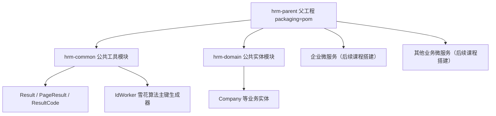

# 父工程怎么搭：把 SaaS-HRM 的依赖与版本收口到一个 pom

系统设计和 API 文档都定下来了，真正动工的第一件事不是写业务代码，而是搭工程骨架。骨架里的第一个动作，是建一个看起来「什么都没有」的父工程：没有一行 Java 代码，连 `src` 目录都要删掉。很多人到这一步会犯嘀咕，建个空壳图什么？答案是聚合与锁版本，后面所有子模块都从它这里领依赖、领版本。

## 先给结论

- 父工程的打包方式是 `pom`，不承载代码，`src` 目录直接删除，它只负责聚合子模块与统一公共依赖。
- 父工程继承 `spring-boot-starter-parent`（2.0.5.RELEASE），Spring 全家桶的版本仲裁全部交给它。
- web、日志、测试、fastjson、Lombok 这些全员公共依赖写在父工程的 `<dependencies>` 里，子模块零声明继承。
- 编码 UTF-8 与 JDK 1.8 定义在 `properties`，编译插件与测试插件也在父工程配好，子模块不再重复。
- 坐标从课程资料里整体复制，不逐个手敲；pom 保存后点 Enable Auto-Import 让依赖自动刷新。

## 一、空壳父工程的价值：聚合与收口

整个 SaaS-HRM 的工程规划是：一个父工程，下面挂公共工具模块、公共实体模块，再往后是企业、员工等一个个业务微服务。这张图就是工程最终长成的样子：



图上的依赖方向要记住：子模块挂在父工程下，业务服务再依赖两个公共模块，箭头永远单向向下。

**第一，聚合让一次构建覆盖全部模块。** 在 IDEA 里对父工程右键 New Module 创建子模块时，`<modules>` 标签会自动写进父 pom。之后在父工程上执行一次构建，所有子模块会按依赖顺序依次构建，不需要逐个点。

**第二，版本收口把冲突扼杀在源头。** 公共依赖只在父工程一处声明版本，子模块不再各写各的版本号。「模块 A 用 fastjson 1.2、模块 B 用 1.6」这种要到运行期才爆发的冲突，从结构上就不存在了。

## 二、五步建出父工程

1. IDEA 里 Create New Project，左侧选 Maven，骨架（archetype）一概不勾。骨架的用途是从网络加载项目模板，父工程连代码都没有，模板毫无用处。
2. 填坐标：groupId 取 `com.example`，artifactId 叫 `hrm-parent`，选好存放的工作目录，点 Finish。目录不存在时 IDEA 会提示创建，确认即可。
3. 打开 File → Settings 搜索 Maven，确认 Maven home 指向本机安装目录、settings 文件指向自己的配置。这一步别跳过：Maven home 不对，下载的依赖就落进另一个仓库；settings 不对，镜像与私服配置全不生效。团队里常见的「我这里能下载、你那里报错」，多半是这步没对齐。
4. pom 首次保存时，IDEA 右下角会提示 Enable Auto-Import，点上，之后 pom 每次改动都会自动刷新依赖。
5. 删掉 `src` 目录。父工程不写代码，留着它只会让目录结构看起来莫名其妙。

## 三、父工程 pom 全文

pom 内容在课程资料里以文本形式提供，整体复制进父工程的 `pom.xml` 即可，不需要背。整理后的版本如下（包名与模块名已改为中性命名）：

```xml
<?xml version="1.0" encoding="UTF-8"?>
<project xmlns="http://maven.apache.org/POM/4.0.0"
         xmlns:xsi="http://www.w3.org/2001/XMLSchema-instance"
         xsi:schemaLocation="http://maven.apache.org/POM/4.0.0 http://maven.apache.org/xsd/maven-4.0.0.xsd">
    <modelVersion>4.0.0</modelVersion>

    <groupId>com.example</groupId>
    <artifactId>hrm-parent</artifactId>
    <version>1.0-SNAPSHOT</version>
    <description>SaaS-HRM 人力资源管理系统：统一依赖与版本的父工程</description>

    <!-- 打包方式为 pom：这是聚合工程的身份标识 -->
    <packaging>pom</packaging>

    <!-- 继承 Spring Boot 官方父工程，Spring 生态全部版本由它仲裁 -->
    <parent>
        <groupId>org.springframework.boot</groupId>
        <artifactId>spring-boot-starter-parent</artifactId>
        <version>2.0.5.RELEASE</version>
        <relativePath/>
    </parent>

    <properties>
        <project.build.sourceEncoding>UTF-8</project.build.sourceEncoding>
        <project.reporting.outputEncoding>UTF-8</project.reporting.outputEncoding>
        <java.version>1.8</java.version>
        <fastjson.version>1.2.47</fastjson.version>
    </properties>

    <dependencies>
        <!-- Web 环境：内含 Spring MVC 与内嵌 Tomcat -->
        <dependency>
            <groupId>org.springframework.boot</groupId>
            <artifactId>spring-boot-starter-web</artifactId>
        </dependency>
        <!-- 日志环境 -->
        <dependency>
            <groupId>org.springframework.boot</groupId>
            <artifactId>spring-boot-starter-logging</artifactId>
        </dependency>
        <!-- 测试支持 -->
        <dependency>
            <groupId>org.springframework.boot</groupId>
            <artifactId>spring-boot-starter-test</artifactId>
            <scope>test</scope>
        </dependency>
        <!-- JSON 转换 -->
        <dependency>
            <groupId>com.alibaba</groupId>
            <artifactId>fastjson</artifactId>
            <version>${fastjson.version}</version>
        </dependency>
        <!-- Lombok：以注解方式生成 getter、setter 与构造方法 -->
        <dependency>
            <groupId>org.projectlombok</groupId>
            <artifactId>lombok</artifactId>
            <version>1.16.16</version>
        </dependency>
    </dependencies>

    <repositories>
        <repository>
            <id>spring-snapshots</id>
            <name>Spring Snapshots</name>
            <url>https://repo.spring.io/snapshot</url>
            <snapshots>
                <enabled>true</enabled>
            </snapshots>
        </repository>
        <repository>
            <id>spring-milestones</id>
            <name>Spring Milestones</name>
            <url>https://repo.spring.io/milestone</url>
            <snapshots>
                <enabled>false</enabled>
            </snapshots>
        </repository>
    </repositories>
</project>
```

逐段拆开看：

- `packaging` 取 `pom`，声明「我是聚合工程，不产出 jar 或 war」。
- `<parent>` 指向 `spring-boot-starter-parent`，`relativePath` 留空表示从仓库解析。继承它之后，Spring Boot 生态几百个依赖的版本号都有了默认值。
- `properties` 里的 `java.version` 会被编译插件读取，编码属性保证源码与输出都是 UTF-8。
- fastjson 这类 Spring 不管理的第三方组件，才需要自己写版本号，并且把版本抽成属性放在 `properties` 里统一引用。
- `repositories` 补充了 Spring 的快照与里程碑仓库。日常只用正式版时它基本闲置，属于官方模板带出来的保险配置。

编译与测试插件也一并放在父工程：

```xml
<build>
    <plugins>
        <!-- 编译插件：源码与字节码版本统一取 java.version -->
        <plugin>
            <groupId>org.apache.maven.plugins</groupId>
            <artifactId>maven-compiler-plugin</artifactId>
            <version>3.1</version>
            <configuration>
                <source>${java.version}</source>
                <target>${java.version}</target>
            </configuration>
        </plugin>
        <!-- 测试插件：构建阶段直接跳过测试 -->
        <plugin>
            <groupId>org.apache.maven.plugins</groupId>
            <artifactId>maven-surefire-plugin</artifactId>
            <version>2.1.7</version>
            <configuration>
                <skipTests>true</skipTests>
            </configuration>
        </plugin>
    </plugins>
</build>
```

`maven-surefire-plugin` 配了 `skipTests=true`，构建时不跑测试。这在联调期是常见取舍：打包要快，测试放到 CI 或本地手动触发。

## 四、版本锁定的两层机制

这套父工程里其实有两层锁版本的机制，分工不同。

**第一层是继承 `spring-boot-starter-parent`。** 它内部又继承自 `spring-boot-dependencies`，后者用 `dependencyManagement` 维护了 Spring 生态所有组件的版本。子工程里写 `spring-boot-starter-web` 不带版本号，版本就是从这里来的。

**第二层是父工程自己的 `<dependencies>`。** 写在这里的依赖会被所有子模块直接继承，等于「全员强制引入」。它和 `dependencyManagement` 的区别值得分清：`dependencyManagement` 只锁版本、不引入依赖，子模块想用还得自己写坐标；本课的写法是直接锁版本加强制引入，适合 web、日志、Lombok 这种每个模块都离不开的公共件。公共依赖少而稳定时用前者还是后者？全员都要就写 `dependencies`，只有部分模块用就写 `dependencyManagement` 让子模块自取。

## 常见误区

- **父工程留着 `src` 目录。** 里面哪怕只放一个工具类，都会造成「公共代码在父工程、依赖在子模块」的错乱分层。父工程只管 pom，代码一律进子模块。
- **子模块自己补版本号。** 子模块里写 `spring-boot-starter-web` 加上一个自己的版本，就会和父工程仲裁的版本打架，症状是运行期抛 `NoSuchMethodError`。子模块只写坐标，版本交给上面。
- **不配 Maven 环境直接用默认值。** IDEA 自带的 Maven 与本机安装的版本可能不同，依赖仓库位置也不一致，经常表现为同样的 pom 在两台机器构建结果不同。Settings 里的 Maven home 与 settings 文件要指向自己维护的那份。
- **坐标靠手敲。** pom 里几十行坐标手敲一个字母，报错还是「找不到依赖」，排查半小时。资料里给的就是现成文本，整体复制再按需改包名。

## 面试可能被问到的问题

1. 面试官追问：「Maven 父工程的 `packaging` 为什么是 `pom`？」
   答：`pom` 表示这个工程不产出 jar 或 war，只承担聚合与依赖管理两个职责。它通过 `<modules>` 聚合子模块，通过自己的 `<dependencies>` 或 `dependencyManagement` 向子模块传递依赖与版本，是 Maven 多模块工程的标准顶层结构。

2. 面试官追问：「父工程里 `<dependencies>` 和 `dependencyManagement` 有什么区别？」
   答：`<dependencies>` 里的依赖会被子模块直接继承并引入，属于强制全员共享；`dependencyManagement` 只登记版本号，不引入依赖，子模块声明坐标时省去版本号。前者适合全员公共件，后者适合只想统一版本、由子模块按需引入的场景。

3. 面试官追问：「继承 `spring-boot-starter-parent` 到底继承了什么？」
   答：主要继承三样东西：由 `spring-boot-dependencies` 维护的整张依赖版本表、默认的插件配置（如编译编码与版本）、以及资源过滤等构建约定。子工程写坐标不写版本，版本号全部来自这条继承链。

4. 面试官追问：「为什么父工程要删掉 `src`？」
   答：父工程的身份是构建描述符，不是代码容器。留 `src` 会诱使开发者把公共代码塞进去，形成父工程被反向依赖、子模块各自复制代码的混乱局面，Maven 对 pom 类型工程的 `src` 也不会参与打包，留着没有任何收益。

5. 面试官追问：「`maven-surefire-plugin` 配置 `skipTests=true` 会不会有风险？」
   答：有。跳过测试后构建通过不代表功能正确，缺陷会后移到联调甚至线上。可控的前提是测试在别的环节有兜底，比如 CI 流水线单独跑测试、或本地发布前手动执行；只图打包快而关测试且没有兜底，属于自杀式配置。

## 配套资料

- 公共依赖中的 Lombok 与统一返回实体在后续小节展开，真实代码见
  `materials/code/02/day01 SAAS-HRM系统概述与搭建环境/SAAS-HRM系统概述与搭建环境/资源/通用代码/common/Result.java`、`PageResult.java`、`ResultCode.java`
  与 `materials/code/02/day01 SAAS-HRM系统概述与搭建环境/SAAS-HRM系统概述与搭建环境/资源/通用代码/IdWorker.java`。
- 本课父工程 pom 在课程资料中为文本形式提供，代码目录未收录；文中 pom 按课程画面内容整理，包名与模块名已改为 `com.example`、`hrm-parent` 等中性命名。
