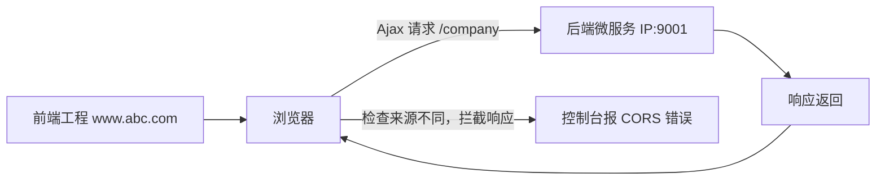
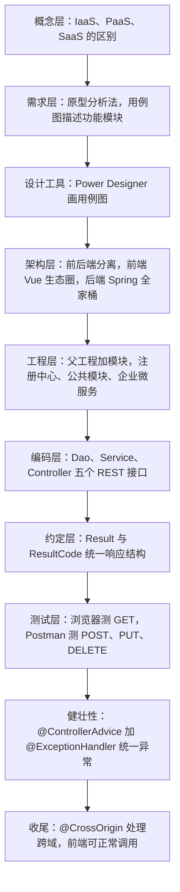

# 接口在 Postman 里全通，前端一调用就报错：跨域问题与 @CrossOrigin

企业微服务的五个接口在 Postman 里测得明明白白，换成前端页面发 Ajax 请求，控制台立刻刷出一段 Blocked by CORS policy 的红色报错。这不是接口写错了，而是浏览器同源策略在起作用。前后端分离项目里前端与后端几乎注定不同源，跨域处理必须有人做，这是 day01 的最后一个知识点，讲完它，第一阶段的环境搭建才算真正闭环。

## 先给结论

- 跨域由浏览器的同源策略触发：协议、域名、端口三者任一不同，请求就算跨域，浏览器会拦截响应。
- 前后端分离部署必然跨域：前端挂在 `www.abc.com` 这样的域名下，后端微服务是某台服务器的 IP 加 9001 端口，两边对不上号。
- 最直接的解法是在 Controller 类上加 `@CrossOrigin`，它是 CORS 标准的注解实现，本项目的企业微服务就是这么写的。
- CORS 是 W3C 制定的跨域资源共享标准，原理是服务器用响应头告诉浏览器放行哪些来源。
- 全工程生效可以用全局配置类集中声明跨域规则，避免每个 Controller 都要标注解。

## 一、同源策略：跨域问题的源头

同源策略是浏览器内置的安全机制，两个页面的协议、域名、端口完全一致才算「同源」。拿本课的场景对号入座：

| 来源 | 地址 | 是否同源 |
|---|---|---|
| 后端接口 | `http://192.168.1.10:9001/company` | 基准 |
| 前端页面 | `http://www.abc.com` | 域名、端口都不同，跨域 |
| 同机调试页 | `http://localhost:8080` | 域名不同（localhost 对 IP），跨域 |
| 另一个后端 | `http://192.168.1.10:9002` | 端口不同，跨域 |

SaaS 版人力资源管理系统采用前后端分离开发、前后端分离部署，前端工程最终会给一个域名让用户访问，后端微服务则部署在公司的某台服务器上，两边往往连网段都不在一起。页面从 `www.abc.com` 发出的请求打到后端 IP 上，跨过了不同的域名，浏览器依据同源策略把响应拦下，于是 Postman 里一切正常的前端调用全线报错。这张图把拦截发生的位置标了出来：



拦截发生在浏览器这一端，后端其实收到了请求也可能正常处理了。理解这一点很重要：跨域不是服务端抛错，而是浏览器把响应扣住了，前端代码拿不到数据。

## 二、CORS 与 @CrossOrigin：标准的解法

CORS 全称 Cross-Origin Resource Sharing，跨域资源共享，是 W3C 出的一个标准。它的思路是：浏览器发出请求时带上自己的来源，服务器在响应头里声明允许哪些来源访问，浏览器看到声明与请求来源匹配，就放行响应。整个过程靠自定义的 HTTP 头部完成浏览器与服务器的沟通，决定请求或响应是成功还是失败。

Spring MVC 把这套机制封装成了注解，在 Controller 类的最上方加 `@CrossOrigin` 即可。课程资料包里的企业微服务成例正是这样写的：

```java
//解决跨域问题
@CrossOrigin
@RestController
@RequestMapping(value = "/company")
public class CompanyController {

    @Autowired
    private CompanyService companyService;

    //保存
    @RequestMapping(value = "", method = RequestMethod.POST)
    public Result save(@RequestBody Company company) {
        companyService.add(company);
        return new Result(ResultCode.SUCCESS);
    }
}
```

注解标在类上，对这个 Controller 下的所有接口生效，访问 `/company` 与 `/company/{id}` 都不再被拦截。它的原理是在响应里补上 `Access-Control-Allow-Origin` 这一类头部。**第一，范围可以细化**：注解也可以标在单个方法上，或用 `origins` 属性限定具体域名，全放开只是学习阶段的省事写法，生产环境通常要收敛来源。**第二，它解决的是 CORS 场景**：跨域的解法不止一种，CORS 是 W3C 的正式标准，也是前后端分离项目的主流选择；JSONP 属于老办法，只能发 GET；让前端请求走同源的代理或网关再转发，是另一类思路。

**微服务这一端就该把跨域问题解决掉**，因为前端团队无法修改浏览器行为，而服务端一行注解就能放行，成本最低的责任划分就是把这件事交给后端。

## 三、全局配置：一处声明管所有 Controller

Controller 多了以后，逐个类加 `@CrossOrigin` 容易漏。Spring MVC 提供了全局配置入口，把跨域规则集中声明一次（`BaseExceptionHandler` 那类公共配置同理放在 `common` 模块；本课没有给出这份源码，下面是按本课写法补全的可运行示例）：

```java
package com.example.company.config;

import org.springframework.context.annotation.Configuration;
import org.springframework.web.servlet.config.annotation.CorsRegistry;
import org.springframework.web.servlet.config.annotation.WebMvcConfigurer;

@Configuration
public class CorsConfig implements WebMvcConfigurer {

    @Override
    public void addCorsMappings(CorsRegistry registry) {
        registry.addMapping("/**")            //拦截所有路径
                .allowedOrigins("*")          //允许的来源，生产环境应指定具体域名
                .allowedMethods("GET", "POST", "PUT", "DELETE")  //允许的请求方式
                .allowedHeaders("*");         //允许携带的请求头
    }
}
```

配置类生效后效果与类上的 `@CrossOrigin` 一致，区别是规则收在一处、可按路径精细控制。两种方式不要对同一批接口重复叠加，排查跨域问题时先确认到底是哪一层在补响应头。

## 四、day01 收束：从概念到能跑的微服务

企业微服务第一天从零走到接口可测，整条线索可以收束成一张图：



沿着图从上往下看：SaaS 意为软件即服务，与 IaaS、PaaS 的差别在于交付的是「能直接用的软件」，企业付费即可使用平台完成人力资源管理；从无到有构造工程靠原型分析法，开发成员不纠缠细节，先用 UML 用例图以更直观的语言体现系统功能模块，绘制工具是 Power Designer；系统架构是前后端分离，前端基于 Vue 生态圈，后端是 Spring 全家桶；落到编码层就是企业微服务的增删改查，响应统一包 `Result`，异常统一进处理器，跨域一行注解收尾。环境搭建、接口开发、测试、异常、跨域这五件事做完，后面每一天的微服务都在重复这套动作。

## 常见误区

- **以为跨域是后端没收到请求**：大多数情况下请求已经到达并处理，是浏览器扣下了响应。看浏览器 Network 面板里请求的状态，再决定查后端还是查响应头。
- **认为 Postman 全通就代表前端也能通**：Postman、curl 这类工具不受同源策略约束，只有浏览器里的页面调用才会触发跨域，验证跨域必须在浏览器环境里做。
- **注解加错位置**：`@CrossOrigin` 标在了启动类或别的 Bean 上，对 Controller 不生效。它要标在控制器类（或方法）上，或改用全局配置类。
- **生产环境把允许来源写成 `*`**：学习阶段图省事可以，上线后等于对所有网站开放接口，应改为具体的域名清单，必要时配合凭证设置。

## 面试可能被问到的问题

1. 面试官追问：「什么是跨域？为什么会有跨域问题？」
   答：浏览器同源策略要求页面的协议、域名、端口三者一致才算同源，页面脚本向不同源的地址发请求时，浏览器会拦截响应，这就是跨域。它是浏览器的安全机制，目的是隔离不可信来源的读写，服务端之间互相调用不存在这个问题。

2. 面试官追问：「CORS 的工作原理是什么？」
   答：浏览器发请求时带上 Origin 头声明来源，服务端在响应头里用 Access-Control-Allow-Origin 等字段声明允许的来源、方法和头部，浏览器比对匹配就放行。非简单请求会先发一个 OPTIONS 预检请求，服务器应答通过后才发真实请求。

3. 面试官追问：「`@CrossOrigin` 和全局配置 CORS 有什么区别，怎么选？」
   答：`@CrossOrigin` 粒度细，类或方法级生效，适合个别接口的定制；全局配置通过 `WebMvcConfigurer` 的 `addCorsMappings` 一次声明全部路径的规则，适合整站统一。项目里一般二选一，规则复杂时优先全局配置，避免散落。

4. 面试官追问：「解决跨域还有哪些方式？」
   答：除了 CORS，还可以让前端开发环境走代理（开发服务器把请求转发到后端，页面只请求同源地址），或生产环境用 Nginx、网关做反向代理把前后端收敛到同一域名下。CORS 是浏览器与服务器的标准协作，代理方案则从源头消除跨域，网关场景下两种常常结合使用。

5. 面试官追问：「预检请求是什么情况会触发？」
   答：非简单请求会触发，比如携带了自定义请求头、Content-Type 为 application/json 的 POST、以及 PUT、DELETE 这类方法。浏览器先发 OPTIONS 询问服务器是否允许，通过后才发真实请求。处理不好常见症状是 OPTIONS 返回 4xx，正式请求根本没发出去。

## 配套资料

- 企业微服务成例（类上有 `@CrossOrigin` 并注明解决跨域问题，包名已改写为 `com.example`）：
  `materials/code/02/day13-代码生成器实现/day13-代码生成器实现/资源/测试/生成代码路径/ihrm_company/src/main/java/com/ihrm/system/controller/CompanyController.java`
- 同目录下 `CityController.java`、`DepartmentController.java` 等成例均采用相同的跨域注解写法，可交叉印证
- 全局配置类 `CorsConfig` 不在资料包中，文中代码为按本课写法补全的示例
