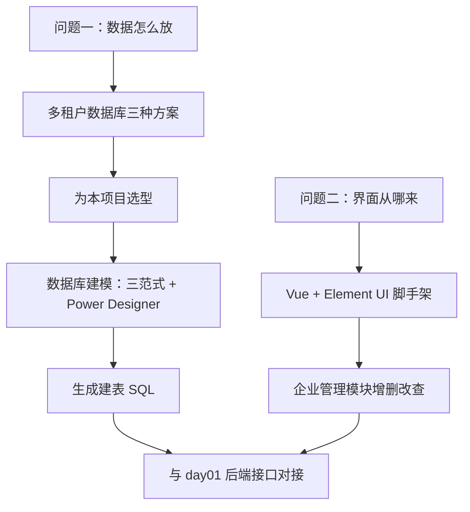

# 一套平台装下 N 家企业：数据库设计与前端工程的开工准备

day01 收尾时，企业微服务的五个接口在 Postman 里全部打通，跨域也用一行注解解决了。但对一个 SaaS 平台来说，这些还只是零件：真正的难题是数据怎么放。A、B、C 几十家企业同时用这套人力资源系统，数据库按什么粒度拆、拆到什么程度，直接决定后面所有模块的写法。另一个悬而未决的问题是界面：前后端分离的项目，前端工程从哪里来，难道从空文件夹开始敲登录页？

day02 就是在回答这两个问题。主线分成两大块：数据库设计与建模（多租户方案选型、三范式、用 Power Designer 从模型生成表），前端框架（基于 Vue 加 Element UI 的脚手架二次开发），最后拿这套前端完成企业管理模块的增删改查，和 day01 的后端接口真正接上。

## 先给结论

- day02 的重心在数据库：多租户场景下有三种主流方案（独立数据库、共享数据库独立 Schema、共享数据库共享表），选型靠隔离性、开发难度、成本三个维度权衡。
- 数据库从无到有靠建模：三范式打底，必要时用反三范式换性能，模型画完用 Power Designer 直接生成建表 SQL。
- 前端不造轮子：在功能完整的 Vue 2.5 + Element UI 2.2.2 脚手架上二次开发，登录页、主框架菜单这些通用能力直接复用。
- 接口没就绪时前端用 Mock 数据顶上，企业管理模块先按约定好的数据结构把页面跑起来。
- 本阶段前端是配角，目标是「理解工程结构、能在上面开发模块」，深度学习前端不是这里的任务。

## 一、day01 之后悬着的两个问题

第一个问题出在数据库上。企业微服务目前只定义了一张企业档案表，而完整的 SaaS-HRM 平台要装下组织架构、员工档案、薪酬社保、权限体系几十张表，每张表都要回答同一个问题：这条数据属于哪家企业？平台里哪些数据可以共享（比如城市字典），哪些必须严格隔离（比如每家企业的员工工资），隔离做到什么程度，成本能压到多少。这些选择没有标准答案，但业界沉淀了三种典型方案，先把方案看全，再为本项目挑一种，这是 day02 前半段的任务。

第二个问题出在前端上。前后端分离意味着前端是一个独立工程，有自己的一套构建、路由、请求封装。如果从官方最小脚手架起步，登录界面、主页面菜单样式这些与业务无关的东西都要自己写，工作量不小。更务实的做法是拿一个功能完整的后台模板改造，把时间花在业务模块上。这也是工业界的常态：企业级中后台极少有人从零搭界面。

两条线在第四块内容汇合：用搭好的前端做企业管理模块，表格展示企业列表、表单新增企业，请求打到 day01 写好的 `/company` 接口上。



图里两条线最后都落到同一个汇合点：前端页面发出请求，后端接口读写按多租户方案设计出来的表。数据库选型和建模是地基，地基没打对，后面每个模块都要返工。

## 二、数据库这块：先选方案，再画模型，最后落表

**方案层面，三种候选先摆上台面。** 独立数据库给每家租户单独装一套库，隔离最好但成本最高；共享数据库独立 Schema 在同一个库实例里按 Schema 切分；共享数据库共享表则所有租户共用一套表，靠租户 ID 字段区分。三种方案各对应一类产品形态，具体优缺点和本项目最后选了什么，后面几节展开。

**模型层面，三范式是设计的底线。** 第一范式保证每列原子性，一列里不再塞多个值；第二范式保证非主字段完全依赖主键，一张表只做一件事；第三范式消除传递依赖，非主字段之间不互相派生。范式约束到第三层还不够用，实战里常有反三范式：没有冗余的数据库未必是最好的数据库，为了提高查询效率，有时要刻意降低范式标准、适当保留冗余数据，典型如订单表里冗余一份商品名称，避免每次都连表查。

**落表层面，建模工具把图变成 SQL。** Power Designer 在 day01 已经画过用例图，这一天继续用它画数据库模型（CDM/PDM），再由模型生成建表脚本。本项目完整的建表脚本 `ihrm.sql` 里有 23 张表，这里节选企业档案表的建表语句，感受一下模型落表之后的产物长什么样：

```sql
CREATE TABLE `co_company` (
  `id` varchar(40) NOT NULL COMMENT 'ID',
  `name` varchar(255) DEFAULT NULL COMMENT '公司名称',
  `manager_id` varchar(255) DEFAULT NULL COMMENT '企业登录账号ID',
  `version` varchar(255) DEFAULT NULL COMMENT '当前版本',
  `renewal_date` datetime DEFAULT NULL COMMENT '续期时间',
  `expiration_date` datetime DEFAULT NULL COMMENT '到期时间',
  `audit_state` varchar(255) DEFAULT NULL COMMENT '审核状态',
  `state` tinyint(2) DEFAULT '1' COMMENT '状态',
  `balance` double DEFAULT NULL COMMENT '当前余额',
  `create_time` datetime DEFAULT NULL COMMENT '创建时间'
) ENGINE=InnoDB DEFAULT CHARSET=utf8mb4;
```

这张表就是租户名册：每家入驻企业一行记录，订阅版本、续期到期、审核状态全在上面。id 列是 `varchar(40)`，存的不是自增数字而是雪花算法生成的全局唯一 ID，为多租户共库存储做准备。其余的业务表（部门、员工、权限）都在模型里以同样方式生成。

## 三、前端这块：在现成脚手架上长业务

前端工程的技术栈是 Vue 2.5 以上版本结合 Element UI 2.2.2，这是目前企业级中后台最常见的一套组合：Vue 负责组件化页面，Element UI 提供现成的表格、表单、弹窗组件。脚手架在一个成熟的后台模板基础上改造而来，登录鉴权、菜单导航、请求封装、布局样式都是现成的，业务开发只需往里加页面模块。

接口还没联调时，前端靠 Mock 数据先跑起来。资料包里企业管理模块的 Mock 文件按后端的数据结构造了三条企业记录（节选）：

```javascript
import Mock from 'mockjs'

const List = []
const count = 100

for (let i = 0; i < 3; i++) {
    let data = {
        id: "1" + i,
        name: "企业" + i,
        managerId: "string",
        version: "试用版v1.0",
        renewalDate: "2018-01-01",
        expirationDate: "2019-01-01",
        companyPhone: "13800138000",
        auditState: "string",
        state: "1",
        createTime: "string"
    }
    List.push(data)
}

export default {
  list: () => {
    return {
        code: 10000,
        success: true,
        message: "查询成功",
        data: List
    }
  }
}
```

注意返回结构里的 `code: 10000`、`success`、`message`、`data`，与 day01 后端约定的统一响应结构完全一致。Mock 的价值就在这里：前后端先按同一份接口契约各干各的，页面结构、字段绑定提前定稳，等后端接口就绪，把请求地址从 Mock 切到真实接口即可，页面代码一行不用改。

## 四、这一天的学习姿势：数据库学深，前端学会

学习目标按优先级排：能说清多租户数据库解决方案为什么这样选；能熟练使用 Power Designer 对数据库建模；能理解前端工程的来龙去脉，知道它为什么这样搭；能在这套前端上完成企业模块开发。前端部分此后不再作为重点讲解，后续课程的前端页面直接拿来练习、直接使用，把精力留给后端架构与多租户设计本身。换句话说，day02 是整个 SaaS-HRM 阶段的「图纸日」，图纸看懂了，后面每一天都是在图纸上添砖加瓦。

## 常见误区

- **把 day02 当成前端课。** 前端脚手架只是工具，拿来即用即可；真正决定系统形态的是多租户数据库方案，这块必须吃透。
- **以为脚手架就是官方文档里的 Hello World 工程。** 官方最小脚手架只有空壳，登录、菜单、布局全要自己写；本课用的是功能完整的模板工程，两者起点差一个量级。
- **以为三范式必须百分之百满足。** 范式是减少冗余的手段而不是教条，查询性能不够时可以反范式，用可控的冗余换连表开销，代价是写入时要维护冗余字段的一致性。
- **以为 Mock 数据是「假东西」不用重视。** Mock 的字段结构必须与后端实体和统一响应结构严格一致，否则联调时页面要大改，Mock 就失去了意义。

## 面试可能被问到的问题

1. 面试官追问：「SaaS 平台的数据库设计和普通单体应用有什么不同？」
   答：核心差异是租户维度。普通应用只服务一家企业，表结构按业务实体设计即可；SaaS 平台要同时服务多家企业，每张业务表都要回答数据属于哪个租户、租户之间如何隔离，需要在独立数据库、独立 Schema、共享表三种方案里做选型，并把租户 ID 贯穿到 ID 生成、查询过滤、权限校验各环节。

2. 面试官追问：「数据库三范式分别约束什么？」
   答：第一范式要求每列不可再分，保证原子性；第二范式在第一范式基础上要求非主字段完全依赖整个主键，一张表只做一件事；第三范式要求消除传递依赖，非主字段不依赖其他非主字段。三者层层递进，目的是减少冗余、避免插入更新删除异常。

3. 面试官追问：「什么是反三范式，什么场景会用？」
   答：反三范式是基于第三范式刻意保留冗余数据的做法。当查询频繁需要连多张表时，适度冗余可以显著提升读取性能，比如订单表直接冗余商品名称。代价是同一份数据存在多处，更新时要同步维护，通常配合定时校对或触发更新来保证一致性。

4. 面试官追问：「前后端分离项目里，为什么常用现成脚手架而不是从零搭建？」
   答：登录鉴权、菜单权限、请求封装、页面布局这些通用能力与业务无关却工作量大，成熟脚手架把它们都做好了，团队把精力集中在业务模块上；同时脚手架统一了工程结构和编码风格，降低协作成本。从零搭建只在有特殊定制需求或团队有前端基建能力时才划算。

5. 面试官追问：「接口还没开发完，前端怎么推进？」
   答：前后端先约定接口契约（URL、方法、请求响应结构），前端按契约写 Mock 数据让页面先行，字段绑定和交互逻辑提前定稳；等后端就绪后把请求从 Mock 切到真实接口。前提是 Mock 的数据结构必须与后端实体、统一响应结构严格一致，否则联调成本会成倍增加。

## 配套资料

- 建表脚本：`materials/code/02/day02 SAAS-HRM数据库设计与前端框架/3-3 SAAS-HRM数据库设计与前端框架/资源/ihrm.sql`（含 `co_company`、`co_department`、`bs_user`、`pe_permission` 等 23 张表，文中为节选）
- 前端企业管理模块 Mock：`materials/code/02/day02 SAAS-HRM数据库设计与前端框架/3-3 SAAS-HRM数据库设计与前端框架/资源/通用代码/company.js`
- 企业档案实体类：`materials/code/02/day01 SAAS-HRM系统概述与搭建环境/SAAS-HRM系统概述与搭建环境/资源/Company.java`
