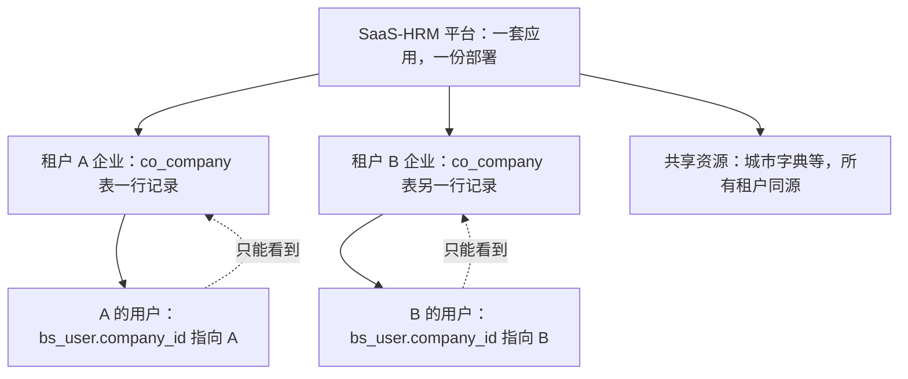
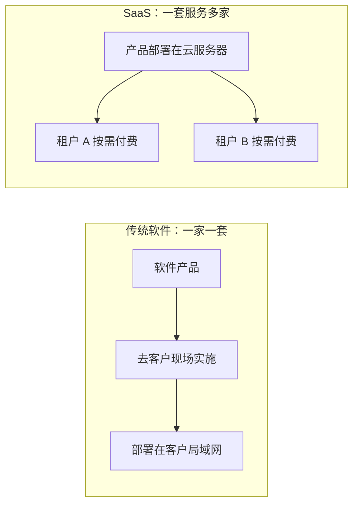

# 多租户是什么：多家企业共用一套系统，数据还要互相看不见

一套人力资源管理系统，以前卖给一家企业就部署到人家机房里，数据不出客户局域网，自然不存在「谁看见谁」的问题。换成 SaaS 模式后，系统只部署一份在云端，几十家企业同时登录使用，麻烦立刻来了：A 企业的员工登录进去，绝不能翻出 B 企业的花名册和工资表。系统怎么知道每条数据属于谁、靠什么把各家划清界限，这是写任何一行业务代码之前必须想清楚的问题，也是本节要讲的「多租户」的全部内容。

## 先给结论

- 多租户又称多重租赁，是一种软件架构技术：多个使用者（企业）访问同一个应用，同时保证使用者之间的数据相互隔离。
- 隔离的表象是「A 看不到 B，B 看不到 A」，本质是数据归属必须有一个明确的、系统可识别的租户维度。
- 传统软件与 SaaS 的分水岭在部署位置：前者装进客户局域网，一次买断；后者部署在云端，租户按需付费。
- 一套 SaaS 系统里既有共享数据（所有租户同源），又有私有数据（租户独享），数据库必须同时支持这两种形态。
- 这个「既要共享又要隔离」的需求，直接引出了后面的三种数据库设计方案。

## 一、多重租赁：一个应用，多家企业，互不可见

多租户这个词听起来抽象，拆开看就是「多重租赁」：像一栋写字楼出租给多家公司办公，楼是同一栋（应用是同一套），但每家公司有自己的门禁和办公室（数据按租户隔离），A 公司的员工刷工卡进不了 B 公司的房间。

放到 SaaS-HRM 平台上：A 企业和 B 企业都通过浏览器访问同一个系统，但 A 企业的用户登录后看到的是 A 自己的员工、部门、薪酬数据；B 企业同样只看到 B 自己的。用户层面完全感知不到对方的存在，用起来就像系统是单独为自己部署的。

一句话概括：**多租户指多个使用者访问同一个应用，同时保证多个访问者之间的数据相互隔离。**

注意这里的使用者不是指某个人，而是指一家入驻的企业。落到本项目的数据模型上，平台、租户、用户是三层结构：



每一层在库里都有真实落点：租户是企业，对应 `co_company` 表的一行；用户挂在租户之下，`bs_user` 表用 `company_id` 字段声明自己属于哪家企业；城市字典这类公共数据则是共享资源，不区分租户。虚线箭头就是隔离要求：用户的一切查询都被限制在自己租户的边界内。

## 二、传统软件与 SaaS：部署位置变了，数据问题跟着变了

多租户为什么在传统软件时代不突出、到了 SaaS 时代成了命门？对比两种模式的交付方式就明白了：

| 维度 | 传统软件 | SaaS 模式 |
|---|---|---|
| 部署位置 | 客户公司服务器，局域网内 | 云端服务器，互联网可访问 |
| 交付方式 | 上门实施，一次买断 | 平台运营，租户按需付费 |
| 数据归属 | 数据完全在客户自己手里 | 数据集中在服务商的存储里 |
| 隔离手段 | 物理隔离：网络都不通 | 逻辑隔离：同一套系统里划边界 |

传统软件把一套产品安装到客户的一台服务器上，实施人员到客户公司部署完，客户在局域网内使用，局限性比较强但数据天然封闭。SaaS 把产品部署到外网云端，A 客户、B 客户（这时该叫租户了）按需求付费后都能访问，同一个存储里开始同时住进多家企业的数据：



部署位置的改变看似只是运维问题，实际把「隔离」从免费的物理状态变成了必须付费设计的逻辑能力：数据都汇聚到服务商手里，隔离不再由网络边界保证，只能靠数据库设计和应用层逻辑保证。

## 三、数据库设计需求：既要共享，又要隔离

理清了多租户的概念，需求就非常具体了：**数据库要能支持多个租户访问共享的资源，也能访问各自私有的资源。**

共享的部分，例如城市字典、行业字典，所有租户读同一份即可，没必要每家复制一套。私有的部分，例如员工档案、部门架构、薪酬记录，必须严格按租户划界。

私有的部分落到表设计上，就是让每条业务数据都带着租户身份。本项目两张核心表的真实建表语句（节选）正好对应这一点。租户名册表 `co_company`，每家入驻企业一行：

```sql
CREATE TABLE `co_company` (
  `id` varchar(40) NOT NULL COMMENT 'ID',
  `name` varchar(255) DEFAULT NULL COMMENT '公司名称',
  `manager_id` varchar(255) DEFAULT NULL COMMENT '企业登录账号ID',
  `version` varchar(255) DEFAULT NULL COMMENT '当前版本',
  `expiration_date` datetime DEFAULT NULL COMMENT '到期时间',
  `audit_state` varchar(255) DEFAULT NULL COMMENT '审核状态',
  `state` tinyint(2) DEFAULT '1' COMMENT '状态',
  `create_time` datetime DEFAULT NULL COMMENT '创建时间'
) ENGINE=InnoDB DEFAULT CHARSET=utf8mb4;
```

用户表 `bs_user`，每条记录用 `company_id` 挂到某个租户名下：

```sql
CREATE TABLE `bs_user` (
  `id` varchar(40) NOT NULL COMMENT 'ID',
  `mobile` varchar(40) NOT NULL COMMENT '手机号码',
  `username` varchar(255) NOT NULL COMMENT '用户名称',
  `password` varchar(255) DEFAULT NULL COMMENT '密码',
  `company_id` varchar(40) DEFAULT NULL COMMENT '企业ID',
  `company_name` varchar(40) DEFAULT NULL,
  `level` varchar(40) DEFAULT NULL COMMENT '用户级别：saasAdmin，coAdmin，user',
  PRIMARY KEY (`id`),
  UNIQUE KEY `idx_user_phone` (`mobile`) USING BTREE
) ENGINE=InnoDB DEFAULT CHARSET=utf8mb4;
```

几个字段值得展开说。**第一，`level` 字段预埋了三级身份。** `saasAdmin` 是平台级管理员，管理所有租户；`coAdmin` 是企业管理员，管理本企业；`user` 是普通用户。三种身份看到的数据范围完全不同，这正是「共享资源平台管、私有数据按租户隔离」在权限上的映射。**第二，`company_name` 与 `company_id` 并存是刻意的反范式。** 列表页频繁要展示企业名称，冗余一份免得每次连表，代价是企业改名时要同步维护。**第三，租户身份一旦落库，后续所有 SQL 都绕不开它。** 查员工要带 `company_id`，查部门要带 `company_id`，这是多租户应用和普通应用在代码层面最直观的区别。

## 四、需求明确了，方案怎么选还没答案

需求侧只有一句话：多租户可访问共享资源，也可访问私有资源，租户之间互相隔离。但怎么在数据库层面实现这句话，业界没有唯一解。给每家租户单独装一套数据库，隔离最彻底，服务器费用却按租户数线性增长；全部塞进一套表，成本最低，隔离全靠每条 SQL 的自觉。隔离性与成本像跷跷板的两头，中间还有折中姿态。

把范围收窄，候选方案就是三种：独立数据库、共享数据库独立 Schema、共享数据库共享表。每种方案的原理、优缺点、适用场景，以及本项目（试用版与正式版）各自的取舍，后面三节逐一展开。

## 常见误区

- **把多租户的「用户」理解成登录账号。** 多租户语境下的使用者是入驻企业（租户），一个租户下有多个登录账号；账号层面做不出隔离，隔离必须落在数据维度。
- **以为隔离就是查询时多加一个 where 条件。** 查询过滤只是最后一环，ID 生成、附件存储、缓存 key、权限校验都要带租户维度，任何一环漏掉都可能串数据。
- **以为传统软件没有数据隔离问题，SaaS 只是换个部署位置。** 传统软件靠物理边界免费获得隔离，SaaS 把数据集中后，隔离变成必须由数据库设计和应用逻辑承担的核心设计项。
- **把共享数据也按租户拆开。** 城市字典这类公共数据每家复制一份毫无收益，反而增加维护成本；先区分共享与私有，再谈隔离方案。

## 面试可能被问到的问题

1. 面试官追问：「什么是多租户？」
   答：多租户又称多重租赁，是一种软件架构技术，指在多用户环境下多个企业共用同一个系统或应用，同时保证各用户之间的数据相互隔离。一句话概括就是多个使用者访问同一个应用，且访问者之间数据互不可见。

2. 面试官追问：「传统软件模式和 SaaS 模式在数据层面最大的区别是什么？」
   答：传统软件部署在客户局域网内，数据封闭在客户自己的服务器上，隔离由物理边界天然保证；SaaS 部署在云端，所有租户的数据集中存储在服务商手里，隔离只能靠逻辑手段实现，因此数据库必须显式设计租户维度，这是两种模式在数据层面最本质的差别。

3. 面试官追问：「SaaS 平台里，哪些数据适合共享，哪些必须隔离？」
   答：与具体租户无关的公共字典适合共享，比如城市、行业、币种，所有租户读同一份；与租户强绑定的业务数据必须隔离，比如员工档案、部门架构、薪酬社保记录。判断标准是这份数据脱离租户语境是否还有意义。

4. 面试官追问：「共享表方案下，怎么标识一条记录属于哪个租户？」
   答：在业务表里增加租户标识字段，本项目用 `company_id` 关联企业表。所有读写都携带该字段过滤，再配合应用层从登录态中提取当前租户并强制注入查询条件，避免依赖调用方自觉传入。

5. 面试官追问：「多租户系统里 `saasAdmin` 和 `coAdmin` 这类角色有什么用？」
   答：它们把隔离要求落到了权限层面。平台级管理员能跨租户管理企业档案，企业管理员只能管理本企业的组织与员工，普通用户范围更小。角色分级与租户隔离配合，才能做到 A 企业的人既看不到 B 企业的数据，也调不了平台管理功能。

## 配套资料

- 建表脚本：`materials/code/02/day02 SAAS-HRM数据库设计与前端框架/3-3 SAAS-HRM数据库设计与前端框架/资源/ihrm.sql`（文中引用了 `co_company`、`bs_user` 两张表的真实 DDL，均为节选）
- 企业档案实体类：`materials/code/02/day01 SAAS-HRM系统概述与搭建环境/SAAS-HRM系统概述与搭建环境/资源/Company.java`（`version`、`renewalDate`、`expirationDate`、`auditState` 等租户档案字段与表一一对应）
