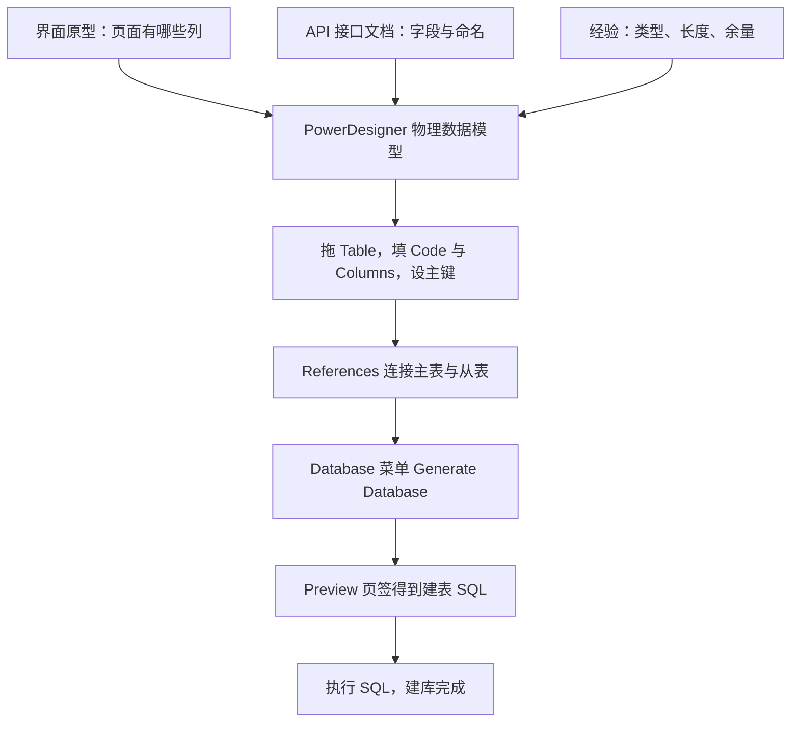

# 三范式与反范式：HRM 库表是怎么设计出来的

面对一张空数据库，最常见的迟疑是「字段到底该放哪张表」。凭直觉建表，表少的时候看不出问题，业务一长，一张表里塞进用户、成绩、家产、配偶，改一个字段牵动半套系统。SaaS-HRM 的库表不是这么长出来的：先立设计规矩，再用建模工具把规矩落成建表 SQL。这一课把整条链路走完，从三条范式讲到 `ihrm.sql` 里那张真实的 `co_company` 表。

## 先给结论

- 三范式逐级加严：第一范式保证每列不可拆分，第二范式要求一个表只做一件事，第三范式消除传递依赖。
- 反三范式不是推翻三范式，而是在遵守它的前提下故意保留冗余字段，用存储空间换查询效率。
- 建表的三个输入：界面原型、API 接口文档、个人经验。字段名跟着接口文档走，Java 代码里就省掉一层字段转换。
- 用 PowerDesigner 画好物理数据模型、连上主外键，建表语句可以自动生成，不必手写 `create table`。
- HRM 库的表名带业务前缀：`co_` 企业、`em_` 员工、`pe_` 权限、`bs_` 基础、`sys_` 系统，看名字就知道归属。

## 一、三条范式：一条比一条严

范式是判断库表设计好坏的三句话，每一条都以前一条为前提，要求逐级变严。

**第一，第一范式，保证每一列的原子性。** 翻译成大白话就是每列不可再拆分。拿用户表举例，地址一列写成「中国北京」，中国和北京是两个独立词汇，将来要做按城市统计就没法直接查。拆成国籍、城市两列，后面再来美国、日本的用户，表照样立得住：

| id | username | address（违反 1NF） | nationality | city（拆分后） |
|---|---|---|---|---|
| 1 | 张三 | 中国北京 | 中国 | 北京 |
| 2 | 李四 | 中国上海 | 中国 | 上海 |

拆分也要有分寸，拆到最小有意义单位为止。把「中国」再拆成「中」和「国」，就没有业务意义了。

**第二，第二范式，一个表只做一件事。** 在第一范式基础上，非主字段必须依赖主字段。用户表就该只放用户自己的属性，一旦把数学成绩、英语成绩塞进来，再把家产、长相、配偶信息也塞进来，这张表就成了无所不能的大杂烩，谁都能往里加一列。判断办法很朴素：检查每个非主字段，看它是不是都在描述主键代表的那个东西。用户表的主键是用户 ID，数学成绩依赖的其实是「这次考试」，不是这个用户，所以它不该在这里。

**第三，第三范式，消除传递依赖。** 传递依赖小学数学就见过：5 大于 4、4 大于 1，推出 5 大于 1，第三个结论是从前两个传递出来的。表里同理。订单表放了单价 10、数量 30，再放一列总价 300，总价完全可以由单价乘以数量算出来，这一列就是传递依赖。还有一种更隐蔽的形态：SaaS 用户表里存企业 ID 没问题，因为用户总要属于某个企业；再存一份企业名称就违反第三范式了，企业名称可以由企业 ID 关联企业表推导出来。凡是能推导出来的列，都属于要消除的对象。


这张图把四层关系串起来：从左到右逐级加严，反三范式是第四层，它站在 3NF 的肩膀上做加法，而不是另起炉灶。

## 二、反三范式：拿冗余换时间

三范式把表拆得干净，但干净是有代价的，两个日常场景就能看出来。

**场景一，订单页要显示总价。** 消除传递依赖之后总价列没了，每次页面渲染都要拿单价乘数量现算。订单里一万件商品就算一万次，十个人同时下单就是十万次计算，全是重复劳动，白白消耗服务端效率。

**场景二，查用户要显示企业名称。** 用户表里只有企业 ID，想显示企业名称，就得先查用户表拿到企业 ID，再拿着 ID 去企业表查一遍名称。每次列表页都平白多一次查询。

反三范式的解法就是把这两列加回来：订单表保留总价，用户表保留企业名称。这种故意重复存储的字段叫冗余字段。要强调的是，反三范式不代表三范式不遵守了，前提依然是先把三范式设计做对，再针对高频查询加冗余。

背景也值得交代：三范式诞生的年代硬盘贵，存储是稀缺资源，设计数据库要锱铢必较；现在硬件便宜，多存一份冗余的成本远低于每次查询多跑一遍 SQL，这笔账换成了「以空间换时间」。

本项目的员工表就是三范式与反三范式同框的活教材，`ihrm.sql` 里的真实 DDL（节选）：

```sql
CREATE TABLE `bs_user` (
  `id` varchar(40) NOT NULL COMMENT 'ID',
  `mobile` varchar(40) NOT NULL COMMENT '手机号码',
  `username` varchar(255) NOT NULL COMMENT '用户名称',
  `department_id` varchar(40) DEFAULT NULL COMMENT '部门ID',
  `company_id` varchar(40) DEFAULT NULL COMMENT '企业ID',
  `company_name` varchar(40) DEFAULT NULL,
  `department_name` varchar(40) DEFAULT NULL,
  PRIMARY KEY (`id`),
  UNIQUE KEY `idx_user_phone` (`mobile`) USING BTREE
) ENGINE=InnoDB DEFAULT CHARSET=utf8mb4;
```

`company_name` 本可以由 `company_id` 关联企业表得到，`department_name` 同理，但它们就躺在员工表里，员工列表页一次查询就能出全所有列。ID 是三范式规范的产物，名称是反三范式加的冗余，一张表里两种思想各占一半。

## 三、从原型到 DDL：PowerDesigner 建模全流程

数据库建模是在建库之前，对现实世界做分析和抽象，找出内在联系，确定数据库的结构。它包含两块：数据结构（有哪些表、哪些字段）和约束（主键、外键）。

建模的输入有三个：

- 界面原型：原型法产出的那套页面里，企业列表有名称、当前版本、联系人、联系电话，这些就是要落库的字段。
- API 接口文档：接口入参叫 `createTime`，数据库字段就叫 `create_time`，Spring Data JPA 对下划线命名会自动映射到驼峰属性，代码里不用做额外转换。
- 经验：类型选多长、要不要留余量，靠积累。

建模操作分四步。

**第一步，新建物理数据模型。** 打开 PowerDesigner，文件 → 新建模型 → Model types → Physical Data Model。注意选的是物理数据模型，不是面向对象模型。模型名填 IHRM，DBMS 选数据库类型，用 MySQL 5 就选 MySQL 5.0，用 Oracle 就选 Oracle。

**第二步，拖 Table 建表。** 从面板把 Table 拖进画布，双击打开属性窗口。Name 填中文描述（企业表），Code 填实际表名。表名要加业务前缀：跟企业相关的加 `co_`，跟权限相关的加 `pe_`，本课建的是 `co_company`。前缀的意义是让表名自带业务归属，几十张表的库一眼能分清哪张管什么。

**第三步，在 Columns 页签加字段。** 每个字段有四样东西要填：Name 是中文描述，Code 是列名，Comment 是注释，Data Type 是类型。课上企业表填出的前几个字段如下：

| Name（中文） | Code（列名） | Data Type | 备注 |
|---|---|---|---|
| 企业ID | id | varchar(40) | 勾选 P 设为主键 |
| 企业名称 | name | varchar(40) | 来自原型的列表列 |
| 创建时间 | create_time | datetime | 对应接口的 createTime |
| 状态 | status | int | 0 不可用，1 可用 |

`id` 的类型值得单独说：项目的 ID 由 ID 生成器生成，产出是字符串，所以主键选 `varchar(40)`。长度给到 40 而不是生成器实际产出的位数，是给业务扩展留余量。

**第四步，用 References 建主外键。** 一个企业下有多个部门，企业表是主表，部门表是从表。面板里拖一个 Reference，箭头方向指向主表。工具默认生成的外键列不一定对，双击关系线，在 Joins 里把连接列改成部门表的「所属企业 ID」字段，应用之后部门表里就多出一个 FK 标记的外键列。



模型画完，Database → Generate Database，Preview 页签里就是全部建表语句。课上现场生成的模型还很小，产出的 SQL 长这样：

```sql
drop table if exists co_company;
create table co_company
(
    id          varchar(40) not null comment '企业ID',
    name        varchar(40) comment '企业名称',
    create_time datetime comment '创建时间',
    status      int comment '状态：0 不可用；1 可用',
    primary key (id)
);
```

这就是建模工具的价值：设计人员只管把表和关系画对，DDL 由工具生成。资料包里完整的 `ihrm.sql` 是这套模型长成之后的最终形态，`co_company` 的真实 DDL 节选：

```sql
CREATE TABLE `co_company` (
  `id` varchar(40) NOT NULL COMMENT 'ID',
  `name` varchar(255) DEFAULT NULL COMMENT '公司名称',
  `manager_id` varchar(255) DEFAULT NULL COMMENT '企业登录账号ID',
  `version` varchar(255) DEFAULT NULL COMMENT '当前版本',
  `renewal_date` datetime DEFAULT NULL COMMENT '续期时间',
  `expiration_date` datetime DEFAULT NULL COMMENT '到期时间',
  `legal_representative` varchar(255) DEFAULT NULL COMMENT '法人代表',
  `audit_state` varchar(255) DEFAULT NULL COMMENT '审核状态',
  `state` tinyint(2) DEFAULT '1' COMMENT '状态',
  `create_time` datetime DEFAULT NULL COMMENT '创建时间',
  PRIMARY KEY (`id`)
) ENGINE=InnoDB DEFAULT CHARSET=utf8mb4;
```

对照课上那四个字段能看出，原型里企业列表的每一列，最终都成了表里的一列。部门表则带上了建模时那条 References 线落成的列：

```sql
CREATE TABLE `co_department` (
  `id` varchar(40) NOT NULL,
  `company_id` varchar(255) NOT NULL COMMENT '企业ID',
  `pid` varchar(255) DEFAULT NULL COMMENT '父级部门ID',
  `name` varchar(255) DEFAULT NULL COMMENT '部门名称',
  `code` varchar(255) DEFAULT NULL COMMENT '部门编码',
  `manager` varchar(40) DEFAULT NULL COMMENT '部门负责人',
  `introduce` text COMMENT '介绍',
  `create_time` datetime DEFAULT NULL COMMENT '创建时间',
  PRIMARY KEY (`id`)
) ENGINE=InnoDB DEFAULT CHARSET=utf8mb4;
```

`company_id` 就是从属企业的外键，一个企业对多个部门；`pid` 让部门还能再分父子层级。这类「谁从属于谁」的判断，要在看原型阶段就想清楚，而不是建完表再补。

## 常见误区

- **拆分没有上限**：为了凑第一范式，把「中国北京」拆成「中」「国」「北」「京」四列。正解是拆到最小有业务意义的词为止，城市、国籍足矣。
- **把三范式当死规矩**：所有表严格消除冗余，列表页全靠联表查询，越查越慢。正解是按查询频率做取舍，高频列允许冗余，但要以三范式设计为基础。
- **冗余字段只加不管**：加了 `company_name`，企业改名后员工表里还是旧名称。正解是给冗余列定同步策略，企业信息变更时一并更新。
- **主键一律自增数字**：多服务、多模块共用一个库时容易撞号。本课的做法是用 ID 生成器发号，主键用 `varchar(40)` 存字符串，长度留足扩展空间。

## 面试可能被问到的问题

1. 面试官追问：「数据库三范式分别是什么？」
   答：第一范式要求每列原子性、不可再拆分；第二范式在第一范式基础上要求非主字段完全依赖主字段，即一个表只做一件事；第三范式在第二范式基础上要求消除传递依赖，凡是能由其他字段推导出来的列都该去掉。三条逐级加严，后一条以前一条为前提。

2. 面试官追问：「反三范式和三范式矛盾吗？什么时候用冗余字段？」
   答：不矛盾，反三范式以遵守三范式为前提。当某列查询频率高、计算或联表代价大时，如订单总价、员工表里的企业名称，故意保留冗余，用空间换时间。代价是写入时要维护冗余列的一致性。

3. 面试官追问：「举一个传递依赖的例子，怎么处理？」
   答：订单表存了单价、数量，又存总价，总价可由单价乘数量推出，这就是传递依赖。规范化做法是去掉总价列，查询时现算；高并发展示场景则反其道行之，保留总价并约定更新时机，属于典型的范式与性能权衡。

4. 面试官追问：「表名为什么要加业务前缀，比如 co_company？」
   答：前缀表达业务归属，`co_` 企业、`pe_` 权限、`em_` 员工，几十上百张表的库里能一眼分类，也避免不同模块的同名表冲突。它同时约束了表的设计者：加列之前先想想这张表归哪个业务域，防止把无关字段塞进来。

5. 面试官追问：「建模时为什么强调字段名跟 API 接口文档走？」
   答：接口入参和响应字段是前后端共同遵守的契约，数据库字段与它对齐，持久层框架按下划线与驼峰自动映射，Java 实体不需要额外的字段名转换，减少一层出错机会。

6. 面试官追问：「主键为什么用 varchar(40) 而不是自增 int？」
   答：主键由分布式 ID 生成器统一发放，得到的是字符串形式的唯一值。自增 ID 在多模块写入、分库分表场景下难以协调且暴露业务量，字符串 ID 无此问题；40 位长度是为将来扩展预留的余量。

## 配套资料

- 建表脚本：`materials/code/02/day02 SAAS-HRM数据库设计与前端框架/3-3 SAAS-HRM数据库设计与前端框架/资源/ihrm.sql`（文中 `co_company`、`co_department`、`bs_user` 三段 DDL 均为该文件节选）
- 企业档案实体类对照：`materials/code/02/day01 SAAS-HRM系统概述与搭建环境/SAAS-HRM系统概述与搭建环境/资源/Company.java`（实体属性与 `co_company` 列一一对应）
- PowerDesigner 模型文件不在资料包内，建模操作步骤按本课画面整理
