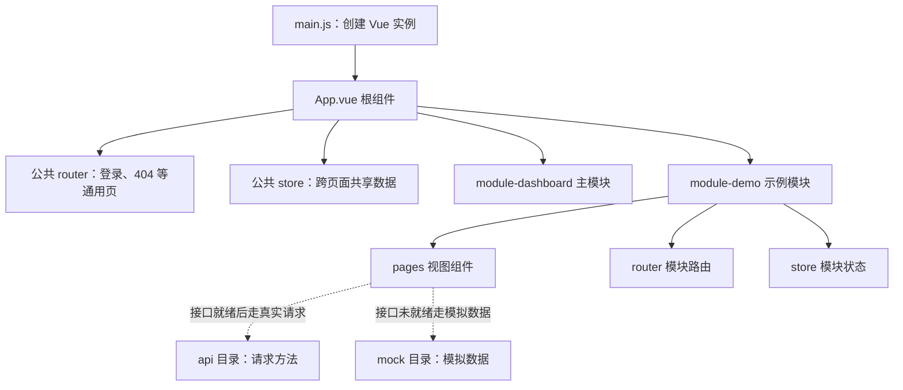

# 一张目录地图：src 下面每个文件夹各管什么

`npm run dev` 跑起来只是及格线，真要动手写企业管理的页面，得先知道代码该放进哪个抽屉。这个工程目录不少，好在职责切得很清楚：根目录管构建和依赖，src 管源码，src 下的 module-xxx 按业务分模块。跟着地图走一遍，之后每写一个功能都知道它该住哪。

## 先给结论

- 根目录的 build、config、node_modules、static 属于构建与依赖层，日常开发基本不动。
- src 是源码主战场：api 放请求方法，router 放公共路由，store 管跨页面共享数据，components 放公共组件，mock 放模拟数据。
- 业务代码按模块组织在 module-xxx 目录里，模块自带 pages 视图、router 模块路由、store 模块状态，新功能照这个结构仿写。
- App.vue 与 main.js 是两个引导：main.js 创建 Vue 实例并注册全局插件，App.vue 是根组件，页面都从它们长出来。
- mock 让前端在接口未就绪时独立开发，登录页里的用户名、首页的公司名都来自 mock 文件而不是后端。

## 一、根目录：构建层的几个目录

先看 src 之外的部分，它们负责让工程能编译、能启动：

```bash
├── build            # 编译相关脚本
├── config           # 启动基础配置：端口、代理等
├── node_modules     # npm 下载的全部依赖组件
├── script           # 与新建模块相关的基础脚本
├── src              # 源码主目录，开发的主战场
├── static           # 静态资源
├── test             # 测试目录
├── index.html       # 页面模板
├── package.json     # npm 包配置：依赖清单与可执行脚本
└── README.md
```

`node_modules` 是安装依赖的产物。以前手写页面要用 jQuery，得自己去官网下载再引入；现在在依赖声明里写一行、敲一条 `npm install`，组件自动落进这个目录，不用再重复下载引入这件事。工程依赖的组件多，全部批量装在这里，删掉它工程就跑不起来，重装一遍又能还原。

`script` 目录和后面新建模块的操作有关，现阶段不用展开；`build` 与 `config` 是编译脚本和启动配置，端口就是在 config 里定义的。

## 二、src：源码目录逐个点名

src 里的内容才是日常要打交道的，职责如下：

| 目录或文件 | 职责 |
|---|---|
| api | 与后端数据交互的请求方法，保存、更新、查询各归各 |
| assets | 静态资源 |
| components | 公共组件，现成的好看效果，直接拿来用 |
| filters | 过滤器，本工程基本不动 |
| icons | 小图标 |
| lang | 多语言库，中文、英文各一份 |
| mock | 前端模拟数据 |
| module-dashboard | 框架主模块，首页仪表盘就在这里 |
| module-demo | demo 示例模块，写新模块照它仿 |
| router | 公共路由配置 |
| store | 状态管理：在多个页面间共享数据 |
| styles | 全局样式 |
| utils | 公共工具库 |
| App.vue | 根组件，两个主引导之一 |
| main.js | Vue 入口，注册全局插件，另一个主引导 |

两个引导的关系值得单独说：Vue 是组件化的视图体系，`main.js` 负责创建 Vue 实例、装载全局插件，`App.vue` 是整棵组件树的根，所有页面都挂在这棵树上。理解了这一点，「页面从哪开始渲染」就有了答案。

mock 单独展开讲。一个真实现象：登录页随手输一个手机号，点登录居然成功了；首页显示的用户名是固定的。这些数据不是后端返回的，而是 mock 文件里写死的。比如模拟用户信息的 mock 文件：

```javascript
export default {
  profile: {
    code: 10000,
    success: true,
    message: "操作成功",
    data: {
      mobile: "13800138000",
      username: "张三",
      company: "某某科技股份有限公司",
      email: "zhangsan@example.com"
    }
  }
}
```

把里面的用户名改成别的，刷新页面立刻跟着变，页面数据来自这份文件，证据确凿。企业模块的 mock 也一样，资料包里就存着它的真实样例（节选）：

```javascript
import Mock from 'mockjs'
import { param2Obj } from '@/utils'

const List = []

for (let i = 0; i < 3; i++) {
  let data = {
    id: "1" + i,
    name: "企业" + i,
    version: "试用版v1.0",
    companyPhone: "13800138000",
    state: "1",
    createTime: "2018-01-01"
  }
  List.push(data)
}

export default {
  list: () => {
    return {
      code: 10000,
      success: true,
      message: "查询成功",
      data: List
    }
  }
}
```

它返回的 JSON 结构（`code`、`success`、`message`、`data`）和将来的真实后端接口完全一致。mock 的价值就在这里：前端把所有页面开发完，后端接口就绪后统一切换联调，两边谁也不用等谁。

## 三、module-xxx：业务代码的住址

这个工程最显著的特征是模块化：写什么功能，就开一个对应的模块目录。以 demo 模块为例，内部结构是：

```bash
module-demo
├── assets        # 模块私有静态资源
├── pages         # 模块的 Vue 视图组件
├── router        # 模块路由：本模块的页面跳转关系
└── store         # 模块状态：本模块内共享的数据
```

将来做企业管理，就仿照这个样子开一个企业模块，页面组件放 pages，模块内的跳转定义在自己的 router 里，模块内共享的状态放自己的 store。模块路由和 src 下公共 router 的分工是：公共路由管登录、404 这类全局页面，模块路由只管本模块内部的事，两者如何配合生成菜单，是下一篇的主题。



这张图从入口往下捋：main.js 拉起 App.vue，公共 router 与 store 服务于全局，业务页面住在各模块里；页面取数有两条路，接口没好走 mock，接口好了走 api 目录里封装的请求方法，页面代码本身不用大改。

## 常见误区

- **业务页面写进 components**：components 收的是跨模块复用的公共组件，业务视图应该放进自己模块的 pages，混在一起后期没法维护。
- **把 mock 当真实后端**：mock 只在开发期兜底，联调前要摘掉，否则看到的永远是写死的数据，联调时才发现页面逻辑对不上真实接口。
- **请求方法散落在页面里**：每个组件里随手写请求，接口一改要翻遍所有页面。请求方法统一收口到 api 目录，页面只负责调用。
- **手工维护 node_modules**：它是 npm 按 package.json 自动管理的产物，缺了就重新 install，手动塞文件或改内容都不可靠。

## 面试可能被问到的问题

1. 面试官追问：「前端工程里的 node_modules 是什么？」
   答：npm 安装依赖后生成的目录，存放 package.json 声明的全部组件。内容由包管理器完全重建，因此不入版本库，换台机器执行 npm install 即可还原，相当于 Maven 的本地仓库在工程里的投影。

2. 面试官追问：「mock 在前后端分离开发里的作用是什么？」
   答：接口未就绪时，mock 用预置数据拦截请求，返回结构与真实接口一致的 JSON，让前端不被后端进度阻塞，可以独立开发自测，联调阶段再统一切换到真实接口。

3. 面试官追问：「为什么要按 module-xxx 划分目录？」
   答：业务以模块为单位聚合，视图、路由、状态、资源都收在模块内部，边界清晰。加一个业务就是加一个模块，删一个业务就是删一个目录，改动范围可预期，也便于多人并行开发互不干扰。

4. 面试官追问：「main.js 和 App.vue 各自承担什么角色？」
   答：main.js 是工程入口，创建 Vue 实例、注册路由、状态管理、组件库等全局插件；App.vue 是根组件，定义整体布局骨架。前者负责装配，后者负责承载，页面内容都渲染在它划出的区域里。

5. 面试官追问：「store 状态管理解决什么问题？」
   答：多个页面要共享一份数据时，靠组件之间层层传值会非常混乱。store 把共享数据集中存放，任何页面都能读写，数据变化后引用它的页面同步更新，典型例子是登录用户信息在首页、导航栏、个人页同时使用。

6. 面试官追问：「公共 router 和模块内 router 怎么分工？」
   答：公共 router 配登录、注册、404 这类全局页面，属于脚手架自带；业务页面的跳转关系定义在各自模块的 router 里，由框架在启动时统一收集挂载。分层的结果是公共层保持稳定，业务层自由扩展。

## 配套资料

- 企业模块模拟数据：`materials/code/02/day02 SAAS-HRM数据库设计与前端框架/3-3 SAAS-HRM数据库设计与前端框架/资源/通用代码/company.js`（文中引用为节选，JSON 响应结构与真实接口约定一致）
- 前端工程完整目录未随资料包提供，目录树与目录职责按本课讲义整理；模拟用户信息文件中的字段值已替换为中性内容
