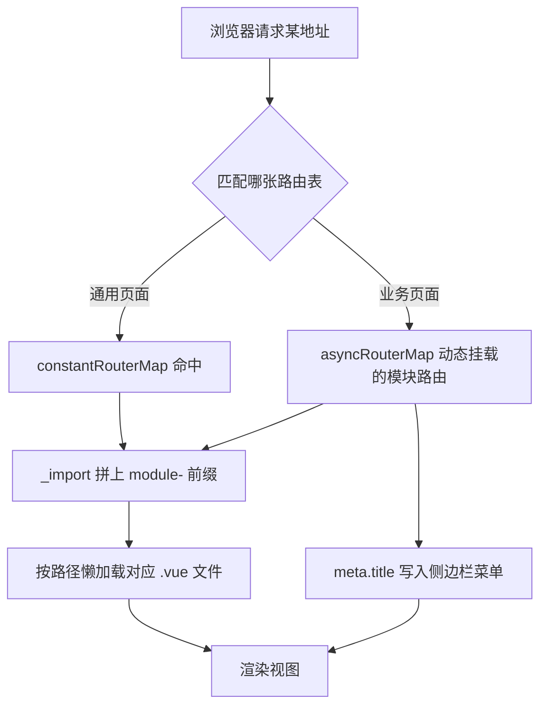
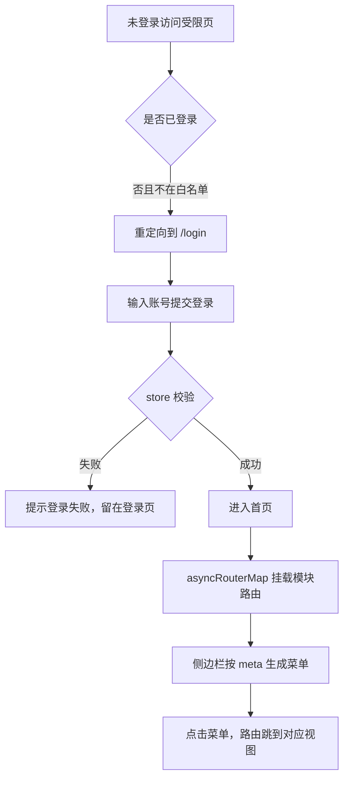

# 路由与菜单：地址栏敲下之后发生了什么

地址栏输入 `/login` 出登录页，登录成功后侧边栏冒出一排菜单，点菜单跳到对应页面。这条链路在后台系统里天天在用，但它是被什么串起来的？答案是 vue-router 的两张路由表加一套约定。路由和菜单是组织一个后台应用的关键骨架，把它们的配合关系看懂，之后每加一个页面都知道该动哪个文件。

## 先给结论

- 路由是请求地址与 Vue 视图的映射关系，公共部分配置在 src 的 router 目录，业务部分配置在各模块自己的 router 子目录。
- 路由分两套：`constantRouterMap` 是公共路由，管登录、注册、404 这类通用页面；`asyncRouterMap` 是业务模块路由，通过 `addRouters` 动态挂载。
- 组件按需加载靠 `_import` 函数：它把传入路径自动拼上 `module-` 前缀，指向模块目录下的页面文件。
- 侧边栏菜单与路由绑定在一起，只要按约定配置路由，菜单就能动态生成，`meta.title` 决定菜单文字，`hidden: true` 表示不进菜单。
- 未登录访问受限页面会被路由守卫拦回 `/login`，白名单里的页面直接放行。

## 一、两张路由表：公共的与动态的

src 的 router 目录里，`index.js` 是路由总配置。其中导出两张表，第一张是公共路由表（节选）：

```javascript
export const constantRouterMap = [
  { path: '/login', component: _import('dashboard/pages/login'), hidden: true },
  { path: '/reg', component: _import('dashboard/pages/reg'), hidden: true },
  { path: '/authredirect', component: _import('dashboard/pages/authredirect'), hidden: true }
]
```

三个路由全是脚手架自带的通用页面：登录、注册、跳转中转，都带 `hidden: true`，所以侧边栏上看不到它们。第二张是 `asyncRouterMap`，它不把页面写死，而是动态加载各业务模块 router 目录下定义的内容，模块有什么路由它就挂什么路由。公共层稳定、业务层可插拔，靠的就是这个分层。

地址栏敲 `/login` 之后，匹配到第一条路由，`component` 一栏的 `_import('dashboard/pages/login')` 开始工作。`_import` 来自文件开头的 `const _import = require('./import')`，它做的事是路径拼接：自动在传入路径前面加上 `module-`，于是 `dashboard/pages/login` 实际指向 `module-dashboard/pages/login.vue`。跟着这条线索打开那个文件，里面的账号输入框、立即注册按钮，和浏览器里的登录页一模一样，路由到视图的映射就此闭环。



关键路径在中间那步：无论走哪张表，最终都通过 `_import` 找到模块目录下的 `.vue` 文件，路径写错一个字母，页面就是白屏。

## 二、模块路由：一段配置同时定义页面和菜单

业务路由长什么样，拿 demo 模块看。打开 `module-demo` 的 router 目录，`index.js` 里是父子两层结构：

```javascript
{
  path: 'index',                          // 子路径
  component: _import('demo/pages/index'), // 跳转的 Vue 视图
  name: 'demo',
  meta: { title: 'demo', icon: 'component', noCache: true }
}
```

它外面还套着一层父路由，定义模块的根路径。父路径加子路径拼出完整访问地址，形如 `saas-clients/index`，父级管前半段，子级管后半段。这段配置里每个字段都有明确分工：

- `path`：请求地址，父级与子级拼接使用。
- `component`：地址命中后跳转的视图文件，`_import('demo/pages/index')` 经前缀拼接落到 `module-demo/pages/index.vue`。
- `meta.title`：侧边栏菜单显示的文字。把它从 `xxx业务模块` 改成 `demo`，刷新后菜单名字立刻跟着变，菜单是按路由的 meta 生成的。
- `meta.icon`：菜单图标，`noCache` 控制页面是否缓存。

component 与 path 的关系再用一个实验验证：打开 `index.vue`，把原有内容注释掉，只留一句「demo 页面」，保存刷新，浏览器里正好只剩这一句话。路由指向的就是这个文件，改文件即改页面。

菜单不用手写的原因也在这里：侧边栏组件遍历路由表，把带 `meta.title` 且没有 `hidden` 的路由渲染成菜单项。配置路由即配置菜单，路由写完菜单自动出现，这就是脚手架「路由与菜单绑定」的约定。

## 三、登录跳转链路：守卫把门

地址能匹配路由，不代表都能进。router 配置里有一道全局守卫，每次跳转前都会检查：

```javascript
const whitelist = ['/login', '/reg', '/authredirect'] // 免登录白名单

router.beforeEach((to, from, next) => {
  if (hasToken()) {
    next()                                   // 已登录，放行
  } else if (whitelist.indexOf(to.path) !== -1) {
    next()                                   // 白名单页面，放行
  } else {
    next('/login')                           // 其余一律回登录页
  }
})
```

守卫骨架之外，登录动作本身还连着状态管理：提交登录时通过 `store.dispatch` 发起验证，失败则弹出「登录失败，重新登录」的提示并留在登录页，成功才进入首页。整条登录后的链路如下：



从提交登录到看到菜单，中间经历了校验、动态路由挂载、菜单生成三步。这也是为什么改一个模块的菜单，不需要碰任何菜单组件，只要改它自己模块的 `meta` 配置。

## 常见误区

- **配了路由菜单却不出**：菜单按 `meta.title` 生成，路由里漏写 meta 或把 title 留空，页面能访问但菜单上没有入口。补上 meta 即可。
- **把所有路由塞进公共路由表**：`constantRouterMap` 只放登录、404 这类通用页，业务路由写进模块自己的 router，否则动态挂载形同虚设，菜单也没法按模块管理。
- **component 路径写错导致白屏**：`_import` 的参数是相对模块的路径，写漏 pages 或拼错模块名，拼接后找不到 `.vue` 文件，页面空白且不易排查。
- **hidden 的含义记反**：`hidden: true` 的路由照常可以访问，只是不出现在侧边栏，登录页就是典型例子，并不是「隐藏后不可访问」。

## 面试可能被问到的问题

1. 面试官追问：「前端路由本质上是什么？」
   答：是请求地址与视图组件之间的映射关系。路由表里每条记录声明 path 对应哪个 component，地址变化时由 vue-router 匹配路由并渲染对应组件，单页应用不刷新浏览器也能完成页面切换。

2. 面试官追问：「constantRouterMap 和 asyncRouterMap 的区别是什么？」
   答：前者是公共路由，登录、注册、404 等脚手架自带的通用页，随工程静态注册；后者是业务模块路由，内容来自各模块的 router 配置，在运行时通过 addRouters 动态挂载。权限控制也常挂在这上面，按用户权限决定挂载哪些模块路由。

3. 面试官追问：「侧边栏菜单是怎么自动生成的？」
   答：菜单组件遍历路由表，把配置了 meta.title 且未标记 hidden 的路由渲染为菜单项，meta.icon 提供图标。路由与菜单绑定后，配置路由就等于配置菜单，新增模块不需要改任何菜单组件。

4. 面试官追问：「路由守卫 beforeEach 用来做什么？」
   答：它在每次路由跳转前执行，是全局的拦截点。本工程用它做登录校验：无 token 且目标不在白名单时重定向到登录页；此外还可以做权限校验、页面标题设置、进度条启停等全局逻辑。

5. 面试官追问：「组件懒加载的好处是什么，工程里怎么实现的？」
   答：懒加载把组件的加载推迟到路由第一次命中时，减少首屏需要下载的代码量。工程里用 `_import` 封装路径拼接并返回动态 import，访问哪个页面才加载哪个页面的代码，大中型后台系统收益明显。

6. 面试官追问：「登录成功之后，到看到首页菜单，中间发生了什么？」
   答：登录请求经 store 校验通过后写入登录态，路由跳转到首页；框架挂载 asyncRouterMap 里的模块路由，侧边栏按各路由的 meta 生成菜单；之后每次点击菜单都是一次路由匹配加组件懒加载的过程。

## 配套资料

- 企业模块模拟数据：`materials/code/02/day02 SAAS-HRM数据库设计与前端框架/3-3 SAAS-HRM数据库设计与前端框架/资源/通用代码/company.js`（登录页与列表页在接口未就绪时的数据来源）
- 前端工程源码未随资料包提供，文中路由配置片段为按本课工程内容整理
