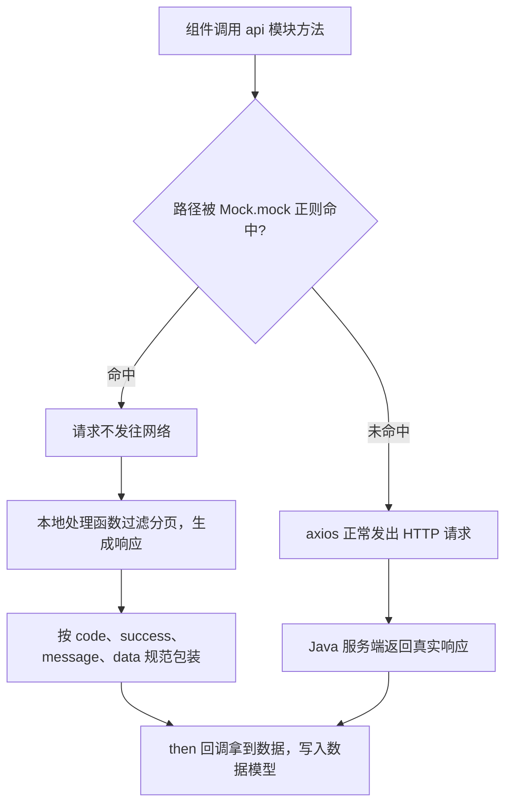

# Mock.js 模拟数据：后端接口没就绪，页面照常出数据

打开 demo 列表页，表格里的操作日志填得满满当当。按 F12 切到 Network 面板刷新，诡异的事情出现了：请求列表里干干净净，一条数据请求都没有。页面没发请求，数据是哪来的？

这不是 bug，而是工程里故意留的一层：Mock.js 拦截。前后端并行开发时，前端经常跑在后端前面，接口还没写完，页面总不能一直空白。Mock.js 的作用就是在浏览器内部把匹配的请求拦下来，用本地构造的数据顶替真实响应。搞清楚它的拦截规则和关闭方式，才能做到「开发时假数据、联调时一键切回真接口」。

## 先给结论

- mock 解决的是并行开发问题：后端接口未就绪时，前端用本地假数据把页面完整跑起来，页面代码与真实联调阶段完全一致。
- 拦截发生在浏览器内部：`Mock.mock` 按路径正则匹配请求，命中的请求根本不会发往网络，所以 Network 面板看不到。
- `Mock.mock` 收三个参数：匹配的请求路径（正则）、请求方式（get、post 等）、拦截到之后响应如何替换（交给哪个处理函数生成数据）。
- 假数据不是随便写的，必须符合工程统一的响应规范：`code`、`success`、`message`、`data`，字段名照接口契约来。
- 切回真实后端只需停用 mock 的注册引入，前提是 api 层写的请求路径与后端接口完全一致。

## 一、先确认现象：请求真的没发出去

回到那条取数链路：`created` 调用 `methods` 的 `getList`，`getList` 又 import 了 api 模块里的 `list` 方法，api 层声明的请求路径是 `/table/list`，get 方式。照理说每次刷新页面，Network 里都该有一条 `/table/list` 的请求，可实际情况是一条都没有，表格照样有数据。

原因就在 api 层之下：工程的 `src/mock` 目录里有一份拦截配置，请求在即将发出的那一刻被 Mock.js 截走了，本地函数直接把「响应」吐回给 `then` 回调。组件、api 层的代码一行没改，它们感知不到自己拿到的是假数据。这一层不破坏链路结构，只替换最末端的数据来源，正是它能在联调时无痛摘掉的原因。

## 二、Mock.mock 的三个参数

拦截配置集中在 `src/mock/index.js`：

```javascript
import Mock from 'mockjs'
import tableAPI from '@/api/table'
import profileAPI from '@/api/profile'
import loginAPI from '@/api/login'

Mock.setup({
  // timeout: 1000    // 想模拟网络延迟时放开，单位毫秒
})

// 正则匹配请求路径，命中即拦截
Mock.mock(/table\/list/, 'get', tableAPI.list)
Mock.mock(/frame\/profile/, 'post', profileAPI.profile)
Mock.mock(/frame\/login/, 'post', loginAPI.login)
```

文件开头 `Mock.setup` 里藏着一个可选项：`timeout` 可以人为给假接口加延迟，模拟真实网络环境下的加载状态，调试 Loading 效果时很有用。

核心是三行 `Mock.mock`，每个参数都有明确分工：

- **第一个参数，匹配的请求 API 路径。** 写成正则，`/table\/list/` 的意思是请求路径里包含 `table/list` 就算命中。api 层声明的 `/table/list` 正好落在规则里。
- **第二个参数，匹配的请求方式。** get、post 各算一类，路径相同方式不同的请求互不干扰，所以 login 和 profile 这类 post 请求要显式声明 `'post'`。
- **第三个参数，拦截之后响应如何替换。** 指向一个处理函数，命中请求后 Mock.js 调用它，把返回值当成接口响应交给调用方。这里交给的是 `tableAPI.list`。

三个参数连起来的读法就是一句完整的话：凡是 get 方式请求 `/table/list` 的，都不许发出去，改由 `tableAPI.list` 函数现场生成响应。

## 三、处理函数：假数据也要讲规矩

被拦截的请求交给处理函数后，函数要自己拼出分页、过滤这些本该后端做的事。`table.js` 里的 `list` 就是一个典型（节选）：

```javascript
export default {
  list: config => {
    // 从请求 config 里解析出分页与排序参数
    const { type, page, limit = 20, sort } = paramObj(config.url)
    let mockList = list.filter(item => {
      if (type && item.type !== type) return false
      return true
    })
    if (sort === '-id') {
      mockList = mockList.reverse()
    }
    const pageList = mockList.filter(
      (item, index) => index < limit * page && index >= limit * (page - 1)
    )
    return {
      total: mockList.length,
      items: pageList
    }
  }
}
```

函数入参 `config` 里带着原始请求信息，从中解析出页码、条数、排序，然后在本地数组上过滤、分页，最后返回 `total` 加 `items`。参数解析、条件过滤这些逻辑写得越像真后端，切换真实接口时页面的改动就越小。

结构上更值得关注的是企业模块的 mock 数据文件，这是课程资料里直接提供的真实文件（节选）：

```javascript
import Mock from 'mockjs'
import { param2Obj } from '@/utils'

const List = []
for (let i = 0; i < 3; i++) {
  let data = {
    id: '1' + i,
    name: '企业' + i,
    managerId: 'string',
    version: '试用版v1.0',
    renewalDate: '2018-01-01',
    expirationDate: '2019-01-01',
    companyPhone: '13800138000',
    industry: 'string',
    auditState: 'string',
    state: '1',
    createTime: 'string'
  }
  List.push(data)
}

export default {
  list: () => {
    return {
      code: 10000,
      success: true,
      message: '查询成功',
      data: List
    }
  },
  sassDetail: () => {
    return {
      code: 10000,
      success: true,
      message: '查询成功',
      data: { /* 单条企业详情，字段结构与列表项一致 */ }
    }
  }
}
```

注意返回值的外壳：`code` 10000 表示成功，`success` 是布尔标记，`message` 是提示语，业务数据全部塞在 `data` 里。这份 mock 不是随手构造的 JS 对象，它严格对齐了工程统一的 API 响应规范，字段名也与企业表的真实字段一一对应。假数据最大的坑从来不是「假」，而是结构与真接口不一致，联调那天页面全线崩掉。

拦截与数据生成的关系如下图：



图里能看出 mock 的寄生方式：它不改变组件和 api 层的任何代码，只在「发不发网络请求」这个分叉点上做文章。命中走左边，本地造数；不命中走右边，真实请求照发。

## 四、切回真实接口：摘掉拦截就够

mock 用完之后怎么接真后端？答案很简单：mock 的全部能力来自那份拦截配置在入口处的注册引入，把这条引入注释掉（或者删掉对应的 `Mock.mock` 行），请求就恢复真实发送，Network 面板里会重新出现 `/company`、`/sys/user` 这些请求记录。

切换能如此干脆，前提只有一个：api 层声明的路径、请求方式、参数结构与后端接口文档完全一致。mock 阶段省下的联调成本，全靠这个「三对齐」换回来。反过来说，如果 mock 文件里路径随手写、字段随手编，摘掉拦截的那天就是全面返工的开始。

## 常见误区

- **把 Network 里没有请求当成环境坏了**：mock 命中的请求本就不走网络，这是特性不是故障。先查 mock 配置里有没有对应的正则，再怀疑环境。
- **假数据字段随意编**：mock 的字段名与结构必须照接口契约写，对照数据库表和接口文档来，否则联调时取值层级、字段命名全要返工。
- **拦截正则写得太宽**：比如只写 `/list/`，所有带 list 的请求全被误拦。正则要写具体路径段，如 `/table\/list/`。
- **联调时忘了停用 mock**：后端明明改了数据，页面纹丝不动，排查半天发现请求根本没到后端。切真实接口的第一步永远是确认 mock 已停用。

## 面试可能被问到的问题

1. 面试官追问：「前端为什么需要 mock？」
   答：前后端并行开发时，接口未就绪会让前端页面无数据可展示。mock 在浏览器内拦截匹配的请求并返回本地构造的数据，让前端不依赖后端进度独立开发与自测，联调时停用拦截即可切回真实接口，页面代码无需改动。

2. 面试官追问：「Mock.mock 的三个参数分别是什么？」
   答：第一个是匹配请求路径的正则，决定拦哪些请求；第二个是请求方式，如 get、post，区分同路径不同方法的请求；第三个是响应替换函数，命中后由它生成本地响应。三者组合起来就是一条完整的拦截规则。

3. 面试官追问：「Mock.js 拦截请求的原理是什么？」
   答：它在浏览器环境里替换了原生的 XMLHttpRequest 对象，被拦截的请求不会真正建立网络连接，直接由本地函数生成响应回调给上层。因此组件与 axios 层感知不到差异，Network 面板也看不到这些请求。

4. 面试官追问：「怎么保证 mock 数据与真实接口最后能对上？」
   答：以接口文档为唯一契约，路径、请求方式、字段结构三对齐；mock 返回值套用工程统一的响应规范，字段名对照数据库表或接口文档书写。契约先行，mock 只是按契约供货的假后端。

5. 面试官追问：「从 mock 切换到真实后端，需要改哪些代码？」
   答：理想情况下只改一处：停用 mock 拦截配置的注册引入。页面、api 层都不用动。前提是 api 层的路径与参数完全按后端接口书写；若 mock 阶段路径随意，切换时就要逐个文件返工。

6. 面试官追问：「Mock.setup 的 timeout 有什么用？」
   答：给被拦截的假接口人为增加响应延迟，模拟真实网络的加载耗时。调试 Loading 动画、骨架屏、防抖等依赖耗时的交互时，不必等后端或限流工具，本地就能复现慢请求场景。

## 配套资料

- 企业模块 mock 数据真实文件：`materials/code/02/day02 SAAS-HRM数据库设计与前端框架/3-3 SAAS-HRM数据库设计与前端框架/资源/通用代码/company.js`（列表与详情两段 mock，响应外壳为工程统一规范）
- 企业表字段参考：`materials/code/02/day02 SAAS-HRM数据库设计与前端框架/3-3 SAAS-HRM数据库设计与前端框架/资源/ihrm.sql`（`co_company` 表结构，mock 字段名的对照来源）
- mock 拦截配置与分页处理函数为按本课工程内容整理，脚手架源码未随资料包提供
