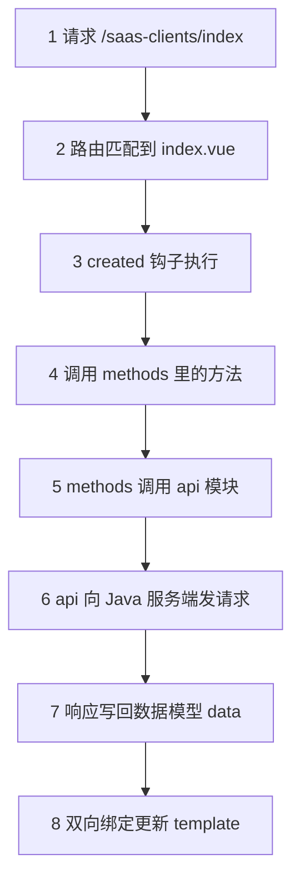
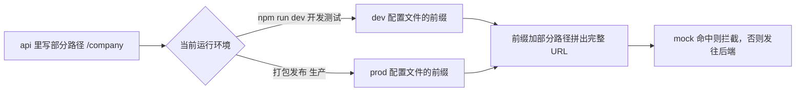

# 封装企业模块的 API：让前端请求与后端接口一一对齐

「SaaS企业管理」菜单挂上了，占位页面也能跳转。但按那条取数链路看，页面还是个空壳：`created` 要调用 `methods`，`methods` 要调用 api 方法，而企业模块的 api 一个都不存在。这一步把 api 补出来，并且让每一条请求的路径、方式与后端接口文档严格对齐，页面才有了真正取数的资本。

写 api 代码本身只有几行，真正的功夫在「对齐」二字：后端给了什么接口、路径长什么样、参数怎么传，前端照单封装，一个字段都不许自作主张。

## 先给结论

- 与后端交互的 api 方法集中放在 `src/api` 目录下，一个业务域一个文件，企业模块对应 `saasClient.js`。
- 封装函数 `createAPI` 与 `createFormAPI` 来自工程统一的 `@/utils/request`，组件不直接碰 axios。
- 请求路径可以只写部分路径，如 `/company`，工程会按运行环境拼上 dev 或 prod 里配置的前缀。
- 企业模块的接口契约来自接口文档：`GET /company` 查列表，按 ID 查详情用路径参数拼 `/company/{id}`，新增、修改、删除各有对应方法。
- 动手顺序是先读接口文档再写 api 文件，路径、请求方式、字段三对齐，mock 切换与联调都靠这个。

## 一、回到链路图，定位 api 的位置

占位页跑通时，链路只走了前两环：请求地址经路由变成页面。剩下的六环全部依赖 api，先把整张链路图摆出来，看清楚这一步要补的是哪一环：



第 5 环之前的页面、路由、钩子都已就位，第 5 环的 api 模块还是空的。api 方法按工程约定全部放进 `src/api` 目录，具体放在哪个子目录并不影响运行，本模块按习惯放进 `base` 子目录，新建文件 `saasClient.js`。

## 二、createAPI：三行封装一个请求

写法直接参照工程里现成的 `table.js`。文件第一行从 `@/utils/request` 引入框架封装好的工具方法，然后每个接口导出一个小函数：

```javascript
import { createAPI, createFormAPI } from '@/utils/request'

// 查询企业列表：GET /company
export const list = data => createAPI('/company', 'get', data)

// 根据 ID 查询企业详情：GET /company/{id}
export const detail = data => createAPI(`/company/${data.id}`, 'get', data)
```

`createAPI` 接收三个参数：请求路径在什么地方、请求方式是什么、携带的数据是什么。`list` 方法把企业列表查询封装成一行；`detail` 是按 ID 查询，ID 属于请求参数，全部来自 `data` 对象，用模板字符串从 `data` 里取出 `id` 拼进路径，`data` 里只要有 `id` 属性，它就会被带到请求地址上。企业列表对应 `GET /company`，按 ID 查询对应 `GET /company/{id}`，都来自接口文档的声明。

组件里将来调用时，就是 `saasClientAPI.list()` 和 `saasClientAPI.detail({ id: xxx })`，与上一节 `tableAPI.list` 的用法完全一致。

## 三、为什么路径只写一半：环境前缀拼接

`createAPI('/company', ...)` 里没有域名和端口，这样的「部分路径」是刻意的。工程的总配置 `config` 目录里，按运行环境各有一份配置文件：`dev` 对应开发测试环境，`prod` 对应正式生产环境，里面各自声明了请求前缀。写成示例：

```javascript
// config 目录按环境分文件（示例，按本课工程写法补全）
// config/dev.env.js：开发测试环境
module.exports = {
  NODE_ENV: '"development"',
  BASE_API: '"http://localhost:8088"'
}

// config/prod.env.js：生产环境
module.exports = {
  NODE_ENV: '"production"',
  BASE_API: '"https://api.example.com"'
}
```

`npm run dev` 启动时读 dev 文件，打包发布时读 prod 文件，`/company` 会被拼上对应前缀再发出。配合 mock 时部分路径还有另一层好处：mock 的正则匹配的就是这些相对路径，`/company` 命中拦截，根本轮不到前缀拼接生效。一条部分路径，同时服务三件事：本地 mock、开发联调、生产发布，切换环境不用改任何 api 代码。



## 四、对照接口文档补齐增删改

查列表、看详情之外，企业管理还承担新增、修改、删除。接口文档的 Swagger 页面上，企业模块的接口一目了然：`POST /company` 新增、`GET /company` 查列表、`PUT /company/{companyId}` 修改、`DELETE /company/{companyId}` 删除，请求体是 Company 实体，字段包括 `name`、`manager_id`、`expiration_date`、`company_phone`、`legal_representative` 等。

照同一套封装写法把其余动作补全：

```javascript
// 以下方法按接口文档与同一封装写法补全
// 新增企业：POST /company，表单类提交走 createFormAPI
export const save = data => createFormAPI('/company', 'post', data)

// 修改企业：PUT /company/{id}
export const update = data => createFormAPI(`/company/${data.id}`, 'put', data)

// 删除企业：DELETE /company/{id}
export const remove = data => createAPI(`/company/${data.id}`, 'delete', data)
```

五个方法排在一起，RESTful 的味道就出来了：同一个 `/company` 资源，请求方式区分动作，路径参数定位到具体一条记录。`createAPI` 与 `createFormAPI` 的分工在于提交形态，查询与删除走前者，表单类的新增修改走后者，这是工程封装层替业务做的约定。

字段层面还有一处隐性对齐：接口文档和数据库里的企业表字段是下划线风格，`manager_id`、`expiration_date`；而 mock 数据文件里是驼峰风格，`managerId`、`expirationDate`。下划线到驼峰的转换约定在哪一层做，前后端要在联调前说定，否则「后端有值前端取不到」这类问题会把时间全耗在互相怀疑上。

## 常见误区

- **api 文件里写死完整 URL**：域名端口全拼进路径，换一次环境就要全文件替换。路径写部分路径，前缀交给环境配置拼。
- **detail 忘了拼 ID**：按 ID 查询写成与列表相同的 `createAPI('/company', 'get', data)`，路径里没有 `{id}`，后端识别不出查哪条，返回的永远是列表语义。
- **字段风格不约定**：后端下划线、前端驼峰各说各话，联调时字段对不上。转换放在统一的一层，或后端直接按文档输出。
- **先写代码后翻文档**：路径凭感觉写，方法用 get 还是 post 随手定，与接口文档冲突后前后端来回扯皮。正确顺序是文档先行，api 文件照文档落笔。

## 面试可能被问到的问题

1. 面试官追问：「前端 api 目录的价值是什么？」
   答：把全部与后端交互的方法集中到一个目录，按业务域分文件。接口契约在代码里有了唯一落点，后端变更只改 api 文件；组件只消费方法返回的数据，与传输细节解耦，mock 与真实请求的切换也因此只发生在底层。

2. 面试官追问：「开发与生产环境请求地址不同，工程里怎么处理？」
   答：config 目录按环境维护配置文件，dev 与 prod 各声明一个请求前缀变量。构建时按环境加载对应文件，api 层只写部分路径，运行时自动拼出完整 URL，代码零改动完成环境切换。

3. 面试官追问：「RESTful 风格下企业模块的接口该怎么设计？」
   答：以 /company 为资源根，GET /company 查列表，GET /company/{id} 查详情，POST /company 新增，PUT /company/{companyId} 修改，DELETE /company/{companyId} 删除。用请求方式表达动作，用路径参数定位资源，URL 层面不再出现动词。

4. 面试官追问：「后端字段是下划线命名，前端习惯驼峰，如何处理？」
   答：约定转换发生的唯一层次，或在后端序列化时输出驼峰，或前端在 axios 拦截器里统一转换，避免每个组件各自手工转换。关键是全工程一个约定，字段映射只写一遍。

5. 面试官追问：「createAPI 与 createFormAPI 为什么要分两个？」
   答：两者底层都走统一封装的请求实例，区别在请求体的编码形态。查询、删除类不涉及表单提交，用 createAPI；新增、修改这类表单数据提交用 createFormAPI，按后端接口的消费方式选择，保证 Content-Type 与参数格式匹配。

6. 面试官追问：「按 ID 查询的参数为什么拼在路径上，而不是放进查询字符串？」
   答：路径参数表达「定位到一个具体资源」，是 RESTful 的语义约定，后端路由也按 /company/{id} 模式注册匹配。放进查询字符串也能传值，但资源定位语义弱化，且与接口文档声明的路径模板不一致，前端 api 就对不上了。

## 配套资料

- 企业模块 mock 数据真实文件：`materials/code/02/day02 SAAS-HRM数据库设计与前端框架/3-3 SAAS-HRM数据库设计与前端框架/资源/通用代码/company.js`（驼峰字段与统一响应外壳的真实样例）
- 企业表结构：`materials/code/02/day02 SAAS-HRM数据库设计与前端框架/3-3 SAAS-HRM数据库设计与前端框架/资源/ihrm.sql`（`co_company` 表，下划线字段命名与接口文档同源）
- 接口文档与脚手架源码未随资料包提供，文中环境配置与增删改方法为按本课写法补全的示例
