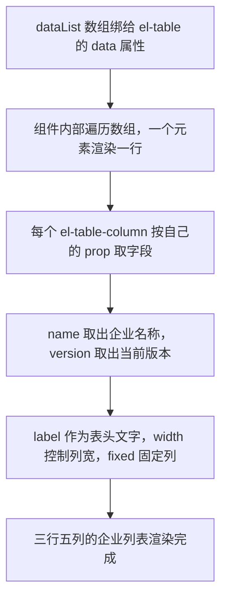

# 数据上屏：从 v-for 裸渲染到 Element UI 表格

控制台里数据已经打出来了，页面还是一片空白。中间缺的一环叫数据绑定：把响应里的数组赋给组件的数据模型，再用模板语法把模型渲染到页面上。这一节先花两分钟验证数据真的能上屏，然后换上 Element UI 的表格组件，把裸渲染的玩具页面升级成企业列表的原型。

## 先给结论

- 绑定的目标是 `data` 里声明的数组 `dataList`，赋值语句是 `this.dataList = res.data.data`，两层 `data` 缺一不可。
- 最简验证用 `v-for` 循环加插值表达式，跑通后立刻换 `el-table` 组件。
- `el-table` 用 `:data="dataList"` 接数据源，每一列是一个 `el-table-column`，`prop` 指定取哪个字段，`label` 是列标题，`width` 控制列宽，`fixed` 固定列。
- `prop` 的值是数组里每个对象元素的属性名，必须与实际数据逐字符一致，字段写错整列空白。
- 字段风格以你实际拿到的那份数据为准：接口文档是下划线风格，mock 数据是驼峰风格，本课渲染的是 mock 数据，prop 写驼峰。

## 一、把数组绑到模型上：剥两层 data

`data` 选项是组件的数据模型，模板里所有动态内容都从这里取。先声明一个空数组，等响应回来再赋值：

```vue
<script>
import { list } from '@/api/base/saasClient'

export default {
  name: 'saas-clients-index',
  data () {
    return {
      dataList: []
    }
  },
  created () {
    this.getList()
  },
  methods: {
    getList () {
      list().then(res => {
        // res.data 是统一响应外壳，数组在外壳的 data 属性里
        this.dataList = res.data.data
      })
    }
  }
}
</script>
```

赋值语句里连续两个 `.data` 是新手的头号卡点。上一节控制台里已经看到，`res` 是 axios 的完整响应，`res.data` 才是接口返回的统一响应外壳，长这样：`code`、`success`、`message`、`data`。数组藏在壳里的 `data` 属性中，所以从响应到数组要打点两次：`res.data.data`。只剥一层壳，绑上去的就是个对象而不是数组，页面上什么都循环不出来。

## 二、先用 v-for 验证数据真的到了

绑定好了先别急着堆样式，用最原始的循环把数据裸露到页面上，确认绑定这条线是通的：

```vue
<template>
  <div class="dashboard-container">
    <div class="app-container">
      <div v-for="(item, index) in dataList" :key="index">
        {{ item.id }} {{ item.name }}
      </div>
    </div>
  </div>
</template>
```

`v-for` 的写法基本固定：`(item, index) in dataList` 表示遍历 `dataList` 数组，`index` 是索引，根据索引依次取出每个元素，给元素起名叫 `item`；`:key` 给每条循环项指定唯一标识，这里暂用索引。循环体里 `{{ item.id }}`、`{{ item.name }}` 是插值表达式，`id` 和 `name` 是接口规范里企业对象的字段。刷新页面，三条数据的 id 和名称全部出现，说明从 mock 到模型到模板的整条渲染线已经打通。

代价也一目了然：页面丑。要做出原型里的效果，靠手写循环和样式不现实，该组件库上场了。

## 三、换上 Element UI 的表格组件

Element UI 是基于 Vue 的一套网站快速成型工具，主打现成的页面组件，本课的脚手架工程已经把它封装进去，拿来即用。官网左侧组件列表里找到「Table 表格」，原型里那些带边框、可固定列的表格，官网示例几乎一模一样，选「固定列」这个例子照抄改造。

改造后的核心代码：

```vue
<template>
  <div class="dashboard-container">
    <div class="app-container">
      <el-card shadow="never">
        <el-table :data="dataList" border style="width: 100%">
          <el-table-column fixed prop="name" label="企业名称" width="200"></el-table-column>
          <el-table-column prop="version" label="当前版本" width="150"></el-table-column>
          <el-table-column prop="companyPhone" label="联系电话" width="150"></el-table-column>
          <el-table-column prop="expirationDate" label="截止时间" width="150"></el-table-column>
          <el-table-column prop="state" label="状态" width="150"></el-table-column>
        </el-table>
      </el-card>
    </div>
  </div>
</template>
```

这套代码里没有一行循环，数组到行的转换全部由组件内部完成，工作方式可以从下面这条链路看明白：



关键角色有三个。**`data` 属性**：`el-table` 的数据入口，`:data="dataList"` 把模型绑上去，冒号开头表示里面是 JavaScript 表达式而非字符串。**`prop`**：数组中每个元素对象的属性名，组件拿着它去每行对象里取值，展示企业名称就用 `name`，展示版本就用 `version`。**`label`**：表头显示的中文列名，跟数据无关，纯给人看。每多要一列就加一个 `el-table-column`，原型上的列照此逐个补齐。

## 四、prop 与字段对齐：文档、mock、页面三方以谁为准

列清单从原型照抄时，字段名从哪来？来源是接口文档与 mock 数据，而两者风格并不一致：接口文档里的企业实体是下划线风格，`manager_id`、`expiration_date`；mock 数据文件里是驼峰风格，`managerId`、`expirationDate`。`el-table-column` 的 `prop` 取的是「当前渲染的这份数据」的属性名，本课页面渲染的是 mock 数据，所以 prop 全部写驼峰，中间没有任何下划线。

照这个原则逐列核对：企业名称 `name`、当前版本 `version`、联系电话 `companyPhone`、截止时间 `expirationDate`、状态 `state`。原型里原本还有一列「联系人」，翻遍 mock 数据找不到对应字段，prop 无值可取，这一列直接砍掉。这是前端先行阶段的常态：文档上有、数据里没有的列，先不做，等联调后再补，别让一列空白挡住整页进度。

刷新页面，企业名称、版本、电话、时间、状态五列齐整地排出来，三条企业数据一目了然，列表页的原型骨架到此成型。剩下的序号列、操作列和状态开关，下一节单独处理。

## 常见误区

- **只剥一层壳就绑定**：写成 `this.dataList = res.data`，绑上去的是响应外壳对象而不是数组，页面空白还不报错。牢记业务数据是 `res.data.data`。
- **prop 写成接口文档的下划线风格**：mock 数据里是 `expirationDate`，prop 写成 `expiration_date`，整列取不到值。prop 以实际渲染数据的字段为准。
- **忘了 `:key` 或用错位置**：`v-for` 循环不加 `:key` 会有警告，后续配合增删操作时还会引发渲染错乱。
- **把 `label` 当成字段名**：`label` 只是表头文字，改成「公司名称」数据照样取 `name` 字段，两者各管一头。

## 面试可能被问到的问题

1. 面试官追问：「`v-for` 的 `:key` 为什么不能用 index？」
   答：index 作为 key 时，数组中间插入或删除元素会导致后续所有项的 key 变化，Vue 的 diff 算法按 key 匹配节点，会做大量不必要的更新甚至渲染错乱。理想做法是用数据里稳定唯一的业务 id 做 key，列表项有增删场景时尤其如此。

2. 面试官追问：「el-table 的 data 和 el-table-column 的 prop 是怎么配合的？」
   答：data 绑定一个对象数组，组件内部遍历数组每个元素渲染一行；每列声明 prop 指定属性名，渲染单元格时按 prop 从当前行对象里取值。数据驱动视图，数组变了表格自动重渲染，无需手动操作 DOM。

3. 面试官追问：「接口文档用下划线命名，mock 数据用驼峰，prop 该按哪个写？」
   答：按实际渲染数据的那份字段写。本课页面消费 mock 数据就写驼峰；联调真实后端时，要么后端按文档输出后前端统一转换，要么约定数据从源头就统一成一种风格，关键是字段转换只在一个层次做，不能每列各转各的。

4. 面试官追问：「Vue 的数据绑定是怎么做到模型一变页面就变的？」
   答：Vue 在初始化时用 Object.defineProperty 把 data 里的属性转成 getter/setter 拦截读写，属性被赋值时通知依赖它的视图做更新。本课 `this.dataList = res.data.data` 一执行，绑定 dataList 的表格立刻重渲染，这就是响应式原理的直观体现。

5. 面试官追问：「为什么选择 Element UI 这类组件库，自己写样式不行吗？」
   答：企业级后台大量复用表格、表单、弹窗、分页这些同类组件，自研要花大量时间打磨样式与交互还难以保证质量。组件库提供开箱即用且风格统一的组件，`el-table` 声明式的列配置让一个数据数组几行代码就能渲染成规范表格，开发效率与一致性都占优。

## 配套资料

- 企业模块 mock 数据真实文件：`materials/code/02/day02 SAAS-HRM数据库设计与前端框架/3-3 SAAS-HRM数据库设计与前端框架/资源/通用代码/company.js`（`name`、`version`、`companyPhone`、`expirationDate`、`state` 等驼峰字段即出自此文件，prop 对照的真实依据）
- 企业表结构：`materials/code/02/day02 SAAS-HRM数据库设计与前端框架/3-3 SAAS-HRM数据库设计与前端框架/资源/ihrm.sql`（`co_company` 表，下划线风格列名，接口文档字段同源）
- Element UI 官网示例与脚手架组件源码未随资料包提供，文中表格改造代码为按本课工程写法补全的示例
