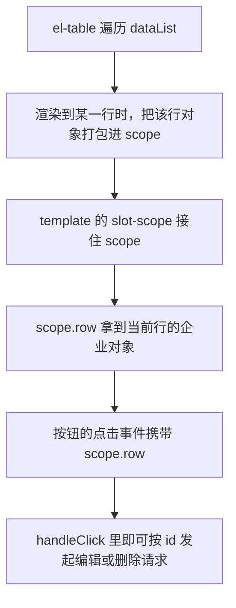

# 列表的序号列与操作列：type=「index」、作用域插槽与 Switch 状态开关

表格出来了，对照原型看还差三处：最左边少一列序号，最右边少一列操作按钮，状态列裸显示一个数字 1，看着既不专业也不友好。这三处的共同点是：它们不再只是「展示某个字段」，序号是组件自动生成的，操作列要放按钮，状态列要放开关组件。把这三列补齐，列表页才算有了交互的雏形。

## 先给结论

- 序号列不用绑定任何字段，`el-table-column` 加一个 `type="index"` 就自动生成从 1 开始的序号。
- 操作列靠作用域插槽承载按钮：`<template slot-scope="scope">` 里放 `el-button`，`scope.row` 就是当前行的完整数据对象。
- 状态列用 `el-switch` 开关组件，`v-model="scope.row.state"` 把当前行状态值绑上去，`active-value="1"`、`inactive-value="0"` 声明两个取值的含义。
- `active-color` 与 `inactive-color` 分别控制开与关两侧的颜色。
- 列表页的开关加 `disabled` 只读展示，修改状态是编辑页的职责，别在列表页引入误操作。

## 一、序号列：type 属性一行搞定

原型里企业名称之前有一列序号，1、2、3 往下排。这个序号不是数据里的字段，mock 数据的企业对象里根本没有它，靠数据取值的方式做不出来。Element UI 为这类列提供了专门机制，在列上指定 `type` 属性即可：

```vue
<el-table :data="dataList" border style="width: 100%">
  <el-table-column type="index" label="序号" width="50"></el-table-column>
  <el-table-column prop="name" label="企业名称" width="200"></el-table-column>
  <el-table-column prop="version" label="当前版本" width="150"></el-table-column>
  <el-table-column prop="companyPhone" label="联系电话" width="150"></el-table-column>
  <el-table-column prop="expirationDate" label="截止时间" width="150"></el-table-column>
  <el-table-column prop="state" label="状态" width="150"></el-table-column>
</el-table>
```

`type="index"` 是 Element UI 内置的列类型，组件渲染时自动按行号填 1、2、3，数据有多少条就排到多少，刷新立即可用。顺手把各列的 `width` 调匀，页面观感立刻提升一截。序号、企业名称、版本、电话、时间、状态，列结构到此与原型对齐。

## 二、操作列：作用域插槽把当前行交给组件

操作列要放的不再是字段值而是按钮，`el-table-column` 的常规取值机制装不下组件，这就要用到 Vue 的作用域插槽。先看写法：

```vue
<el-table-column fixed="right" label="操作" width="150">
  <template slot-scope="scope">
    <el-button @click="handleClick(scope.row)" type="text" size="small">编辑</el-button>
    <el-button @click="handleClick(scope.row)" type="text" size="small">删除</el-button>
  </template>
</el-table-column>
```

这里的 `template` 不是页面结构标签，而是插槽的载体：它声明「这一列的每个单元格，都按我里面的内容渲染」。按钮点击时要操作的是「这一行」的企业，那么这一行的数据从哪来？答案就是 `slot-scope="scope"`：组件在渲染每个单元格时，把当前行的数据打包放进 `scope` 传给你，`scope.row` 就是当前行对应的那个企业对象。这个传值过程可以画成一条链：



作用域插槽的本质是「子组件向插槽内容回传数据」：表格知道当前渲染到第几行，插槽内容需要这行数据，`slot-scope` 就是两者之间的桥。`fixed="right"` 把操作列固定在表格右侧，数据列多出横向滚动条时，操作按钮始终可见。

## 三、状态列：Switch 开关替代裸数字

状态列现在显示 1，语义要靠查文档才知道。原型用的是一种左右拨动的开关，手机上常见的样式，Element UI 里对应「Switch 开关」组件。把官网示例拷进状态列的插槽，绑上当前行的状态值：

```vue
<el-table-column prop="state" label="状态" width="150">
  <template slot-scope="scope">
    <el-switch
      v-model="scope.row.state"
      active-value="1"
      inactive-value="0"
      active-color="#13ce66"
      inactive-color="#ff4949"
      disabled>
    </el-switch>
  </template>
</el-table-column>
```

开关组件的几个属性各管一件事。**`v-model`** 负责绑定，`scope.row.state` 把当前行的状态字段接到开关上。**`active-value` 与 `inactive-value`** 负责定义语义：激活态对应什么值、未激活态对应什么值。mock 数据里 `state` 的取值是字符串 `"1"`，那 `active-value` 就写 `"1"`；如果业务里用「是」与「否」当取值，这两个属性照改即可，开关的显示与数据的取值完全由这两个属性约定。**`active-color` 与 `inactive-color`** 负责配色，激活一侧一个颜色、未激活一侧一个颜色。**`disabled`** 负责禁点：列表页只做展示，开关拨动属于修改操作，交给编辑页去做。

刷新页面，mock 数据里三条企业的 `state` 全是 `"1"`，全部命中激活态，开关统一显示激活颜色。一眼看过去哪家企业启用、哪一家停用，不用再查字典表。

## 常见误区

- **序号列写成 `prop="index"`**：数据里没有 `index` 字段，整列空白。序号列靠 `type="index"` 生成，不依赖任何字段。
- **插槽里直接写按钮，忘了 `slot-scope`**：按钮渲染得出来，但拿不到行数据，点击事件里 `row` 是 `undefined`。要在单元格里用行数据，`<template slot-scope="scope">` 这个固定写法不能省。
- **`active-value` 与数据类型对不上**：mock 里 `state` 是字符串 `"1"`，属性写成数字 `1`，开关永远显示为未激活态。两侧的值与类型要逐一对齐。
- **列表页开关不禁用**：`v-model` 双向绑定意味着点一下就可能改了数据，列表页混入编辑职责，误操作风险大。展示与修改分页面，加 `disabled`。

## 面试可能被问到的问题

1. 面试官追问：「作用域插槽和普通插槽的区别是什么？」
   答：普通插槽的内容由父组件写死，子组件只负责往指定位置塞内容；作用域插槽允许子组件在渲染插槽时把内部数据回传给父组件，父组件的插槽内容可以拿到这些数据做渲染。本课表格的 `slot-scope="scope"` 是典型用法，子组件把行数据传出来，父组件用它渲染按钮和开关。

2. 面试官追问：「`scope.row` 里的 row 是什么？」
   答：作用域插槽回传对象的属性之一，指向当前行绑定的那个数组元素。el-table 渲染每个单元格时以行为单位回传数据，`scope.row` 就是这一行的企业对象，取 `scope.row.id`、`scope.row.state` 都直接可用。

3. 面试官追问：「el-switch 绑定的值可以是任意类型吗？」
   答：可以，配合 `active-value` 与 `inactive-value` 约定两侧取值即可，字符串、数字、布尔都行。容易翻车的点是类型不一致：数据是字符串 `"1"`，属性写成数字 1，严格比较不相等，开关状态就错位。约定取值时连类型一起约定。

4. 面试官追问：「列表页直接放可编辑开关改状态，你反对的理由是什么？」
   答：列表是高频浏览场景，误触率高；且状态变更往往带业务校验与后端交互，静默修改让用户无感知。规范做法是列表只读展示，修改走编辑页或二次确认弹窗，操作留痕。展示与操作分离是后台系统的基本交互原则。

5. 面试官追问：「表格列很多时操作列会被滚出视野，怎么处理？」
   答：给操作列加 `fixed="right"` 固定在表格右侧，数据列横向滚动时操作按钮始终可见。同理 `fixed` 默认值可把企业名称这类关键列固定在左侧，宽表格的可用性全靠固定列保证。

## 配套资料

- 企业模块 mock 数据真实文件：`materials/code/02/day02 SAAS-HRM数据库设计与前端框架/3-3 SAAS-HRM数据库设计与前端框架/资源/通用代码/company.js`（`state` 字段取值为字符串 `"1"`，Switch 的 `active-value` 对齐依据）
- 企业表结构：`materials/code/02/day02 SAAS-HRM数据库设计与前端框架/3-3 SAAS-HRM数据库设计与前端框架/资源/ihrm.sql`（`co_company` 表，`state` 列注释「状态」，默认值 1）
- Element UI 官网 Switch 与固定列示例、插槽写法未随资料包提供，文中操作列与开关代码为按本课工程写法补全的示例
