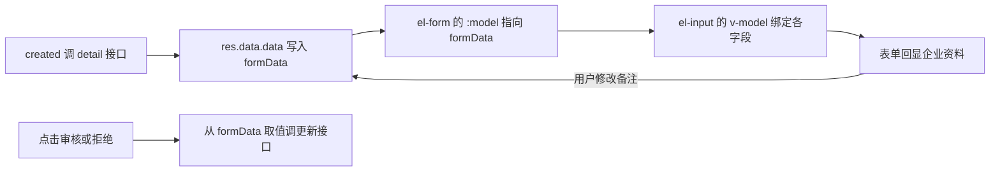

# 用 el-form 渲染企业详情：v-model 回显、disabled 只读与审核按钮区

上一节收尾时，`formData` 里已经躺着一个对象，控制台能打出「测试企业」的完整资料。数据有了，页面还是三个空页签，这一步把数据变成看得见的表单。工具依然是 Element UI，这次登场的是 Form 组件：官方示例照搬结构，字段换成企业资料，再把大部分输入框锁成只读，详情页的样子就立起来了。

## 先给结论

- 表单三件套：`el-form` 的 `:model` 指向 `formData`，`el-form-item` 的 `label` 出标签文案，`el-input` 的 `v-model` 绑到具体字段。
- 字段名必须照接口返回写：真实 mock 与数据库里是 `mailbox`、`remarks`，手写成 `mailBox`、`remark` 输入框就空白，拼错一个字母数据就丢。
- 详情页大部分字段只读，`el-input` 加 `disabled`；备注留给审核意见，底部「审核」「拒绝」按钮提交的是企业状态更新。
- 从官方文档复制示例时，示例里的 `@click="submitForm"` 要么删掉要么在 `methods` 里补实现，否则控制台报 `Invalid handler for event "click" got undefined`。
- `label-width` 统一标签列宽度，输入框用 `style` 约束宽度，页面立刻整齐。

## 一、从官方示例到业务表单

Element UI 的 Form 文档给了一个「活动名称、活动区域、活动时间」的示例表单，结构就是详情页要的样子，整套复制到 `el-tab-pane` 的企业信息页签里，然后做减法：下拉、日期、单选这些演示组件都删掉，只留最基础的输入框，再逐行换成业务字段。

改造后的模板如下：

```vue
<el-tab-pane label="企业信息" name="first">
  <el-form ref="form" :model="formData" label-width="200px">
    <el-form-item label="企业名称">
      <el-input v-model="formData.name" disabled></el-input>
    </el-form-item>
    <el-form-item label="公司地址">
      <el-input v-model="formData.companyAddress" disabled></el-input>
    </el-form-item>
    <el-form-item label="公司电话">
      <el-input v-model="formData.companyPhone" disabled></el-input>
    </el-form-item>
    <el-form-item label="邮箱">
      <el-input v-model="formData.mailbox" disabled></el-input>
    </el-form-item>
    <el-form-item label="备注">
      <el-input v-model="formData.remarks"></el-input>
    </el-form-item>
    <el-form-item>
      <el-button type="primary" @click="approve">审核</el-button>
      <el-button type="danger" @click="reject">拒绝</el-button>
    </el-form-item>
  </el-form>
</el-tab-pane>
```

三个属性各司其职。`:model` 是表单的数据双向绑定对象，指向 `formData`，表单里所有取值赋值都围着它转；`label` 是左侧标签文案，写「企业名称」页面就出「企业名称」；`v-model` 是每个输入框与字段之间的直通车，`formData.name` 有值，输入框就显示，输入框里改了，`formData.name` 跟着变。

字段名不是拍脑袋写的。接口返回的对象里，邮箱字段叫 `mailbox`，备注字段叫 `remarks`，这与资料包 mock 文件以及数据库 `co_company` 表的列名完全一致。照着接口写字段，数据到了就能回显；凭感觉写一个 `mailBox`，绑定不上任何值，页面只能给你一个空输入框，还不会报任何错。

## 二、回显链路与双向绑定的方向

详情页的数据流向和普通编辑页不一样：进来的时候是接口数据推给表单，叫回显；用户在备注里打字，是表单推回数据模型；点审核时，又是模型交给接口。`v-model` 在这条链路上承担双向运输：



回显是「接口到模型到视图」的单向流动，编辑是「视图到模型」的反向流动，提交又是「模型到接口」。三个方向共用同一个 `formData`，谁改了它，绑着它的输入框立刻同步，这正是双向绑定的价值：不需要手写一行「把数据显示出来」的代码。

## 三、disabled 只读与审核按钮区

企业详情页不是编辑页。名称、地址、电话、邮箱这些资料由企业自己维护，平台侧只负责看和审，所以这些输入框全部加 `disabled` 锁死，光标点进去也输入不了。真正允许动的只有备注框，审核时要在这里填意见。

`disabled` 是 `el-input` 的原生属性，写上即生效。锁完之后页面观感立刻从「待填写的表单」变成「供查阅的档案」，这个细节在后台系统里非常常用：查看场景一律 `disabled`，编辑场景才放输入。

底部的「审核」「拒绝」两个按钮对应两个动作，本质是同一件事：调更新接口，改企业的状态字段。审核通过状态改为可用，拒绝则改为不可用，备注随状态一起提交。这两个方法本节先留了空实现，作为练习留给读者：

```javascript
methods: {
  // 审核与拒绝本质都是更新企业状态，按同一套 update 接口封装
  approve () {
    // 调 update，把 state 改为可用，携带备注一起提交
  },
  reject () {
    // 调 update，把 state 改为不可用，携带备注一起提交
  }
}
```

## 四、两个现场问题

**第一，控制台报 `Invalid handler for event "click" got undefined`。** 从文档复制示例时，按钮上带着示例自己的 `@click="submitForm"`，模板里绑了这个事件，`methods` 里却没有这个方法，Vue 找不到处理器就抛出这条错误。处理方式二选一：暂时用不上就把事件绑定删掉，页面立刻干净；要留按钮就在 `methods` 里把方法补上。报错信息里 `got undefined` 说的就是处理器不存在。

**第二，标签与输入框宽窄不齐。** 默认样式下标签列宽度跟着文案走，每行起点参差不齐。`el-form` 上指定 `label-width="200px"`，标签列统一宽度，所有输入框起点对齐；输入框再用 `style="width: 250px"` 约束宽度，整列排版立刻规整。这两处纯样式调整不影响逻辑，但决定页面「像不像个成品」。

## 常见误区

- **字段名凭印象手写**：接口返回 `mailbox`、`remarks`，模板里写 `mailBox`、`remark`，大小写单复数之差让输入框全空。字段名对照接口返回或数据库列名抄，不靠记忆。
- **`:model` 写成 `model`**：少了冒号就变成了传字符串 `model`，表单拿不到真正的数据对象，校验与回显全部失效。`v-bind` 的冒号不能省。
- **只读写成 `disable`**：Element UI 的属性名是 `disabled`，拼少一个 d 没有任何效果，输入框照样能编辑。
- **复制示例不清理事件绑定**：示例里的提交方法没搬过来，控制台报 `Invalid handler for event "click" got undefined`。复制组件后把用不到的事件与方法一并清理。

## 面试可能被问到的问题

1. 面试官追问：「el-form 的 :model 属性是干什么的，不传行不行？」
   答：`:model` 声明表单的数据源对象，表单内组件的取值、赋值、校验都以它为根。不传时单纯展示也能渲染，但校验规则、重置表单这些能力全部失效，规范用法必须传。

2. 面试官追问：「v-model 的实现原理是什么？」
   答：它是语法糖，等价于给输入框绑 `value` 属性并监听 `input` 事件：数据变化更新 value 驱动视图，用户输入触发事件把新值写回数据。双向是两条单向合起来的效果，数据流依然可追踪。

3. 面试官追问：「disabled 和 readonly 有什么区别？」
   答：disabled 让控件完全不可交互，值不随表单提交，外观置灰；readonly 只挡键盘输入，值照常提交，外观基本不变。详情页的「看」用 disabled，业务上「只许展示不许改但要随单提交」的场景用 readonly。

4. 面试官追问：「详情页为什么要大部分字段只读？」
   答：详情页的使用者是平台运营，职责是查看与审核，企业资料由企业自己维护，平台侧修改会破坏数据归属边界。只读控制把误操作挡在界面层，也让审核动作与资料维护的权限边界在页面上可见。

5. 面试官追问：「审核和拒绝按钮背后的设计要点是什么？」
   答：两者都是状态更新而非新增，走同一套 update 接口，只改状态字段并携带审核备注。要点是把状态机设计清楚：可用与不可用的取值、能否重复审核、审核后是否要通知企业方，接口幂等性也要考虑。

## 配套资料

- 企业模块 mock 数据真实文件：`materials/code/02/day02 SAAS-HRM数据库设计与前端框架/3-3 SAAS-HRM数据库设计与前端框架/资源/通用代码/company.js`（`mailbox`、`remarks` 等真实字段名，表单绑定的对照来源）
- 企业表结构：`materials/code/02/day02 SAAS-HRM数据库设计与前端框架/3-3 SAAS-HRM数据库设计与前端框架/资源/ihrm.sql`（`co_company` 表，`mailbox`、`remarks` 列与页面字段同源）
- `el-form` 模板为按本课工程写法整理，审核与拒绝的接口提交逻辑为按本课写法补全的示例，脚手架源码未随资料包提供
