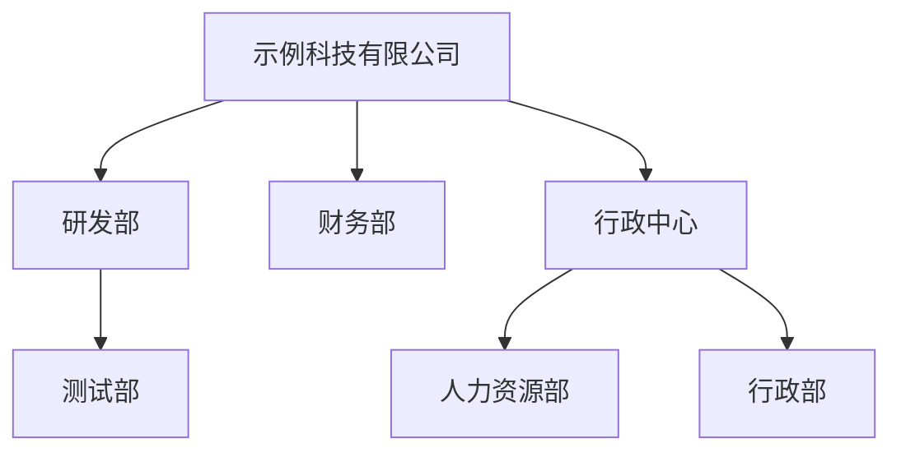
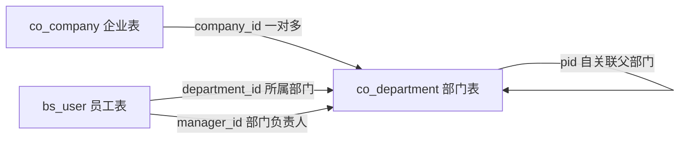

# 组织机构管理需求分析：一张 co_department 表装下所有企业的部门树

SaaS 人力资源管理平台要面对成千上万家企业，每家都有自己的组织架构。页面上的诉求很朴素：以树形结构展示企业的全部部门，节点上能增、能删、能改。落到数据库就冒出两个真问题：所有企业共用一张部门表时，数据怎么互不串门？部门的上下级层级又该怎么表达？

这两个问题的答案都藏在 `co_department` 这一张表里，这也是本阶段进入第一个业务模块开发的起点。

## 先给结论

- 组织机构管理落地之后就是部门 CRUD：页面按树展示部门，后端提供增删改查接口，本课先完成需求分析与表设计。
- 采用完全共享表方案：所有企业的部门数据放在同一张表里，每一行都带 `company_id`，靠它隔离不同企业的数据。
- 树形层级靠 `pid` 表达：子部门的 `pid` 指向父部门的 `id`，一张表通过自关联表达任意深度的组织树。
- 部门负责人存 `manager_id` 与 `manager` 两个字段：前者关联员工表保证数据一致，后者冗余存名称供直接显示。
- 这一天的完整路线是：组织机构管理、RBAC 权限模型、权限实现设计，再加上用户管理与权限管理两组 CRUD，角色管理留作作业。

## 一、这一天的任务清单

进入具体编码前，先把日程摆清楚，后面的每一篇博客都能在这张清单里找到位置：

| 模块 | 内容 | 形式 |
|---|---|---|
| 组织机构管理 | 企业部门树展示与增删改查，含部分前端补充 | 讲解加编码 |
| RBAC 模型 | 这套经典权限模型的产生背景与基本结构 | 概念讲解 |
| 权限实现设计 | 在本系统里基于 RBAC 演化出适配 SaaS 的权限方案 | 概念讲解 |
| 用户管理 | SaaS 企业员工的增删改查 | 编码 |
| 权限管理 | 权限数据的增删改查 | 编码 |
| 角色管理 | 完成角色的增删改查 | 留作作业 |

组织机构管理是其中最轻的一块，却是最典型的 CRUD 全流程样本，表结构、微服务代码、前端页面一条龙走完，后面所有模块照此模式复制。

## 二、需求长什么样：一棵部门树

把页面原型翻译成一句话：实现企业组织结构管理，完成部门的基本 CRUD 操作。界面上，顶部是当前企业的名称，企业下面以竖形树状结构罗列出所有部门，每个部门节点挂着新增、删除、修改等操作入口。

用示例科技公司的数据画出来就是这样一棵树：



图中测试部是研发部的子部门，行政中心下辖人力资源部与行政部，树的深度由企业自己决定，不同企业差异很大。需求本身不难，难的是用什么样的表结构，才能让任何形状的组织树都能装进去。

## 三、表设计：co_department 的每个字段都有理由

数据库表设计直接看课程资料包里的建表语句：

```sql
CREATE TABLE `co_department` (
  `id` varchar(40) NOT NULL,
  `company_id` varchar(255) NOT NULL COMMENT '企业ID',
  `pid` varchar(255) DEFAULT NULL COMMENT '父级部门ID',
  `name` varchar(255) DEFAULT NULL COMMENT '部门名称',
  `code` varchar(255) DEFAULT NULL COMMENT '部门编码',
  `manager` varchar(40) DEFAULT NULL COMMENT '部门负责人',
  `introduce` text COMMENT '介绍',
  `create_time` datetime DEFAULT NULL COMMENT '创建时间',
  `manager_id` varchar(255) DEFAULT NULL COMMENT '负责人ID',
  PRIMARY KEY (`id`)
) ENGINE=InnoDB DEFAULT CHARSET=utf8mb4;
```

**第一，`company_id` 是 SaaS 隔离的命根子。** 平台用的是完全共享表方案：所有企业的部门数据都在 `co_department` 这一张表里，不按企业分库分表。查询任何一个企业的部门列表，SQL 都必须带上 `where company_id = ?`，少了它，A 企业的页面就会查出 B 企业的组织架构，这在 SaaS 系统里是最高级别的生产事故。

**第二，`pid` 表达父子层级。** 树形结构不需要额外的关联表，子部门记录自己的父部门 id 即可。比如人事部是北京总公司的子部门，人事部这一行的 `pid` 就填北京总公司部门的 `id`。整棵树由若干行互相引用构成，层级再深也只是一列字符的事。

**第三，负责人拆成两个字段存。** `manager_id` 指向员工或用户表的记录，是真正的外键关系；`manager` 直接冗余存负责人姓名，列表页展示时不用再去联员工表。员工模块在这一天还没开发，所以 `manager_id` 的赋值来源暂时空着，等到用户模块落地再接上。

**第四，`code` 要求同级不重复。** 部门编码是给人和前端用的业务标识，同名部门可以存在（各城市都可以有销售部），但同一父部门下的编码必须唯一，保存接口后面要做这个校验。

表里的示例数据能直观看出 `pid` 的用法：

```sql
INSERT INTO `co_department` VALUES ('1063676045212913664', '1', '0', '研发部', 'DEV-TECHNOLOG', '技术部总监', '包含开发部，测试部', '2018-11-17 14:11:45', null);
INSERT INTO `co_department` VALUES ('1063678149528784896', '1', '1063676045212913664', '测试部', 'DEPT-TEST', '测试部门领导', '所有测试人员统一划分到测试部', '2018-11-17 14:20:07', null);
```

两行数据的 `company_id` 都是 `1`，属于同一家企业；测试部的 `pid` 恰好是研发部的 `id`，两条记录就构成了一棵两层子树。

## 四、三张表怎么协作

部门表不是孤岛，它和企业在上的员工表在将来都有关系：



关键路径是纵向的：`co_company` 的一条企业记录，通过 `company_id` 挂起 `co_department` 里的整棵部门树；`bs_user` 的每一行员工又通过 `department_id` 挂到某个具体部门。组织机构的本质就是这三层归属关系，后续的权限分配、考勤统计都建立在这套层级之上。

## 常见误区

- **查部门列表忘了带 `company_id`**：功能跑起来看不出问题，一旦第二家注册企业入驻，数据立刻串台。正解是列表、详情、更新、删除全部限定在企业 id 之内，这个条件在 Service 层强制拼上，不依赖调用方自觉。
- **用固定层级字段表达树**：比如表里直接建 `level1_name`、`level2_name` 列，组织结构加一层就要改表结构。正解是单表加 `pid` 自关联，层级变化对表结构完全透明。
- **负责人只存 `manager_id` 不存 `manager`**：每次展示部门列表都要联一次员工表，列表页性能白白多花一次 join；反过来只存名称，员工离职或改名后就对不上号。两个都存，id 保证关联正确性，名称承担显示职责。
- **把企业本身当部门树的根节点存进 `co_department`**：企业是租户，部门才是组织节点，混在一起会让隔离条件和权限判断都变复杂。树的根应该是企业名称加顶级部门集合。

## 面试可能被问到的问题

1. 面试官追问：「SaaS 多租户的数据隔离有哪几种方案？」
   答：常见三种，独立数据库、独立 schema、共享表加租户字段。共享表成本最低、运维最简单，靠每张业务表上的租户字段隔离，代价是代码里必须处处带租户条件，任何一处遗漏都会串数据。课程采用的是共享表方案，`company_id` 就是那个租户字段。

2. 面试官追问：「树形结构用 pid 自关联，查询整棵树时怎么处理？」
   答：把当前企业的部门一次性全部查出来，在内存里按 `pid` 组装成树返回前端，避免数据库递归。代价是递归查某个子树时需要多次查询或把整棵树拉回来，层级很深、量级很大的场景可以引入路径枚举或物化路径优化。

3. 面试官追问：「manager 和 manager_id 同时存，不算违反数据库范式吗？」
   答：是刻意的反范式冗余。列表页高频展示负责人姓名，冗余一列名称可以省掉与员工表的 join；修改入口走 `manager_id` 保证关联关系正确，名称随 id 变更同步刷新。用可控的一致性成本换查询性能，是读多写少场景的常见取舍。

4. 面试官追问：「部门表的 id 为什么是 varchar(40) 而不是自增数字？」
   答：系统按微服务拆分后，多个服务都会往同一张表写数据，数据库自增在分库分表下会冲突。课程统一用 IdWorker 雪花算法生成 64 位 long 值再转字符串，全局唯一、趋势递增，也不向外暴露业务量。

5. 面试官追问：「前端渲染部门树，接口应该返回平铺列表还是树形 JSON？」
   答：两种都可以。返回平铺列表时后端实现简单，前端按 `pid` 组树，灵活度更高；返回树形 JSON 则前端零处理直接渲染。课程方案是后端查出企业全部部门后组好树形结构返回，前端只负责展示。

## 配套资料

- 数据库脚本：`materials/code/02/day02 SAAS-HRM数据库设计与前端框架/3-3 SAAS-HRM数据库设计与前端框架/资源/ihrm.sql`（含 `co_department` 建表语句与示例数据，正文 SQL 即出自此处）
- 实体类：`materials/code/02/day03 SaaS-HRM系统用户权限设计概述/SaaS-HRM系统用户权限设计概述/资源/工具代码/实体类/Department.java`
