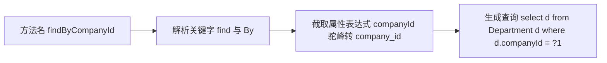
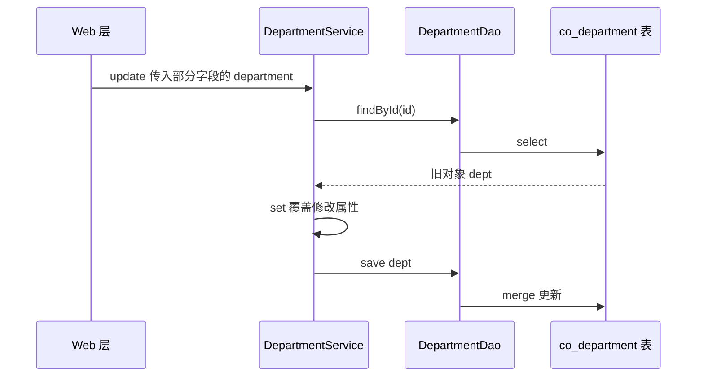

# 部门 Dao 与 Service：一个空接口加五个方法撑起全部 CRUD

Controller 搭好骨架后，真正干活的两层还空着。这一步的工作量出人意料地小：Dao 层是一个不写任何方法体的空接口，Service 层是五个转调方法。省下的代码被 Spring Data JPA 按约定生成掉了，理解「约定替你写了什么」比照着敲完这五个方法更有价值。

部门属于企业微服务的子模块，Dao 和 Service 都建在企业微服务模块的对应包下，这一定位与前一篇实体的归属保持一致。

## 先给结论

- `DepartmentDao` 只需继承 `JpaRepository<Department, String>` 与 `JpaSpecificationExecutor<Department>` 两个接口，save、findById、findAll、deleteById 等基本方法全部现成。
- `DepartmentService` 五个方法：save、update、findById、findAll、deleteById，当前阶段都是对 Dao 的直接转调，业务规则随后续 Controller 编写再往里加。
- 主键在 Service 层生成：注入 IdWorker，`idWorker.nextId()` 返回 long，拼接空串转成 String 塞给实体。
- 更新的正确姿势是先查再改再存，直接 save 前端传来的对象会把未提交字段覆盖成 null。
- 按企业查部门列表用方法名派生查询 `findByCompanyId(String companyId)`，Spring Data JPA 解析方法名自动生成 SQL。

## 一、Dao 层：一行继承换一整套数据访问

新建一个接口，两个泛型一个不落，这就是部门 Dao 的全部：

```java
package com.example.company.dao;

import com.example.domain.company.Department;
import org.springframework.data.jpa.repository.JpaRepository;
import org.springframework.data.jpa.repository.JpaSpecificationExecutor;

public interface DepartmentDao extends JpaRepository<Department, String>,
        JpaSpecificationExecutor<Department> {
}
```

接口体是空的，能力全部来自父接口。`JpaRepository<T, ID>` 的两个泛型分别是实体类和主键类型，这里对应 `Department` 和 `String`，它把单表 CRUD、分页排序的方法全部带进来；`JpaSpecificationExecutor<T>` 提供基于 Specification 的动态条件查询，现阶段用不上，先继承着为复杂查询预留扩展点。

没有 SQL，没有 XML，没有实现类。Spring Data JPA 在启动时为接口生成代理对象，方法调用被翻译成 JPQL 交给 Hibernate 执行。方法语义由名字约定，`findByCompanyId` 就会被解析成对 `company_id` 的等值查询：



图里这条链路就是「方法名即查询语句」的核心：框架在启动阶段解析接口方法名，按解析结果生成查询逻辑，运行时直接走代理。写两遍单元测试跑一下，这套约定就不再神秘。

## 二、Service 层：五个方法的标准实现

Service 类上打 `@Service` 交给容器管理，Dao 与 IdWorker 通过 `@Autowired` 注入，五个方法对应五个接口：

```java
package com.example.company.service;

import com.example.common.utils.IdWorker;
import com.example.company.dao.DepartmentDao;
import com.example.domain.company.Department;
import org.springframework.beans.factory.annotation.Autowired;
import org.springframework.stereotype.Service;

import java.util.List;

@Service
public class DepartmentService {

    @Autowired
    private DepartmentDao departmentDao;

    @Autowired
    private IdWorker idWorker;

    /**
     * 1.保存部门
     */
    public void save(Department department) {
        //设置主键id
        String id = idWorker.nextId() + "";
        department.setId(id);
        //调用dao保存部门
        departmentDao.save(department);
    }

    /**
     * 2.更新部门
     */
    public void update(Department department) {
        //根据id查询出数据库中的旧对象
        Department dept = departmentDao.findById(department.getId()).get();
        //设置要修改的属性
        dept.setCode(department.getCode());
        dept.setIntroduce(department.getIntroduce());
        dept.setName(department.getName());
        //调用dao更新部门
        departmentDao.save(dept);
    }

    /**
     * 3.根据id查询部门
     */
    public Department findById(String id) {
        return departmentDao.findById(id).get();
    }

    /**
     * 4.查询全部部门列表
     */
    public List<Department> findAll() {
        return departmentDao.findAll();
    }

    /**
     * 5.根据id删除部门
     */
    public void deleteById(String id) {
        departmentDao.deleteById(id);
    }
}
```

五个方法里只有 save 和 update 值得多说两句，其余三个都是一行转调。save 的第一步永远是生成主键，IdWorker 是基于雪花算法的工具类，`nextId()` 产出的 64 位 long 拼接空串转成 String 填进 `id` 字段，随后才轮到 `departmentDao.save(department)` 落库。这套「应用层生成 id、Dao 只管保存」的分工是全系统通用的固定套路。

## 三、save 的双重语义与更新的先查再改

`save` 这个方法名有迷惑性，它并不只做 insert。JPA 对它的定义是：实体主键为空或不存在于数据库时执行 persist，等价于新增；主键已存在时执行 merge，先按主键查一次再合并属性更新。save 因此同时承担新增与更新两种职责，这也解释了 update 方法为什么要绕一道弯。

**第一，永远先查询。** `findById(department.getId()).get()` 把数据库里的旧对象捞出来。前端修改表单通常只提交部分字段，比如改个部门介绍，名称、编码根本不在请求体里。

**第二，在旧对象上覆盖修改属性。** 把请求对象里携带的 code、introduce、name 逐个 set 到查出来的 `dept` 上，没提交的字段维持数据库原值。

**第三，保存旧对象。** `departmentDao.save(dept)` 触发 merge 更新。整个流程可以用一张时序图概括：



关键路径是中间那步 set：更新的载体始终是从数据库查出的 `dept`，而不是前端传来的对象，未提交字段因此天然安全。

## 四、按企业查列表：方法名派生查询

当前的 `findAll` 会把所有企业的部门一股脑查出来，这在 SaaS 系统里是错的，列表必须限定在企业范围内。不需要写 SQL 也不需要 `@Query` 注解，在 Dao 接口里声明一个方法即可（此方法按 Spring Data JPA 方法名派生规则补全）：

```java
// 按企业查询部门列表：JPA 解析方法名生成 where company_id = ?
List<Department> findByCompanyId(String companyId);
```

框架解析方法名的过程就是上一节那张流程图：`findBy` 声明查询动作，`CompanyId` 对应实体属性并映射到表列 `company_id`。Service 里加一个对应方法，查出结果后在内存按 `pid` 组装成树，就是前端要的组织架构数据。

## 常见误区

- **update 直接 save 前端传来的对象**：请求体没带的字段全部变成 null 覆盖旧值，部门介绍一夜清空。正解是先 `findById` 查旧对象，在旧对象上 set 修改属性再保存。
- **`Optional` 上直接 `.get()` 不做判断**：id 不存在时抛出 `NoSuchElementException`，前端只收到一个晦涩的 500。课程为聚焦主线先直接 get，工程上应当 `orElseThrow` 抛业务异常，交统一异常处理器返回友好提示。
- **IdWorker 手动 new 而不是注入**：`new IdWorker()` 绕过了 Spring 容器，多实例部署时机器标识缺乏统一规划，存在撞号风险。把它注册为 Bean 全局共享一份。

## 面试可能被问到的问题

1. 面试官追问：「Spring Data JPA 的方法名派生查询是怎么工作的？」
   答：框架在启动阶段扫描 Repository 接口，按 `find` 等关键字加 `By` 加属性表达式的语法拆解方法名，属性驼峰转下划线映射到列，生成 JPQL 查询由代理对象执行。支持 `And、Or、Between、Like、OrderBy` 等组合。

2. 面试官追问：「`JpaRepository` 和 `JpaSpecificationExecutor` 的区别？」
   答：前者提供单表 CRUD 与分页排序等固定能力，方法语义编译期确定；后者提供 `findAll(Specification)` 入口，条件运行时动态拼装，适合多条件筛选。两者泛型一致，可同时继承。

3. 面试官追问：「JPA 的 save 什么时候是 insert，什么时候是 update？」
   答：由实体主键状态决定：主键为 null 或库中无对应记录时执行 persist 新增；主键已存在时执行 merge，先查再合并属性更新。save 名义上叫保存，实际同时覆盖新增与更新两种场景。

4. 面试官追问：「雪花算法生成的 id 由哪几部分组成？」
   答：标准结构 64 位：1 位符号位、41 位毫秒级时间戳、5 位数据中心 id、5 位机器 id、12 位毫秒内序列号，毫秒内靠序列号自增区分，单机每毫秒可生成 4096 个 id，整体趋势递增。

5. 面试官追问：「`findById` 返回的 `Optional` 有什么好处？」
   答：它用类型系统显式表达「结果可能不存在」，迫使调用方在编译期面对空值问题，而不是运行时抛出 `NullPointerException`。正确姿势是 `orElseThrow`、`map`、`filter` 链式处理，无条件 `get()` 等于把空指针问题延后爆发。

## 配套资料

- day13 代码生成器产出的部门模块与本课写法一致，可作对照：`materials/code/02/day13-代码生成器实现/day13-代码生成器实现/资源/测试/生成代码路径/ihrm_company/src/main/java/com/ihrm/system/dao/DepartmentDao.java` 与 `.../service/DepartmentService.java`
- IdWorker 雪花算法工具类：`materials/code/02/day01 SAAS-HRM系统概述与搭建环境/SAAS-HRM系统概述与搭建环境/资源/通用代码/IdWorker.java`
- 正文 `findByCompanyId` 为按 Spring Data JPA 方法名派生规则与本课写法补全的示例，课程源码包中无对应文件
