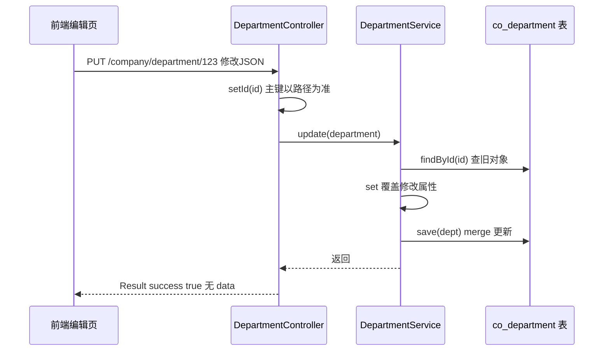

# 部门改与删：路径参数、先查后改与删除前的存在性校验

列表页已经有数据了，点某一行进编辑页，回显要按 id 查一条；保存修改走 PUT；不要了这个部门走 DELETE。部门模块剩下这三个接口的 URL 是同一个模板 `/company/department/{id}`，全靠请求方式区分动作。接口本身几行就写完，真正值得掰开的是三件事：路径参数怎么接、修改为什么必须先查再改、删除前要不要校验存在。

## 先给结论

- 三个接口共用 `/department/{id}` 模板：GET 查单条、PUT 改一条、DELETE 删一条，路径参数用 `@PathVariable` 接收。
- 修改接口同时收两样东西：`@PathVariable` 从路径取 id，`@RequestBody` 把请求体 JSON 封装成 Department 对象。
- Controller 在调 Service 前先 `department.setId(id)`，让路径里的 id 覆盖请求体里的 id，主键只信 URL。
- Service 的 update 延续先查再改的套路：`findById` 捞旧对象，set 覆盖修改属性再 save，未提交字段天然安全。
- 删除前做存在性校验更稳：直接 `deleteById` 遇到无效 id 会抛 `EmptyResultDataAccessException`，前端只能收到晦涩的 500。

## 一、根据 ID 查询：@PathVariable 拿路径参数

编辑页一打开就要回显，靠的是按 id 查单条。Controller 方法如下：

```java
/**
 * 根据id查询部门
 */
@RequestMapping(value = "/department/{id}", method = RequestMethod.GET)
public Result findById(@PathVariable("id") String id) {
    //1.调用service查询部门
    Department department = departmentService.findById(id);
    //2.构造返回结果，携带部门数据用于页面回显
    return new Result(ResultCode.SUCCESS, department);
}
```

路径模板里的 `{id}` 是占位符，请求 `/company/department/105238836272664578` 时，URL 上这一段被提取出来填进方法参数，靠的正是 `@PathVariable`。注解里显式写上 `("id")` 把参数名钉死，代码重命名参数时不至于悄悄断链。查询有数据返回，走的是 `Result` 的双参构造器，data 带着实体出去。

## 二、修改：路径参数与请求体同时接收

修改接口的请求里有两份信息：定位到哪条记录的 id 在路径上，改成什么样在请求体里。两种参数一并在签名里声明：

```java
/**
 * 根据id修改部门
 */
@RequestMapping(value = "/department/{id}", method = RequestMethod.PUT)
public Result update(@PathVariable("id") String id,
                     @RequestBody Department department) {
    //1.设置修改部门的id：以路径参数为准
    department.setId(id);
    //2.调用service完成更新
    departmentService.update(department);
    //3.构造返回结果，无数据返回
    return new Result(ResultCode.SUCCESS);
}
```

`department.setId(id)` 这一步是隐形的安全阀。请求体里虽然带着 id 字段，但主键只认 URL：路径决定改哪条，请求体决定改成什么样，两者混用一旦不一致就可能出现「请求体指向 A 记录、路径指向 B 记录」的错位，统一以路径为准最稳。

Service 层的 update 在 Dao 与 Service 那一节已经定型，这里直接复用：先 `findById` 查出数据库旧对象，把请求对象携带的 name、code、introduce 逐个 set 上去，最后 save 旧对象。更新载体始终是从库里查出来的 `dept`，前端没提交的字段维持原值。整条链路如下：



修改不返回业务数据，`new Result(ResultCode.SUCCESS)` 单参构造即可，data 为空但 success、code、message 三件套齐全，前端照样按统一结构解析。

## 三、删除：DELETE 与删除前的存在性校验

删除接口最短，路径模板与修改一致，请求方式换成 DELETE：

```java
/**
 * 根据id删除部门
 */
@RequestMapping(value = "/department/{id}", method = RequestMethod.DELETE)
public Result delete(@PathVariable("id") String id) {
    //1.调用service完成删除
    departmentService.deleteById(id);
    return new Result(ResultCode.SUCCESS);
}
```

Service 里一行 `departmentDao.deleteById(id)` 就完事。但这行代码藏着一个体验坑：id 在库里不存在时，Spring Data JPA 的 `deleteById` 会抛 `EmptyResultDataAccessException`，用户看到的是 500 而不是「部门不存在」。删除前补一道存在性校验是更工程化的写法（此段为按本课写法补全的示例，课程主线为直接删除）：

```java
//示例：删除前校验存在性，按本课统一响应结构补全
public void deleteById(String id) {
    Department dept = departmentDao.findById(id)
            .orElseThrow(() -> new CommonException(ResultCode.FAIL, "部门不存在或已被删除"));
    departmentDao.delete(dept);
}
```

部门表里还有 `pid` 父级字段，树形结构下删父部门会留下孤儿子部门，真正落生产还要级联处理或禁止删除有子节点的部门，这些规则同样归 Service 层管，Controller 只负责转调。

## 四、五个接口一张表：RESTful 的样子齐了

部门模块的 CRUD 至此闭环，同一批 URL 的分工全貌如下：

| 动作 | 请求方式与路径 | 关键注解 | 返回 |
|---|---|---|---|
| 保存 | POST `/company/department` | `@RequestBody` | 无 data |
| 列表 | GET `/company/department` | 无 | `DeptListResult` |
| 单查 | GET `/company/department/{id}` | `@PathVariable` | Department |
| 修改 | PUT `/company/department/{id}` | `@PathVariable` + `@RequestBody` | 无 data |
| 删除 | DELETE `/company/department/{id}` | `@PathVariable` | 无 data |

同一资源、请求方式区分动作、路径参数定位记录，三个特征凑齐，这就是 RESTful 风格在工程里的落地形态。GET 与 DELETE 天然幂等，反复请求结果一致；PUT 按主键覆盖也幂等；只有 POST 每次都新建，重复提交要靠前端防抖或后端防重兜底。

## 常见误区

- **用 `@RequestParam` 接路径参数**：id 在路径段里而不是查询字符串里，`@RequestParam` 只会拿到 null。路径模板 `{id}` 对应的参数一律 `@PathVariable`。
- **修改接口只收请求体不收路径参数**：id 全信请求体，被篡改后改了不该改的记录。主键永远以路径参数为准，进 Service 前显式 `setId` 覆盖。
- **update 直接 save 前端对象**：请求体没带的字段全变 null 覆盖旧值，部门介绍一夜清空。先 `findById` 捞旧对象，在旧对象上 set 再存。
- **删除不校验存在性也不接异常**：无效 id 直接 500，用户一脸茫然。要么先查再删给出业务提示，要么在统一异常处理器里把 `EmptyResultDataAccessException` 转成友好响应。

## 面试可能被问到的问题

1. 面试官追问：「`@PathVariable` 和 `@RequestParam` 的区别是什么？」
   答：`@PathVariable` 提取 URL 路径模板中 `{id}` 占位符的值，表达资源定位语义；`@RequestParam` 读取查询字符串或表单里的普通参数，表达过滤、分页这类附加条件。用哪个取决于参数在请求里的位置，混用会直接取不到值。

2. 面试官追问：「PUT 和 POST 都能改数据，语义上怎么区分？」
   答：POST 表达在集合下新建资源，每次调用都产生新记录；PUT 表达按已知 id 整体更新某个资源，幂等且可重复提交。工程里常配合 PATCH 做部分字段更新，本课用 PUT 承载修改，靠先查再改的方式规避了整字段覆盖问题。

3. 面试官追问：「为什么修改要先查询再更新，而不是直接 save？」
   答：前端表单往往只提交部分字段，直接 save 请求对象会把缺失字段以 null 覆盖进数据库。先 `findById` 拿到旧对象，在其上 set 提交的字段再保存，未提交字段保持原值，更新范围被精确控制在请求真正携带的属性上。

4. 面试官追问：「DELETE 接口重复点击会不会出问题？」
   答：DELETE 天然幂等，第一次删成功、后续再删影响行数为零，不会产生副作用。但直接 `deleteById` 遇到不存在的 id 会抛 `EmptyResultDataAccessException`，生产实现会先做存在性校验或捕获该异常，把重复点击转成「记录不存在」的业务提示而非 500。

5. 面试官追问：「树形结构的部门表，删除父部门要注意什么？」
   答：子部门通过 pid 挂在父部门下，直接删父节点会留下孤儿数据，列表按树渲染时这部分节点将无法归位。常见做法是删除前检查是否存在子部门，有则禁止删除或级联删除，必要时把子部门上移挂到祖父节点，规则放在 Service 层统一执行。

## 配套资料

- 部门 Controller 成例（正文三接口与之同构，day13 代码生成器产物）：`materials/code/02/day13-代码生成器实现/day13-代码生成器实现/资源/测试/生成代码路径/ihrm_company/src/main/java/com/ihrm/system/controller/DepartmentController.java`
- Department 实体类（`pid`、`companyId` 等字段出处）：`materials/code/02/day03 SaaS-HRM系统用户权限设计概述/SaaS-HRM系统用户权限设计概述/资源/工具代码/实体类/Department.java`
- 正文删除前的存在性校验为按本课写法补全的示例，课程主线为 Service 直接转调 `deleteById`，资料包内无对应源文件
