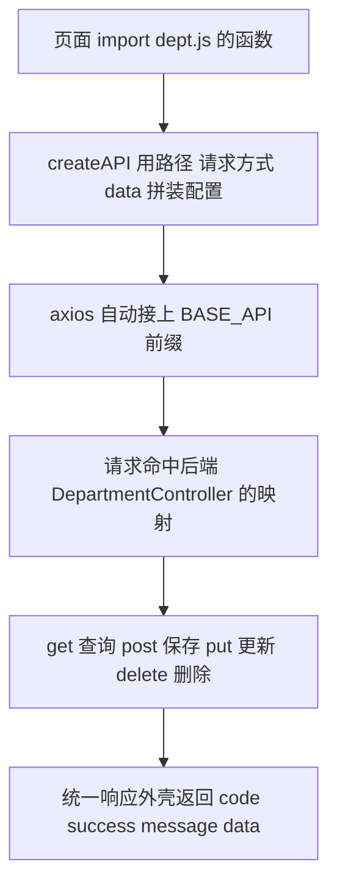

# 部门模块的请求层落地：一个 createAPI 把五个 REST 接口收进 dept.js

`module-departments` 已经挂进工程，组织架构页面也能打开，但它还是一张静态图：按钮点了没反应，页面里没有任何一个请求发出去。原因很直接，前端到现在还不知道后端的部门接口长什么样。这一节把后端的五个接口封装成五个请求函数，收进 `src/api/base/dept.js`，从此页面想发请求，`import` 一个函数就够。

## 先给结论

- 请求函数统一放 `src/api` 目录，部门模块对应 `api/base/dept.js`，位置不强制，约定俗成便于查找。
- 写请求不直接碰 axios：`@/utils/request` 暴露的 `createAPI(路径, 请求方式, data)` 把请求配置收敛成一个三参函数。
- 路径只写 `/company/department` 这后半段，前缀由 `config/dev.env.js` 里的 `BASE_API` 统一拼接。
- 五个函数对齐后端五个接口，REST 风格下同一路径靠请求方式区分：get 查、post 存、put 改、delete 删。
- 保存与更新可以合并成一个 `saveOrUpdate`，判断依据是 data 里有没有 id。

## 一、先约定 api 目录，再看 createAPI 长什么样

企业模块当天留下的习惯直接沿用：api 函数集中放在 `src/api` 下，部门模块建一个 `dept.js`。目录位置其实无所谓，工程能找到就行，约定统一放 api 目录是为了让任何人接手时都能在一个固定的地方找到全部请求入口。

函数本体不用从零写，企业模块的 `saasClient.js` 就是现成模板，复制过来改路径和函数名。文件第一行永远是这样的引入：

```javascript
import { createAPI } from '@/utils/request'
```

`createAPI` 是脚手架框架封装好的请求函数，接收三个参数：请求路径、请求方式、请求参数 data。data 有就传，没有就空着，取决于调用方手里有什么。参数 data 指的是请求参数，与请求方式配套：get 时拼在 URL 上，post 与 put 时放进请求体。想深究的可以顺着源码路径读进去，它底层就是 axios，外面套了一层统一加前缀、统一处理响应的壳。

**前缀为什么不用写。** api 里写的路径都是半截，比如 `/company/department`，发出前 axios 会自动接上 `config/dev.env.js` 里 `BASE_API` 指向的完整地址。前后端联调时改协议、改端口、改域名，动的只是那一行配置，api 文件一个字不用碰。

## 二、五个函数对齐五个接口

后端部门微服务对外暴露五个接口，接口文档上写得清楚：`/company/department` 路径下挂了 POST 保存、GET 列表，`/company/department/{id}` 路径下挂了 GET 查详情、PUT 更新、DELETE 删除。前端五个函数与之一一对应，课程资料里的最终版本完整长这样：

```javascript
import { createAPI } from '@/utils/request'

// 查询部门列表
export const list = data => createAPI('/company/department', 'get', data)
// 保存部门
export const save = data => createAPI('/company/department', 'post', data)
// 根据 id 查询部门
export const find = data => createAPI(`/company/department/${data.id}`, 'get', data)
// 根据 id 删除部门
export const deleteById = data => createAPI(`/company/department/${data.id}`, 'delete', data)
// 根据 id 更新部门
export const update = data => createAPI(`/company/department/${data.id}`, 'put', data)
// 保存或更新：有 id 走更新，没 id 走保存
export const saveOrUpdate = data => { return data.id ? update(data) : save(data) }
```

对照着看，每个函数与后端 Controller 的映射关系一目了然：

| 前端函数 | 请求方式 | 请求路径 | 后端动作 |
|---|---|---|---|
| `list` | get | `/company/department` | 查询部门列表 |
| `save` | post | `/company/department` | 保存部门 |
| `find` | get | `/company/department/{id}` | 根据 id 查详情 |
| `deleteById` | delete | `/company/department/{id}` | 根据 id 删除 |
| `update` | put | `/company/department/{id}` | 根据 id 更新 |

写的过程中有一个典型对齐动作值得记录：从企业 api 复制模板后，路径一开始留在 `/company` 没改，靠对照接口文档才纠正成 `/company/department`。这就是 api 层的核心纪律，路径、请求方式、参数位置三样必须与后端逐条核对，抄错一个词，404 会等到联调那天才找上门。

整条请求链路串起来是这样：



关键路径在第三步：api 里只有半截路径，前缀在请求发出前由 axios 从环境配置接上，api 层因此对部署环境完全无感。

## 三、路径参数用模板字符串拼

带 id 的三个函数有一个共同细节，路径里的 `{id}` 要换成调用方传入的真实值。写法用 ES6 的模板字符串，反引号包住整条路径，`${data.id}` 占位：

```javascript
export const find = data => createAPI(`/company/department/${data.id}`, 'get', data)
```

调用时传 `{ id: '106' }`，实际发出的就是 `GET /company/department/106`。不习惯模板字符串的话，普通字符串拼接 `'...department/' + data.id` 是等价写法，但反引号版本读写都更清楚，工程里统一用它。data 里除了 id 还可以带别的属性，比如更新时带 `name`、`code`，这些字段走 put 的请求体发往后端，不会出现在路径上。

## 四、saveOrUpdate：有 id 就改，没 id 就存

细心一点会发现 `save` 和 `update` 大同小异，差别只有两点：有没有 id、请求方式是 post 还是 put。而前端的新增与编辑又往往共用同一个表单弹窗，提交时调用方根本不想关心这次到底是新增还是修改。于是再包一层：

```javascript
// 保存或更新：调用方只管传 data，函数内部自行分流
export const saveOrUpdate = data => { return data.id ? update(data) : save(data) }
```

逻辑就是一行三目：data 里出现了 id，认为在编辑，走 `update` 把整包 data 交给 put；没有 id，认为是新增，走 `save` 交给 post。表单组件只管 `saveOrUpdate(form)` 一个入口，分流细节收敛在 api 层。这个判断成立的隐含前提是后端用数据库生成的 id 标识「已存在的记录」，新增时 id 为空，编辑时表单回显必然带着 id，前提天然满足。

## 常见误区

- **复制企业 api 忘改路径**：`/company` 原样留着，或者只改成 `/department` 丢了 `/company` 前缀，后端 Controller 的映射对不上，请求一律 404。每条路径都要与接口文档逐字核对。
- **路径参数不用模板字符串**：写成 `'/company/department/${data.id}'` 却用了单引号，`${data.id}` 会被当成普通字符原样发出，后端收到路径 `/company/department/$%7Bid%7D`。路径插值必须用反引号。
- **用 delete 当函数名**：`delete` 是 JavaScript 的关键字（还是删除对象属性的运算符），拿来做导出名会有歧义冲突，命名为 `deleteById` 或 `remove` 更稳妥。
- **save 与 update 的方式写反**：更新必须用 put 并且 id 拼在路径上，因为后端按 `PUT /{id}` 映射；写成 post 会落不到对应方法上。分流函数里 `update` 分支之所以必须要求 id，原因就在这。

## 面试可能被问到的问题

1. 面试官追问：「为什么要把请求封装成 createAPI 这类三参函数，而不是组件里直接写 axios？」
   答：封装把请求配置收敛到一处，路径前缀、响应拦截、错误提示、token 注入都只在框架层维护一次。组件拿到的是语义化函数，调用代码与业务对齐；底层换 axios 实例、改 baseURL，业务代码零改动。散落在组件里的裸 axios 调用则每处都要重复处理这些横切逻辑。

2. 面试官追问：「同一路径靠请求方式区分增删改查，后端怎么做到的？」
   答：Spring MVC 的 `@RequestMapping` 可以声明 method 属性，`/company/department` 同时映射 POST 与 GET 两个方法，`/{id}` 映射 PUT 与 DELETE，DispatcherServlet 按「路径加方式」定位唯一处理器。这就是 REST 风格的资源表达，路径定位资源，方式表达动作。

3. 面试官追问：「路径参数和请求体参数分别用在什么场景？」
   答：定位资源身份的标识走路径参数，如 `/company/department/{id}` 中的 id，配合 GET、PUT、DELETE 表达「对这一条资源」的操作。业务数据走请求体，如新增时的名称、编码、负责人。这样拆分后 URL 语义清晰，也便于后端用 `@PathVariable` 与 `@RequestBody` 分别接收。

4. 面试官追问：「saveOrUpdate 这种分流封装有什么隐患？」
   答：分流依据只有 data.id 一个，如果调用方在编辑时漏带 id，会被静默当成新增，产生一条重复数据。规范做法是表单回显时强制带 id，并在后端对更新接口做存在性校验。更严格的方案是新增与编辑显式调用各自函数，把分流责任交还调用方。

5. 面试官追问：「前端 api 层的路径只写半截，前缀是怎么接上的？」
   答：构建工具在启动时把 `config/dev.env.js` 里的 `BASE_API` 注入为环境变量，axios 实例创建时把它配置成 baseURL。开发环境指向本地微服务，生产环境指向网关域名，切环境只改配置文件。注意这类变量在打包或启动时固化，改完必须重启 dev-server 才生效。

## 配套资料

- 部门 api 真实文件（正文请求函数的完整出处）：`materials/code/02/day04 权限分配与jwt概述/权限分配与jwt概述/资源/前端代码/api/base/dept.js`
- 同款写法参照，用户模块 api：`materials/code/02/day03 SaaS-HRM系统用户权限设计概述/SaaS-HRM系统用户权限设计概述/资源/工具代码/工具/userApi/users.js`
- 部门前端页面组件（下一节调用的宿主）：`materials/code/02/day03 SaaS-HRM系统用户权限设计概述/SaaS-HRM系统用户权限设计概述/资源/前端代码/module-departments/pages/index.vue`
