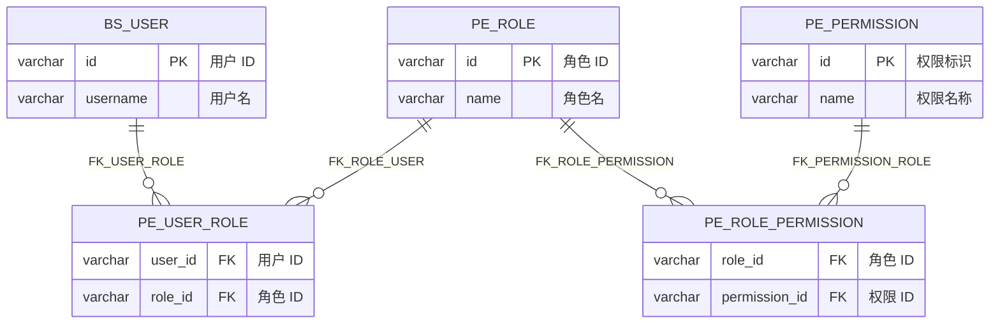

# RBAC 落库五张表：三张主表管身份，两张中间表管关系

RBAC 的思想说清楚了，下一步是回答数据库怎么建。整套模型拆到表这一层其实非常干净：用户、角色、权限各一张主表，两处多对多关系各补一张中间表，五张表构成完整的授权模型。这一节按关系分析推出表结构，给出可直接执行的建表语句，并对照课程里真实存在的 JPA 实体验证这套设计。

## 先给结论

- 两处多对多决定表数量：用户与角色多对多，角色与权限多对多，各需一张中间表，合计五张表。
- 主表只放身份与属性，中间表只放两个外键字段，不放业务含义，也不设业务主键。
- 本课实体的真实表名是 `bs_user`、`pe_role`、`pe_permission`、`pe_user_role`、`pe_role_permission`，由 JPA 注解映射而非 SQL 脚本建表。
- 中间表靠复合唯一约束防重复授权，查询用户权限就是五张表按外键 join。
- 权限表还要能同时表达菜单、按钮、API 三类控制点，本节先立骨架，细分字段在下一节的 SaaS 需求里展开。

## 一、先数关系，再定表

建模顺序是先关系后表。一个用户可以是管理员、人事经理、招聘专员、薪酬专员中的多个，一个角色下面也能容纳很多用户，用户与角色是多对多。角色到权限同理：一个角色可以有系统设置、雇员管理、招聘管理等多个权限，而雇员管理这个权限，人事经理能用，薪酬专员也可能要用，角色与权限同样多对多。

关系数据库不直接支持多对多，标准解法是为每条多对多关系补一张中间表，表里存两头的主键。于是五张表的格局定下来了：



图里三张主表各自独立，两张中间表像四枚钉子把关系钉住，外键名沿用了讲义表结构里的 `FK_USER_ROLE`、`FK_ROLE_USER`、`FK_ROLE_PERMISSION`、`FK_PERMISSION_ROLE` 命名。一个用户拥有若干角色，每个角色拥有若干权限，「用户、角色、权限」的授权模型就此成表。

## 二、三张主表：身份与属性各归各位

主表字段在讲义的表结构图里给得很克制：用户表是用户 ID 加用户名，角色表是角色 ID 加角色名，权限表是权限标识加权限名称。ID 统一 varchar(64)，名称统一 varchar(40)。这是教学用的最小骨架，实际项目会在主表上补业务字段，课程实体的真实定义比 PPT 丰富得多（节选自资料包实体类，包名已改为 `com.example`）：

```java
@Entity
@Table(name = "bs_user")
public class User implements Serializable {
    @Id
    private String id;
    private String mobile;            // 手机号
    private String username;          // 用户名
    private String password;          // 密码
    private Integer enableState;      // 启用状态 0 禁用 1 启用
    private String companyId;         // 所属企业 id，SaaS 多租户的关键字段

    // 用户与角色多对多，中间表 pe_user_role
    @JsonIgnore
    @ManyToMany
    @JoinTable(name = "pe_user_role",
            joinColumns = {@JoinColumn(name = "user_id", referencedColumnName = "id")},
            inverseJoinColumns = {@JoinColumn(name = "role_id", referencedColumnName = "id")})
    private Set<Role> roles = new HashSet<Role>();
}
```

`companyId` 这类字段是多租户场景的痕迹，角色表里同样有：一个角色属于哪个企业，决定了它只在那个企业内生效。骨架与业务字段分层理解，表结构图负责关系，实体类负责完整字段，两不冲突。

## 三、建表语句：五张表一次建齐

课程用 JPA 注解管理表结构，没有随资料包提供 SQL 脚本。下面这份 DDL 按实体注解的字段与讲义表结构补全，MySQL 方言，可直接执行：

```sql
-- 示例 DDL：按本课实体的表名与字段补全，非课程原始脚本
CREATE TABLE bs_user (
    id         VARCHAR(64)  PRIMARY KEY,
    username   VARCHAR(40)  COMMENT '用户名',
    mobile     VARCHAR(20)  COMMENT '手机号',
    company_id VARCHAR(64)  COMMENT '所属企业 id'
) ENGINE = InnoDB DEFAULT CHARSET = utf8mb4;

CREATE TABLE pe_role (
    id         VARCHAR(64)  PRIMARY KEY,
    name       VARCHAR(40)  COMMENT '角色名',
    company_id VARCHAR(64)  COMMENT '所属企业 id'
) ENGINE = InnoDB DEFAULT CHARSET = utf8mb4;

CREATE TABLE pe_permission (
    id          VARCHAR(64) PRIMARY KEY,
    name        VARCHAR(40) COMMENT '权限名称',
    type        INT         COMMENT '权限类型 1 菜单 2 功能 3 API',
    code        VARCHAR(64) COMMENT '权限编码'
) ENGINE = InnoDB DEFAULT CHARSET = utf8mb4;

CREATE TABLE pe_user_role (
    user_id  VARCHAR(64) NOT NULL,
    role_id  VARCHAR(64) NOT NULL,
    PRIMARY KEY (user_id, role_id),
    KEY FK_ROLE_USER (role_id),
    CONSTRAINT FK_USER_ROLE FOREIGN KEY (user_id) REFERENCES bs_user (id),
    CONSTRAINT FK_ROLE_USER FOREIGN KEY (role_id) REFERENCES pe_role (id)
) ENGINE = InnoDB DEFAULT CHARSET = utf8mb4;

CREATE TABLE pe_role_permission (
    role_id       VARCHAR(64) NOT NULL,
    permission_id VARCHAR(64) NOT NULL,
    PRIMARY KEY (role_id, permission_id),
    KEY FK_PERMISSION_ROLE (permission_id),
    CONSTRAINT FK_ROLE_PERMISSION FOREIGN KEY (role_id) REFERENCES pe_role (id),
    CONSTRAINT FK_PERMISSION_ROLE FOREIGN KEY (permission_id) REFERENCES pe_permission (id)
) ENGINE = InnoDB DEFAULT CHARSET = utf8mb4;
```

两个设计点值得圈出来。**中间表的复合主键就是防重复的闸门。** `(user_id, role_id)` 做联合主键，同一用户对同一角色的授权记录只能存在一条，重复插入直接报错，不需要业务代码先查后插。**外键名与讲义图一致。** 四个 FK 约束把删除行为也管起来了：角色还有用户持有时不加级联就删不掉，从数据库层面挡住悬挂关联。

## 四、查一次权限，验证整条链路

表建好后，RBAC 模型的正确性可以用一次查询检验：给定一个用户，把他能用的权限全部取出来。路径严格沿着模型图走，用户、用户角色、角色、角色权限、权限五张表依次 join（示例 SQL，按本课表名补全）：

```sql
SELECT DISTINCT p.id, p.name, p.type, p.code
FROM bs_user u
JOIN pe_user_role ur        ON ur.user_id = u.id
JOIN pe_role r              ON r.id = ur.role_id
JOIN pe_role_permission rp  ON rp.role_id = r.id
JOIN pe_permission p        ON p.id = rp.permission_id
WHERE u.id = '1';
```

结果集就是该用户的全部权限。给用户加角色，往 `pe_user_role` 插一行；给角色加权限，往 `pe_role_permission` 插一行；收回权限，删中间表的行。所有授权动作都落在两张中间表的增删上，主表数据保持稳定。

## 五、留一个伏笔：权限到底是什么

表结构收工之前，课程抛出一个必须想清楚的问题：前后端分离的系统里，权限究竟指什么。用户在页面上看到的是菜单，点进页面后遇到的是操作按钮，按钮背后发出去的是 API 请求，这三样都得能控。权限表若只有名称和编码，撑不住三种粒度的差异，菜单需要图标与排序，按钮需要样式与状态，API 需要请求路径与请求方式。课程资料里的实体已经给出了答案的方向，权限按类型拆出三张子表：

```java
@Entity
@Table(name = "pe_permission")
public class Permission implements Serializable {
    @Id
    private String id;
    private String name;        // 权限名称
    private Integer type;       // 权限类型 1 菜单 2 功能 3 API
    private String code;        // 权限编码
    private String pid;         // 父级权限，支撑菜单树
}
```

主表放公共字段，type 区分菜单、功能、API 三类，各类型的专属字段由 `pe_permission_menu`、`pe_permission_point`、`pe_permission_api` 三张子表承接，主表 id 即子表主键。这套细分结构正是为下一节的 SaaS 权限需求准备的。

## 常见误区

- **中间表漏建或塞业务字段**：没有中间表就只能靠逗号拼接的字符串存角色列表，查询与约束全废；中间表里加创建时间之外的业务字段同样多余，它只负责表达关系。
- **中间表不加复合唯一约束**：同一对 user 与 role 插入多条记录，权限计算虽然能去重，但数据越积越脏，授权审计也对不上账。联合主键或唯一索引是标配。
- **用整型自增 ID 关联**：多表之间用各自生成的自增号做主键，跨库迁移与数据合并时会撞号。本课五张表统一 varchar(64) 的雪花风格 ID，就是为了在 SaaS 多租户与分库场景下不冲突。
- **删除主表数据不查中间表**：直接删角色，`pe_role_permission` 里的授权记录变成孤儿，用户权限查询 join 不上就悄悄丢权限。删前先清理或校验中间表，外键约束会替你把关。

## 面试可能被问到的问题

1. 面试官追问：「RBAC 模型一般要建几张表，分别是什么？」
   答：基础模型五张表：用户表、角色表、权限表三张主表，加上用户角色中间表与角色权限中间表。两处多对多各对应一张中间表，表里通常只有两个外键字段加联合主键。

2. 面试官追问：「多对多为什么必须引入中间表？」
   答：关系数据库里一张表的一行只能表达两个实体间的一条记录，多对多关系无法在两张主表内部表达。中间表把关系实体化，一行就是一条授权记录，既支持一个用户多个角色，也支持一个角色多个用户，还能加约束与审计字段。

3. 面试官追问：「查询一个用户的全部权限，SQL 怎么写？」
   答：以用户表为起点，join 用户角色中间表、角色表、角色权限中间表、权限表，按用户 id 过滤后取权限字段并去重。五张表串起来的 join 路径与 RBAC 模型图完全一致。

4. 面试官追问：「中间表的联合主键和外键约束各防住了什么？」
   答：联合主键防重复授权，同一对用户与角色的记录只能有一条，重复插入被数据库拒绝。外键约束防悬挂引用，主表记录仍被中间表引用时不加级联就删不掉，从存储层挡住脏数据。

5. 面试官追问：「权限表既要管菜单又要管按钮和接口，怎么设计？」
   答：主表放公共字段并用 type 区分权限类型，菜单、按钮、API 各建一张子表放专属字段，子表主键与主表 id 相同。查询时按 type 关联对应子表，既能保持单一权限表做授权关联，又不让字段互相冗余。

## 配套资料

- 用户实体真实文件（表名 bs_user，@JoinTable 映射中间表 pe_user_role）：`materials/code/02/day03 SaaS-HRM系统用户权限设计概述/SaaS-HRM系统用户权限设计概述/资源/工具代码/实体类/User.java`
- 角色实体真实文件（表名 pe_role，@JoinTable 映射中间表 pe_role_permission）：`materials/code/02/day03 SaaS-HRM系统用户权限设计概述/SaaS-HRM系统用户权限设计概述/资源/工具代码/实体类/Role.java`
- 权限主表与三张子表的真实实体：`materials/code/02/day04 权限分配与jwt概述/权限分配与jwt概述/资源/实体类/Permission.java`、同目录 `PermissionMenu.java`、`PermissionPoint.java`、`PermissionApi.java`
- 课程用 JPA 注解建表，无 SQL 脚本资料包，文中 DDL 与查询示例按本课实体表名与主流写法补全
