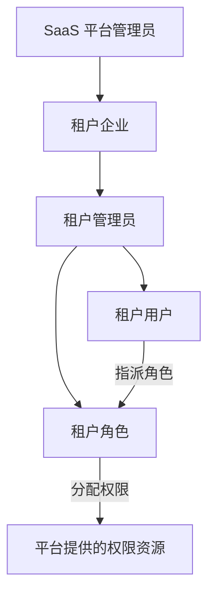

# SaaS 平台的权限需求：平台管资源，租户管分配，前后端各守一道门

RBAC 模型解决的是「一个系统内部怎么授权」，把它搬进 SaaS 平台，问题立刻多出一个维度：平台上同时住着几十家企业，每家都有自己的管理员、自己的角色、自己的员工，谁也不能碰谁的地盘，而菜单和接口又必须全平台共用一套。带着「权限到底要控住哪些东西」这个悬念做需求分析，会发现答案分成三层角色和三类资源，前后端各守一道门。

## 先给结论

- SaaS 平台的基本元素有五类：平台管理员、租户企业、租户管理员、租户角色、租户用户，一层管一层。
- 菜单、按钮、API 这三类权限资源由平台侧提供并维护，租户拿到手只做分配，分配途径依然是 RBAC。
- 前端控制两样：菜单按角色动态加载，操作按钮按权限显隐。
- 前端控制只是体验层，网页源代码里能看到全部 API 地址，接口安全必须由后端独立校验。
- 最终目标：判断一个登录者时，菜单权限、按钮权限、API 权限三个问题都要答得上来。

## 一、五类基本元素：一层管一层

SaaS 平台里的人不是平铺的，讲义里的基本元素图给出了一条清晰的指挥链：



**平台管理员站在最顶层**，负责整个平台的日常运行和维护，管的是用户日志、租户账号这类平台级事务。有一条铁律：平台管理员不能干扰各个租户企业的运行，只能访问有限的模块。平台管理员看到的是租户管理界面，看看有多少企业申请入驻、做相应的审核操作，而组织架构、员工档案这些租户内部的菜单，他一个都不该看到。

**租户企业**是能访问平台的企业，企业之间相对独立。数据因此分成两类：共享数据是全平台统一的菜单和权限定义，相对独立的数据是每个企业自己的角色、自己的用户。**租户管理员**是企业内部的最高权限者，登录后做三件事：添加租户角色、添加租户用户、指派关系（给角色配权限、给用户派角色）。**租户角色**是企业内设的岗位，人事经理、招聘专员，每个企业可以起不一样的名字、配不一样的权限。**租户用户**就是日常登录系统干活的员工，他的权限完全来自被指派的角色。

## 二、权限资源归平台，分配动作归租户

元素理清后会冒出一个关键问题：权限本身在哪。答案是平台侧。理由很朴素：所有开发都在平台这边完成，只有平台知道系统里有哪些菜单、哪些页面按钮、哪些 API 接口。比如组织管理菜单下挂着哪些接口，只有写这些代码的平台方才清楚。

所以分工是固定的：**平台管理员维护整个系统的菜单和权限清单，租户管理员只能在这个清单里做选择题。** 企业内部的人员管理动作，本质都是对平台已有权限的重新组合，走的形式还是 RBAC 那两步：给角色分配权限，给用户指派角色。租户不能自己造一个平台不存在的菜单，也不能给角色配一个系统里没有的接口权限，这既保证了全平台升级时权限清单统一演进，也保证了某个租户配错权限不会污染别人的系统。

## 三、前端两道控制：菜单与按钮

需求落到前端，是两个显隐问题。

**菜单动态加载。** 不同的人登录后看到的导航不一样，菜单不能写死在页面里，要登录后按角色向后端拉取再渲染。菜单请求在课程前端的 api 层有真实定义：

```javascript
// api/base/menus.js：菜单资源走独立接口
export const list = data => createAPI('/base/menus', 'get', data)
```

登录者是什么角色，`/base/menus` 就返回他能看到的菜单集合。平台管理员拉到的是租户管理等平台模块，租户员工拉到的是组织架构、员工管理这些企业模块，同一套页面代码，渲染出两种完全不同的导航。

**按钮按权限显隐。** 菜单进得去，页面里的操作还得再分一层。组织架构页面上有导入导出、添加部门、删除部门一排操作，管理员角色全都能用，普通员工进来只该看到部门列表，连操作列都没有。控制方式就是按钮上做权限判断，有权限才渲染，没有连 DOM 都不生成。

## 四、前端控不住的部分：接口必须自己把关

前端做完两道控制，离安全还差关键一步。网页再怎么藏按钮、藏菜单，底层全靠 HTML 元素，任何人在浏览器里右键查看源代码，菜单项、按钮、甚至每个按钮背后请求的 API 地址都明明白白写在里面。地址看得到，工具带上登录凭证直接发请求，前端精心做的显隐瞬间被绕过。

这个漏洞决定了权限控制必须有第二道门：**后端对每个到达的接口请求做权限校验**，检查当前这个人有没有该接口的访问权。于是目标完整了，前端控制菜单与按钮，负责把不该出现的东西不展示，让普通用户用得舒服；后端控制接口访问，负责把不该发生的请求拦下来，让绕过页面的攻击者进不来。前后端校验的是同一份权限数据，菜单权限、按钮权限、API 权限三个层面各管各的，缺一层就有一个裸奔的入口。

## 五、模型升级：用户、角色、权限之外再加资源

三类控制点要进权限表，RBAC 的骨架不变，权限这一层需要能区分类型。课程实体的解法是在权限主表上打类型标记，再把各类型的专属字段拆到子表：

```java
public class PermissionConstants {
    // 权限类型 1 为菜单 2 为功能 3 为 API
    public static final int PY_MENU = 1;
    public static final int PY_POINT = 2;
    public static final int PY_API = 3;
}
```

API 类权限的子表字段最有代表性（实体类节选，包名已改为 `com.example`）：

```java
@Entity
@Table(name = "pe_permission_api")
public class PermissionApi implements Serializable {
    @Id
    private String id;          // 与权限主表 id 一致
    private String apiUrl;      // 接口地址
    private String apiMethod;   // 请求方式
    private String apiLevel;    // 等级 1 通用接口权限 2 需校验接口权限
}
```

`apiUrl` 加 `apiMethod` 正好唯一定位一个后端接口，后端拦截器拿请求的路径和方法去权限集合里查，查到放行，查不到拒绝。菜单类权限靠主表的 `pid` 组织成树给前端渲染，按钮类权限靠 `code` 供页面判断显隐。这就是讲义里说的「用户、角色、权限、资源」授权模型：RBAC 三件套之上，权限按资源类型细分，三类资源对应前端菜单、前端按钮、后端接口三道关卡。

## 常见误区

- **把前端隐藏当安全**：按钮不渲染、菜单不加载就以为接口安全了，实际上 API 地址就在源代码里。前端显隐只做体验，真正的访问控制必须落在后端接口校验上。
- **租户自己定义权限**：租户管理员创建了角色就以为能配任意权限，实际可选项只有平台提供的权限清单。权限资源的增删改是平台管理员的职责，租户只做分配。
- **所有租户共用一套角色**：角色表带 `companyId` 字段，说明角色是企业内部数据，A 公司的人事经理和 B 公司的人事经理可以是两个权限完全不同的角色。查询与授权都要带租户条件，否则越权就在这一步发生。
- **平台管理员拥有全部权限**：平台管理员管平台运维，看租户账号与日志，但不能进租户的组织架构改人家数据。平台侧与租户侧的模块边界要在权限清单里固化下来。

## 面试可能被问到的问题

1. 面试官追问：「SaaS 多租户系统的权限设计与传统单体系统有什么区别？」
   答：多了一层租户隔离。角色与用户都要挂企业标识，授权范围限制在本租户内；菜单、按钮、API 等权限资源全平台统一由平台方维护，租户只能分配不能新增。校验时要同时回答「有没有这个权限」和「是不是本租户的数据」两个问题。

2. 面试官追问：「前端已经按权限控制了菜单和按钮，后端为什么还要再校验一遍？」
   答：前端的显隐建立在 HTML 元素上，查看源代码就能拿到全部 API 地址，构造请求即可绕过页面。前端控制服务于体验，后端校验服务于安全，接口层要独立验证登录者是否持有该接口权限，二者共用一份权限数据但各自把关。

3. 面试官追问：「菜单、按钮、API 三类权限怎么统一建模？」
   答：权限主表存公共字段并用 type 区分三类，1 菜单 2 功能 3 API，各类型的专属字段拆到子表，子表主键与主表 id 一致。菜单子表放图标排序，按钮子表放样式状态，API 子表放接口地址与请求方式。授权关联只发生在主表上，结构不因类型增多而膨胀。

4. 面试官追问：「权限校验放在系统的哪一层做比较合适？」
   答：原则是贴近资源入口做统一拦截。单体应用常用过滤器或 AOP 切面在 Controller 之前校验，微服务架构通常在网关或认证层统一处理，避免每个接口各自实现一遍。校验依据是登录态中携带的权限集合，来源是 RBAC 五张表查出的结果。

5. 面试官追问：「租户管理员离职后，他配置的权限怎么办？」
   答：权限分配记录在中间表里，与具体的人解耦。人离职禁用账号即可，他创建的角色、配置的角色权限关系仍然属于企业资产，由新的租户管理员接管调整。若角色本身有问题，改角色权限列表或删除角色，持有该角色的用户权限随之变化。

## 配套资料

- 菜单接口真实文件（`/base/menus` 五个 CRUD 函数）：`materials/code/02/day04 权限分配与jwt概述/权限分配与jwt概述/资源/前端代码/api/base/menus.js`
- 权限类型常量真实文件（1 菜单 2 功能 3 API）：`materials/code/02/day04 权限分配与jwt概述/权限分配与jwt概述/资源/通用代码/工具类/PermissionConstants.java`
- API 权限子表真实实体（apiUrl、apiMethod、apiLevel 字段）：`materials/code/02/day04 权限分配与jwt概述/权限分配与jwt概述/资源/实体类/PermissionApi.java`
- 权限主表真实实体（type、code、pid 字段）：`materials/code/02/day04 权限分配与jwt概述/权限分配与jwt概述/资源/实体类/Permission.java`
- 本课为需求分析课，无后端校验代码资料包，文中拦截校验思路为按本课模型推演
