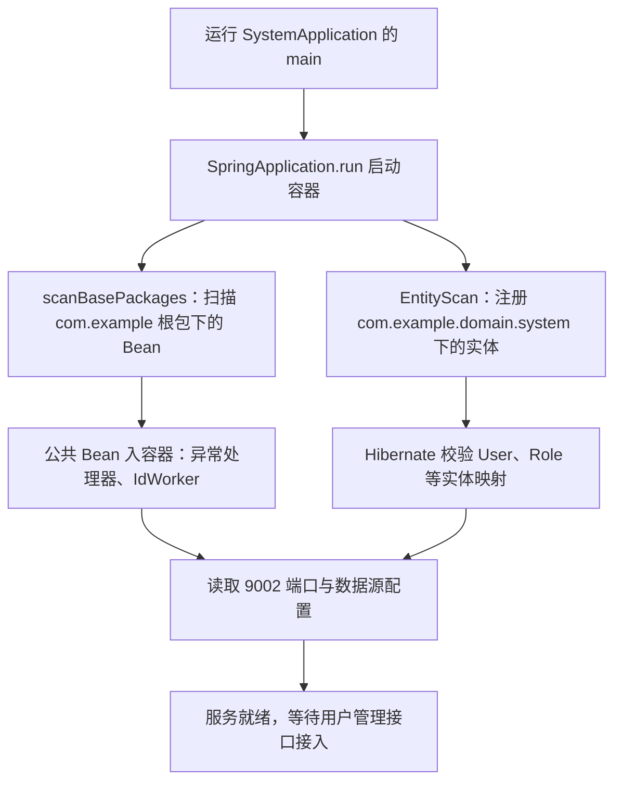

# 搭建系统微服务：用户、角色、权限的代码有了自己的地盘

权限模型设计完，接下来要让用户管理真正能跑。用户、角色、权限这些元素的增删改查不会塞进企业微服务里，它们在系统里自成一个领域，归口到一个新的系统微服务。搭法与企业服务如出一辙：一个 Maven 模块、一份 `application.yml`、一个启动类，差别只在端口、服务名和实体扫描的包，而实体扫描这一处恰恰是最容易照抄出错的地方。

## 先给结论

- 新模块 `hrm-system` 挂在父工程下，依赖四组坐标：JPA 起步依赖、MySQL 驱动、公共工具模块、公共实体模块。
- 配置文件定四件事：端口 9002，服务名 `hrm-system`，连接数据库，JPA 行为开关；所有微服务当前共用一个库，分库是后续章节的活。
- 启动类两个注解：`scanBasePackages` 扫整个 `com.example` 根包，`@EntityScan` 只指向 `com.example.domain.system`，绝不能沿用企业服务写的 company 包。
- IdWorker 以 `@Bean` 注册进容器，保存用户时用它生成主键。

## 一、用户管理要做什么：先看表再动手

用户管理的范围是用户的基本增删改查，操作对象是 `bs_user` 表。这张表字段不少，但建表阶段已定型，真正影响代码设计的是两组字段：

```sql
CREATE TABLE `bs_user` (
  `id` varchar(40) NOT NULL COMMENT 'ID',
  `mobile` varchar(40) NOT NULL COMMENT '手机号码',
  `username` varchar(255) NOT NULL COMMENT '用户名',
  `password` varchar(255) DEFAULT NULL COMMENT '密码',
  `enable_state` int(2) DEFAULT '1' COMMENT '启用状态 0是禁用,1是启用',
  `department_id` varchar(40) DEFAULT NULL COMMENT '部门ID',
  `company_id` varchar(40) DEFAULT NULL COMMENT '企业ID',
  `department_name` varchar(40) DEFAULT NULL,
  PRIMARY KEY (`id`),
  UNIQUE KEY `idx_user_phone` (`mobile`) USING BTREE
) ENGINE=InnoDB DEFAULT CHARSET=utf8mb4
```

（DDL 为节选，员工档案类字段如入职时间、工号、聘用形式在后续员工管理章节才用得上。）

**第一组是企业归属字段。** `company_id` 与 `company_name` 标记这个用户属于哪家租户企业，用户必然归属某一个企业，这是 SaaS 多租户数据隔离的锚点，后面所有用户查询都要带企业条件。

**第二组是部门归属字段。** `department_id` 标记用户从属于哪个部门，另外存了一份 `department_name` 冗余列，列表页展示时免去连表。这两个字段当前允许为空，因为「分配部门」是用户创建之后的独立动作，员工列表页按「已分配、未分配」筛选时正是拿它做空值判断。

角色表、权限表、菜单表等其余表格在资料包里已随实体类一并提供，结构完全遵守前一篇的八表设计，无需再逐张分析。

## 二、建模块与四组坐标

在父工程下 New Module 建一个 Maven 模块 `hrm-system`，然后引入依赖（包名已改为 `com.example`）：

```xml
<parent>
    <artifactId>hrm_parent</artifactId>
    <groupId>com.example</groupId>
    <version>1.0-SNAPSHOT</version>
</parent>
<artifactId>hrm-system</artifactId>
<dependencies>
    <!-- JPA 起步依赖 -->
    <dependency>
        <groupId>org.springframework.boot</groupId>
        <artifactId>spring-boot-starter-data-jpa</artifactId>
    </dependency>
    <!-- MySQL 驱动 -->
    <dependency>
        <groupId>mysql</groupId>
        <artifactId>mysql-connector-java</artifactId>
    </dependency>
    <!-- 公共工具：IdWorker、统一返回结构、统一异常处理器 -->
    <dependency>
        <groupId>com.example</groupId>
        <artifactId>hrm-common</artifactId>
        <version>1.0-SNAPSHOT</version>
    </dependency>
    <!-- 公共实体：User、Role、Permission 等实体类都在里面 -->
    <dependency>
        <groupId>com.example</groupId>
        <artifactId>hrm-domain</artifactId>
        <version>1.0-SNAPSHOT</version>
    </dependency>
</dependencies>
```

与企业服务的坐标几乎一模一样，这是有意的：微服务的骨架依赖是套路化的，变的只有业务模块本身。版本号一处不写，前两个由 Spring Boot 父工程仲裁，后两个是本地 SNAPSHOT 模块随父工程走。

## 三、application.yml：9002 端口上的 hrm-system

```yaml
server:
  port: 9002                         # 企业服务占 9001，系统服务顺延一位
spring:
  application:
    name: hrm-system                 # 服务名，注册与调用都认它
  datasource:
    driver-class-name: com.mysql.jdbc.Driver
    url: jdbc:mysql://localhost:3306/hrm_db?useUnicode=true&characterEncoding=utf8
    username: root
    password: 111111
  jpa:
    database: MySQL
    show-sql: true
    open-in-view: true
```

URL 指向的库与企业服务是同一个：所有微服务现阶段共用一套库，用户、角色、权限、企业的表全在里面。共享库在微服务架构里是权宜之计，数据层面的隔离要靠「各服务只碰自己的表」这条纪律维持，彻底的分库改造留在后续章节处理。学习阶段先共用，能把精力集中在服务边界的划分上。

## 四、启动类：注解相同，指向不同

```java
package com.example.system;

import com.example.common.utils.IdWorker;
import org.springframework.boot.SpringApplication;
import org.springframework.boot.autoconfigure.SpringBootApplication;
import org.springframework.boot.autoconfigure.domain.EntityScan;
import org.springframework.context.annotation.Bean;

// 1. 配置 Spring Boot 的包扫描
@SpringBootApplication(scanBasePackages = "com.example")
// 2. 配置 JPA 实体的包扫描
@EntityScan(value = "com.example.domain.system")
public class SystemApplication {

    // 启动方法
    public static void main(String[] args) {
        SpringApplication.run(SystemApplication.class, args);
    }

    @Bean
    public IdWorker idWorker() {
        return new IdWorker();
    }
}
```

与企业服务的启动类逐行对比，注解还是一个没变，变的只有两处指向，而这两处正是新服务最容易翻车的地方。

**`scanBasePackages` 扫的是整个根包。** 值写 `com.example` 而不是 `com.example.system`，因为公共模块里还有要进容器的 Bean：统一异常处理器、工具类配置都住在 `com.example.common` 下，扫描范围收得太窄它们就进不来。企业服务同理，这个值在两个服务里是同一个。

**`@EntityScan` 指向的是本服务自己的实体包。** 企业服务写 `com.example.domain.company`，系统服务必须改成 `com.example.domain.system`。实体模块里两个包的实体都在，JPA 只该管本服务的那一半；照抄不改的话，容器里注册的全是企业实体，User、Role 这些实体根本没被识别，DAO 一创建就报找不到持久化类型。

`IdWorker` 以 `@Bean` 注册，用户保存时注入它生成雪花主键。从运行 `main` 方法到服务就绪的链路如下：



两条扫描线依旧互不重叠：Bean 扫描管容器对象，实体扫描管持久化类型。系统服务与企业服务并排跑起来，一个占 9001 一个占 9002，微服务家族又添了一员。

## 常见误区

- **`@EntityScan` 照抄企业服务没改包**：值还停在 `com.example.domain.company`，启动时实体的注册集合里没有 User，注入 UserDao 直接失败。每个服务新建后，第一件事就是把实体扫描包改成自己的 `domain.<模块>`。
- **端口照抄 9001**：两个服务抢同一个端口，后启动的报 `Port already in use`。微服务各自独占端口，建新服务先在配置文件里把端口顺延。
- **`scanBasePackages` 收窄成自己的包**：写 `com.example.system` 看着更精确，代价是公共模块的异常处理器、工具 Bean 全部失联，接口抛异常时返回的成了原始堆栈而不是统一结构。扫描根包保持 `com.example` 不动摇。
- **模块建在了父工程外面**：pom 里没有 `<parent>` 声明，Spring Boot 版本仲裁与公共模块的版本全失效，各种依赖版本对不上。新建模块必须挂在父工程之下。

## 面试可能被问到的问题

1. 面试官追问：「为什么用户、角色、权限要单独拆一个系统微服务，而不是并进企业服务？」
   答：它们是平台级的通用领域，企业、部门属于租户的组织数据，用户与权限属于系统安全领域，变化节奏与复用方都不同。拆开后企业服务专心做组织架构，系统服务同时支撑认证、授权等多个场景，边界清晰才谈得上独立部署与独立演进。

2. 面试官追问：「多个微服务共用一个数据库有什么风险？」
   答：服务之间通过表产生了隐式耦合，任何一个服务改表结构都可能波及别人，事务边界也含混。短期靠「谁的业务表谁维护」的纪律约束，长期应拆库，让每个服务只访问自己的数据，跨服务取数走接口或事件。

3. 面试官追问：「`scanBasePackages` 与 `@EntityScan` 的区别？」
   答：前者是 Spring 的组件扫描，管 `@Service`、`@Component` 这类容器 Bean 的注册；后者是 JPA 的实体扫描，管 `@Entity` 标注的持久化类注册。两套机制配置项独立，多模块工程里 Bean 在公共模块、实体在实体模块，两个扫描范围都要显式指定。

4. 面试官追问：「微服务的 `application.name` 命名有什么讲究？」
   答：它是服务在注册中心与调用链里的唯一身份，命名要与业务语义对应且全工程统一风格，比如 `hrm-system`、`hrm-company`。名字一旦对外就别再改，调用方与配置中心都按它索引，改名等于接口变更。

5. 面试官追问：「新服务启动时实体和 DAO 报找不到，排查顺序是什么？」
   答：先看 `@EntityScan` 是否覆盖实体真实所在包，再看实体类是否漏了 `@Entity` 注解或实体模块没被依赖进来，最后确认 DAO 接口的泛型与实体一致。绝大多数案例出在实体扫描范围与实体实际包路径对不上。

## 配套资料

- 系统服务实体类（拷入公共实体模块后由本服务扫描）：`materials/code/02/day03 SaaS-HRM系统用户权限设计概述/SaaS-HRM系统用户权限设计概述/资源/工具代码/实体类/User.java` 及同目录 `Role.java`、`Permission.java` 等
- 用户表建表语句：`materials/code/02/day02 SAAS-HRM数据库设计与前端框架/3-3 SAAS-HRM数据库设计与前端框架/资源/ihrm.sql`（`bs_user` 表，含 `idx_user_phone` 唯一索引）
- 同套路微服务成例的 pom 与配置可对照：`materials/code/02/day13-代码生成器实现/day13-代码生成器实现/资源/测试/生成代码路径/ihrm_company/pom.xml`、同目录 `src/main/resources/application.yml`
- 文中 `hrm-system` 模块的 pom、`application.yml` 与启动类按课程演示画面整理，包名与模块名已改为 `com.example` 体系
