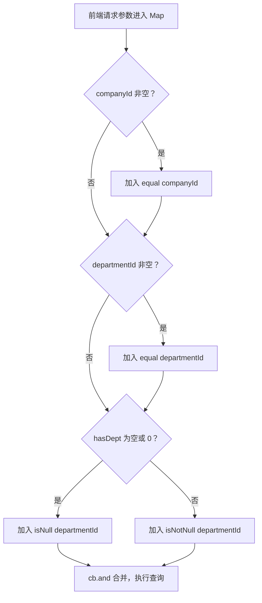

# 用户 Dao 与 Service：默认值补齐、动态条件与分页一个都不能少

> 🔒 安全提示：文中示例的口令/密钥均为课程教学环境演示口径，生产环境的安全要求见《安全与合规须知》。

实体类到位，数据访问的两层代码随之铺开。Dao 是一个空接口，Service 的增删改查大半是对 Dao 的转调，照企业服务的套路敲完毫无悬念。真正值得展开的是两处：保存用户时页面根本不传密码和状态，这三个空着的字段要在 Service 里补上默认值；列表查询带三个可有可无的筛选条件还要求分页，得靠 Specification 动态拼条件，页码还有一个从 0 起算的错位坑。

## 先给结论

- `UserDao` 空接口继承 `JpaRepository` 与 `JpaSpecificationExecutor`，CRUD 与动态查询能力全部现成。
- 保存用户在 Service 里补三个默认值：IdWorker 生成主键、初始密码 `123456`、启用状态置 1。
- 更新的固定套路是先查再改再存，更新载体永远是从数据库查出的对象。
- 列表查询三个条件动态拼装：`companyId`、`departmentId` 非空才加等值条件，`hasDept` 不传或为 0 查 `departmentId` 为空的未分配用户，为 1 查非空的已分配用户。
- 条件之间用 `cb.and` 合并；分页页码从 0 起算，前端传第 1 页要减 1。

## 一、Dao 层：空接口的扩展点这次真用上了

```java
package com.example.system.dao;

import com.example.domain.system.User;
import org.springframework.data.jpa.repository.JpaRepository;
import org.springframework.data.jpa.repository.JpaSpecificationExecutor;

public interface UserDao extends JpaRepository<User, String>,
        JpaSpecificationExecutor<User> {
}
```

接口体一行代码没有，两个泛型分别是实体与主键类型。企业服务的 Dao 里 `JpaSpecificationExecutor` 只是个预留扩展点，这一次它要正式上岗：用户的列表查询带动态条件，全靠它提供的 `findAll(Specification, Pageable)` 入口。为什么提前继承它，到这里才见分晓。

## 二、保存用户：页面不传的三个字段在 Service 补齐

对照接口文档，新增用户的请求体里有手机号、用户名、部门这些前端填的字段，但密码和启用状态页面上根本没有输入框。这些字段不能空着入库，Service 的 save 方法负责补齐：

```java
@Service
public class UserService {

    @Autowired
    private UserDao userDao;

    @Autowired
    private IdWorker idWorker;

    /**
     * 保存用户
     */
    public void save(User user) {
        // 1.雪花算法生成主键
        String id = idWorker.nextId() + "";
        user.setId(id);
        // 2.页面不传密码，设置初始密码
        user.setPassword("123456");
        // 3.默认启用状态：0为禁用 1为启用
        user.setEnableState(1);
        userDao.save(user);
    }
}
```

三行默认值各有讲究。主键沿用全系统统一的分工：应用层用 IdWorker 生成雪花 id，Dao 只管保存，id 在入库前就确定，后续关联、跳转都拿得到。初始密码 `123456` 是教学演示的明文写法，真实系统入库前必须散列加盐，认证章节会正面处理这个问题。启用状态默认 1，账号一建就能用，禁用是管理员显式的管理动作。

## 三、更新用户：先查再改，载体是查出来的对象

```java
/**
 * 更新用户
 */
public void update(User user) {
    // 1.根据id查询出数据库中的旧对象
    User target = userDao.findById(user.getId()).get();
    // 2.在旧对象上设置要修改的属性
    target.setUsername(user.getUsername());
    target.setPassword(user.getPassword());
    target.setDepartmentId(user.getDepartmentId());
    target.setDepartmentName(user.getDepartmentName());
    // 3.保存修改
    userDao.save(target);
}
```

直接 save 前端传来的对象，请求体没带的字段会以 null 覆盖旧值，用户的入职时间、工号一夜清空。先 `findById` 捞出 `target`，只把页面确实提交的四个字段 set 上去，其余字段维持原值，最后保存 `target` 触发 merge 更新。删除与按 id 查询都是一行转调，`deleteById(id)` 与 `findById(id)`，不再占用篇幅。

## 四、动态查询：Map 传参，Specification 拼条件

列表接口的查询参数有三个，且都有可能不传：`companyId` 按企业查、`departmentId` 按部门查、`hasDept` 区分已分配与未分配部门的用户。条件组合数是 2 的三次方，写死任何一个组合都覆盖不全。做法是 Controller 把参数原样装进 Map 传下来，Service 里用 Specification 按参数有无动态拼装：

```java
/**
 * 根据条件查询用户列表
 */
public List<User> findAll(Map<String, Object> map) {
    // 1.需要查询条件
    Specification<User> spec = new Specification<User>() {
        @Override
        public Predicate toPredicate(Root<User> root, CriteriaQuery<?> cq, CriteriaBuilder cb) {
            List<Predicate> list = new ArrayList<>();
            // 根据请求的companyId构造查询条件
            if (!StringUtils.isEmpty(map.get("companyId"))) {
                list.add(cb.equal(root.get("companyId").as(String.class),
                        (String) map.get("companyId")));
            }
            // 根据请求的departmentId构造查询条件
            if (!StringUtils.isEmpty(map.get("departmentId"))) {
                list.add(cb.equal(root.get("departmentId").as(String.class),
                        (String) map.get("departmentId")));
            }
            // hasDept不传或为0：未分配部门，departmentId为空
            if (StringUtils.isEmpty(map.get("hasDept")) || "0".equals(map.get("hasDept"))) {
                list.add(cb.isNull(root.get("departmentId")));
            } else {
                // hasDept为1：已分配部门，departmentId不为空
                list.add(cb.isNotNull(root.get("departmentId")));
            }
            // 条件之间是并列的与关系
            return cb.and(list.toArray(new Predicate[list.size()]));
        }
    };
    return userDao.findAll(spec);
}
```

`toPredicate` 是拼条件的回调：`root.get("companyId")` 取实体的属性路径，`as(String.class)` 声明类型，`cb.equal` 生成等值条件；`hasDept` 的两个分支用的是 `cb.isNull` 与 `cb.isNotNull`，专判空值，等值条件碰不了 null。散装出来的 `Predicate` 全部塞进 list，`cb.and` 把它们合并成以 AND 连接的完整条件。整个拼装流程如下：



图里三条判断彼此独立，参数缺谁就跳过谁，六个组合共用这一段代码。`StringUtils.isEmpty` 是 Spring 工具包的判空方法，顺手把 null 和空串一起挡掉，比手写 `!= null` 严谨。

## 五、分页：PageRequest 的页码从 0 起算

Spring Data JPA 的 `findAll` 天然支持「条件加分页」的双参数版本，第二个参数传 `Pageable`：

```java
/**
 * 分页查询用户列表
 */
public Page<User> findAll(Map<String, Object> map, int page, int size) {
    // 1.动态查询条件，拼装过程与上一节完全一致
    Specification<User> spec = new Specification<User>() {
        @Override
        public Predicate toPredicate(Root<User> root, CriteriaQuery<?> cq, CriteriaBuilder cb) {
            List<Predicate> list = new ArrayList<>();
            if (!StringUtils.isEmpty(map.get("companyId"))) {
                list.add(cb.equal(root.get("companyId").as(String.class),
                        (String) map.get("companyId")));
            }
            if (!StringUtils.isEmpty(map.get("departmentId"))) {
                list.add(cb.equal(root.get("departmentId").as(String.class),
                        (String) map.get("departmentId")));
            }
            if (StringUtils.isEmpty(map.get("hasDept")) || "0".equals(map.get("hasDept"))) {
                list.add(cb.isNull(root.get("departmentId")));
            } else {
                list.add(cb.isNotNull(root.get("departmentId")));
            }
            return cb.and(list.toArray(new Predicate[list.size()]));
        }
    };
    // 2.分页设置：页码从0开始，前端传1要减1
    Page<User> pageUser = userDao.findAll(spec, PageRequest.of(page - 1, size));
    return pageUser;
}
```

返回的 `Page` 对象里除了当前页数据，还带着总记录数、总页数，前端分页条要的都在里面。两个细节值得单拎出来。

**第一，页码错位。** 前端分页组件习惯从 1 开始数页，`PageRequest` 的页码却从 0 起算，直接把 1 传进去会跳过第一页。所以代码里是 `page - 1`，约定在 Service 层消化掉，Controller 拿到的仍是自然页码。

**第二，构造方式的版本差异。** 老教程里常见 `new PageRequest(page, size)` 的写法，该构造器在 Spring Data JPA 2.x 起已标记废弃，静态工厂 `PageRequest.of` 是如今的正写，效果相同。

## 常见误区

- **`isNull` 与 `isNotNull` 分支写反**：未分配对应 `isNull`（查 `departmentId` 为空的记录），已分配对应 `isNotNull`，两个方法名长得像，一交换，查「未分配」出来的全是已分配的人，而 SQL 又看不出错，只能对着数据集怀疑人生。
- **页码不减 1**：前端点第 1 页，后端按第 2 页查，列表永远从第二条开始，最后一页还得手动补。统一在 Service 层做 `page - 1`。
- **保存用户不补默认密码**：密码字段 null 入库，账号建完了谁都登录不进去。凡页面不提供的必填语义字段，Service 层都要有默认值兜底。
- **Map 取值直接比较**：`map.get("hasDept")` 返回 `Object`，用 `==` 和字面量比较恒为假。先确认类型再比，字符串用 `"0".equals(...)` 且把字面量放前面，null 安全。

## 面试可能被问到的问题

1. 面试官追问：「Spring Data JPA 的 Specification 动态查询原理是什么？」
   答：它是对 JPA Criteria API 的封装。`toPredicate` 回调里拿到 `Root`（实体属性路径）、`CriteriaQuery`（查询骨架）、`CriteriaBuilder`（条件工厂），按运行时参数用 `equal、isNull、like` 等方法拼装 `Predicate`，框架把条件翻译成参数化 SQL。条件在运行期确定，天然适合多条件组合查询。

2. 面试官追问：「查询参数用 Map 传递有什么问题，怎么改进？」
   答：Map 绕过了类型检查，键名拼错编译期发现不了，取值还得手动转型。改进方向是定义查询对象（DTO）承载参数，字段即文档，配合校验注解更稳；课程用 Map 是为了把焦点放在 Specification 的动态拼装上，工程实践建议 DTO。

3. 面试官追问：「`PageRequest` 的页码为什么从 0 开始？」
   答：它底层映射到 SQL 的 `limit` 与 `offset`，offset 的语义是「跳过多少条」，第 0 页偏移 0 条，从 0 计数与偏移量天然对齐。前端组件从 1 计数时，服务层统一做减 1 转换，别把这个差一错误留给每个调用方。

4. 面试官追问：「查「未分配部门的用户」为什么用 `isNull` 而不是 `equal(null)`？」
   答：SQL 里 null 参与 `=` 比较的结果是 unknown，`column = null` 永远查不到数据，判空必须用 `is null`。Criteria API 里对应的表达就是 `cb.isNull(root.get("departmentId"))`，非空则用 `isNotNull`。

5. 面试官追问：「主键为什么在 Service 层生成，而不是交给数据库自增？」
   答：应用层生成后，保存前对象就有完整主键，关联组装、响应返回都不依赖二次查询；雪花 id 趋势递增不扰动索引，且不依赖单库自增，为分库分表留了后路。生成逻辑收敛在 Service 层，Dao 保持纯粹。

6. 面试官追问：「多个 `Predicate` 怎么合并？如果条件间是或关系呢？」
   答：与关系用 `cb.and(Predicate...)`，数组里的条件以 AND 连接；或关系用 `cb.or`。要表达 `(A OR B) AND C` 这种嵌套，把 or 的结果作为一个 `Predicate` 再参与 and 组合即可，Criteria 的组合是可嵌套的。

## 配套资料

- 用户模块 Dao 与 Service 成例（基础 CRUD 版，可对照正文的默认值补齐与动态查询扩展）：`materials/code/02/day13-代码生成器实现/day13-代码生成器实现/资源/测试/生成代码路径/ihrm_company/src/main/java/com/ihrm/system/dao/UserDao.java`、同目录 `service/UserService.java`
- 用户实体：`materials/code/02/day03 SaaS-HRM系统用户权限设计概述/SaaS-HRM系统用户权限设计概述/资源/工具代码/实体类/User.java`
- 用户表结构（`department_id` 允许为空，`hasDept` 判空查询的数据基础）：`materials/code/02/day02 SAAS-HRM数据库设计与前端框架/3-3 SAAS-HRM数据库设计与前端框架/资源/ihrm.sql`
- 文中带默认值补齐与 `hasDept` 分支的 UserService 为按课程演示画面整理的版本，包名已改为 `com.example`；`PageRequest.of` 为现行写法，课程录屏中的 `new PageRequest` 构造器已废弃
