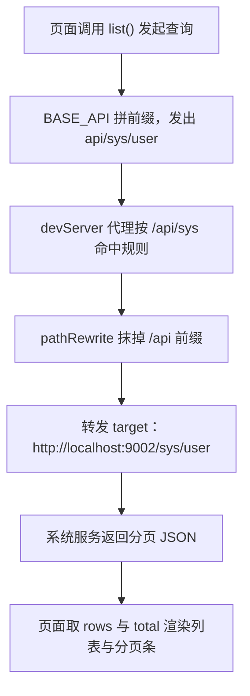

# 员工前端模块落地：复制注册只是开场，devServer 代理分流才是正戏

后端 `/sys/user` 系列接口在 Postman 里全部通过，接下来把用户管理的前端皮接上。员工模块（用户管理在页面上的名字）在资料包里有现成代码，模块复制、注册、api 拷贝都是企业模块和部门模块练过的动作，照搬即可。真正的麻烦在启动之后：企业、组织机构页面一切正常，员工页面却报网络错误，所有请求都发往 9001 端口，而用户接口明明在 9002。单微服务时代把接口地址写死在一个端口上的老配置，面对多个后端服务时失灵了，Vue 开发服务器的代理机制要在这时候顶上来。

## 先给结论

- 动手前先给后端补一刀：分页查询里由服务端把当前企业 id 放进条件 Map，`map.put("companyId", companyId)`，数据隔离的边界不交给前端划。
- 前端模块 `module-employees` 整目录复制进 `src`，`main.js` 两行注册，路由挂 `/employees`，子页面是列表 `index` 与详情 `details/:id`。
- api 拷 `users.js` 到 `api/base`，字典常量拷 `constant/employees.js`，聘用形式、在职状态等下拉数据源就位；新增弹层选部门用的是现成的部门 api。
- 网络错误的根因：`config/dev.env.js` 里 `BASE_API` 写死 `http://localhost:9001`，企业服务占着它，系统服务的接口它够不着。
- 解法是两步：`BASE_API` 改成标志位 `api`，再在 `config/index.js` 的 `proxyTable` 里按前缀把请求分流到 9001 与 9002，抹掉 `/api` 前缀后转发；改配置必须重启开发服务器。

## 一、后端补刀：企业条件由服务端自己放进去

前端模块动手之前，Controller 的分页接口还要改一处。查询条件 Map 是前端传什么就有什么，但「只查本企业」这条铁律不能指望前端自觉，服务端要自己把企业 id 塞进去：

```java
/**
 * 分页查询企业用户列表
 */
@RequestMapping(value = "/user", method = RequestMethod.GET)
public Result findAll(int page, int size, @RequestParam Map<String, Object> map) {
    // 当前企业id由服务端放进查询条件，不依赖前端传参
    map.put("companyId", companyId);
    // 1.调用service完成条件加分页查询
    Page<User> pageUser = userService.findAll(map, page, size);
    // 2.构造分页返回结果
    PageResult<User> pageResult = new PageResult<>(pageUser.getTotalElements(),
            pageUser.getContent());
    // 3.返回结果
    return new Result(ResultCode.SUCCESS, pageResult);
}
```

改完用 Postman 验一遍：`GET localhost:9002/sys/user?page=1&size=10` 传页码 1、每页 10 条，数据正常返回；继续拼上 id 查单条 `/sys/user/{id}`，也没有问题。后端就绪，前端的活才能开始。

## 二、模块落地：复制四件套，注册两行

前端代码不是本阶段的重点，资料包里把员工模块整个准备好了，复制比手写更接近真实工作里的做法（公司里新模块同样是从老模块拷骨架）。把 `module-employees` 拷进工程的 `src` 目录，结构如下：

```text
module-employees/
├── index.js                 # 模块入口，install 时把路由 push 进 asyncRouterMap
├── router/index.js          # 路由：列表 index 与详情 details/:id
├── store/app.js             # 模块级状态
├── pages/index.vue          # 员工列表页
├── pages/details.vue        # 员工详情页
└── components/add.vue       # 新增员工弹层
```

注册动作与部门模块一字不差，`src/main.js` 里 import 之后 `Vue.use`：

```javascript
import employees from '@/module-employees/'
Vue.use(employees, store)
```

路由表定义了访问地址与页面构成，列表和详情是两个子路由：

```javascript
import Layout from '@/module-dashboard/pages/layout'
const _import = require('@/router/import_' + process.env.NODE_ENV)

export default [
  {
    root: true,
    path: '/employees',
    component: Layout,
    name: 'employees',
    meta: {
      title: 'employees',
      icon: 'people'
    },
    children: [
      // 列表
      {
        path: 'index',
        component: _import('employees/pages/index'),
        name: 'employees-index',
        meta: { title: '员工', icon: 'people', noCache: true }
      },
      // 详情
      {
        path: 'details/:id',
        component: _import('employees/pages/details'),
        name: 'details',
        meta: { title: '详情' }
      }
    ]
  }
]
```

列表页 `index.vue` 的结构沿用部门模块的套路：`el-card` 顶部放筛选与按钮区，`el-table` 定义姓名、手机号、工号、聘用形式、部门、入职时间等列，底部分页交给公共组件 `PageTool`，新增员工的表单收在弹层组件 `add.vue` 里，`created` 钩子发起首屏查询。

## 三、api 与字典：把请求函数和下拉数据源配齐

模块之外还要拷两组文件。第一组是用户 api，资料包工具代码里的 `users.js` 放到 `api/base` 目录下：

```javascript
import {createAPI} from '@/utils/request'

export const list = data => createAPI('/sys/user', 'get', data)
export const simple = data => createAPI('/sys/user/simple', 'get', data)
export const add = data => createAPI('/sys/user', 'post', data)
export const update = data => createAPI(`/sys/user/${data.id}`, 'put', data)
export const remove = data => createAPI(`/sys/user/${data.id}`, 'delete', data)
export const detail = data => createAPI(`/sys/user/${data.id}`, 'get', data)
export const assignRoles = data => createAPI(`/sys/user/assignRoles`, 'put', data)
```

路径与后端 `UserController` 的五个接口一一对齐，`simple` 与 `assignRoles` 是给后续功能预留的。第二组是字典常量 `constant/employees.js`，聘用形式、在职状态这些下拉框的数据源全在里面：

```javascript
// api/constant/employees.js（节选）
export default {
  // 聘用形式
  hireType: [
    { id: '1', value: '正式' },
    { id: '2', value: '非正式' }
  ],
  // 在职状态
  workingState: [
    { id: '1', value: '在职' },
    { id: '2', value: '离职' }
  ]
}
```

新增员工弹层里还有一个依赖容易漏：选择所属部门要拉部门树，它用的是部门模块现成的 api。`components/add.vue` 在 `created` 钩子里调部门列表接口，把平铺数据转成树形格式喂给 `el-tree`：

```javascript
created: function() {
  deptApi.list().then(ret => {
    this.depts = commonApi.transformTozTreeFormat(ret.data.data.depts)
  })
}
```

点选树节点时把节点的 `id` 与 `name` 回填进表单的 `departmentId` 与 `departmentName`，部门字段就这样在前端完成了一次跨模块取数。

## 四、网络错误：一个前端要打两个后端

启动开发服务器，刷新页面：demo、企业、组织机构都正常，进员工页面立刻报网络错误。F12 打开网络面板看请求，路径没有错，坏在目的地：请求全打到了 9001。原因是环境配置文件里写死了接口基地址：

```javascript
// config/dev.env.js（原配置）
module.exports = merge(prodEnv, {
  NODE_ENV: '"development"',
  BASE_API: '"http://localhost:9001"'
})
```

`BASE_API` 会被拼在每个请求路径前面。之前只有企业微服务一个后端，指到 9001 万事大吉；现在用户接口在 9002 的系统服务上，员工页面的请求全落空。服务只会越拆越多，把地址写死在一个端口上，每加一个微服务就断一批页面，这条老路走到头了。

## 五、devServer 代理：给请求贴 /api 标签，按前缀分流

Vue 脚手架的开发服务器（webpack devServer）自带代理能力，思路是给所有后端请求换成一个统一的相对标志，再由代理按前缀决定转发给谁。

第一步，`BASE_API` 从完整地址改成标志位：

```javascript
// config/dev.env.js（改后）
module.exports = merge(prodEnv, {
  NODE_ENV: '"development"',
  BASE_API: '"api"'
})
```

改完之后，组件里写的 `/sys/user` 实际发出的是 `api/sys/user` 这样的相对路径，`api` 只是一个可识别的标志，不是地址。

第二步，在 `config/index.js` 的开发配置段写代理规则（资料包未附此文件，代码按课程演示整理为示例）：

```javascript
proxyTable: {
  // 企业、部门等接口：转发给 9001 企业服务
  '/api/company': {
    target: 'http://localhost:9001',
    changeOrigin: true,
    pathRewrite: { '^/api': '' }
  },
  // 用户、角色等系统接口：转发给 9002 系统服务
  '/api/sys': {
    target: 'http://localhost:9002',
    changeOrigin: true,
    pathRewrite: { '^/api': '' }
  }
}
```

每条规则的三个字段各司其职：键是请求路径的前缀匹配条件；`target` 是命中的请求要转发到的真实服务；`pathRewrite` 把 `/api` 前缀替换为空，后端收到的是干净的 `/sys/user`，Controller 才能匹配上。一条请求的完整旅程如下：



改的是 config 目录下的文件，它们只在开发服务器启动时读取，热更新救不了，必须重启 `npm run dev`。重启后刷新：组织机构的数据从 9001 来，员工的数据从 9002 来，同一个前端工程同时服务两个后端，代理按前缀分流，页面代码里感受不到任何多服务的存在。

代理规则写错一个逗号、少一个闭合括号，整段配置会静默失效，表现依旧是网络错误或 404。联调时页面取不到数，先怀疑这两处，再去看后端。

## 常见误区

- **`BASE_API` 指死某个服务的端口**：单服务时代的惯性配置。微服务一多，每加一个服务就要断一批页面；统一用标志位加代理分流，服务增减只改代理表。
- **改了 config 不重启**：`dev.env.js` 与 `index.js` 在启动时一次性读取，热更新不覆盖它们，页面怎么刷新都是旧配置。改动 config 后必须重启开发服务器。
- **`pathRewrite` 忘了抹前缀**：代理把 `api/sys/user` 原样转发，后端收到 `/api/sys/user`，Controller 上只有 `/sys/user`，命中不了就是 404。转发到真实地址前，人为添加的路由标志必须去掉。
- **以为代理能管到生产环境**：`proxyTable` 是开发服务器的便利设施，打包后的静态站没有它。生产环境的同款分流要靠 Nginx 反向代理或网关，按同样的前缀约定实现。

## 面试可能被问到的问题

1. 面试官追问：「devServer 的代理为什么能绕开浏览器的跨域限制？」
   答：同源策略限制的是浏览器里发出的请求。代理让页面把请求发给与自己同源的开发服务器，浏览器认为没有跨域；开发服务器是 Node 进程，它在服务端把请求转发给真正的后端，服务与服务的通信不受同源策略约束，跨域被挡在了浏览器之外。

2. 面试官追问：「`pathRewrite` 在什么场景下必须用？」
   答：当请求路径里的人为标志与后端真实路径不一致时。本课的 `api` 前缀只是给代理匹配用的路由标志，后端 Controller 上并没有它，转发前必须重写掉。网关做路由改写、灰度环境加流量标记，用的也是同类机制。

3. 面试官追问：「`BASE_API` 从完整 URL 改成相对标志，除了分流还有什么好处？」
   答：请求变成同源相对路径，开发期彻底摆脱跨域问题；部署时前端不感知后端地址，同一个打包产物可以配不同环境的代理或网关规则；标志位还能统一收口日志与拦截器，比在每个环境文件里维护一串地址干净得多。

4. 面试官追问：「前端页面报 404，Postman 直连后端却是通的，怎么排查？」
   答：先比对自己发出的完整 URL 与后端注解路径，重点看代理规则有没有命中、前缀有没有重写干净；再看请求方法是否一致；最后确认代理配置改动后是否重启过。这类问题的根因几乎都在「浏览器看到的路径」与「后端注册的路径」之间多出来或少掉了一段。

5. 面试官追问：「多环境配置在前端工程里通常怎么管理？」
   答：按环境拆配置文件，开发与生产各一份，里面声明接口基地址等环境量，构建时通过 `process.env` 注入。敏感与易变的环境差异不写进组件代码，组件只引用注入后的常量，切环境不改业务代码。

6. 面试官追问：「解决跨域除了代理还有哪些办法，各适合什么场景？」
   答：后端直接开 CORS，加 `@CrossOrigin` 或全局配置响应头，适合后端可控且前端直连的场景；网关统一配置 CORS，适合微服务集群收口；开发期用 devServer 代理，改动只在本地，不污染后端。三者可以并存，按环境选择。

## 配套资料

- 前端员工模块真实文件（正文模块结构与路由代码出处）：`materials/code/02/day03 SaaS-HRM系统用户权限设计概述/SaaS-HRM系统用户权限设计概述/资源/前端代码/module-employees/`（含 `index.js`、`router/index.js`、`pages/index.vue`、`pages/details.vue`、`components/add.vue`）
- 用户 api 封装：`materials/code/02/day03 SaaS-HRM系统用户权限设计概述/SaaS-HRM系统用户权限设计概述/资源/工具代码/工具/userApi/users.js`
- 字典常量（聘用形式等下拉数据源）：`materials/code/02/day03 SaaS-HRM系统用户权限设计概述/SaaS-HRM系统用户权限设计概述/资源/工具代码/工具/constant/employees.js`
- 部门 api（新增员工弹层选部门所用）：`materials/code/02/day04 权限分配与jwt概述/权限分配与jwt概述/资源/前端代码/api/base/dept.js`
- `dev.env.js` 与 `proxyTable` 属于前端工程的 config 目录，资料包未随附，正文代码为按课程演示画面整理的可运行示例
