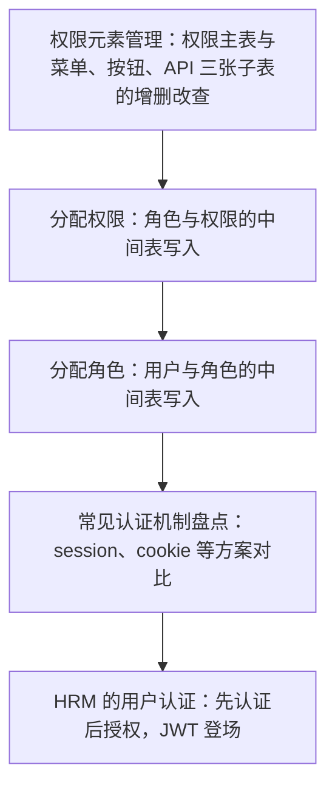

# day04 开篇：角色模块复盘收官，权限分配与认证排上日程

第四天从一份作业讲起：角色的增删改查。它不引入新知识，是把用户模块的四层套路在角色实体上复刻一遍，价值在于检验前面搭模块的方法论是否真的内化，顺带把 RBAC 三要素里的「岗」也管理起来。作业复盘之后，今天的正事是权限：给权限、菜单、按钮、API 这些资源做管理，再把权限分配给角色、把角色分配给用户。元素和关系都齐了，最后回答一个悬了几天的问题：请求进来时，服务端凭什么知道「你是谁」。先认证、后授权，这条线会把 JWT 推到台前。

## 先给结论

- 角色模块四层全部有真实资料：实体 `Role`（`pe_role` 表，name、description、companyId）带两个多对多集合，空接口 Dao，Service 五方法，Controller 五接口。
- 角色更新的固定写法是先查再改，只允许动名称与描述；分页查询带 companyId 条件，条件构造收敛在公共的 Specification 方法里。
- 前端落在 `module-settings`：公司设置页的 el-tabs 挂角色列表组件，新增与修改共用一个 dialog，分配权限的 el-tree 弹层已备好坑位。
- 今天四块正事：权限元素管理（主表加三张子表，双表联动增删）、分配权限、分配角色、常见认证机制盘点与 HRM 认证方案。
- 权限资源是平台公共的，由平台管理员录入，`enVisible` 字段控制租户可见性，这是 SaaS 权限区别于单体应用权限的关键一环。

## 一、作业复盘：角色四层与用户模块逐层对照

角色实体在资料包的工具代码里，字段比 User 少一大截，复杂度全在两个多对多集合上（包名已改为 `com.example`）：

```java
@Entity
@Table(name = "pe_role")
@Getter
@Setter
public class Role implements Serializable {
    private static final long serialVersionUID = 594829320797158219L;

    @Id
    private String id;
    // 角色名
    private String name;
    // 说明
    private String description;
    // 企业id
    private String companyId;

    @JsonIgnore
    @ManyToMany(mappedBy = "roles")
    private Set<User> users = new HashSet<>();   // 角色与用户 多对多，User 侧维护

    @JsonIgnore
    @ManyToMany
    @JoinTable(name = "pe_role_permission",
            joinColumns = {@JoinColumn(name = "role_id", referencedColumnName = "id")},
            inverseJoinColumns = {@JoinColumn(name = "permission_id", referencedColumnName = "id")})
    private Set<Permission> permissions = new HashSet<>();   // 角色与权限 多对多
}
```

`users` 一侧是「被持有」方，`mappedBy` 指回用户实体的 `roles` 字段，中间表 `pe_user_role` 由用户侧维护；`permissions` 一侧是维护方，`pe_role_permission` 中间表在角色保存时由它写。两个集合都挂 `@JsonIgnore`，防止 JSON 序列化时双向递归。

Service 层五个方法与用户模块逐一同构，看两个有细节的：

```java
@Service
public class RoleService {

    @Autowired
    private RoleDao roleDao;

    @Autowired
    private IdWorker idWorker;

    /**
     * 保存角色
     */
    public void save(Role role) {
        // 雪花算法生成主键
        role.setId(idWorker.nextId() + "");
        roleDao.save(role);
    }

    /**
     * 更新角色：先查再改，只允许动名称与描述
     */
    public void update(Role role) {
        Role target = roleDao.findById(role.getId()).get();
        target.setName(role.getName());
        target.setDescription(role.getDescription());
        roleDao.save(target);
    }
}
```

更新的载体永远是从数据库查出来的对象：角色的 id、companyId、两个关联集合都不该被请求体重置，前端传来的 `Role` 只贡献名称与描述两个字段。删除是 `deleteById` 一行转调，按 id 查询是 `findById(id).get()`。分页查询多一个企业条件，条件构造直接复用公共方法：

```java
/**
 * 分页查询：条件交给公共方法构造
 */
public Page<Role> findSearch(String companyId, int page, int size) {
    Specification<Role> spec = getSpec(companyId);
    return roleDao.findAll(spec, PageRequest.of(page - 1, size));
}
```

`getSpec` 是之前封装好的公共方法，传入企业 id 就返回按企业过滤的 `Specification`，页码减一的差一错误也消化在服务层。Controller 层五个接口照葫芦画瓢，保存时企业 id 从 `BaseController` 取：

```java
/**
 * 保存角色
 */
@RequestMapping(value = "/role", method = RequestMethod.POST)
public Result save(@RequestBody Role role) throws Exception {
    // 当前企业id：暂由 BaseController 提供，接入认证后自动解析
    role.setCompanyId(companyId);
    roleService.save(role);
    return new Result(ResultCode.SUCCESS);
}
```

整套代码对照接口文档逐条核过：新增、更新、删除、按 id 查询、分页，路径分别是 `POST /sys/role`、`PUT /sys/role/{id}`、`DELETE /sys/role/{id}`、`GET /sys/role/{id}`、`GET /sys/role`。

## 二、前端：公司设置页签里的角色管理

角色相关的前端代码配置在 `module-settings` 模块里，资料同样下发齐全。api 文件拷到 `api/base` 目录：

```javascript
import {createAPI} from '@/utils/request'

export const list = data => createAPI('/sys/role', 'get', data)
export const add = data => createAPI('/sys/role', 'post', data)
export const update = data => createAPI(`/sys/role/${data.id}`, 'put', data)
export const remove = data => createAPI(`/sys/role/${data.id}`, 'delete', data)
export const detail = data => createAPI(`/sys/role/${data.id}`, 'get', data)
export const assignPrem = data => createAPI(`/sys/role/assignPrem`, 'put', data)
```

模块注册、路由挂载仍是老两步，落点在公司设置页：`pages/index.vue` 用 `el-tabs` 分页签，「角色管理」页签里用动态组件挂上列表组件：

```vue
<el-tabs v-model="activeName" class="topLab">
    <el-tab-pane name="role" class="rInfo">
      <span slot="label">角色管理</span>
      <component v-bind:is="roleList"></component>
    </el-tab-pane>
</el-tabs>
```

列表组件 `role-list.vue` 是一个浓缩版用户列表：表格只有角色名与描述两列，操作列三个按钮（分配权限、修改、删除），底部分页组件照旧。新增与修改共用一个编辑弹层，靠 `formData` 里有没有 id 区分走哪条路：

```javascript
saveOrUpdate() {
  // formData.id 不存在说明是新增，存在说明是修改
  if (this.formData.id == null || this.formData.id == undefined) {
    this.save()
  } else {
    this.update()
  }
}
```

页面上还有一个分配权限的弹层，用 `el-tree` 勾选权限节点，按钮先占着位。它的 api `assignPrem` 已经封装好，但今天权限数据还没就绪，弹层要等权限管理做完才能点亮。跑通后的效果：在公司设置里新增一个角色、改个名字、删除一个角色，全链路无阻。

## 三、今天的路线图：从元素到关系，从关系到验证

RBAC 的三要素「人、岗、资源」里，用户与角色已经管理完毕，资源与关系还是空白。day04 的四块内容正好补齐这条链，再加一个验证环节：



前三块是在给授权攒数据，后两块解决「访问时怎么验明正身」。图上从左到右，每块的产出都是下一块的输入，缺任何一格，权限体系都只能停在纸面。

权限管理这一块有个结构性特点要先想清楚。权限主表 `pe_permission` 之下挂菜单、按钮、API 三张子表，关系是一对一：一条权限记录对应一条菜单记录或一条按钮记录或一条 API 记录。于是权限的增删改查天然是双表联动，新增权限要同步往对应粒度的子表写数据，删除同理，两个表的操作必须在一个流程里完成。

另外两个业务约束也值得先记下。其一，菜单、按钮、API 是全平台一套的公共资源，不由各租户企业自行维护，录入方是平台管理员，企业只能选用；其二，权限带可见性属性 `enVisible`，值为 1 是常规资源，租户企业可见，值为 0 是平台级资源，比如管理 SaaS 平台本身的功能菜单，企业不可见。同一条菜单，平台管理员看得见，租户企业看不见，控制点就在这一个字段上。

## 四、认证为什么排在授权前面：JWT 预热

路线图走到最后一块，才碰到这个系统悬了几天的问题。现在所有接口的企业 id 都由 `BaseController` 提供占位值，接口「知道」当前企业靠的是写死，任何真实的认证都不存在。要让 `companyId`、当前用户这些值真正可信托请求自己带上来，前提是服务端能确认请求者的身份，这就是认证。

老牌方案是 session：登录成功后服务器存一份会话，发一个 cookie 标识，之后每次请求靠 cookie 找回会话。它在单体应用里够用，搬到多端加微服务的场景就吃力：App、小程序对 cookie 的支持参差，服务集群要么共享 session 要么粘性会话，会话的存储与同步本身成了负担。把身份信息直接签进一个令牌、服务端不存状态、每次请求验签即信，这就是 token 方案的思路，具体到这个系统怎么落地，JWT 是主角，下一课正式展开。

先认证、后授权，顺序不可颠倒：身份都没验明，谈何判断它有没有权限。这条因果链就是今天路线图最后两块内容的存在理由。

## 常见误区

- **角色分页漏掉 companyId**：角色按企业隔离，分页不带企业条件会跨租户串数据。企业条件要么进 Specification，要么由 Controller 注入，不能依赖前端自觉。
- **更新角色直接 save 请求体对象**：请求体没带的字段以 null 覆盖旧值，companyId 可能被清掉，多对多集合被误动。先查再改，只 set 名称与描述。
- **急着做分配权限的弹层**：权限数据还没管理起来，el-tree 里没有可勾的节点，`assignPrem` 提交的也是空列表。功能顺序是先元素后关系，跳步没有意义。
- **把 `enVisible` 的语义记反**：1 是常规资源，企业可见；0 是平台级资源，企业不可见。做权限过滤时按这个约定写查询条件，写反了租户会看到平台管理菜单。

## 面试可能被问到的问题

1. 面试官追问：「RBAC 里为什么要专门有角色这一层抽象？」
   答：角色是权限的集合，也是岗位语义的载体。没有它，权限要逐个分配给用户，授权与回收的成本随人数线性增长；有了它，权限先聚合再下发，人员变动只调整用户与角色的关联，权限体系本身保持稳定，审计时也只需检查角色定义这一层。

2. 面试官追问：「JPA 双向多对多怎么防止序列化递归与重复维护？」
   答：序列化递归靠在关联字段上挂 `@JsonIgnore`，两侧都要加，对象转 JSON 时跳过彼此。重复维护靠 `mappedBy`：中间表只由声明 `@JoinTable` 的一方写，另一方声明只读。两侧都声明 `@JoinTable` 会导致保存时中间表被反复操作。

3. 面试官追问：「角色的哪些字段不允许通过更新接口修改，为什么？」
   答：主键 id 决定更新目标，自然不可变；companyId 是数据归属与租户隔离的锚点，随请求体重置会破坏隔离；关联集合属于关系维护，应由专门的分配接口管理，不能藏在通用更新里顺手改。更新接口只开放名称与描述这类纯展示属性。

4. 面试官追问：「session 认证在多端与微服务场景下有什么问题？」
   答：会话状态存在服务端，多端下 cookie 机制在 App 与小程序里支持不一；服务集群要保证会话共享，要么引入集中存储，要么粘性路由，扩展性与可用性都受牵连。token 方案把状态移到客户端，服务端无状态，验签即可信任，天然适配水平扩展。

5. 面试官追问：「认证和授权是什么关系，顺序为什么不能颠倒？」
   答：认证解决「你是谁」，凭据验明身份；授权解决「你能干什么」，依据身份上的角色与权限做判断。授权的所有输入都来自认证结果，身份未验明时授权无从谈起，这也是系统先做登录认证、再做权限校验的原因。

6. 面试官追问：「平台的公共权限资源为什么要和租户数据分开控制可见性？」
   答：菜单、按钮、API 这类资源是全平台一套的运行时骨架，各租户必须看到一致的能力面，不能各自维护出分叉；而平台自身的管理功能（如租户管理）对租户属于敏感内容，必须隐藏。用一个可见性字段区分资源等级，比给每家企业维护一套菜单省事得多，也避免了越权看到平台功能的入口。

## 配套资料

- 角色实体（正文代码出处）：`materials/code/02/day03 SaaS-HRM系统用户权限设计概述/SaaS-HRM系统用户权限设计概述/资源/工具代码/实体类/Role.java`
- 角色前端 api：`materials/code/02/day04 权限分配与jwt概述/权限分配与jwt概述/资源/前端代码/api/base/role.js`（`api/role.js` 与之同内容）
- 公司设置页签与角色列表组件：`materials/code/02/day04 权限分配与jwt概述/权限分配与jwt概述/资源/前端代码/module-settings/pages/index.vue`、`components/role-list.vue`
- 角色 Controller、Service 成例（基础版，可对照正文补默认值与公共条件方法的增强版）：`materials/code/02/day13-代码生成器实现/day13-代码生成器实现/资源/测试/生成代码路径/ihrm_company/src/main/java/com/ihrm/system/controller/RoleController.java`、`service/RoleService.java`
- 权限实体（`enVisible` 可见性字段所在）：`materials/code/02/day04 权限分配与jwt概述/权限分配与jwt概述/资源/实体类/Permission.java`
- 正文 `getSpec` 公共条件方法与角色 Service 增强版为按课程演示整理的写法，包名统一改为 `com.example`
