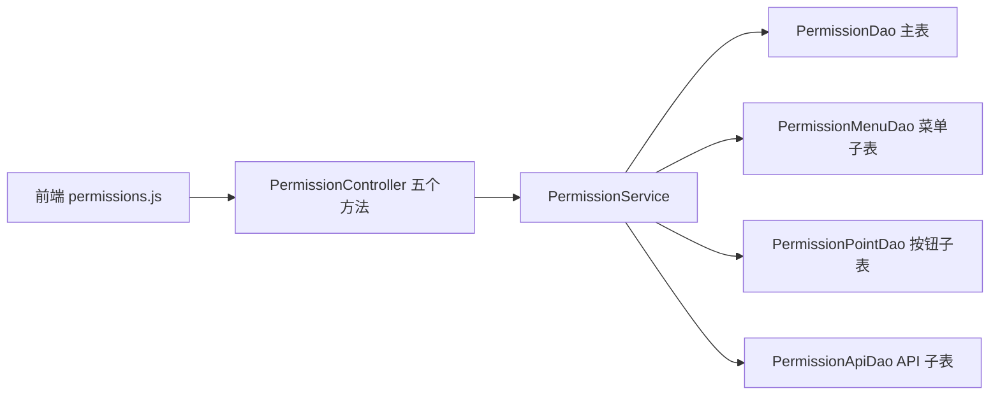

# 权限模块的五个接口与两层骨架：一个请求体装下三种权限

实体和 Dao 就位，按老套路该写 Controller 和 Service 了。接口文档却先泼了盆冷水：保存权限的请求体里，既有菜单的 `menuOrder`，又有按钮的 `pointClass`，还有 API 的 `apiMethod`，一个方法怎么同时服务三种实体？把五个接口的契约逐条读懂，这个疑问就解开了大半：请求体是三种实体字段的并集，服务端收到后按 type 决定每个字段流向哪张表。本课先把接口清单理清楚，再搭起 Controller 与 Service 的骨架，业务逻辑留给下一课填。

## 先给结论

- 权限模块五个接口：`POST /sys/permission` 保存、`GET /sys/permission` 列表、`GET /sys/permission/{id}` 详情、`PUT /sys/permission/{id}` 更新、`DELETE /sys/permission/{id}` 删除。
- 保存与更新的请求体是三种权限字段并集，服务端用 `Map<String, Object>` 接收，没有哪个单一实体能全接住。
- 列表接口三个可选参数：`type`（0 表示菜单加按钮一起查）、`pid`（父权限 id）、`enVisible`（可见性过滤）。
- Controller 声明五个方法，Service 注入四个 Dao 并声明同名方法，方法体留空等下一课实现。
- 类级路径前缀 `/sys` 对应系统微服务，前端 api 文件按同样前缀封装请求。

## 一、API 清单：读文档就是在读数据流

五个接口摆在一起，权限模块的形状就出来了：

| 方法 | 路径 | 关键参数 | 说明 |
|---|---|---|---|
| POST | `/sys/permission` | 请求体为字段并集 | 保存，按 type 分流写表 |
| GET | `/sys/permission` | type、pid、enVisible | 列表查询，无分页 |
| GET | `/sys/permission/{id}` | id | 详情，响应按 type 补齐资源属性 |
| PUT | `/sys/permission/{id}` | id 加请求体并集 | 更新 |
| DELETE | `/sys/permission/{id}` | id | 删除 |

保存接口的请求体把三种实体的字段铺在同一个 JSON 里（示例值，字段以接口文档为准）：

```json
{
  "name": "员工管理",
  "code": "EMS",
  "description": "员工管理菜单",
  "type": "1",
  "pid": "0",
  "enVisible": "1",
  "menuOrder": "1",
  "menuIcon": "fa fa-users",
  "pointClass": "",
  "pointIcon": "",
  "pointStatus": "",
  "apiUrl": "",
  "apiMethod": "",
  "apiLevel": ""
}
```

一个请求既能保存菜单权限，又能保存按钮权限，还能保存 API 权限，服务端靠 `type` 区分：1 菜单、2 按钮、3 API。type 不同，请求体里有意义的字段也不同，这就是为什么响应和请求都要「按类型提供属性」。详情接口同理：返回的 JSON 里，type 决定了菜单字段、按钮字段还是 API 字段是有值的。

前端 api 文件与这份清单一一对应，还封装了一个根据有无 id 自动二选一的方法：

```javascript
import {createAPI} from '@/utils/request'

const api = "/sys/permission"
export const list = data => createAPI(`${api}`, 'get', data)
export const add = data => createAPI(`${api}`, 'post', data)
export const update = data => createAPI(`${api}/${data.id}`, 'put', data)
export const remove = data => createAPI(`${api}/${data.id}`, 'delete', data)
export const detail = data => createAPI(`${api}/${data.id}`, 'get', data)
export const saveOrUpdate = data => {return data.id?update(data):add(data)}
```

`saveOrUpdate` 用 `data.id` 是否存在区分新增与更新，与后端 POST、PUT 两个接口严格对应。前端只认这份契约，后端的实现顺序不影响联调。

## 二、Controller：五个方法先立起来

为什么 Controller 先写？因为 Service 的逻辑眼下有点复杂，先把接口层的形状定死，联调的锚点就有了。权限控制器照着用户控制器改出来，五个注解位置不变：

```java
// 1.解决跨域
@CrossOrigin
// 2.声明 restController
@RestController
// 3.设置访问路径，系统微服务统一前缀
@RequestMapping(value = "/sys")
public class PermissionController {

    @Autowired
    private PermissionService permissionService;

    /**
     * 保存权限
     */
    @RequestMapping(value = "/permission", method = RequestMethod.POST)
    public Result save(@RequestBody Map<String, Object> map) throws Exception {
        permissionService.save(map);
        return new Result(ResultCode.SUCCESS);
    }

    /**
     * 查询权限列表
     */
    @RequestMapping(value = "/permission", method = RequestMethod.GET)
    public Result findAll(@RequestParam Map map) {
        List<Permission> list = permissionService.findAll(map);
        Result result = new Result(ResultCode.SUCCESS);
        result.setData(list);
        return result;
    }

    /**
     * 根据 id 查询权限
     */
    @RequestMapping(value = "/permission/{id}", method = RequestMethod.GET)
    public Result findById(@PathVariable(value = "id") String id) {
        Permission permission = permissionService.findById(id);
        return new Result(ResultCode.SUCCESS, permission);
    }

    /**
     * 更新权限
     */
    @RequestMapping(value = "/permission/{id}", method = RequestMethod.PUT)
    public Result update(@PathVariable(value = "id") String id, @RequestBody Map<String, Object> map) throws Exception {
        // 路径上的 id 并入参数集合
        map.put("id", id);
        permissionService.update(map);
        return new Result(ResultCode.SUCCESS);
    }

    /**
     * 根据 id 删除权限
     */
    @RequestMapping(value = "/permission/{id}", method = RequestMethod.DELETE)
    public Result delete(@PathVariable(value = "id") String id) {
        permissionService.deleteById(id);
        return new Result(ResultCode.SUCCESS);
    }
}
```

三个细节值得圈出来。其一，保存与更新都用 `Map<String, Object>` 接请求体，并集字段没有归属实体，先原样收下。其二，更新接口把路径变量塞进 map：请求体里的字段是并集，id 可以由路径提供得更可靠，Service 拿到的始终是完整参数集。其三，`@CrossOrigin` 解决开发期前后端分离端口不同导致的跨域问题，这是从企业模块一路沿用下来的固定配置。

## 三、Service：注入四个 Dao 的空架子

Service 层这一课只搭架子：五个方法与五个接口同名对应，方法体留空，四个 Dao 先注入齐。

```java
@Service
public class PermissionService {

    @Autowired
    private PermissionDao permissionDao;
    @Autowired
    private PermissionMenuDao permissionMenuDao;
    @Autowired
    private PermissionPointDao permissionPointDao;
    @Autowired
    private PermissionApiDao permissionApiDao;

    // save、update、deleteById、findById、findAll：方法体下一课补全
}
```

四个 Dao 一个不少，这是权限模块与企业、用户模块最大的结构差异：权限操作天然双表联动，主表加一张随 type 变化的子表。整条数据通路长这样：



一个 Service 同时握四个 Dao，全部写表动作都从它出发。骨架立住之后，接口签名就冻结了：save 与 update 接 `Map`，findAll 接 `Map` 返回 `List`，后两课只往方法体里填肉，不再动签名。

## 常见误区

- **用 Permission 实体直接接保存请求体**：`menuOrder`、`pointClass` 这些字段在 Permission 里根本不存在，前端传了也悄悄丢掉。并集参数用 `Map` 接，字段分配交给 Service。
- **POST 与 PUT 忘了 `@RequestBody`**：JSON 进不了方法，Map 是空集合但不报错，最终静默存了一条几乎全空的权限，比抛异常难查得多。
- **列表接口照抄用户模块加 page 和 size**：权限列表的契约没有分页，全量返回，多出来的分页参数既误导前端，也让方法签名背上个用不上的负担。
- **丢了 `/sys` 前缀**：前端 `createAPI` 请求的是 `/sys/permission`，网关按前缀把流量路由到系统微服务，控制器只写 `/permission` 会让请求 404。

## 面试可能被问到的问题

1. 面试官追问：「保存接口为什么用 Map 接收参数，而不是设计一个并集 DTO？」
   答：请求体是三种权限字段的并集，字段全集有十几个，但一次请求里只有一种类型有值。用 Map 收下再按 type 分配，配合 Map 转实体的工具类，避免维护一个大量字段常年为空的 DTO。设计一个并集 DTO 配合 BeanUtils 也能实现，两者取舍在于字段校验的严格程度与代码可读性。

2. 面试官追问：「同一个路径挂不同 HTTP 方法，这种 RESTful 设计有什么好处？」
   答：`/sys/permission` 上挂 GET 与 POST，`/{id}` 上挂 GET、PUT、DELETE，资源语义集中在 URL 上，方法表达操作意图，接口数量减半，前后端对接口的记忆成本也低。权限控制还能按「资源加方法」统一拦截，比如对同一资源放行 GET、收紧 DELETE。

3. 面试官追问：「`@CrossOrigin` 解决的是什么问题，原理是什么？」
   答：浏览器同源策略下，端口不同的前端页面请求后端属于跨域请求，会被浏览器拦截响应。`@CrossOrigin` 让 Spring 在响应头里写入 `Access-Control-Allow-Origin` 等 CORS 头，声明允许该来源访问。它只对浏览器行为生效，Postman 这类客户端不存在跨域概念。

4. 面试官追问：「统一响应体 Result 加 ResultCode 的设计动机是什么？」
   答：所有接口返回同一种结构：success 标志、code 状态码、message 提示、data 数据。前端只需要一套解析逻辑，异常信息经统一异常处理器转成同样的结构返回，避免每个接口各自约定成功失败的格式。状态码枚举集中在 ResultCode 里，语义可查。

5. 面试官追问：「Controller 为什么不直接调 Dao，中间要隔一层 Service？」
   答：Controller 的职责是协议适配：接参数、校验、组响应；业务规则与多表操作属于 Service。本模块一次保存要写两张表、按 type 分流，这些细节必须收在 Service 里，才能保证换一个入口（比如定时任务、消息消费）时业务规则不重写。Controller 里只有转调，事务边界也天然落在 Service 方法上。

## 配套资料

- 前端 api 清单：`materials/code/02/day04 权限分配与jwt概述/权限分配与jwt概述/资源/前端代码/api/base/permissions.js`（`api/permissions.js` 与之同内容）
- day13 代码生成器产出的成例（实体参数版，类级路径无 `/sys` 前缀，可对照差异）：`materials/code/02/day13-代码生成器实现/day13-代码生成器实现/资源/测试/生成代码路径/ihrm_company/src/main/java/com/ihrm/system/controller/PermissionController.java`、`service/PermissionService.java`
- 统一响应与状态码：`materials/code/02/day01 SAAS-HRM系统概述与搭建环境/SAAS-HRM系统概述与搭建环境/资源/通用代码/common/Result.java`、`ResultCode.java`
- 正文 Controller、Service 骨架按本课视频写法整理（day04 资料包未含这两层源文件），请求体 JSON 为示例，包名统一改为 `com.example`
