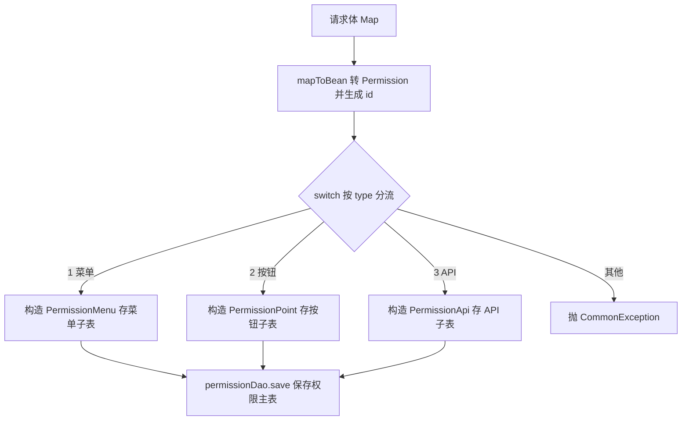

# 权限的保存与更新：一次请求写两张表的 switch 分流

骨架立好了，往里填业务。权限保存与用户、企业保存最大的不同在于：请求体是三种实体的字段并集，落到数据库却只允许主表加一张子表。字段怎么拆、两张表的主键怎么对齐、更新时哪些要先查哪些可以直接改，全部收在 Service 的一个方法里。把 save 写通，update 就是同一套动作换个顺序再来一遍。

## 先给结论

- 保存分三步：Map 转 Permission 并生成 id、按 type 构造资源对象写入子表、最后保存 Permission 本体。
- Map 转实体用 `BeanMapUtils.mapToBean`，基于 Spring 自带的 cglib BeanMap，实体属性名与 Map 的 key 一致才赋上值。
- 资源对象的 id 必须显式 set 成权限 id，共享主键靠代码对齐，两张表的归属关系全在这一行。
- 更新时 Controller 把路径上的 id 塞进 map；权限主表先查再改公共字段，资源对象 id 已知直接保存，省一次查询。
- type 不是 1、2、3 时抛 `CommonException`，快速失败优于静默半保存。

## 一、保存：一个 Map 拆成两张表

Controller 已经把请求体收成 `Map<String, Object>`，Service 拿到后按既定步骤走。整个流程一张图先看清：



对应到代码，save 方法的完整实现（包名已改为 `com.example`）：

```java
/**
 * 1.保存权限
 */
public void save(Map<String, Object> map) throws Exception {
    // 设置主键的值
    String id = idWorker.nextId() + "";
    // 1.通过 Map 内容创建 permission 对象
    Permission perm = BeanMapUtils.mapToBean(map, Permission.class);
    perm.setId(id);
    // 2.根据类型选择不同的资源对象（菜单，按钮，api）
    int type = perm.getType();
    switch (type) {
        case PermissionConstants.PY_MENU:
            PermissionMenu menu = BeanMapUtils.mapToBean(map, PermissionMenu.class);
            menu.setId(id);
            permissionMenuDao.save(menu);
            break;
        case PermissionConstants.PY_POINT:
            PermissionPoint point = BeanMapUtils.mapToBean(map, PermissionPoint.class);
            point.setId(id);
            permissionPointDao.save(point);
            break;
        case PermissionConstants.PY_API:
            PermissionApi api = BeanMapUtils.mapToBean(map, PermissionApi.class);
            api.setId(id);
            permissionApiDao.save(api);
            break;
        default:
            throw new CommonException(ResultCode.FAIL);
    }
    // 3.保存权限
    permissionDao.save(perm);
}
```

**第一，公共对象先构造。** 不管保存的是菜单、按钮还是 API，权限主表的公共字段一定有，所以第一步把 Map 转成 `Permission`，id 由 IdWorker 雪花算法生成。构造对象不再一个个 `map.get` 再 set，靠的就是 Map 转实体的工具类。

**第二，资源对象按类型构造。** switch 的分支依据是 `perm.getType()`，每个分支做同样三件事：Map 转对应子实体、setId 与权限 id 对齐、save 落子表。字段归属在这里自然完成：转 `PermissionMenu` 时只有 `menuIcon`、`menuOrder` 能对上属性，其余 key 被忽略。

**第三，主表最后保存。** 资源都落库了，千万别忘了权限本身。这一步漏掉，子表有数据、主表没记录，列表接口查不到，详情接口 404，数据从此对不上账。

## 二、两个工具类：转换与常量

Map 转实体的活由 `BeanMapUtils` 承担，它基于 Spring 内置的 cglib `BeanMap` 实现：

```java
public class BeanMapUtils {

    /**
     * 将对象属性转化为 map 集合
     */
    public static <T> Map<String, Object> beanToMap(T bean) {
        Map<String, Object> map = new HashMap<>();
        if (bean != null) {
            BeanMap beanMap = BeanMap.create(bean);
            for (Object key : beanMap.keySet()) {
                map.put(key + "", beanMap.get(key));
            }
        }
        return map;
    }

    /**
     * 将 map 集合中的数据转化为指定对象的同名属性中
     */
    public static <T> T mapToBean(Map<String, Object> map, Class<T> clazz) throws Exception {
        T bean = clazz.newInstance();
        BeanMap beanMap = BeanMap.create(bean);
        beanMap.putAll(map);
        return bean;
    }
}
```

`BeanMap.create(bean)` 把实体包装成一个按属性名读写的视图，`putAll` 时逐个 key 匹配实体属性，名字对得上就通过 setter 赋值。两个关键推论：前端字段名必须与实体属性名完全一致，写错就静默丢值；Map 里多余的 key（比如为另一种类型准备的字段）会被自然忽略，这正是「一个请求体服务三种实体」能成立的原因。

switch 里的分支常量来自 `PermissionConstants`，用常量替代魔法数字：

```java
public class PermissionConstants {
    /**
     * 权限类型 1为菜单 2为功能 3为API
     */
    public static final int PY_MENU = 1;
    public static final int PY_POINT = 2;
    public static final int PY_API = 3;
}
```

type 判断散落在 Controller、Service 多处的日子里，这三个常量让「1 是什么」只有一个出处。default 分支抛出的 `CommonException` 是公共模块早就备好的业务异常，传入 `ResultCode.FAIL` 枚举，统一异常处理器会把它转成标准错误响应。

## 三、更新：权限先查再改，资源直接保存

更新的 Controller 已把路径 id 并进 map，Service 的 update 与 save 长得几乎一样，多了一个「先查」的动作：

```java
/**
 * 更新权限
 */
public void update(Map<String, Object> map) throws Exception {
    Permission perm = BeanMapUtils.mapToBean(map, Permission.class);
    // 1.通过传递的权限 id 查询权限
    Permission permission = permissionDao.findById(perm.getId()).get();
    // 2.设置权限属性
    permission.setName(perm.getName());
    permission.setCode(perm.getCode());
    permission.setDescription(perm.getDescription());
    permission.setEnVisible(perm.getEnVisible());
    // 3.根据类型更新对应的资源对象
    int type = perm.getType();
    switch (type) {
        case PermissionConstants.PY_MENU:
            PermissionMenu menu = BeanMapUtils.mapToBean(map, PermissionMenu.class);
            menu.setId(perm.getId());
            permissionMenuDao.save(menu);
            break;
        case PermissionConstants.PY_POINT:
            PermissionPoint point = BeanMapUtils.mapToBean(map, PermissionPoint.class);
            point.setId(perm.getId());
            permissionPointDao.save(point);
            break;
        case PermissionConstants.PY_API:
            PermissionApi api = BeanMapUtils.mapToBean(map, PermissionApi.class);
            api.setId(perm.getId());
            permissionApiDao.save(api);
            break;
        default:
            throw new CommonException(ResultCode.FAIL);
    }
    // 4.更新权限
    permissionDao.save(permission);
}
```

主表与子表在这里走了两条不同的路线，理由值得说透。主表先查再改：更新载体是从数据库查出的托管对象，只在它上面覆盖名称、编码、描述、可见性四个公共字段，请求体没带的字段天然维持原值。子表直接保存：编辑表单按类型渲染，该类型的资源字段前端全量提交，不存在「没传被覆盖成 null」的风险；资源 id 又与权限 id 相同、不必查就知道，直接构造带 id 的对象 save，省掉一次查询。

这条权衡的反面是：直接 save 一个 new 出来的对象走的是 merge，JPA 会先按主键查一次再全字段合并，未赋值的属性就可能以 null 覆盖旧值。资源对象敢这么写，前提是字段全量提交；主表不敢，因为公共字段可能只改其中一两项。

## 常见误区

- **方法末尾漏掉 `permissionDao.save(perm)`**：save 分支只写了子表，主表没有这条权限，列表查不出来，删也删不干净。两张表的动作必须同属一个流程。
- **资源对象不 setId**：共享主键靠这一行对齐，漏了它，子表记录与主表 id 对不上，按权限 id 查详情、删权限都找不到资源记录。
- **前端字段名与实体属性名对不上**：`menuOrder` 写成 `menu_order`，`mapToBean` 不会报错，只会静默跳过，字段值悄悄丢失。联调时字段对不上先查命名。
- **更新接口允许改 type**：switch 按新 type 写新子表，旧类型的资源记录成了孤儿数据。本系统权限类型创建后不可变，前端编辑弹层按原 type 渲染；要支持改类型，得先清理旧子表记录再写新表。

## 面试可能被问到的问题

1. 面试官追问：「一次请求写两张表，怎么保证原子性？」
   答：理想做法是在 Service 方法上加 `@Transactional`，任一步抛异常整体回滚，主表子表要么都有要么都没有。成例里两次 save 各自提交，属于教学简化；生产环境必须补上事务注解，否则子表成功、主表失败的中间态无法自动恢复。

2. 面试官追问：「BeanMap 转换的原理是什么，有什么局限？」
   答：cglib 的 BeanMap 把实体包装成 Map 视图，读写都走 getter 和 setter，不碰字段本身，所以受访问器约束。局限有二：属性名与 key 必须完全一致，不一致就静默跳过；`clazz.newInstance()` 要求目标类有无参构造。类型不匹配的赋值会抛异常，需要在入口做参数校验。

3. 面试官追问：「JPA 的 persist 和 merge 有什么区别？」
   答：persist 面向新实体，主键不存在时执行 insert；merge 面向分离态实体，先按主键 select，把改动合并进持久化上下文再 update。直接 save 一个 new 出来且带 id 的对象走的是 merge 路径，未赋值属性可能以 null 覆盖库中旧值，这就是更新操作推崇先查再改的原因。

4. 面试官追问：「为什么更新资源对象不先查，更新权限却要先查？」
   答：依据是「请求体是否全量」。资源字段由按类型渲染的表单全量提交，直接构造带 id 的对象保存没有覆盖风险，还省一次查询；权限公共字段可能只提交部分，先查出托管对象再覆盖，未提交字段保持原值。判据永远是数据完整性，不是习惯。

5. 面试官追问：「switch 按 type 分流，如果资源类型继续增多怎么办？」
   答：类型数量稳定且分支逻辑同构时，switch 是最直白的选择；类型开始膨胀或每个分支出现差异化校验时，可以演进成策略模式：按 type 注册各自的构造与保存逻辑，新增类型只加一个实现类。本系统类型固定为菜单、按钮、API 三种，没有过度设计的必要。

## 配套资料

- Map 与实体互转工具类、权限类型常量：`materials/code/02/day04 权限分配与jwt概述/权限分配与jwt概述/资源/通用代码/工具类/BeanMapUtils.java`、`PermissionConstants.java`
- day13 成例（实体参数版 save/update，可对照本课 Map 参数版差异）：`materials/code/02/day13-代码生成器实现/day13-代码生成器实现/资源/测试/生成代码路径/ihrm_company/src/main/java/com/ihrm/system/service/PermissionService.java`、`controller/PermissionController.java`
- 业务异常使用的状态码枚举：`materials/code/02/day01 SAAS-HRM系统概述与搭建环境/SAAS-HRM系统概述与搭建环境/资源/通用代码/common/ResultCode.java`
- 正文 save、update 为按本课视频写法整理并补全的示例（day04 资料包未含 Service 层源文件），包名统一改为 `com.example`
