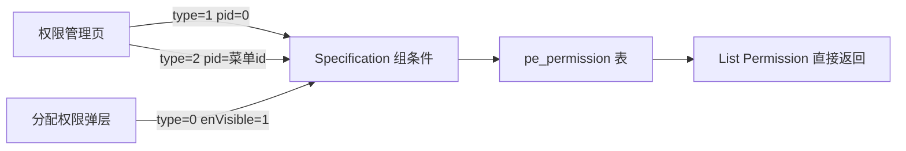

# 权限列表查询：pid 拉子节点，enVisible 分租户，一个 in 条件合并两种类型

保存与更新写完，剩下的列表查询看着最简单，参数却一个比一个有讲究：type 传 0 不是「查无此类型」，而是要一次取回菜单和按钮两种记录；pid 传 0 不是空值，而是「顶级菜单」这个合法条件；enVisible 的两个取值更直接决定租户能不能看到平台的管理菜单。这三件事都收敛在一个不分页、直接返回实体列表的接口里，Specification 动态拼条件是唯一的实现路径。

## 先给结论

- 列表接口 `GET /sys/permission`，参数 type、pid、enVisible 全部可选，不传查全部，返回 `List<Permission>`，没有分页。
- pid 是权限树的钥匙：顶级菜单 pid 为 0，展开某个菜单的按钮、查看某个菜单的 API，都靠 pid 等于父权限 id 来查。
- enVisible 的语义：1 企业可见，0 平台私有（企业看不到），不传则全部返回。接口文档里「0 查询全部」的说法并不准确。
- type 为 0 是组合查询：用 `in (1, 2)` 一次取回菜单与按钮，`CriteriaBuilder.in` 负责构造。
- 返回结构直接用主表实体：公共字段全在 `pe_permission`，实体属性与响应字段一一对应，不需要 DTO 组装。

## 一、三个参数，三种过滤

把三个参数的含义先钉死：

| 参数 | 含义 | 典型取值 |
|---|---|---|
| type | 权限类型过滤 | 0 菜单加按钮，1 菜单，2 按钮，3 API |
| pid | 父权限 id | 0 查顶级菜单，其余查指定节点下的子权限 |
| enVisible | 可见性过滤 | 1 企业可见，0 平台私有，不传查全部 |

enVisible 值得多解释几句，因为文档的描述误导过人。它的真实语义是 SaaS 双向隔离的开关：平台管理员维护的权限资源里，平台自己的管理功能（比如企业管理菜单）对企业隐藏，这批记录 enVisible 为 0；企业日常使用的权限 enVisible 为 1。反过来，企业内部的用户、权限数据，平台侧的常规查询也不该看见。查询时传 1 拿到的就是企业可见的那部分，传 0 拿到的是平台私有的最高权限，什么都不传才是全部。

前端两处真实调用能把这个接口的用法讲得最清楚。权限管理页首屏拉顶级菜单，点击菜单名展开按钮，弹层里查 API 列表，三次调用各用一组参数：

```javascript
// 首屏：顶级菜单
list({type:1,pid:0}).then(res => {
    this.dataList = res.data.data
})
// 展开某菜单下的按钮（权限点）
list({type:2,pid:id}).then(res => {
    // 子权限按行插入当前菜单下方
    for(var i = 0 ; i <res.data.data.length;i++) {
        this.dataList.splice(index+1,0,res.data.data[i]);
    }
})
// 查看某菜单下的 api 权限
list({type:3,pid:id}).then(res => {
    this.apiList = res.data.data
})
```

给角色分配权限的弹层则是另一种组合：菜单和按钮一起拉，且只要企业可见的：

```javascript
// 分配权限弹层：企业可见的菜单与按钮，供 el-tree 勾选
permApi.list({type:0,pid:null,enVisible:1}).then(res => {
    this.permData = res.data.data
})
```

同一个接口，四组参数，服务端全部用动态条件消化。这正是把查询条件做成 Map 传进 Service 的意义：接口签名不变，参数组合随场景自由变化。

## 二、Service：Specification 动态拼条件

Service 的 findAll 接收参数 Map，返回 `List<Permission>`。条件构造是标准的 Specification 匿名内部类写法，三个参数各占一段：

```java
public List<Permission> findAll(Map<String, Object> map) {
    // 1.准备查询条件
    Specification<Permission> spec = new Specification<Permission>() {
        @Override
        public Predicate toPredicate(Root<Permission> root, CriteriaQuery<?> query,
                                     CriteriaBuilder criteriaBuilder) {
            List<Predicate> list = new ArrayList<>();
            // 根据父权限 id 查询
            if (!StringUtils.isEmpty(map.get("pid"))) {
                list.add(criteriaBuilder.equal(root.get("pid").as(String.class), (String) map.get("pid")));
            }
            // 根据可见状态查询
            if (!StringUtils.isEmpty(map.get("enVisible"))) {
                list.add(criteriaBuilder.equal(root.get("enVisible").as(String.class), (String) map.get("enVisible")));
            }
            // 根据类型查询：0 表示菜单与按钮一起查
            if (!StringUtils.isEmpty(map.get("type"))) {
                String tp = (String) map.get("type");
                CriteriaBuilder.In<Object> in = criteriaBuilder.in(root.get("type"));
                if ("0".equals(tp)) {
                    in.value(1);
                    in.value(2);
                } else {
                    in.value(Integer.parseInt(tp));
                }
                list.add(in);
            }
            return criteriaBuilder.and(list.toArray(new Predicate[list.size()]));
        }
    };
    // 2.执行查询
    return permissionDao.findAll(spec);
}
```

pid 与 enVisible 都是等值匹配，条件存在才往里加，参数是 String 直接比较。真正有分量的是 type 的处理：

**第一，`criteriaBuilder.in(root.get("type"))` 返回一个 `CriteriaBuilder.In` 谓词对象。** 它可以连续调 `value()` 往取值范围里添加值，语义等价于 SQL 的 `type in (?, ?)`。type 传 0 时 `value(1)` 加 `value(2)`，菜单和按钮一条 SQL 全查出来；type 传 1、2、3 时，单个值同样塞进 in，分支代码保持对称。

**第二，Map 里的值全是 String。** GET 参数进 Map 后没有类型信息，`Integer.parseInt(tp)` 把字符串转成整数再交给 in，因为实体的 type 是 `Integer` 字段。三个条件最终 `criteriaBuilder.and` 成一个整体，条件列表为空时就是无条件全查。

整个数据流可以这样看：



图上三条入线对应前端的三种场景，全部落在同一张主表上。没有任何一条路径需要碰子表，这就是返回结构能保持极简的根本原因。

## 三、返回结构：主表实体直接当响应体

列表接口的响应字段是 id、name、type、pid、code、description 这几项，全部是主表字段。设计阶段把三种权限的公共属性都抽进了 `pe_permission`，资源子表里只有图标、排序这类展示细节，列表页恰好只需要公共字段：权限管理页的表格列是名称、权限标识、描述，一个子表字段都没用到。

于是返回结构不需要任何组装：`List<Permission>` 序列化出去，实体属性与响应字段一一对应。要是当年把菜单名留在子表里，这个接口就得联三张表、再手工拼一个聚合 DTO，成本完全不同。公共字段抽得够不够狠，到列表查询这一步才见分晓。

树形展示的分工也值得记一笔：后端只负责「按 pid 查子节点」，整棵树的组装交给前端。权限管理页用点开再查的方式，把子权限插入当前行下方，每层的查询压力都很小；分配权限弹层则一次拉全量（type 0 加 enVisible 1），交给 `el-tree` 自行渲染层级。两种策略共用同一个接口，靠参数组合区分，后端不为任何一个场景单独开接口。

## 常见误区

- **enVisible 语义记反**：把 1 当成平台私有、0 当成企业可见，查询结果刚好相反，租户会看到平台管理菜单，平台侧会看到企业内部权限。以实际数据为准：1 企业可见，0 平台私有。
- **type 传 0 直接 equal 匹配**：`pe_permission` 里没有 type 为 0 的记录，等值查询永远返回空列表。0 是「菜单加按钮」的组合语义，必须翻译成 `in (1, 2)`。
- **把 pid 的 0 当空值过滤掉**：顶级菜单的 pid 就是 0，判空要判断参数是否传递（`StringUtils.isEmpty`），而不是判断值是否为 0，否则首屏永远查不出数据。
- **对 Map 里的值强转 Integer**：GET 参数进 Map 全是 String，`(Integer) map.get("type")` 直接 `ClassCastException`。先 `parseInt` 再参与比较。

## 面试可能被问到的问题

1. 面试官追问：「`CriteriaBuilder.in` 和多个 equal 用 or 连接，有什么区别？」
   答：两者语义等价，`in` 生成 SQL 的 `IN` 子句，多个 equal 用 `or` 生成一串等值条件。`in` 写法集中、取值可循环添加，值多了仍是一个谓词对象；or 连接要手工管理每个分支。取值来自集合时优先用 in，代码和执行计划都更清晰。

2. 面试官追问：「Specification 的三个参数各是什么，怎么配合？」
   答：Root 是实体根，从这里按属性名取路径并声明转换类型；CriteriaQuery 承载最终查询，可设置排序与去重；CriteriaBuilder 是谓词工厂，提供 equal、in、like、and、or 的构造。约定是把条件拼成 `Predicate` 列表再 and 合并返回，框架负责翻译成 SQL。

3. 面试官追问：「GET 请求的多个查询参数在 Spring MVC 里怎么接收？」
   答：控制器方法声明 `@RequestParam Map map`，所有查询参数按 key 收进 Map，适合条件动态的场景；也可以逐个声明 `@RequestParam String type` 之类获得类型安全。本接口条件可选且组合多变，Map 加 Specification 的组合最贴合，代价是取值后要自行处理类型转换。

4. 面试官追问：「权限树是点开再查还是一次全量返回整棵树，怎么选？」
   答：看节点规模与交互形态。点开再查首屏快、每层查询轻，但父子关系依赖前端维护展开状态；一次全量在前端组树，交互流畅、适合一次性勾选全部节点的分配场景。本系统两种并存：管理页按 pid 懒加载，分配弹层用 type 0 加 enVisible 1 拉全量给树组件。

5. 面试官追问：「不分页的全量列表接口，什么情况下会出问题？」
   答：数据量增长后响应体膨胀、序列化与传输成本线性上升，前端渲染也随之变慢。权限这类基础资源总量可控（百级到千级），全量返回可接受，配合按 enVisible、type 过滤能进一步缩小结果集；若资源规模不可控，就需要分页或把热点权限数据放进缓存。

## 配套资料

- 权限管理页真实调用（type 与 pid 的组合）：`materials/code/02/day04 权限分配与jwt概述/权限分配与jwt概述/资源/前端代码/module-permissions/pages/index.vue`
- 分配权限弹层的 enVisible 过滤调用：`materials/code/02/day04 权限分配与jwt概述/权限分配与jwt概述/资源/前端代码/module-settings/components/role-list.vue`
- 权限 Dao（动态查询能力来自 `JpaSpecificationExecutor`）：`materials/code/02/day04 权限分配与jwt概述/权限分配与jwt概述/资源/通用代码/PermissionDao.java`
- day13 成例的 `findAll` 可对照（无条件全查版）：`materials/code/02/day13-代码生成器实现/day13-代码生成器实现/资源/测试/生成代码路径/ihrm_company/src/main/java/com/ihrm/system/service/PermissionService.java`
- 正文 findAll 的 Specification 实现为按本课视频写法整理的示例（day04 资料包未含 Service 层源文件），包名统一改为 `com.example`
