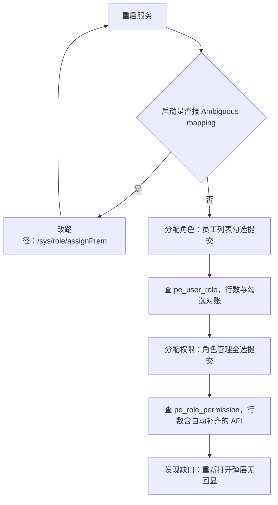

# 分配权限与分配角色联调测试：先过 Ambiguous mapping，再对两张中间表的账

两条分配链路的代码都写完了，联调第一枪就哑了：服务压根启动不起来，控制台抛出一长串 Ambiguous mapping。复制粘贴留下的路径冲突要现挂现修，修完之后真正的测试才开始。这一课的价值不在新知识，在于确立一套验收标准：界面弹出「操作成功」不算数，中间表里多出的那几行才是证据。

## 先给结论

- 启动报 `Ambiguous mapping`：分配权限方法是从分配角色复制来的，请求路径忘了改，两个方法都注册到同一个 URL 加 PUT 上，Spring MVC 直接拒绝启动。
- 修复只需一行：分配权限挂到角色控制器自己的路径 `/sys/role/assignPrem`，与前端封装对齐。
- 测试顺序按依赖方向走：先验证分配角色（写 `pe_user_role`），再验证分配权限（写 `pe_role_permission`），两条链路各自对账。
- 验收证据是中间表数据，不是前端提示；分配权限一行勾选会带出多条记录，因为 API 权限是后端自动补齐的。
- 功能通过后暴露出新的体验问题：重新打开弹层没有回显，之前勾的全空，这是下一课要补的缺口。

## 一、启动就挂：Ambiguous mapping 的来龙去脉

从分配角色复制方法时，最容易漏改的就是 `@RequestMapping` 的路径。两个控制器方法长成这样时，应用直接起不来：

```java
// RoleController 与 UserController 中同时存在同一映射
@RequestMapping(value = "/user/assignRoles", method = RequestMethod.PUT)
public Result save(@RequestBody Map<String, Object> map) { ... }
```

控制台的报错核心是 `IllegalStateException: Ambiguous mapping. Cannot map 'roleController' method ... There is already 'userController' bean method ... mapped`。Spring MVC 在启动阶段就把所有 `@RequestMapping` 注册进 URL 映射表，同一 URL 加同一 HTTP 方法出现两次，框架无法决定请求该交给谁，与其把冲突留到运行期，不如启动时直接失败，这是典型的 fail-fast 设计。

修复办法是把分配权限的方法挂回它该在的位置，路径、语义、归属三者对齐：

```java
// RoleController 中：分配权限
@RequestMapping(value = "/role/assignPrem", method = RequestMethod.PUT)
public Result save(@RequestBody Map<String, Object> map) {
    // 1.获取角色 id
    String roleId = (String) map.get("id");
    // 2.获取权限的 id 列表
    List<String> permIds = (List<String>) map.get("permIds");
    // 3.调用 service 完成权限分配
    roleService.assignPerms(roleId, permIds);
    return new Result(ResultCode.SUCCESS);
}
```

路径的前缀与控制器的 `@RequestMapping("/sys")` 拼接后，完整地址是 `/sys/role/assignPrem`，与前端 `api/base/role.js` 里封装的 `assignPrem` 对齐。这个拼写本身就值得留意：接口方法叫 `assignPerms`（复数），前端函数叫 `assignPrem`（单数），课堂上视频里的路径一度写成 `assignPerm`，两端拼写对不上就是 404，Spring MVC 的路径匹配默认大小写敏感。联调对不上路径时，把前端真实发出的 URL 打出来逐字符比对，比盯着代码猜快得多。改完重启，服务正常拉起。

## 二、分配角色链路：员工列表到 pe_user_role

按依赖顺序先测分配角色。员工列表页的每一行挂着「分配角色」按钮，弹层里是当前企业全部角色的复选框，勾选两个提交，前端调 `assignRoles({id, roleIds})`，请求打到 `/sys/user/assignRoles`。

界面提示「操作成功」只是第一层信号。打开数据库客户端查用户与角色的中间表：

```sql
-- 看用户与角色的关系落没落库
SELECT * FROM pe_user_role;

-- 按某个用户过滤，行数应与该用户当前角色数一致
SELECT * FROM pe_user_role WHERE user_id = '分配时的用户 id';
```

课堂上的真实数据是：表里原有 6 条记录，先删掉两条旧的测试数据，再对一名员工勾选角色提交，刷新后新增了 4 条。行数变化与勾选数对得上，这一步才算通过。**第一，核对的是行的增减，不是返回码。** Result 里只有成功状态，它证明事务没抛异常，不证明写的就是你想写的那几行。字段名对不上时（例如把 `roleIds` 写成 `roleId`），`map.get` 拿到 null 传进 Service，同样可能「成功」返回而一行没插。

## 三、分配权限链路：角色管理到 pe_role_permission

角色侧的验证走同样的套路，只是入口换到「公司设置」的角色列表，操作换成「分配权限」：

1. 选一个角色（比如「人事专员」）点分配权限，弹层的权限树全部勾上。
2. 点确定，前端调 `assignPrem({id, permIds})`，`permIds` 来自树的 `getCheckedKeys()`。
3. 查中间表核对。

```sql
-- 看角色与权限的关系
SELECT * FROM pe_role_permission WHERE role_id = '分配时的角色 id';

-- 顺带看权限表里各类型的分布，确认 API 权限也被带进来了
SELECT id, name, type, pid FROM pe_permission;
```

对账时有个预期差异要提前建立：**中间表的行数会明显多于勾选数。** 树上勾的是菜单和按钮，而写入中间表的还包括按 `pid` 反查出来的全部 API 权限。勾一个「员工管理」菜单，进去的是这一整个子树挂的所有按钮加按钮背后的接口，一次全选提交后表里几十条记录是正常现象。



图里最后一格不是失败，是这一轮测试的真正产出：功能层面对了，体验层面缺一块。

## 四、这轮测试留下的两个缺口

**第一，回显缺失。** 刚给「张三」分完角色，再点开他的分配弹层，复选框全是空的；刚给某个角色分完权限，再打开权限树，所有节点也没勾。数据明明在中间表里，弹层却装作不知道。原因是详情接口只返回实体本身，实体里没有角色 id 数组、权限 id 数组这类「关系快照」，前端拿不到初始勾选值。

**第二，测试数据的整理习惯。** 课堂里顺手删了两条旧的角色记录再测，避免旧数据干扰对账。中间表测试尤其怕脏数据：上一轮整体覆盖留下的行会让「新增了几条」算不清楚。每轮测试前把中间表收干净，对账才有明确基线。

## 常见误区

- **看到「操作成功」就认为功能通过**：Result 的成功只代表没抛异常。中间表无记录、记录全错都可能发生在「成功」之下，联调必须以库里的数据为准。
- **中间表行数不等于勾选数就报 bug**：分配权限链路里 API 权限自动补齐是设计行为。先算清勾选节点的子树规模，再判断是否真的错。
- **复制方法只改方法体不改路径**：两个控制器方法映射到同一 URL 时启动直接失败。复制来的代码，注解里的 value 是第一处要检查的地方。
- **对账 SQL 只看行数不看内容**：行数对了不代表 user_id、role_id 落对列。抽一行按列核对两端 id，能同时暴露字段取值错误与前端提交结构错误。

## 面试可能被问到的问题

1. 面试官追问：「Ambiguous mapping 在什么阶段暴露，为什么？」
   答：启动阶段。Spring MVC 初始化时把全部 `@RequestMapping` 注册到处理器映射表，检测到同一 URL 与请求方法的重复映射就抛 `IllegalStateException` 拒绝启动，把冲突提前到部署期暴露，而不是让某个请求运行时才随机失败。

2. 面试官追问：「分配角色接口重复提交会怎样，是幂等的吗？」
   答：幂等。整体覆盖语义下，每次提交都是用当前勾选集合替换用户的全量角色，JPA 对比新旧集合做差量增删，重复提交同样的勾选集合，中间表结果不变。

3. 面试官追问：「怎么设计分配权限功能的测试用例？」
   答：至少覆盖三类：勾选单个菜单，验证菜单、按钮、API 三种类型都进了中间表；只勾按钮，验证该按钮名下 API 被带出；重复提交相同勾选，验证幂等。每类都以后端中间表数据断言，不依赖前端提示。

4. 面试官追问：「前端提示成功但中间表没数据，你会怎么排查？」
   答：先抓请求确认实际发出的 URL、方法与请求体字段名，对不上接口文档的字段名是高发原因；再确认 Service 方法被调用、事务没有回滚（看日志里有无异常被吞）；最后核对中间表表名与实体注解声明一致。

5. 面试官追问：「为什么分配角色的测试要放在分配权限之前？」
   答：验证方向与数据依赖一致。分配权限写的是角色与权限的关系，分配角色写的是用户与角色的关系，两者虽不直接依赖，但业务上「用户先有角色、角色再有权限」是 RBAC 的正向链路，先测入口层再测资源层，出问题时定位范围小。

6. 面试官追问：「这轮测试发现的回显问题，根因在哪一层？」
   答：在接口响应结构层。详情接口返回的是实体，没有携带关联关系的 id 集合，前端无从设置初始勾选。解法是后端在详情响应里补 roleIds、permIds 数组，前端把数组交给复选框或树的默认勾选属性。

## 配套资料

- 分配权限前端调用与路径封装：`materials/code/02/day04 权限分配与jwt概述/权限分配与jwt概述/资源/前端代码/api/base/role.js`（`assignPrem` 对应 `/sys/role/assignPrem`）
- 分配角色前端调用：`materials/code/02/day04 权限分配与jwt概述/权限分配与jwt概述/资源/前端代码/api/base/users.js`（`assignRoles` 对应 `/sys/user/assignRoles`）
- 两个弹层组件的真实提交结构：`materials/code/02/day04 权限分配与jwt概述/权限分配与jwt概述/资源/前端代码/module-settings/components/role-list.vue`、`materials/code/02/day04 权限分配与jwt概述/权限分配与jwt概述/资源/前端代码/module-employees/components/addRole.vue`
- 正文 Controller 修复代码为按本课视频写法整理的示例，包名统一为 `com.example`；中间表核对 SQL 中的表名来自 `Role`、`User` 实体的 `@JoinTable` 声明，见 `materials/code/02/day03 SaaS-HRM系统用户权限设计概述/SaaS-HRM系统用户权限设计概述/资源/工具代码/实体类/Role.java`
