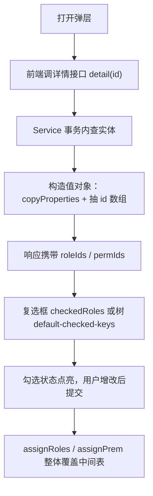
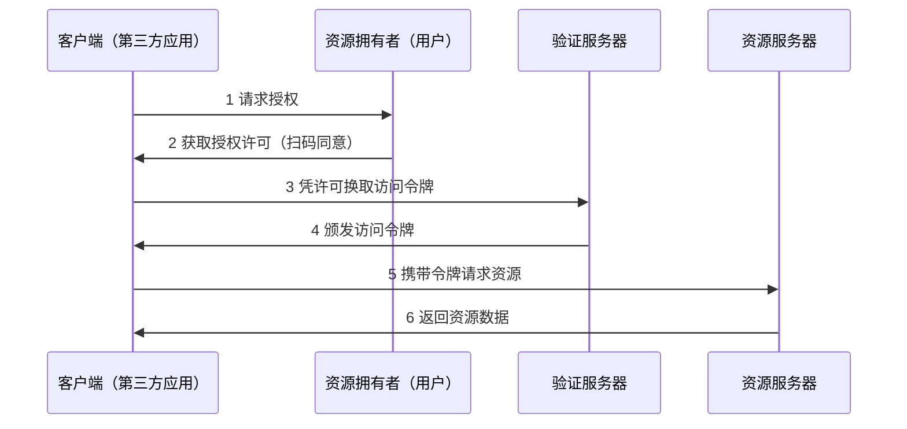
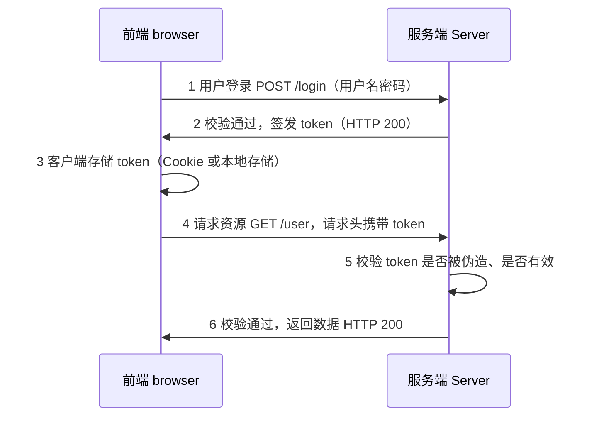

# 分配弹层的回显改造与四种认证机制：从「勾选状态丢了」到 token 登场

上一轮联调收尾时留了一个尾巴：分配操作本身都通了，可再点开弹层，之前勾的角色、勾的权限全没了，复选框一片空白。数据明明躺在中间表里，弹层却装作不知道。把回显补上，看似是前端问题，根子却在后端响应结构里；补完它，正好把话头引向一个更根本的问题：请求打进来，服务端凭什么知道你是谁。认证机制的四条路线，就是为这个问题准备的。

## 先给结论

- 回显的本质是详情接口多吐一个 id 数组：用户详情带 `roleIds`，角色详情带 `permIds`，前端拿数组去点亮复选框和树的默认勾选。
- 后端用值对象包装实体：`UserResult`、`RoleResult` 放在 response 包里，构造时 `BeanUtils.copyProperties` 拷贝同名属性，再从关联集合里抽出 id 装进数组。
- 前端其实早就准备好了：`addRole.vue` 一直写着 `this.checkedRoles = res1.data.data.roleIds`，响应里没这个字段它拿到的是 undefined，填了等于没填。
- 认证四机制按历史顺序排开：HTTP Basic 每次传用户名密码，Cookie 加 Session 把状态押在服务端，OAuth 解决第三方授权，Token 把凭证交还客户端放在请求头里。
- 微服务场景选 Token：跨域请求头畅通无阻、服务端无状态可水平扩展、移动端没有 Cookie 也能用，它的标准化实现就是 JWT，下一课的主角。

## 一、回显缺在哪：前端等一个不存在的字段

先看前端，员工列表把点击事件转交给子组件，链路很短：

```javascript
// module-employees/pages/index.vue：分配角色按钮的处理器
handleRole(item) {
    this.$refs.addRole.toAssignPrem(item.id)
},

// module-employees/components/addRole.vue：打开弹层
toAssignPrem(id) {
    detail({id: id}).then(res1 => {
        this.checkedRoles = res1.data.data.roleIds;   // 等详情响应里的 roleIds
        findAll().then(res => {
            this.id = id;
            this.roles = res.data.data
            this.roleFormVisible = true
        })
    })
},
```

`checkedRoles` 绑在复选框组的 `v-model` 上，组件渲染时谁在数组里谁就被勾上。逻辑一个字都不用改，问题出在 `res1.data.data.roleIds`：详情接口返回的是 User 实体序列化出来的 JSON，里面根本没有 `roleIds` 字段，取出来是 undefined，赋给数组等于清空。分配权限那边同理，`role-list.vue` 打开弹层时也在等一个不存在的 `permIds`：

```javascript
// module-settings/components/role-list.vue：打开分配权限弹层
handlerPerm(obj) {
    detail({id: obj.id}).then(res => {
        this.formData = res.data.data;
        this.checkNodes = res.data.data.permIds        // 等角色详情里的 permIds
        permApi.list({type: 0, pid: null, enVisible: 1}).then(res => {
            this.treeData = commonApi.transformTozTreeFormat(res.data.data)
            this.permFormVisible = true
        })
    })
},
```

注意拉树数据的那行参数：`enVisible: 1`。进分配弹层的权限必须是企业可见的，平台私有的资源在租户侧没有资格出现在勾选树里，这一层过滤在查询参数上就完成了。

**后端要补的字段清楚了：** 用户详情响应加 `roleIds`，角色详情响应加 `permIds`。给实体直接加字段是一条路，但 User 和 Role 是 JPA 实体，跟数据库表一一对应，为一次响应视图去改持久化模型，等于让表结构伺候页面。标准的做法是加一层值对象（VO）：实体是给持久化用的，值对象是给响应用的。

## 二、UserResult：把实体翻译成响应

值对象放在 domain 的 response 包下，与实体同包不同层。代码量不大，坑全在细节里：

```java
package com.example.domain.system.response;

import com.example.domain.system.Role;
import com.example.domain.system.User;
import org.springframework.beans.BeanUtils;
import java.io.Serializable;
import java.util.ArrayList;
import java.util.List;

public class UserResult implements Serializable {
    // 与 User 同名的业务属性（username、mobile、departmentId 等）……
    private String workingCity;
    private List<String> roleIds;

    public UserResult(User user) {
        // 同名属性整体拷贝：user 是源，this 是目标
        BeanUtils.copyProperties(user, this);
        this.roleIds = new ArrayList<>();
        // 从多对多集合里抽出角色 id，拼成前端要的数组
        for (Role role : user.getRoles()) {
            this.roleIds.add(role.getId());
        }
    }

    // getter/setter 必须齐全，序列化靠它们
}
```

**第一，`BeanUtils.copyProperties` 的参数方向要记死：先源后目标。** 它基于反射读 getter 写 setter，名字相同的属性才拷贝。值对象与实体属性同名设计正是为了这个：一次拷贝搬完大部分字段，剩下手工处理的只有 `roleIds` 这个实体没有的新属性。

**第二，`roleIds` 必须先初始化再 add。** 构造器里直接对 null 调 `add` 是空指针，`new ArrayList<>()` 这一行不能省。

**第三，getter 与 setter 一个都不能少。** 课堂直播现场就栽在这里：类写完直接启动，后台报序列化错误，接口回不来数据。Jackson 序列化走 getter，`BeanUtils` 拷贝也走 getter 与 setter，少了任何一个环节，要么字段凭空消失，要么拷贝静默失败。补齐之后接口恢复，重新给员工勾选「人事经理」提交，再点开弹层，勾选状态回来了；追加一个「薪资」角色再查看，两个都亮着。

**第四，`user.getRoles()` 是多对多懒加载集合。** `@ManyToMany` 默认 LAZY，遍历必须发生在事务还开着的上下文里。详情查询收在 Service 的 `@Transactional` 方法内，构造值对象的动作也放在这个窗口里，出了事务再遍历就是 `LazyInitializationException`。

Controller 的改动只有三行：查实体、包一层、返回值对象。

```java
// 用户详情：返回 UserResult 而不是裸 User
@RequestMapping(value = "/user/{id}", method = RequestMethod.GET)
public Result findById(@PathVariable(name = "id") String id) throws Exception {
    User user = userService.findById(id);
    UserResult userResult = new UserResult(user);
    return new Result(ResultCode.SUCCESS, userResult);
}
```

## 三、RoleResult 与 el-tree 的默认勾选

角色侧是同一个模式的复刻。`RoleResult` 拷贝 Role 的同名属性，再遍历角色的权限集合抽出 `permIds`：

```java
public class RoleResult implements Serializable {
    // 与 Role 同名的属性（name、description、companyId）……
    private List<String> permIds;

    public RoleResult(Role role) {
        BeanUtils.copyProperties(role, this);
        this.permIds = new ArrayList<>();
        for (Permission perm : role.getPermissions()) {
            this.permIds.add(perm.getId());
        }
    }
    // getter/setter 省略
}
```

角色详情接口同样换成返回 `RoleResult`。前端的 `checkNodes` 现在能拿到货真价实的数组，它接在 `el-tree` 的默认勾选属性上：

```html
<el-tree
  :data="treeData"
  default-expand-all
  show-checkbox
  node-key="id"
  ref="tree"
  :default-checked-keys="checkNodes"
  :props="{label: 'name'}">
</el-tree>
```

两个属性是回显成功的关键搭配：`node-key="id"` 告诉树用哪个字段当节点身份，`default-checked-keys` 按这个身份点亮勾选。没有 `node-key`，树不知道数组里的 id 对应哪个节点，默认勾选整个失效，`getCheckedKeys()` 也会拿不到东西，提交时 `permIds` 变成空数组，分配静默失败。验证的路径是：先给「人事经理」勾两个新节点提交，刷新再打开，新增的节点和原有节点都处于勾选状态；换一个角色打开，勾的是它自己的那套，互不串台。

回显修完，整条分配链路的数据流长这样：



图上从左到右走完一圈，中间表的关系数据经过值对象变成视图状态，再经提交写回中间表，回显是这根链路缺的最后一段。

## 四、从回显到认证：服务端凭什么认识你

分配链路全部打通，一个前提问题始终悬着：这些请求发出去，服务端怎么确认操作者是登录过的管理员？这就是认证（身份认证），验证请求方有没有资格操作接口。走过的认证机制不少，把它们摆成一排看演进。

**第一站，HTTP Basic，最原始的一条。** 每次请求 API 都把用户名和密码直接带上，是配合 RESTful API 最简单的认证方式。凭据用 Base64 编码后放进请求头，形如 `Authorization: Basic am9objoxMjM0NTY=`，Base64 只是编码不是加密，解开就是明文。每次传输都暴露一遍用户名密码，第三方客户端一旦介入风险更大，生产环境的对外接口应避免使用它。

**第二站，Cookie 加 Session，单体 Web 应用的标配。** 登录成功后服务端创建 Session 对象把登录状态存起来，响应通过 Set-Cookie 把 `SESSIONID` 写进浏览器，之后每个请求自动带上 Cookie，服务端按 id 找回 Session 验证登录态。状态押在服务端，这一下埋了两颗雷：手机原生应用（iOS、Android）很多场景没有 Cookie，没有 Cookie 就没有 Session；服务一旦横向扩到十台百台，Session 存在第一台上，第二个请求被负载均衡打到别的机器，Cookie 带着过去的 id 在新机器上对不上号，跨域与共享全是麻烦。

**第三站，OAuth，开放授权标准。** 它解决的不是「你是不是我系统的用户」，而是「让第三方应用访问你在某服务上的私密资源，而不用把密码交给它」。最熟悉的场景是三方网站的「微信登录」：网站弹出二维码，手机扫码确认，网站没拿到你的微信密码，却拿到了访问你头像昵称的资格。经典流程三步：



许可换令牌、令牌换资源，令牌可以设置失效时间（比如 24 小时），过期重新走授权。OAuth 用的是令牌，但它的定位是授权框架，与下面这种「我自己系统的登录凭证」不是一回事。

**第四站，Token，微服务时代的主流。** 思路是在 HTTP Basic 基础上演化：用户名密码太扎眼，换成一串看不出内容的字符串。服务端不存任何登录状态，凭证完全由客户端持有：



四种机制摆在一起对比，优劣一目了然：

| 机制 | 凭据与位置 | 服务端状态 | 适用场景 | 微服务适配 |
|---|---|---|---|---|
| HTTP Basic | 用户名密码，每次随请求头传输 | 无 | 最简单的接口保护 | 凭据反复明文暴露，不用 |
| Cookie + Session | Session id 藏在 Cookie | 有，Session 存服务端 | 单体 Web 应用 | Cookie 跨域受限，移动端缺失，不用 |
| OAuth | 授权许可换访问令牌 | 令牌可托管 | 第三方应用接入 | 授权场景专用，不是登录方案 |
| Token | 签发的令牌，放请求头 | 无，客户端持有 | Web、移动端、微服务 | 跨域、无状态，正解 |

Token 的优点可以数出一串：请求头跨域畅通，Cookie 做不到；服务端无状态，扩展机器不需要共享 Session；静态资源可以交给 CDN 分发，服务端专心提供 API；客户端与服务端完全解耦；原生移动应用没有 Cookie 也能在请求头里带令牌；不依赖 Cookie，CSRF（跨站请求伪造）的防线天然少了一块要操心的事；验证一次 token 只是一次 HMACSHA256 计算外加解析，比去数据库查一遍 Session 的网络往返快得多。最后一条最关键：它是标准化技术，标准名叫 JSON Web Token，简称 JWT，在 .NET、Ruby、Java、Python、PHP 多种语言中都有实现，Google、Microsoft 等公司的微服务认证也在用它。

HRM 系统的认证方案就此定型：以 JWT 的形式完成用户认证与授权，后续再对照 Shiro 安全框架的做法。JWT 到底长什么样、怎么用 Java 签出来，是下一课的正题。

## 常见误区

- **`BeanUtils.copyProperties` 的参数顺序记反**：它是「源在前、目标在后」，写反了不是报错，而是把空对象往响应里拷，字段全为 null，静默出错最难查。拿不准时写完立刻自测一次详情接口。
- **值对象缺 getter 或 setter**：Jackson 序列化与属性拷贝都依赖它们，缺了要么响应里字段消失，要么构造器拷贝静默失败。用 Lombok 的 `@Getter @Setter` 也要确认生成成功。
- **el-tree 忘配 `node-key`**：没有节点身份，`default-checked-keys` 失效，`getCheckedKeys()` 也拿不出勾选结果，表现为「回显空白、提交空数组」两个症状并发。
- **把 OAuth 当成自家系统的登录认证**：OAuth 是授权框架，解决第三方应用访问资源的授权问题；自己系统的登录凭证走的是 Token 或 Session，两者目标不同，混用概念在方案讨论时会跑偏。
- **以为微服务可以沿用 Session**：Session 依赖 Cookie 且状态押在单一服务端，跨域受限、多实例难共享。微服务认证的底座是无状态的 Token，把校验成本从一次数据库往返换成一次本地计算。

## 面试可能被问到的问题

1. 面试官追问：「为什么回显要引入值对象，而不是在实体上加 roleIds 字段？」
   答：实体是持久化模型，字段与数据库表一一对应；roleIds 是响应视图需要的关系快照，不属于实体。用 response 包下的值对象包装，既不改表结构，也避免实体上多一个无法映射的裸字段，持久化与视图两层各管各的。

2. 面试官追问：「`BeanUtils.copyProperties` 的原理和风险？」
   答：基于反射，按属性名匹配读写，同名同类型才拷贝。风险有三：参数顺序写反不报错只拷空；反射有一定性能开销，高频接口要掂量；浅拷贝，嵌套对象只传引用。字段少量且固定的场景用它最省事。

3. 面试官追问：「Session 和 Token 认证的核心区别？」
   答：状态存放位置。Session 把登录状态存服务端，客户端只拿一个 id，依赖 Cookie 传输，多实例需要共享存储；Token 把登录信息编码进凭证本身由客户端持有，服务端只做签名校验，天然跨域、无状态，适合横向扩展与移动端。

4. 面试官追问：「OAuth 和 Token 认证是什么关系？」
   答：OAuth 是开放授权框架，核心流程是授权许可换访问令牌、令牌访问受保护资源，它使用的凭证就是令牌。Token 认证是更宽泛的机制，OAuth 可以看作令牌体系在第三方授权场景下的一套完整规范，自家系统登录用 JWT 不必引入 OAuth 的授权流程。

5. 面试官追问：「为什么 Cookie 认证撑不起微服务，Token 可以？」
   答：Cookie 受浏览器同源策略限制，跨域请求默认不携带；移动原生端支持残缺；Session 绑定在单个服务实例上，扩容后要引入共享存储。Token 放在请求头里，跨域随意，校验靠签名计算，不需要服务端之间对状态。

6. 面试官追问：「值对象的构造器里遍历多对多集合，有什么前提？」
   答：集合是 `@ManyToMany` 默认懒加载的，遍历必须在持久化上下文还活着的事务窗口内完成，否则抛 `LazyInitializationException`。所以详情查询与值对象构造都收在 Service 的 `@Transactional` 方法里，Controller 只拿构造好的结果。

## 配套资料

- 分配角色组件（回显逻辑的真实前端写法）：`materials/code/02/day04 权限分配与jwt概述/权限分配与jwt概述/资源/前端代码/module-employees/components/addRole.vue`
- 员工列表对子组件的调用（`$refs.addRole.toAssignPrem(item.id)`）：`materials/code/02/day04 权限分配与jwt概述/权限分配与jwt概述/资源/前端代码/module-employees/pages/index.vue`
- 分配权限弹层与 `el-tree` 默认勾选（`checkNodes`、`enVisible: 1` 过滤）：`materials/code/02/day04 权限分配与jwt概述/权限分配与jwt概述/资源/前端代码/module-settings/components/role-list.vue`
- `User`、`Role` 实体（多对多集合与 `@JsonIgnore` 声明，值对象遍历的依据）：`materials/code/02/day03 SaaS-HRM系统用户权限设计概述/SaaS-HRM系统用户权限设计概述/资源/工具代码/实体类/User.java`、`Role.java`
- 正文 `UserResult`、`RoleResult` 与 Controller 改造代码为按本课视频写法整理并补全的示例（day04 资料包未含 response 包源文件），包名统一为 `com.example`
